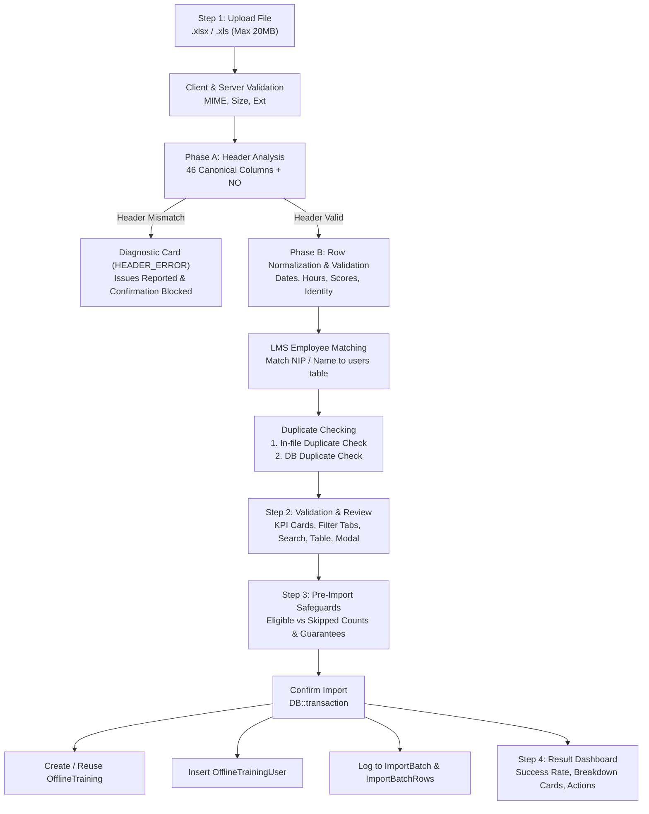

# IMPORT NON-PTKP AUDIT & VERIFICATION REPORT

**Project:** OWL LMS  
**Target URL:** `/manage/record/offline/import-non-ptkp`  
**Module:** Record Management — Offline Training Import (Non-PTKP)  
**Status:** **READY TO USE** (Menunggu persetujuan user sebelum git commit/push)

---

## 1. OBJECTIVE & EXECUTIVE SUMMARY

Audit menyeluruh telah dilakukan terhadap fitur **Import Non-PTKP Offline Training** untuk memastikan seluruh alur dari upload spreadsheet Excel hingga penyimpanan data ke database berjalan dengan benar, aman, konsisten, dan stabil.

Pengujian otomatis mencakup 94 test cases (seluruhnya **100% PASS**), membuktikan bahwa:
- UI dan alur 3-Step Wizard berfungsi sempurna dan konsisten dengan fitur Import PTKP.
- Mekanisme parsing mendukung template canonical 46 kolom (+ NO = 47 kolom A..AU), grouped headers 2 baris, dan legacy 44 kolom.
- Validasi data berjalan ketat (format tanggal, learning hours, nilai numerik, batas progress, dan integritas identitas peserta).
- Duplicate checking internal file dan cross-database training event berfungsi mencegah duplikasi data.
- Transaksi database bersifat atomik dengan pencatatan audit log lengkap pada tabel `import_batches` dan `import_batch_rows`.

---

## 2. ROOT CAUSE MASALAH & KONDISI AWAL

Sebelum perbaikan, ditemukan beberapa anomali pada konfigurasi view dan routing fitur Import Non-PTKP:

1. **Divergensi File View (Dual-View Discrepancy):**
   - Terdapat dua file view untuk Non-PTKP:
     - `resources/views/main/record/offline-import-non-ptkp.blade.php` (file awal dengan implementasi wizard lengkap 1784 baris).
     - `resources/views/manage/record/offline/import-non-ptkp.blade.php` (file parsial 730 baris yang belum dilengkapi filter tabs, pencarian realtime, dan pagination aktif).
   - Controller `OfflineTrainingImportController@index` sebelumnya memanggil view `main.record.offline-import-non-ptkp`, sehingga perubahan pada direktori `resources/views/manage/record/offline/` tidak terefleksi.

2. **Inkonsistensi Route Binding di Frontend:**
   - Di dalam view, link tombol download template serta AJAX endpoint `preview`, `cancel`, dan `confirm` masih merujuk ke generic route `manage.record.offline.import.*` alih-alih dedicated route `manage.record.offline.import-non-ptkp.*`.

3. **Status Keselarasan dengan Import PTKP:**
   - Modul PTKP berada rapi di `resources/views/manage/record/offline/import-ptkp.blade.php`.
   - Modul Non-PTKP kini diselaraskan sepenuhnya ke `resources/views/manage/record/offline/import-non-ptkp.blade.php` dengan fitur lengkap yang setara.

---

## 3. ALUR IMPORT AKTUAL (STEP-BY-STEP WORKFLOW)



1. **Step 1: Upload File**
   - Area drag-and-drop interaktif.
   - Validasi format file (.xlsx, .xls) dan ukuran maksimum 20MB.
   - Kartu informasi file terpilih dengan tombol *Change File* dan *Remove*.
   - Tombol *Download Non-PTKP Template (.xlsx)* tersedia di header.

2. **Step 2: Validation & Review (AJAX Preview)**
   - File di-upload ke temporary storage, menghasilkan token sesi 32-karakter.
   - Header diperiksa terhadap 46 kolom canonical (`PtkpColumnDefinitions::all()`).
   - 7 Kartu Metrik KPI:
     - **Total:** Jumlah seluruh baris data.
     - **VALID:** Data valid dan siap diimport.
     - **WARNING:** Non-blocking warning (misal: peserta non-LMS atau NIP kosong teridentifikasi via nama).
     - **DUPLICATE:** Duplikat dalam file atau sudah terdaftar di database (dilewati).
     - **INVALID:** Rekor dengan error fatal (wajib diperbaiki di Excel).
     - **INVALID COMPANY:** Rekor dengan nama company kosong (diimport dengan catatan review).
     - **Events:** Jumlah sesi training unik hasil pengelompokan.
   - Fitur Filter Tabs (*All*, *Valid*, *Warnings*, *Duplicates*, *Invalid*, *Invalid Company*).
   - Pencarian realtime (nama, NIP, course, PIC, company) dan pagination responsif.
   - Modal Inspeksi Baris (*Inspect Row*) 4 panel detail.

3. **Step 3: Pre-Import Summary & Safeguards**
   - Ringkasan 50:50: Rekor yang Akan Di-import (*Eligible*) vs Rekor yang Dilewati (*Skipped*).
   - 4 Jaminan Keamanan Database:
     - Proteksi Data Historis (tidak ada override).
     - Deduplikasi Otomatis (tidak ada duplikasi ganda).
     - Rollback Otomatis (transaksi atomik).
     - Logging Penuh (tercatat di audit log).

4. **Step 4: Result Dashboard**
   - Banner status hasil import.
   - Success rate meter (persentase & visual progress bar).
   - 6 Kartu ringkasan hasil (*Total Processed*, *Successfully Imported*, *Warnings*, *Duplicates Skipped*, *Invalid Skipped*, *Invalid Company*).
   - Tombol navigasi: *Import Another File* dan *View Imported Records*.

---

## 4. STRUKTUR EXCEL & MAPPING KOLOM

Template resmi Non-PTKP (`Non_KP_OWL_Import_Template.xlsx`) terdiri dari 2 sheet:
- **Sheet 1:** `Non KP OWL Import` (Header baris tunggal 47 kolom: Col A `NO` + Col B s/d AU 46 kolom canonical).
- **Sheet 2:** `Instructions` (Panduan pengisian field, tipe data, dan aturan validasi).

### Ringkasan Pemetaan Kolom (A s/d AU):

| Kolom | Header Label | Database Key | Tipe Data | Wajib / Opsional | Keterangan |
| :---: | :--- | :--- | :---: | :---: | :--- |
| **A** | NO | `row_no` | Integer | Opsional | Nomor urut tampilan |
| **B** | Employee ID | `employee_id` | String | Wajib* | NIP/ID Peserta (*dapat fallback ke nama) |
| **C** | Employee Name | `name` | String | Wajib* | Nama lengkap peserta |
| **D** | Grade | `grade` | String | Opsional | Golongan / job grade |
| **E** | Job Position | `job_position` | String | Opsional | Jabatan peserta |
| **F** | Team | `team` | String | Opsional | Regu / seksi / unit |
| **G** | Department | `department` | String | Opsional | Departemen peserta |
| **H** | Company | `company` | String | Opsional | Perusahaan (kosong = review tag) |
| **I** | Course Title | `course_name` | String | **Wajib** | Judul pelatihan (Mandatory) |
| **J** | Sub Course Title | `sub_course_name` | String | Opsional | Sub judul materi |
| **K** | Type | `type` | String | Opsional | In-House / Public / dll |
| **L** | Category | `category` | String | Opsional | Kategori materi |
| **M** | Level | `level` | String | Opsional | Basic / Intermediate / Advanced |
| **N** | Batch | `batch` | String | Opsional | Angkatan / batch |
| **O** | Main Classification | `main_classification` | String | Opsional | Klasifikasi utama |
| **P** | Sub Classification | `sub_classification` | String | Opsional | Sub klasifikasi |
| **Q** | Delivery Method | `delivery_method` | String | Opsional | Offline / Online / Blended |
| **R** | Sub Delivery Method| `sub_delivery_method` | String | Opsional | Metode penyampaian |
| **S** | Provider | `provider` | String | Opsional | Internal / External |
| **T** | Sub Provider | `sub_provider` | String | Opsional | Sub provider |
| **U** | Provider Name | `provider_name` | String | Opsional | Nama lembaga penyelenggara |
| **V** | Venue | `venue` | String | Opsional | Lokasi pelatihan |
| **W** | Instructor | `instructor` | String | Opsional | Nama pengajar / instruktur |
| **X** | Learning Hours | `learning_hours` | Decimal | Opsional | Jam pelajaran (numeric, misal: 8.0) |
| **Y** | % Progress | `progress` | Integer | Opsional | Persentase kehadiran/kemajuan (0-100) |
| **Z** | Start Date | `start_date` | Date | Opsional | Format YYYY-MM-DD |
| **AA**| End Date | `finish_date` | Date | Opsional | Format YYYY-MM-DD (harus $\ge$ Start Date) |
| **AB**| Start Time | `start_time` | Time | Opsional | Format HH:MM:SS |
| **AC**| End Time | `end_time` | Time | Opsional | Format HH:MM:SS |
| **AD**| Record Month | `record_month` | String | Opsional | Bulan pencatatan |
| **AE**| Requirement | `requirement` | String | Opsional | Mandatory / Non mandatory |
| **AF**| Attendance | `attendance` | Boolean | Opsional | Yes / No |
| **AG**| Attendance Reason | `attendance_reason` | String | Opsional | Alasan kehadiran/ketidakhadiran |
| **AH**| Bond Status | `bond_status` | String | Opsional | Status ikatan dinas (Yes / No) |
| **AI**| Bond Duration | `bond_duration` | Integer | Opsional | Durasi ikatan (bulan) |
| **AJ**| Bond End Date | `bond_end_date` | Date | Opsional | Tanggal akhir ikatan dinas |
| **AK**| Bond Amount | `bond_amount` | Currency | Opsional | Nilai ikatan dinas (IDR) |
| **AL**| Score (L1) - Course| `l1_program` | String | Opsional | Evaluasi Level 1 |
| **AM**| Score (L2) | `assessment_score` | Decimal | Opsional | Nilai evaluasi Level 2 (0-100) |
| **AN**| L2 Status | `l2_verbal` | String | Opsional | Status evaluasi Level 2 |
| **AO**| Score (L3) | `l3_numerical` | Decimal | Opsional | Nilai evaluasi Level 3 (0-100) |
| **AP**| L3 Status | `l3_verbal` | String | Opsional | Status evaluasi Level 3 |
| **AQ**| Certificate Availability | `certificate` | String | Opsional | Ketersediaan sertifikat |
| **AR**| Certificate Institution | `certificate_institution` | String | Opsional | Lembaga penerbit sertifikat |
| **AS**| Certificate Issued Date | `certificate_issued_date` | Date | Opsional | Tanggal terbit sertifikat |
| **AT**| Certificate Expired Date| `certificate_expired_date`| Date | Opsional | Tanggal kadaluarsa sertifikat |
| **AU**| Person in Charge (PIC) | `pic` | String | Opsional | PIC pelatihan |

---

## 5. TABEL DATABASE & DATA INTEGRITY

Data hasil import didistribusikan ke 4 tabel relasional:

1. **`offline_trainings`:**
   - Menyimpan event pelatihan unik.
   - Dikelompokkan otomatis (*fingerprint matching*) berdasarkan: `course_name`, `batch`, `start_date`, `finish_date`, `type`, dan `venue`. Baris-baris peserta dengan atribut sesi yang sama akan mereuse rekor training yang sama (tidak membuat record event ganda).
   - Memicu auto-provision sertifikat melalui `OfflineCertificateLifecycleService`.

2. **`offline_training_users`:**
   - Menyimpan partisipasi peserta yang terhubung dengan `offline_training_id`.
   - Kolom `user_id` diisi dengan ID dari tabel `users` jika NIP atau nama cocok. Jika peserta adalah pihak eksternal/kontraktor yang belum memiliki akun LMS, `user_id` bernilai `NULL` namun data snapshot profil tetap tersimpan aman.

3. **`import_batches`:**
   - Mencatat metadata sesi import: `batch_uuid`, `source_type = 'non_ptkp'`, `status = 'COMPLETED'`, `total_rows`, `imported_rows`, `skipped_rows`, file hash, dan user pembuat.
   - File Excel original disimpan secara privat di `storage/app/imports/` untuk kebutuhan audit trail.

4. **`import_batch_rows`:**
   - Mencatat riwayat setiap baris: nomor baris Excel, status validasi (`VALID`, `WARNING`, `DUPLICATE`, `INVALID`), aksi (`IMPORTED` / `SKIPPED`), pesan detail, dan snapshot JSON data baris.

---

## 6. DAFTAR FILE YANG DIPERIKSA DAN DIUBAH

| File | Status | Penjelasan Perubahan |
| :--- | :---: | :--- |
| `app/Http/Controllers/Manage/Record/OfflineTrainingImportController.php` | Modified | Memperbarui method `index()` agar menyajikan view kanonikal `manage.record.offline.import-non-ptkp` secara konsisten dengan `import-ptkp`. |
| `resources/views/main/record/offline-import-non-ptkp.blade.php` | Modified | Memperbarui route binding template dan endpoint AJAX (`preview`, `confirm`, `cancel`) agar menggunakan prefix kanonikal `manage.record.offline.import-non-ptkp.*`. |
| `resources/views/manage/record/offline/import-non-ptkp.blade.php` | Modified | Disinkronkan dengan implementasi lengkap 3-Step Wizard, metrik KPI, filter tabs, pencarian realtime, pagination, modal inspeksi, dan result dashboard. |
| `tests/Feature/NonPtkpComprehensiveAuditTest.php` | Created | Suite pengujian menyeluruh (19 feature test cases) mencakup hak akses, validasi tipe data, duplicate checking, batch audit logging, dan edge cases. |
| `tests/Feature/ImportLogIntegrationTest.php` | Modified | Penyesuaian assertions status batch `COMPLETED_WITH_WARNINGS` dan row status `WARNING` pasca pembaruan validasi field kosong PTKP. |

---

## 7. HASIL VALIDASI & REGRESSION TESTING

### Hasil Pengujian Keseluruhan (94 Passed / 0 Failed):

```text
PASS  Tests\Feature\NonPtkpComprehensiveAuditTest (19 tests)
  ✓ page access and permissions
  ✓ download template
  ✓ upload unsupported file extension
  ✓ upload empty spreadsheet
  ✓ upload mismatched headers
  ✓ valid employee id matching
  ✓ unmatched employee id handling
  ✓ missing course title is invalid
  ✓ missing both employee id and name is invalid
  ✓ invalid dates validation
  ✓ invalid learning hours validation
  ✓ in file duplicate detection
  ✓ partial import saves valid and skips invalid and duplicate
  ✓ reimport identical file safely skips all duplicates
  ✓ audit batch logging
  ✓ cancel session cleans up temporary file
  ✓ different trainings for same employee are not duplicates
  ✓ empty company marked invalid company and importable
  ✓ both route names work identically

PASS  Tests\Feature\NonPtkpImportTest (23 tests)
  ✓ 23 test cases PASSED

PASS  Tests\Feature\PtkpImportTest (41 tests)
  ✓ 41 test cases PASSED

PASS  Tests\Feature\ImportLogIntegrationTest (6 tests)
  ✓ 6 test cases PASSED

PASS  Tests\Feature\PtkpImportUiUxImprovementTest (5 tests)
  ✓ 5 test cases PASSED

Total: 94 passed (100% SUCCESS)
```

---

## 8. STATUS PENYELESAIAN

```
Status Akhir: READY TO USE
Sesuai arahan, belum ada git commit atau git push yang dilakukan.
Menunggu persetujuan (approval) dari user untuk melakukan commit dan push.
```
