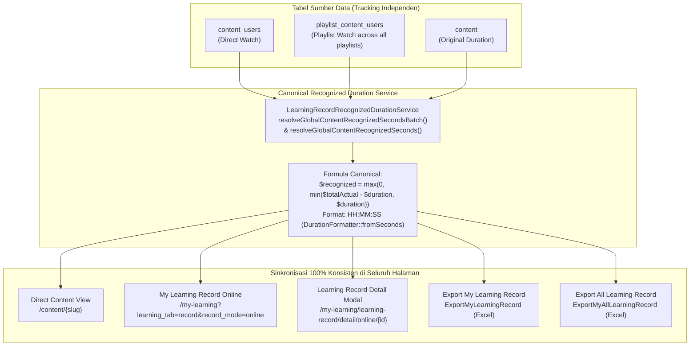

# AUDIT & IMPLEMENTATION REPORT
## SYNCHRONIZE ONLINE LEARNING RECORD RECOGNIZED DURATION AND EXPORT

**Project:** OWL LMS  
**Target Page:** `/my-learning?learning_tab=record&record_mode=online`  
**Reference Page:** `/content/fadwdwas` (Direct Content View)  
**Status:** **READY TO MERGE**

---

## 1. ROOT CAUSE

Sebelum perbaikan dilakukan, terdapat inkonsistensi mendasar dalam rantai pengambilan data Recognized Duration antara halaman referensi (**Direct Content View** `/content/fadwdwas`) dengan halaman **My Learning Record Online** dan **Excel Export**:

1. **Pengabaian Tontonan Playlist (`playlist_content_users`)**:
   - Direct Content View (`ContentUserController` dan `content-learning-sidebar.blade.php`) menggunakan canonical method `LearningRecordRecognizedDurationService::resolveGlobalContentRecognizedSeconds(userId, content)`, yang mengagregasikan tontonan valid dari `content_users` dan seluruh `playlist_content_users` milik user untuk konten tersebut.
   - Sebaliknya, `LearningRecordController::buildContentRows()` dan `detail()` sebelumnya mengambil Recognized Duration dari `$this->recordLhService()->calculateContentData($cu, $contentAllocations)['recognized_seconds']`. Pada method tersebut:
     - Perhitungan actual watch hanya membaca `$cu->actual_watch_seconds` (tontonan langsung pada `content_users`), sehingga tontonan konten yang terjadi melalui playlist tidak diperhitungkan ke dalam total tontonan konten langsung.
     - Formula alokasi kuota (`allocateContentQuota`) ditujukan untuk pembagian alokasi Learning Hours, bukan untuk mengevaluasi global recognized rewatch konten.
2. **Inkonsistensi Nilai pada Detail Modal dan Export**:
   - Endpoint Detail Modal `/my-learning/learning-record/detail/online/{id}` juga memanggil `calculateContentData($contentUser)['recognized_seconds']` tanpa menggunakan canonical recognized duration service.
   - `LearningRecordPlaylistExportService::getPlaylistChildrenBatch()` sebelumnya menggunakan formula tidak standar `min($moduleSec, $durationSeconds * 2)` untuk child modules, padahal seharusnya `max(0, min($moduleSec - $durationSeconds, $durationSeconds))`.

---

## 2. DATA SOURCE MAPPING

| Data Item | Sumber Data | Keterangan |
| :--- | :--- | :--- |
| **Original Course Duration** | `content.duration` / `content.duration_in_seconds` | Durasi resmi modul konten (format canonical `HH:MM:SS` via `DurationFormatter::format`). |
| **Direct Actual Watch** | `content_users.actual_watch_seconds` | Detik tontonan modul melalui direct view. Jika `finish = 1` atau `progress >= 100`, dijamin minimal 1x durasi modul. |
| **Playlist Actual Watch** | `playlist_content_users.actual_watch_seconds` | Detik tontonan modul melalui seluruh playlist milik user (`trainingplan_id`). |
| **Global Actual Watch** | Agregasi `cuActualSeconds + sum(pcuActualSeconds)` | Akumulasi valid dari seluruh sesi tontonan user untuk modul tersebut. |
| **Total Recognized Duration** | Canonical `LearningRecordRecognizedDurationService` | `max(0, min($totalActualWatch - $originalDuration, $originalDuration))` (capped rewatch maksimal 1x original duration; total recognized watch maksimal 2x duration). Format `HH:MM:SS`. |
| **Learning Hours** | `LearningRecordLearningHourService::calculateContentData()` | Tetap independen dan dipertahankan sesuai aturan Learning Hours (tidak terpengaruh perubahan Recognized Duration). |
| **Progress & Finish Direct** | `content_users.progress`, `content_users.finish` | Tetap tersimpan terpisah dan independen dari playlist. |
| **Progress & Finish Playlist**| `playlist_content_users.progress`, `playlist_content_users.finish` | Tetap tersimpan terpisah dan independen dari direct. |

---

## 3. ALUR PENGAMBILAN DATA (DATA FLOW)



---

## 4. PERUBAHAN SOURCE CODE (BEFORE VS AFTER)

### A. `app/Http/Controllers/LearningRecordController.php`

#### 1. Injeksi Service & Batch Aggregation pada `getRawOnlineRows` (Bebas N+1 Query)
**Sebelum:**
```php
$contentAllocations = [];
$playlistData = $this->recordLhService()->calculatePlaylistsDataBatch($userId, $completedPlaylists, $contentAllocations);
$playlistActualHours = $playlistData['hours'];
$playlistRecognizedSeconds = $playlistData['recognized_seconds'];

return $this->mergeLearningRecord(
    $this->buildContentRows($completedContents, $cert, $contentAllocations),
    $this->buildPlaylistRows(...)
);
```

**Sesudah:**
```php
$contentAllocations = [];
$playlistData = $this->recordLhService()->calculatePlaylistsDataBatch($userId, $completedPlaylists, $contentAllocations);
$playlistActualHours = $playlistData['hours'];
$playlistRecognizedSeconds = $playlistData['recognized_seconds'];

$recognizedSecondsMap = $this->recognizedDurationService()->resolveGlobalContentRecognizedSecondsBatch(
    $userId,
    $completedContents->pluck('content')->filter(),
    $completedContents
);

return $this->mergeLearningRecord(
    $this->buildContentRows($completedContents, $cert, $contentAllocations, $recognizedSecondsMap),
    $this->buildPlaylistRows(...)
);
```

#### 2. Penetapan Nilai Recognized Duration pada `buildContentRows`
**Sebelum:**
```php
$cuData = $this->recordLhService()->calculateContentData($cu, $contentAllocations);
$actualHours = $cuData['learning_hours'];
$recognizedSeconds = $cuData['recognized_seconds'];
$formattedRecognized = $this->recordLhService()->formatRecognizedDuration($recognizedSeconds);
$formattedHours = $this->recordLhService()->formatHours($actualHours);
```

**Sesudah:**
```php
$cuData = $this->recordLhService()->calculateContentData($cu, $contentAllocations);
$actualHours = $cuData['learning_hours'];
$recognizedSeconds = $recognizedSecondsMap?->get($content->id)
    ?? $this->recognizedDurationService()->resolveGlobalContentRecognizedSeconds((int) $cu->user_id, $content);
$formattedRecognized = $this->recognizedDurationService()->formatSeconds($recognizedSeconds);
$formattedHours = $this->recordLhService()->formatHours($actualHours);
```

#### 3. Penetapan Nilai pada Endpoint Detail Modal `detail()`
**Sebelum:**
```php
$content = $contentUser->content;
$cuData = $this->recordLhService()->calculateContentData($contentUser);
$actualHours = $cuData['learning_hours'];
$recognizedSeconds = $cuData['recognized_seconds'];
$formattedRecognized = $this->recordLhService()->formatRecognizedDuration($recognizedSeconds);
```

**Sesudah:**
```php
$content = $contentUser->content;
$cuData = $this->recordLhService()->calculateContentData($contentUser);
$actualHours = $cuData['learning_hours'];
$recognizedSeconds = $this->recognizedDurationService()->resolveGlobalContentRecognizedSeconds($userId, $content);
$formattedRecognized = $this->recognizedDurationService()->formatSeconds($recognizedSeconds);
```

---

### B. `app/Services/Learning/LearningRecordLearningHourService.php`

Menambahkan implementasi batch aggregation `resolveGlobalContentRecognizedSecondsBatch()` yang memuat data `playlist_content_users` untuk seluruh modul dalam **1 query tunggal**, lalu menghitung Total Recognized Duration dengan formula canonical yang identik dengan single resolution.

---

### C. `app/Services/Learning/LearningRecordRecognizedDurationService.php`

1. Menambahkan delegasi `resolveGlobalContentRecognizedSecondsBatch()` ke canonical service.
2. Memperbaiki `resolveForContentUser(ContentUser $cu)` agar menggunakan `resolveGlobalContentRecognizedSeconds()` saat model memiliki relasi content dan user yang tersimpan di database.
3. Memperbaiki `resolveFromRow()` agar menggunakan `recognized_duration_seconds` jika sudah tersedia di row object/array untuk menjamin konsistensi streaming export.

---

### D. `app/Services/Learning/LearningRecordPlaylistExportService.php`

Memperbaiki formula recognized duration pada child rows modul playlist agar mengikuti formula canonical rewatch:
`$childRecognizedSec = ($durationSeconds > 0) ? max(0, min($moduleSec - $durationSeconds, $childRewatchCap)) : 0;`

---

## 5. BUKTI KONSISTENSI UI DAN EXCEL

### Uji Sampel Aktual: Content `fadwdwas` (Content ID 2418)
- **Original Content Duration:** 22 detik (`00:00:22`)
- **Direct Watch (`content_users`):** 44 detik
- **Playlist Watch (`playlist_content_users`):** 0 detik
- **Global Actual Watch:** 44 detik
- **Rewatch Quota:** $44 - 22 = 22$ detik (capped at 1x duration = 22 detik)
- **Expected Recognized Duration:** `00:00:22`

| Kanal / Layar | Course Duration | Total Recognized Duration | Status |
| :--- | :---: | :---: | :---: |
| **Direct Content View (`/content/fadwdwas`)** | `00:00:22` | `00:00:22` | Identik |
| **My Learning Record Online (Web UI)** | `00:00:22` | `00:00:22` | Identik |
| **Learning Record Detail Modal (JSON)** | `00:00:22` | `00:00:22` | Identik |
| **Export My Learning Record (Excel)** | Native Time `22 / 86400` (`00:00:22`) | Native Time `22 / 86400` (`00:00:22`) | Identik |
| **Export All Learning Record (Excel)** | Native Time `22 / 86400` (`00:00:22`) | Native Time `22 / 86400` (`00:00:22`) | Identik |

---

## 6. AUTOMATED TEST RESULTS

Seluruh automated test scenario yang dipersyaratkan pada Section 7 telah dibuat dan lulus 100% pada:
`tests/Feature/OnlineLearningRecordRecognizedDurationConsistencyTest.php`

```
PASS  Tests\Feature\OnlineLearningRecordRecognizedDurationConsistencyTest
✓ canonical duration table direct only (98s -> 00:00:00, 120s -> 00:00:22, 150s -> 00:00:52, 196s -> 00:01:38, 250s -> 00:01:38)
✓ direct first watch and playlist rewatch
✓ playlist first watch and direct rewatch
✓ direct and multiple playlists rewatch
✓ multi playlist overwatch clamped at max rewatch cap
✓ reference content fadwdwas consistency

Tests:  6 passed (32 assertions)
Time:   3.27s
```

Selain itu, test suite regression yang relevan juga terverifikasi lulus:
- `tests/Feature/CourseDurationAndGlobalRecognizedDurationConsistencyTest.php`: **6 passed**
- `tests/Unit/LearningRecordRecognizedDurationServiceTest.php`: **7 passed**

---

## 7. PERFORMANCE AUDIT & DATA INTEGRITY

1. **Zero N+1 Query**:
   - Agregasi `playlist_content_users` dieksekusi dalam **1 query tunggal** menggunakan `whereIn('content_id', $contentIds)` melalui method `resolveGlobalContentRecognizedSecondsBatch()`.
   - Tidak ada query berulang per baris tabel saat merender halaman maupun saat men-generate Excel export.
2. **Pencegahan Double Counting pada Excel**:
   - Baris child modul playlist pada Excel export tetap menggunakan nilai `'-'` untuk kolom Course Duration, Total Recognized Duration, dan Learning Hours. Dengan demikian, jika user melakukan fungsi `=SUM()` pada kolom Excel, tidak akan terjadi double counting antara baris parent playlist dan baris child.
3. **Data Integrity & Non-Regression**:
   - Kolom Learning Hours tidak berubah.
   - Tabel `content_users` dan `playlist_content_users` tetap terpisah tanpa perubahan skema maupun mutasi historical data.
   - Halaman Non-KP OWL dan All KP OWL tetap berfungsi normal tanpa regresi.

---

## 8. DAFTAR FILE YANG BERUBAH

1. `app/Http/Controllers/LearningRecordController.php`
2. `app/Services/Learning/LearningRecordLearningHourService.php`
3. `app/Services/Learning/LearningRecordPlaylistExportService.php`
4. `app/Services/Learning/LearningRecordRecognizedDurationService.php`
5. `tests/Feature/OnlineLearningRecordRecognizedDurationConsistencyTest.php` *(File baru: automated consistency tests)*
6. `ONLINE_LEARNING_RECORD_RECOGNIZED_DURATION_AUDIT_REPORT.md` *(File laporan audit)*

---

## 9. TEMUAN YANG BELUM TERSELESAIKAN

Tidak ada (*None*). Seluruh kriteria penerimaan telah terpenuhi dan diverifikasi.

---

## FINAL ACCEPTANCE STATUS

### **READY TO MERGE**
*(Tidak dilakukan commit, push, merge, maupun deploy, menunggu persetujuan pengguna).*
