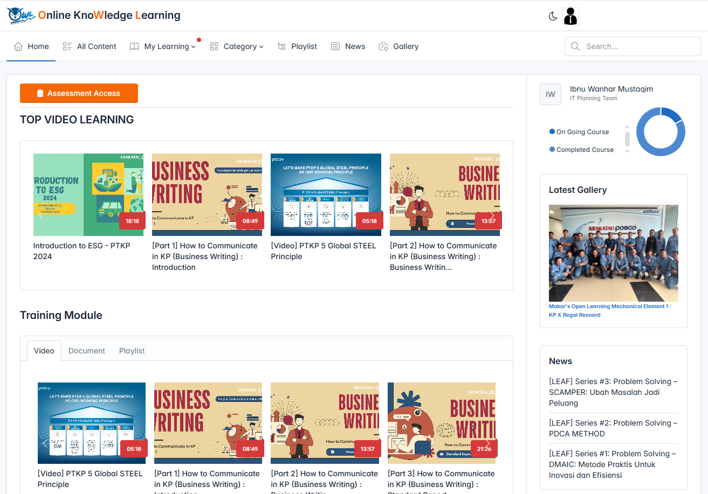

<h1 align="center">OWL Application</h1>



## About OWL Apps 
OWL Apps is an application that requested by Training to collect all course related knowledge in company/factory process included Assesment, News, Galery and etc.

## Feature:
- PDF Learning.
- Video Learning.
- Assesment.
- Watched / Progress History.

## Technologies


## Templates
Tabler Admin Template
```
https://github.com/tabler/tabler.git
```

## How to Install and Development the Application
1. Open Terminal and Clone Project from Repository.
    - Use HTTPS
        - GITHUB
        ```
        https://github.com/Krakatau-Posco-Project/owl.git
        ```
        - GITLAB
        ```
        http://172.21.23.77/krakatau-posco-project/owl.git
        ```
    - Use SSH *must generate SSH Key first
        - GITHUB
        ```
        git@github.com:Krakatau-Posco-Project/owl.git
        ```
        - GITLAB
        ```
        git@172.21.23.77:krakatau-posco-project/owl.git
        ```
2. Go to the project after the clone process is complete.
    ```
    cd owl
    ```
3. Install all the dependencies using composer
    ```
    composer install
    ```
    or
    ```
    composer update
    ```
4. Copy the .env.example file and make the required configuration changes in the .env file
    ```
    cp .env.example .env
    ```
    set your database connection in .env file.
    ```
    DB_CONNECTION=mysql
    DB_HOST=127.0.0.1
    DB_PORT=3306
    DB_DATABASE=your-database
    DB_USERNAME=your-username
    DB_PASSWORD=your-password
    ```
5. Generate a new key application
    ```
    php artisan key:generate
    ```
6. Migrate the database
    ```
    php artisan migrate
    ```
