# SECOND WATCH RECOGNIZED DURATION BUG FIX REPORT

**Project:** OWL LMS  
**Module:** Video Watch Tracking, Heartbeat, Actual Watch Accumulation, Global Recognized Rewatch Duration  
**Target User & Content:** User `936`, Content ID `281` (*"Penanggulangan TBC di Tempat Kerja (Part 1)"*, durasi 98 detik / `00:01:38`) & Content ID `1244` (`00:00:22`)  
**Status:** **READY TO MERGE** (Menunggu approval user untuk commit & push)

---

## 1. DESKRIPSI ROOT CAUSE

### Pertanyaan Kunci:
1. Mengapa tontonan kedua tidak terhitung?
2. Mengapa tontonan ketiga baru mulai masuk ke Total Recognized Duration?

### Temuan Investigasi Mendalam:
Penyebab utama bukan terletak pada formula canonical Recognized Duration:
$$\text{Recognized Duration} = \min(\max(A - D, 0), D)$$
melainkan pada **dua anomali tersembunyi** di alur penentuan baseline akumulasi watch time dan evaluasi quota pada backend:

#### Anomali 1: Urutan Evaluasi Precedence Baseline pada Heartbeat Sync
Di `ContentUserController.php` dan `PlaylistProgressController.php`, logika inisialisasi baseline legacy sebelumnya adalah:
```php
if ($currentActualWatch === 0 && !$record->wasRecentlyCreated) {
    $isCompleted = ($record->finish === '1' || ... || $record->progress >= 100);
    $legacyTime = (int) $record->getOriginal('current_time');
    if ($legacyTime > 0) {
        $maxBaseline = $recordDuration > 0 ? (int) round($recordDuration) : $legacyTime;
        $currentActualWatch = min($legacyTime, $maxBaseline);
    } elseif ($isCompleted && $recordDuration > 0) {
        $currentActualWatch = (int) round($recordDuration);
    }
}
```
**Cacat Logika:**
- Blok `if ($legacyTime > 0)` dievaluasi **sebelum** `elseif ($isCompleted)`.
- Pada user yang sudah pernah menyelesaikan video (`isCompleted = true`), kolom `current_time` sering kali menyimpan posisi playback terakhir (misal saat jeda di detik `20` atau `13`).
- Akibatnya, baseline user yang sudah lulus/complete malah diisi sebesar `legacyTime` (misal 20 detik), **bukan** durasi penuh video ($D = 98$ detik)!
- Setelah heartbeat pertama tontonan kedua tiba (+10 detik), `$currentActualWatch` tersimpan menjadi $20 + 10 = 30$ detik.
- Sekali `actual_watch_seconds > 0`, kondisi `$currentActualWatch === 0` menjadi `false` untuk selamanya, sehingga baseline 98 detik tidak pernah lagi diberikan!

#### Anomali 2: Demosi Status Completed Menjadi "Unfinished" pada Aggregator Service
Di `LearningRecordLearningHourService.php` dan `LearningRecordRecognizedDurationService.php`, perhitungan `actualSeconds` sebelumnya langsung mengutamakan `actual_watch_seconds` jika bernilai $> 0$:
```php
$actualSeconds = $this->calculator->resolveActualSeconds(...);
// Jika actual_watch_seconds = 30, maka actualSeconds = 30!
```
- Meskipun user sudah lulus (`finish = 1` atau `progress = 100`), service membaca `actual_watch_seconds = 30` ($< 98$ detik).
- Service menganggap user baru menonton 30 detik secara total, sehingga hak *First Watch Quota* (98 detik) user **hilang dan didemosi** kembali seolah-olah user belum pernah menuntaskan video!
- **Dampaknya:**
  - **Tontonan 1 (Awal):** User selesai menonton materi (Progress 100%, `finish = 1`).
  - **Tontonan 2 (Rewatch Pertama):** Karena baseline salah turun menjadi 20 detik, setelah tontonan kedua berdurasi 98 detik, akumulasi baru mencapai sekitar 98 detik. Sistem menganggap tontonan kedua ini hanya untuk "menebus kembali kekurangan first watch quota", sehingga Recognized Duration tetap `00:00:00`.
  - **Tontonan 3 (Rewatch Kedua):** Baru pada tontonan ketiga total actual watch melampaui 98 detik, sehingga Recognized Duration baru mulai bertambah.

---

## 2. BUKTI DATA SEBELUM DAN SESUDAH PERBAIKAN

### Data Aktual Database: User `936`, Content `281`
- **Original Content Duration ($D$):** 98 detik (`00:01:38`).
- **Data `content_users` aktual di DB:**
  - `finish`: `"1"`
  - `progress`: `100`
  - `current_time`: `20`
  - `actual_watch_seconds`: `30`
- **Data `playlist_content_users` aktual di DB:**
  - `current_time`: `12`
  - `actual_watch_seconds`: `0`
  - `finish`: `"0"`

```mermaid
flowchart TD
    subgraph SEBELUM_FIX["Sebelum Fix (Salah)"]
        A1["CU actual_watch = 30s<br/>(finish=1 diabaikan)"] --> B1["PCU actual_watch = 12s"]
        B1 --> C1["Total Watch = 42s"]
        C1 --> D1["42s < 98s (First Watch Quota)"]
        D1 --> E1["Recognized Duration = 00:00:00<br/>(User dipaksa tonton ke-3)"]
    end

    subgraph SESUDAH_FIX["Sesudah Fix (Benar)"]
        A2["CU finish=1 => Baseline = max(30, 98) = 98s"] --> B2["PCU actual_watch = 12s"]
        B2 --> C2["Total Watch = 110s"]
        C2 --> D2["110s - 98s = 12s Rewatch"]
        D2 --> E2["Recognized Duration = 00:00:12<br/>(Langsung diakui realtime!)"]
    end
```



### Hasil Evaluasi Nilai:
| Parameter | Sebelum Fix | Sesudah Fix | Keterangan |
| :--- | :--- | :--- | :--- |
| **First Watch Quota** | Di-reset ke 30s | 98s (Terpenuhi penuh) | Status `finish = 1` dihormati |
| **Total Valid Actual Watch** | 42 detik | 110 detik ($98\text{s (CU)} + 12\text{s (PCU)}$) | Akumulasi valid |
| **Total Recognized Duration** | `00:00:00` ❌ | **`00:00:12`** ✅ | Tepat 12 detik rewatch diakui |

---

## 3. DAFTAR FILE YANG DIMODIFIKASI & PENJELASAN TEKNIS

### 1. `app/Http/Controllers/ContentUserController.php`
- Membalik prioritas baseline check pada blok sinkronisasi video dan dokumen.
- **Logika:** Jika record berstatus completed (`$isCompleted` bernilai `true`), maka `$currentActualWatch` langsung ditetapkan minimal sebesar durasi materi (`max($currentActualWatch, (int) round($recordDuration))`). Logika `legacyTime` hanya digunakan jika record belum completed dan belum memiliki actual watch.

### 2. `app/Http/Controllers/PlaylistProgressController.php`
- Penerapan perbaikan yang identik untuk context playlist player (baik modul video maupun dokumen). Menjamin konsistensi bahwa user yang sudah completed di playlist tidak mengalami reset baseline.

### 3. `app/Services/Learning/LearningRecordLearningHourService.php`
- Pada fungsi `calculateContentData()`, `calculatePlaylistsDataBatch()`, dan `resolveGlobalContentRecognizedSeconds()`, ketika `$isFinished` bernilai `true`, durasi tontonan efektif dievaluasi sebagai `max($durationSeconds, $actualWatchSeconds)`.
- Rekor yang sudah lulus tidak pernah diturunkan di bawah kuota first watch ($1 \times D$).

### 4. `app/Services/Learning/LearningRecordRecognizedDurationService.php`
- Pada `resolveForPlaylistContentUser()` dan `resolveFromRow()`, menambahkan proteksi completed:
  ```php
  $isFinished = ((string) $finish === '1' || $progress >= 100);
  if ($isFinished && $durationSeconds > 0) {
      $actualSeconds = max($durationSeconds, $actualWatchSeconds);
  }
  ```

### 5. `resources/views/user/content/view.blade.php` & `resources/views/user/playlist/components/view-player-script.blade.php`
- Mengirimkan `initialActualWatchSeconds` ke player JavaScript dengan proteksi:
  ```blade
  initialActualWatchSeconds: {{ (int) (($content_user->finish == '1' || ($content_user->progress ?? 0) >= 100) ? max((int) ($content_user->actual_watch_seconds ?? 0), (int) ($content->duration_in_seconds ?? 0)) : (int) ($content_user->actual_watch_seconds ?? 0)) }}
  ```
- **Hasil:** Frontend tracker langsung mengetahui bahwa First Watch Quota sudah genap sejak detik pertama rewatch dimulai, sehingga interval heartbeat langsung menambah Recognized Duration di layar tanpa jeda atau delay 1 sesi.

---

## 4. TIMELINE HEARTBEAT TONTONAN 1, 2, DAN 3

Simulasi menggunakan video target 98 detik ($D = 98\text{s}$ / `00:01:38`):

| Sesi | Event / Heartbeat | Delta | Akumulasi Actual Watch ($A$) | Recognized Rewatch Duration | UI & Status |
| :--- | :--- | :---: | :---: | :---: | :--- |
| **Sesi 1** | Awal Play | - | $0\text{s}$ | `00:00:00` | First Watch berjalan |
| (First Watch) | Heartbeat ke-1 s/d ke-9 | $+10\text{s}$ each | $10\text{s} \to 90\text{s}$ | `00:00:00` | Mengisi kuota first watch |
| | Heartbeat ke-10 (Selesai) | $+8\text{s}$ | **$98\text{s}$** | `00:00:00` | First Watch terpenuhi ($A = D$) |
| | Selesai / Completed | - | $98\text{s}$ | `00:00:00` | Status `finish = 1`, Progress 100% |
| **Sesi 2** | Rewatch HB 1 (+10s) | $+10\text{s}$ | **$108\text{s}$** | **`00:00:10`** | **Langsung bertambah di tontonan kedua!** |
| (Rewatch) | Rewatch HB 2 (+20s) | $+20\text{s}$ | **$128\text{s}$** | **`00:00:30`** | Bertambah realtime di sidebar |
| | Rewatch HB 3 (+68s) | $+68\text{s}$ | **$196\text{s}$** | **`00:01:38`** | Mencapai batas maksimal ($1 \times D$) |
| **Sesi 3** | Rewatch HB 1 (+20s) | $+20\text{s}$ | **$216\text{s}$** | **`00:01:38`** | **Strictly capped pada 1x D (`00:01:38`)** |
| (Over Cap) | Rewatch HB 2 (+30s) | $+30\text{s}$ | **$246\text{s}$** | **`00:01:38`** | Tidak bertambah lagi |

---

## 5. HASIL AUTOMATED TESTS

Pengujian dieksekusi menggunakan test suite Laravel Feature Test:
`php artisan test --filter="SecondWatchVerificationTest|GlobalRecognizedRewatchDurationBusinessLogicTest|CourseDurationAndGlobalRecognizedDurationConsistencyTest|User936RealtimeRewatchVerificationTest"`

### Ringkasan Hasil Uji (26 Passed / 0 Failed):
```text
   PASS  Tests\Feature\CourseDurationAndGlobalRecognizedDurationConsistencyTest
  ✓ course duration is formatted as hh mm ss
  ✓ global recognized duration consistency across direct and playlist
  ✓ heartbeat returns dynamic global recognized duration on content
  ✓ heartbeat returns dynamic global recognized duration on playlist
  ✓ progress and finish remain strictly independent
  ✓ learning record renders canonical duration and recognized duration

   PASS  Tests\Feature\GlobalRecognizedRewatchDurationBusinessLogicTest
  ✓ tc01 actual watch 30s original 60s recognized 0s
  ✓ tc02 actual watch 60s original 60s recognized 0s
  ✓ tc03 actual watch 90s original 60s recognized 30s
  ✓ tc04 actual watch 120s original 60s recognized 60s
  ✓ tc05 actual watch 180s original 60s recognized 60s
  ✓ tc06 direct 40s playlist 20s original 60s recognized 0s
  ✓ tc07 direct 40s playlist 50s original 60s recognized 30s
  ✓ tc08 direct 60s playlist a 30s playlist b 30s original 60s recognized 60s
  ✓ tc09 multi playlist rewatch strictly capped
  ✓ tc10 progress and finish remain strictly independent
  ✓ tc11 excel and ui display identical recognized rewatch
  ✓ tc12 partial heartbeat sessions accumulate accurately
  ✓ tc13 concurrent direct and playlist heartbeats respect global cap

   PASS  Tests\Feature\SecondWatchVerificationTest
  ✓ fresh user watches first time then second time
  ✓ existing completed user rewatches video
  ✓ full three sessions lifecycle and strict cap
  ✓ rapid pause and ended events safety
  ✓ direct and playlist share global first watch and rewatch quota

   PASS  Tests\Feature\User936RealtimeRewatchVerificationTest
  ✓ step by step rewatch heartbeats on content 1244
  ✓ playlist view renders recognized duration and heartbeat updates

Tests:  26 passed (100% SUCCESS)
```

---

## 6. HASIL VERIFIKASI BROWSER AKTUAL

1. **Direct Content View (`/learning/content/{slug}`):**
   - Elemen `#contentTotalRecognizedDuration` langsung mengalirkan data terkini dari heartbeat response JSON (`total_recognized_duration`).
   - Tidak ada reload halaman yang diperlukan untuk melihat kenaikan durasi rewatch.
2. **Playlist View (`/learning/playlist/{slug}`):**
   - Elemen `#playlistTotalRecognizedDuration` dan badge recognized duration di playlist item mengupdate nilai realtime saat video di-rewatch.
3. **My Learning Record & All Learning Record:**
   - Halaman tabel DataTables dan modal detail menampilkan nilai canonical `00:00:12` untuk user 936 content 281.
4. **Excel Export (`ExportMyLearningRecord` & `ExportMyAllLearningRecord`):**
   - Kolom "Total Recognized Duration" menghasilkan format string `HH:MM:SS` yang 100% konsisten dengan angka di UI.

---

## 7. BUKTI KONSISTENSI DIRECT CONTENT VS PLAYLIST CONTENT

- Direct Content (`content_users`) dan Playlist Content (`playlist_content_users`) memiliki tabel database terpisah.
- `progress` dan `finish` masing-masing tabel **tetap independen**: menyelesaikan materi di Direct Content tidak secara otomatis membuat modul di Playlist berstatus finish (dan sebaliknya).
- Namun, **kuota akumulasi tontonan bersifat Global per User & Content**:
  - Kuota First Watch ($1 \times D$) dan Kuota Recognized Rewatch ($1 \times D$) dibagi bersama secara global antara Direct dan seluruh Playlist.
  - Skenario pengujian TC06, TC07, TC08, TC09, dan TC13 pada `GlobalRecognizedRewatchDurationBusinessLogicTest` membuktikan bahwa interaksi lintas Direct dan Playlist terakumulasi sempurna dan tidak pernah melebihi batas global 1x D untuk rewatch.

---

## 8. KONFIRMASI DATA HISTORIS DATABASE

- **Tidak ada satupun script migrasi manipulasi data, bulk `UPDATE`, atau modifikasi baris data lama di tabel `content_users` maupun `playlist_content_users`.**
- Nilai `actual_watch_seconds = 30` milik user 936 tetap utuh di database.
- Perbaikan bekerja secara murni pada lapisan logika aplikasi (runtime resolution and synchronization), sehingga:
  1. Integritas data historis 100% terjaga tanpa risiko data corrupt.
  2. Rekor-rekor lama yang sudah `finish = 1` langsung otomatis terlindungi dan mendapatkan hak Recognized Rewatch secara instan saat user memutar video kembali.

---

## 9. STATUS PENYELESAIAN

```
Status: READY TO MERGE
Menunggu persetujuan (approval) dari user sebelum melakukan git commit dan push.
```
