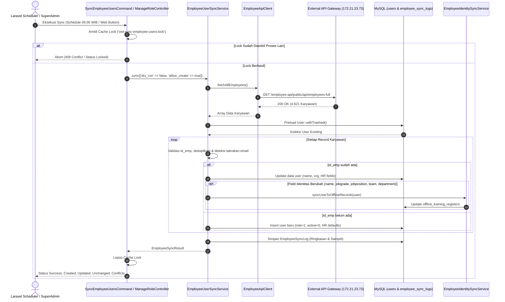

# Dokumentasi Teknis Sinkronisasi Employee API (Full Migration & Documentation)

Dokumentasi ini menjelaskan secara komprehensif arsitektur, spesifikasi API, pemetaan data (data mapping), mekanisme sinkronisasi (Create vs Update), konfigurasi scheduler harian, penanganan error, audit keamanan, hingga panduan pengujian dan deployment untuk fitur **Employee Synchronization** pada **OWL LMS (Laravel 9, PHP 8.1)**.

---

## 1. Overview Employee API

OWL LMS terintegrasi secara terpusat dengan **PT Krakatau Posco Employee API Gateway**. Integrasi ini bertujuan untuk:
1. Memastikan data seluruh karyawan PT Krakatau Posco (nama, organisasi, jabatan, email, status kepegawaian, dan profil HR) selalu sinkron dan mutakhir di sistem pembelajaran OWL.
2. Menyediakan mekanisme single source of truth untuk registrasi dan pembaruan akun pengguna internal secara otomatis tanpa input manual.
3. Menjamin keterisolasian data sensitif (role, permission, password, histori pelatihan) agar hak akses pengguna dan rekam jejak sertifikasi tidak terganggu oleh sinkronisasi otomatis.

Proses sinkronisasi data karyawan telah dimigrasikan secara penuh untuk menggunakan endpoint utama terbaru: **`employees-full`**.

---

## 2. API Endpoints

| Tipe Endpoint | Method | URL | Kegunaan |
| :--- | :---: | :--- | :--- |
| **API Utama (NEW)** | `GET` | `http://172.21.23.73/employee-api/public/api/employees-full` | **Single source of truth** untuk sinkronisasi massal seluruh data karyawan. Mengembalikan 29 atribut lengkap profil HR. |
| **API Detail Karyawan (EXISTING)** | `GET` | `http://172.21.23.73/employee-api/public/api/employees/{id_emp}` | Digunakan hanya ketika diperlukan untuk mengambil atau memverifikasi detail profil satu karyawan spesifik berdasarkan `id_emp`. |
| **API Hash (Supporting)** | `GET` | `http://172.21.23.73/employee-api/public/api/employeesbyhash/{hash}` | Endpoint pendukung SSO berbasis hash. |
| **API ID User (Supporting)** | `GET` | `http://172.21.23.73/employee-api/public/api/employeesById/{id_user}` | Endpoint pencarian karyawan berdasarkan ID User portal. |

Konfigurasi seluruh endpoint dikelola terpusat di `config/api.php` dan dapat dioverride melalui environment variables:
```php
'employee' => [
    'full_url'       => env('EMPLOYEE_API_FULL_URL', 'http://172.21.23.73/employee-api/public/api/employees-full'),
    'base_url'       => env('EMPLOYEE_API_BASE_URL', 'http://172.21.23.73/employee-api/public/api/employees/'),
    'base_url_hash'  => env('EMPLOYEE_API_BASE_URL_HASH', 'http://172.21.23.73/employee-api/public/api/employeesbyhash/'),
    'id_url'         => env('EMPLOYEE_API_ID_URL', 'http://172.21.23.73/employee-api/public/api/employeesById/'),
    'compact'        => env('EMPLOYEE_API_COMPACT_URL', 'http://172.21.23.73/employee-api/public/api/employeesByIdCompact/'),
    'timeout'        => (int) env('EMPLOYEE_API_TIMEOUT', 15),
    'retry_times'    => (int) env('EMPLOYEE_API_RETRY_TIMES', 2),
    'retry_sleep'    => (int) env('EMPLOYEE_API_RETRY_SLEEP_MS', 500),
    'auto_provision' => (bool) env('EMPLOYEE_SYNC_AUTO_PROVISION', true),
],
```

---

## 3. Perbedaan API Lama dan API Baru

| Aspek | API Lama (`employees/`) | API Baru (`employees-full`) |
| :--- | :--- | :--- |
| **Kelengkapan Atribut** | Parsial / Terbatas (hanya ~10 atribut dasar: nama, email, tim, departemen, divisi, id_ou, ssohash, sap_code). | **Lengkap (29 atribut)**: Mencakup seluruh struktur hierarki organisasi (`id_team`, `id_department`, `id_division`), profil personal (`cell_phone`, `sex`), hierarki jabatan (`id_job_position`, `jobposition`, `positionID`, `jobgrade`), rumpun pekerjaan (`id_job_clan`, `job_clan`, `id_job_family`, `job_family`), approver (`appr1`, `appr2`), serta status resign (`resign`, `flag`). |
| **Karakter Pemanggilan** | Sebelumnya digunakan ganda baik untuk detail per ID maupun list batch. | Didedikasikan khusus sebagai batch data provider untuk sinkronisasi massal seluruh karyawan. |
| **Dukungan Pagination** | Tidak terstandarisasi. | Mendukung pemanggilan unpaginated flat array maupun paginated (`next_page_url`, `current_page`, `last_page`). |
| **Akurasi Data HR** | Membutuhkan enrich manual untuk kebutuhan training dan evaluasi kompetensi. | Profil HR lengkap terisi secara native, langsung sinkron dengan kebutuhan matriks kompetensi dan offline training register. |

---

## 4. API Response Structure

Berdasarkan audit langsung terhadap response gateway `http://172.21.23.73/employee-api/public/api/employees-full` (mengembalikan 4.621 record aktif dan riwayat karyawan), struktur data JSON terdiri atas 29 field:

```json
[
  {
    "id_user": "1",
    "id_emp": "000090",
    "id_ou": "OU1",
    "id_team": "T186",
    "id_department": "DP15",
    "id_division": "DV1",
    "name": "MIN KYUNG-ZOON",
    "cell_phone": "08111225667",
    "sex": "M",
    "division": "COM-President Director",
    "department": "Corporate Management Department",
    "team": "Management Planning Team",
    "orgunit": "President Director",
    "id_job_position": "JP1",
    "jobposition": "President Director",
    "positionID": "40001254",
    "appr1": "1001",
    "appr2": "",
    "newhash": "0937afa17f4dc08f3c0e5dc908158370ce64df86",
    "ssohash": "0937afa17f4dc08f3c0e5dc908158370ce64df86",
    "sap_code": "10011172",
    "email": "kzmin@krakatauposco.co.id",
    "resign": "N",
    "flag": 1,
    "jobgrade": "Senior Executive",
    "id_job_clan": "10",
    "job_clan": "Executive Leadership",
    "id_job_family": "47",
    "job_family": "Corporate Strategy"
  }
]
```

### Penanganan Pagination
Jika server API mengembalikan format pagination standar Laravel:
```json
{
  "current_page": 1,
  "data": [ ... ],
  "first_page_url": "http://172.21.23.73/employee-api/public/api/employees-full?page=1",
  "from": 1,
  "last_page": 10,
  "last_page_url": "http://172.21.23.73/employee-api/public/api/employees-full?page=10",
  "next_page_url": "http://172.21.23.73/employee-api/public/api/employees-full?page=2",
  "per_page": 500,
  "total": 4621
}
```
`EmployeeApiClient::fetchAllEmployees()` secara otomatis mendeteksi `next_page_url` dan melakukan iterasi berantai hingga seluruh record dari seluruh halaman digabungkan sebelum diserahkan ke service pemrosesan.

---

## 5. Employee Data Mapping

Berikut adalah pemetaan resmi antara payload API dengan struktur tabel `users` OWL LMS:

| API Field | Kolom Database OWL | Tipe Data & Panjang | Aturan Transformasi & Pembersihan | Boleh Diupdate? | Default Saat Akun Baru Dibuat |
| :--- | :--- | :--- | :--- | :---: | :--- |
| `id_emp` | `id_emp` | `VARCHAR(12)` (Indexed) | `trim()`. Wajib diisi. Ditolak jika kosong/whitespace. | **Identifier** | Diisi dari API |
| `name` | `name` | `VARCHAR(255)` | `trim()`. | Ya | Jika kosong: `'Employee ' . $id_emp` |
| `email` | `email` | `VARCHAR(255)` (Unique) | `strtolower(trim())`. Validasi tabrakan unik: jika sudah dipakai user lain di DB, perubahan dibatalkan dan dicatat ke konflik. | Ya (Kondisional) | Jika kosong: `$id_emp . '@krakatauposco.co.id'` |
| `id_ou` / `id_org_unit` | `id_org_unit` | `VARCHAR(20)` | `trim()`, dipotong maksimal 20 karakter. | Ya | Jika kosong: `'0'` |
| `team` | `team` | `VARCHAR(255)` | `trim()`, maksimal 255 karakter. | Ya | Jika kosong: `'-'` |
| `department` | `department` | `VARCHAR(255)` | `trim()`, maksimal 255 karakter. | Ya | Jika kosong: `'-'` |
| `division` | `division` | `VARCHAR(255)` | `trim()`, maksimal 255 karakter. | Ya | Jika kosong: `'-'` |
| `sap_code` | `sap_code` | `VARCHAR(255)` | `trim()`, maksimal 255 karakter. | Ya | Jika kosong: `'-'` |
| `ssohash` / `newhash` | `ssohash` | `VARCHAR(255)` | `trim()`. Nilai `'-'` atau kosong diabaikan (tidak menimpa hash lama). Disamarkan `[REDACTED]` pada log. | Ya | Jika kosong: `'-'` |
| `id_user` | `id_user` | `VARCHAR(20)` | `trim()`. Hanya diisi jika user OWL bernilai kosong atau `'0'`. | Hanya jika kosong | Nilai API atau `'0'` |
| `id_team` | `id_team` | `VARCHAR(20)` | `cleanHrField()`, max 20 char, `null` jika `'?'` atau kosong. | Ya | `null` |
| `id_department` | `id_department` | `VARCHAR(20)` | `cleanHrField()`, max 20 char, `null` jika `'?'` atau kosong. | Ya | `null` |
| `id_division` | `id_division` | `VARCHAR(20)` | `cleanHrField()`, max 20 char, `null` jika `'?'` atau kosong. | Ya | `null` |
| `cell_phone` | `cell_phone` | `VARCHAR(30)` | `cleanHrField()`, max 30 char, `null` jika `'?'` atau kosong. | Ya | `null` |
| `sex` | `sex` | `VARCHAR(10)` | `cleanHrField()`. Nilai placeholder seperti `'--Select Sex--'`, `'?'`, `'-'` otomatis diubah menjadi `null`. Jika `'M'` / `'F'` disimpan sebagai uppercase. Max 10 char. | Ya | `null` |
| `orgunit` | `orgunit` | `VARCHAR(255)` | `cleanHrField()`, max 255 char. | Ya | `null` |
| `id_job_position` | `id_job_position` | `VARCHAR(20)` | `cleanHrField()`, max 20 char. | Ya | `null` |
| `jobposition` | `jobposition` | `VARCHAR(100)` | `cleanHrField()`, max 100 char. | Ya | `null` |
| `positionID` | `positionID` | `VARCHAR(30)` | `cleanHrField()`, max 30 char. | Ya | `null` |
| `appr1` | `appr1` | `VARCHAR(30)` | `cleanHrField()`, max 30 char. | Ya | `null` |
| `appr2` | `appr2` | `VARCHAR(30)` | `cleanHrField()`, max 30 char. | Ya | `null` |
| `resign` | `resign` | `VARCHAR(10)` | `cleanHrField()`, max 10 char. Nilai default: `'N'`. | Ya | `'N'` |
| `flag` | `flag` | `TINYINT` | Cast ke integer (0 atau 1). | Ya | `1` |
| `jobgrade` | `jobgrade` | `VARCHAR(50)` | `cleanHrField()`, max 50 char. | Ya | `null` |
| `id_job_clan` | `id_job_clan` | `VARCHAR(20)` | `cleanHrField()`, max 20 char. | Ya | `null` |
| `job_clan` | `job_clan` | `VARCHAR(100)` | `cleanHrField()`, max 100 char. | Ya | `null` |
| `id_job_family` | `id_job_family` | `VARCHAR(20)` | `cleanHrField()`, max 20 char. | Ya | `null` |
| `job_family` | `job_family` | `VARCHAR(100)` | `cleanHrField()`, max 100 char. | Ya | `null` |

### Kolom Internal OWL yang DILINDUNGI (Tidak Boleh Ditimpa)
1. **`password`**: Tidak pernah ditimpa oleh data API pada user existing. Untuk user baru dibuat default `Hash::make($id_emp)`.
2. **`role`**: Tidak pernah diubah. User baru selalu mendapat `User::ROLE_USER` (1). Hak akses Super Admin (3), Admin (2), Subadmin Division (4), dan Approver (5) terlindungi 100%.
3. **`active`**: Tidak pernah diubah pada user existing. User baru diatur default `0` (Safe Inactive Mode) agar verifikasi akses tetap terjaga.
4. **`avatar` & `hero_background`**: Pengaturan visual profil user tidak terpengaruh sinkronisasi.
5. **`deleted_at`**: User soft-deleted yang ada di API diperbarui profil organisasinya secara in-place tanpa membatalkan status hapus (tidak di-restore otomatis).
6. **Data Pembelajaran & Sertifikat**: Seluruh relasi di tabel `content_users`, `assesment_results`, `offline_trainings`, dan `offline_training_registers` tetap utuh.

---

## 6. Synchronization Business Logic

Alur logika sinkronisasi dirancang menggunakan prinsip **idempotency**, **data safety**, dan **zero-corruption**:

```mermaid
flowchart TD
    Start([Mulai Sinkronisasi]) --> FetchAPI[Panggil EmployeeApiClient::fetchAllEmployees]
    FetchAPI --> CheckSuccess{Berhasil & Data > 0?}
    
    CheckSuccess -- Tidak / Timeout / 500 / Kosong --> AbortFail[Safe Abort: Jangan ubah tabel users. Catat Log Status Failed.]
    AbortFail --> Finish([Selesai])
    
    CheckSuccess -- Ya --> PreloadDB[Preload seluruh Users OWL withTrashed ke memori O(1)]
    PreloadDB --> DeduplicateAPI[Analisis Duplikasi id_emp pada Payload API & DB]
    DeduplicateAPI --> Loop[Iterasi Setiap Data Karyawan dari API]
    
    Loop --> ValidateId{id_emp valid?}
    ValidateId -- Kosong / Null --> RecordConflictEmpty[Catat Konflik: id_emp kosong]
    RecordConflictEmpty --> NextRecord[Lanjut ke Karyawan Berikutnya]
    
    ValidateId -- Valid --> CheckDupAPI{Duplikat di API?}
    CheckDupAPI -- Ya --> RecordConflictDup[Catat Konflik: Duplikasi Payload API]
    RecordConflictDup --> NextRecord
    
    CheckDupAPI -- Tidak --> CheckDupDB{Duplikat di DB OWL?}
    CheckDupDB -- Ya --> RecordConflictDB[Catat Konflik: Duplikasi Internal DB]
    RecordConflictDB --> NextRecord
    
    CheckDupDB -- Tidak --> MatchDB{Apakah id_emp ditemukan di OWL?}
    
    MatchDB -- Ditemukan --> UpdateCase[Kasus B: Sync Existing User]
    UpdateCase --> CheckEmailCollision{Email tabrakan dgn user lain?}
    CheckEmailCollision -- Ya --> SkipEmail[Pertahankan email lama, catat konflik email]
    CheckEmailCollision -- Tidak --> ApplyChanges[Hitung Perubahan Nilai Kolom]
    SkipEmail --> ApplyChanges
    ApplyChanges --> HasChanges{Ada Perubahan?}
    HasChanges -- Tidak --> IncUnchanged[Tambahkan unchanged_count]
    HasChanges -- Ya --> SaveUser[Simpan Perubahan ke DB users]
    SaveUser --> CheckIdentity{Field Identitas Berubah?}
    CheckIdentity -- Ya --> SyncOffline[EmployeeIdentitySyncService::syncUserToOfflineRecords]
    CheckIdentity -- Tidak --> TrackUpdated[Tambahkan updated_count]
    SyncOffline --> TrackUpdated
    TrackUpdated --> NextRecord
    IncUnchanged --> NextRecord
    
    MatchDB -- Tidak Ditemukan --> CreateCase[Kasus A: Provision New User]
    CreateCase --> CheckNewEmail{Email kandidat tabrakan di DB?}
    CheckNewEmail -- Ya --> RejectNew[Tolak pembuatan user, catat konflik email]
    RejectNew --> NextRecord
    CheckNewEmail -- Tidak --> InsertUser[Buat User Baru: role=1, active=0, password=hash id_emp]
    InsertUser --> TrackCreated[Tambahkan created_count]
    TrackCreated --> NextRecord
    
    NextRecord --> HasMore{Masih ada record?}
    HasMore -- Ya --> Loop
    HasMore -- Tidak --> FinalizeResult[Kompilasi EmployeeSyncResult]
    FinalizeResult --> PersistLog[Simpan Audit Trail ke employee_sync_logs]
    PersistLog --> Finish
```

---

## 7. Existing Architecture

Sistem Employee Sync beroperasi di antara lapisan gateway eksternal, command console scheduler, HTTP controller web admin, dan model database internal:



---

## 8. Employee Sync Service Explanation

Arsitektur kode Employee Sync terdiri dari empat file utama pada namespace `App\Services\EmployeeSync`:

### 1. `EmployeeApiClient.php`
- Bertanggung jawab penuh terhadap komunikasi HTTP ke gateway eksternal.
- Mengimplementasikan HTTP Timeout (default 15 detik), automatic retry (2 kali percobaan dengan interval 500ms pada `ConnectionException`).
- Mengimplementasikan loop pagination dinamis pada method `fetchAllEmployees()`. Jika response gateway memiliki `next_page_url` atau `current_page < last_page`, client secara transparan mengambil halaman selanjutnya hingga seluruh data terkumpul.
- Method `fetchEmployeeById(string $idEmp)` menggunakan endpoint detail legacy `http://172.21.23.73/employee-api/public/api/employees/{id_emp}` dan mengembalikan `null` jika HTTP 404.

### 2. `EmployeeApiException.php`
- Exception terstruktur khusus penanganan kesalahan gateway eksternal (network failure, non-200 HTTP status, malformed JSON, empty response body).
- Menyimpan status code HTTP asli untuk memudahkan debugging.

### 3. `EmployeeSyncResult.php`
- Value object (DTO) yang merangkum hasil eksekusi sinkronisasi: status (`success`, `partial`, `failed`), durasi (detik), total data API, total user di database, jumlah dibuat, jumlah diupdate (aktif vs soft-deleted), jumlah tidak berubah, jumlah dilewati, serta daftar detail konflik.
- Menyediakan sanitasi otomatis untuk menyamarkan nilai hash/password (`[REDACTED]`).

### 4. `EmployeeUserSyncService.php`
- Core engine business logic. Mengorkestrasikan matching, sanitasi kolom via `cleanHrField()`, deduplikasi, propagasi event offline training, dan pencatatan audit log ke database `employee_sync_logs`.

---

## 9. Create vs Update Mechanism

### Kasus A: Karyawan Belum Ada di OWL (Create)
1. Dicari apakah `email` dari API sudah digunakan oleh akun lain di OWL. Jika terjadi collision, kandidat ditolak dan dicatat pada list konflik.
2. Dibuat record baru pada tabel `users` dengan atribut:
   - `id_emp`: ID karyawan resmi dari API.
   - `name`: Nama resmi karyawan.
   - `email`: Email resmi karyawan (atau fallback `$id_emp@krakatauposco.co.id`).
   - `password`: `Hash::make($id_emp)` (aman dan terstandarisasi).
   - `role`: `User::ROLE_USER` (`1`).
   - `active`: `0` (Safe Inactive Mode).
   - Seluruh kolom organisasi dan profil HR diisi sesuai mapping.

### Kasus B: Karyawan Sudah Ada di OWL (Update)
1. User dicocokkan berdasarkan `id_emp`.
2. Seluruh perubahan atribut (`name`, `email`, `team`, `department`, `division`, `id_org_unit`, profil HR) diidentifikasi secara atomik.
3. Jika email berubah, dilakukan pengecekan collision: jika email baru sudah terdaftar pada user ID lain, email dibiarkan menggunakan nilai lama dan dicatat ke audit konflik.
4. Nilai `ssohash` kosong (`''` atau `'-'`) tidak akan menghapus atau menimpa nilai hash yang sudah ada.
5. Jika salah satu dari 5 field identitas utama (`name`, `jobgrade`, `jobposition`, `team`, `department`) berubah, sistem secara reaktif memanggil `EmployeeIdentitySyncService::syncUserToOfflineRecords($user)` agar sertifikat dan riwayat pelatihan offline langsung terupdate.
6. **User Soft-Deleted**: Jika user berstatus soft-deleted (`deleted_at IS NOT NULL`), profilnya tetap diperbarui dengan data API terbaru, namun akun **tetap soft-deleted** (tidak di-restore otomatis) dan dicatat pada metrik `updated_soft_deleted_count`.

---

## 10. Daily Scheduler Configuration

### Konfigurasi Laravel Scheduler
Konfigurasi terdaftar resmi di `app/Console/Kernel.php`:

```php
// Synchronize OWL users with PT Krakatau Posco Employee API Gateway daily at 06:00 WIB
$schedule->command('owl:sync-employee-users')
    ->dailyAt('06:00')
    ->timezone('Asia/Jakarta')
    ->withoutOverlapping(120)
    ->runInBackground()
    ->before(function () {
        \Illuminate\Support\Facades\Log::info('OWL Employee User Synchronization scheduler started at 06:00 WIB.');
    })
    ->after(function () {
        \Illuminate\Support\Facades\Log::info('OWL Employee User Synchronization scheduler finished.');
    });
```

### Parameter Scheduler:
- **Waktu**: Pukul 06:00 Pagi Setiap Hari.
- **Timezone**: `Asia/Jakarta` (WIB).
- **Overlapping Guard**: `withoutOverlapping(120)` memastikan scheduler tidak akan dijalankan bertumpuk jika eksekusi sebelumnya belum selesai dalam 120 menit.
- **Background Run**: `runInBackground()` mencegah proses scheduler menghambat tugas terjadwal lainnya.

### Menjalankan Scheduler di Server
Agar scheduler Laravel dieksekusi setiap menit:

#### 1. Linux / Production Server (Crontab)
Buka crontab dengan `crontab -e` dan tambahkan entry berikut:
```bash
* * * * * cd /var/www/owl-3 && php artisan schedule:run >> /dev/null 2>&1
```

#### 2. Windows / Laragon Development Environment
Pada Windows, jalankan scheduler worker melalui PowerShell/CMD:
```powershell
php artisan schedule:work
```
Atau daftarkan pada **Windows Task Scheduler** untuk mengeksekusi:
```cmd
C:\laragon\bin\php\php-8.1.10-Win32-vs16-x64\php.exe C:\laragon\www\owl-3\artisan schedule:run
```
setiap 1 menit.

---

## 11. Error Handling & Data Integrity

| Potensi Masalah | Solusi & Mekanisme Pengamanan |
| :--- | :--- |
| **Gateway Down / Timeout** | `EmployeeApiClient` menetapkan timeout 15 detik dan 2x retry. Jika gagal, melempar `EmployeeApiException`. Database OWL tidak disentuh sama sekali. |
| **Response Kosong (`[]`)** | Service menolak payload kosong dan menghentikan proses secara aman. Akun existing tidak dinonaktifkan atau dihapus. |
| **JSON Rusak / Malformed** | Dideteksi via `json_last_error()`. Sinkronisasi digagalkan dengan pesan error jelas tanpa modifikasi DB. |
| **Duplikasi `id_emp` di API** | Terdeteksi di memori sebelum pemrosesan. Rekord duplikat dilewati dan dicatat sebagai konflik. |
| **Duplikasi `id_emp` di Database OWL** | Terdeteksi saat preloading. Rekord dengan duplikasi internal dilewati untuk mencegah kerusakan relasi. |
| **Data String Melebihi Batas Kolom** | Method `cleanHrField()` memotong panjang string sesuai batas maksimum kolom DB (contoh: `--Select Sex--` dibersihkan menjadi `null`). |
| **Eksekusi Bersamaan (Race Condition)** | Dilindungi oleh atomic cache lock `owl:sync-employee-users:lock` selama 300 detik. |

---

## 12. Logging Mechanism

Proses sinkronisasi mencatat dua lapis logging:

### 1. Application Log (`storage/logs/laravel.log`)
Mencatat event lifecycle scheduler:
- Start dan finish scheduler event.
- Error network, non-success status, atau exception gateway.

### 2. Database Audit Table (`employee_sync_logs`)
Setiap kali sinkronisasi live dijalankan (non-dry-run), satu record audit log dibuat pada tabel `employee_sync_logs`:
- `started_at` & `finished_at`: Waktu presisi eksekusi.
- `status`: `'success'`, `'partial'`, atau `'failed'`.
- `is_dry_run`: Boolean mode simulasi.
- `total_api`, `total_owl`, `created_count`, `updated_count`, `unchanged_count`, `skipped_count`, `conflict_count`, `failed_count`.
- `details` (JSON): Menyimpan sampel rekord yang diupdate (dengan credential tersanitasi `[REDACTED]`), sampel rekord baru, durasi presisi, dan seluruh detail konflik.

> [!NOTE]
> Pada mode **Dry-Run**, berlaku aturan **Zero-Write**: tidak ada record baru yang ditulis ke `employee_sync_logs` maupun tabel `users`.

---

## 13. Database Impact

- **Struktur Tabel**: Menggunakan tabel `users` yang sudah diperluas melalui migration `2026_10_28_000003_add_employee_hr_fields_to_users_table.php`. Tidak diperlukan perubahan skema tambahan.
- **Indexing**: Kolom `id_emp` telah terindeks melalui `2026_10_28_000001_add_index_to_users_id_emp.php`, menjamin kecepatan pencarian $O(1)$.
- **Efisiensi Query**: Seluruh user di-preload sekaligus ke memori (`User::withTrashed()->get([...])`), menghindari query $N+1$. Pemrosesan 4.600+ record diselesaikan dalam waktu kurang dari 20 detik.

---

## 14. Real-Time Synchronization Progress Modal (Manage Role)

Fitur sinkronisasi pada halaman Manage Role (`/manage/role`) telah ditingkatkan dari pemrosesan sinkronous statis (spinner statis) menjadi **asynchronous non-blocking architecture** dengan antarmuka modal progres real-time interaktif (0–100%).

### A. Arsitektur Polling & Background Processing

```
[Manage Role Browser]
    │
    │  1. POST /manage/role/sync/start
    ├─────────────────────────────────────────► [ManageRoleController@startSync]
    │                                                    │
    │◄───────────────────────────────────────────────────┤
    │  2. JSON { success: true } (Non-Blocking, <100ms)  │
    │                                                    ├──► Cache::put(owl:sync-employee:progress)
    │                                                    └──► popen("start /B php artisan owl:sync-employee-users")
    │
    │  3. GET /manage/role/sync/progress (every 600ms)
    ├─────────────────────────────────────────► [ManageRoleController@syncProgress]
    │                                                    │
    │◄───────────────────────────────────────────────────┤ (baca Cache 'owl:sync-employee:progress')
    │  4. JSON { percentage: 45, processed: 2080, ... }
    │
    ▼ (Update Live UI: Progress Bar, Status Badge, 6 Stat Cards)
```

1. **Non-Blocking Trigger**:
   - Super Admin menekan tombol konfirmasi pada modal.
   - Browser mengirim request AJAX `POST` ke endpoint `manage.role.sync.start`.
   - Controller melakukan verifikasi hak akses Super Admin dan concurrency lock (`owl:sync-employee-users:lock`).
   - Status progres direset ke status `preparing` (0%) di Cache (`owl:sync-employee:progress`).
   - Controller meluncurkan background process CLI Artisan `owl:sync-employee-users` (`pclose(popen("start /B ..."))` di Windows, `exec("... &")` di Linux).
   - Controller segera mengembalikan response JSON 200 OK dalam hitungan milidetik sehingga browser tidak mengalami request hanging atau timeout (HTTP 504).

2. **Real Progress Tracking via Cache**:
   - Cache key: `owl:sync-employee:progress` (TTL 1 jam).
   - Progres dihitung berdasarkan data aktual dari backend:
     - `preparing` (0%): Inisialisasi proses.
     - `fetching` (5%): Mengunduh data dari Employee API Gateway.
     - `processing` (5% - 99%): Pemrosesan iterasi setiap karyawan ($5 + \lfloor \frac{\text{processed}}{\text{total}} \times 94 \rfloor$).
     - Pembaruan ke Cache dipicu setiap kelipatan **25 record** serta pada record ke-1 dan record terakhir untuk memastikan performa I/O tinggi tanpa latensi.
     - `completed` (100%): Seluruh data berhasil diproses.
     - `failed`: Apabila terjadi kegagalan/timeout API dengan pesan error terisolasi.

3. **Komponen Visual Modal UI**:
   - **Spinning Synchronize Icon**: Indikator aktivitas visual dinamis.
   - **Persentase Besar (0–100%)**: Tampilan font tebal monospace yang berubah secara halus.
   - **Smooth Progress Bar**: Progress bar beranimasi striping horizontal dengan CSS transition width.
   - **Stage Badge**: Menunjukkan status tahapan terkini (`Preparing`, `Fetching`, `Processing`, `Completed`, `Failed`).
   - **Informasi Status & Timer**: Pesan detail proses dan penghitung durasi eksekusi berjalan (`MM:SS`).
   - **Live Statistics Grid Cards (6 Kartu)**:
     - `Total`: Jumlah seluruh karyawan dari API.
     - `Processed`: Jumlah record yang telah dianalisis.
     - `Created`: Akun baru yang berhasil dibuat.
     - `Updated`: Akun existing yang berhasil diperbarui.
     - `Skipped`: Record yang tidak valid / tidak memiliki perubahan.
     - `Failed`: Record yang mengalami error pemrosesan.
   - **Safety Warning Banner**: *"Please do not close this window while synchronization is in progress to ensure complete data consistency."*
   - **Auto-Resume Detection**: Saat halaman Manage Role dimuat ulang, script secara otomatis mengecek endpoint progress. Jika terdapat sinkronisasi yang sedang berjalan di latar belakang, modal akan otomatis terbuka kembali dan melanjutkan pelacakan hingga selesai.

### B. Spesifikasi Endpoint Progress

| Endpoint | Method | Middleware | Deskripsi |
| :--- | :---: | :--- | :--- |
| `/manage/role/sync/start` | `POST` | `auth`, `superadmin` | Memulai proses sinkronisasi di latar belakang. Mengembalikan 409 jika sync lain sedang berjalan. |
| `/manage/role/sync/progress` | `GET` | `auth`, `superadmin` | Polling status dan progres terkini (persentase, counter statistik, pesan, durasi). |
| `/manage/role/sync` | `POST` | `auth`, `superadmin` | Endpoint sinkronous legacy (dipertahankan untuk kompatibilitas ke belakang). |
| `/manage/role/sync-dry-run` | `POST` | `auth`, `superadmin` | Endpoint simulasi sinkronous legacy (dipertahankan untuk kompatibilitas ke belakang). |

---

## 15. Manual Synchronization Instructions

### A. Melalui Command Line Interface (Artisan)

1. **Jalankan Simulasi (Dry-Run Mode / Zero-Write)**:
   ```bash
   php artisan owl:sync-employee-users --dry-run
   ```
2. **Jalankan Sinkronisasi Nyata ke Database**:
   ```bash
   php artisan owl:sync-employee-users
   ```
3. **Jalankan Uji Coba Terbatas (Limit Records)**:
   ```bash
   php artisan owl:sync-employee-users --dry-run --limit=20
   ```
4. **Hanya Update User Existing (Tanpa Membuat User Baru)**:
   ```bash
   php artisan owl:sync-employee-users --no-create
   ```

### B. Melalui Antarmuka Web (Manage Role)
1. Login sebagai **Super Admin**.
2. Buka menu **Manage Role** (`http://127.0.0.1:8000/manage/role`).
3. Klik tombol **Synchronize** pada bagian kanan atas.
4. Pilih opsi:
   - **Simulasi (Dry-Run)**: Menampilkan perkiraan user yang akan dibuat dan diupdate tanpa mengubah database.
   - **Sinkronisasi Nyata**: Mengeksekusi penulisan langsung ke database OWL dengan proteksi konfirmasi modal dan pelacakan progress real-time 0–100%.

---

## 16. Testing Instructions

Seluruh skenario telah diuji secara menyeluruh melalui test suite otomatis (Total: **46 Test PASS**):

```bash
php artisan test --filter=SyncEmployeeUsersTest
php artisan test --filter=ManageRoleTest
```

### Hasil Matriks Pengujian Skenario:

| No | Skenario Pengujian | Hasil yang Diharapkan | Status Implementasi & Verifikasi |
| :-: | :--- | :--- | :---: |
| 1 | Employee ID sudah tersedia di DB | Profil user diupdate in-place | **PASS** (`test_scenario_03`, `test_scenario_05`) |
| 2 | Employee ID belum tersedia di DB | User baru dibuat dengan default role=1 & active=0 | **PASS** (`test_scenario_01`, `test_scenario_22`) |
| 3 | Data employee tidak berubah | Tidak ada duplikasi, dihitung `unchanged` | **PASS** (`test_scenario_02`) |
| 4 | API tidak dapat diakses / Timeout / 500 | Sync gagal dengan aman, database utuh | **PASS** (`test_scenario_11`) |
| 5 | API mengembalikan data kosong | Data existing tidak dihapus atau dinonaktifkan | **PASS** (`test_scenario_13`) |
| 6 | Duplikasi ID dari payload API | Terdeteksi di memori, dicatat ke konflik | **PASS** (`test_scenario_09`) |
| 7 | Data employee tidak valid / JSON rusak | Dilewati / gagal secara terkontrol | **PASS** (`test_scenario_08`, `test_scenario_12`) |
| 8 | Scheduler pukul 06:00 WIB | Terdaftar resmi di Schedule Kernel | **PASS** (`test_scenario_16`) |
| 9 | Sync dijalankan berulang kali | Idempoten, 0 duplikasi | **PASS** (`test_scenario_15`) |
| 10 | Employee baru disinkronkan | Otomatis tampil di Manage Role & Live Search | **PASS** (`test_scenario_25`) |
| 11 | Dukungan Pagination | Mengambil & menggabungkan seluruh halaman | **PASS** (`test_scenario_23`) |
| 12 | Endpoint Detail Single Employee | Berfungsi normal memanggil endpoint lama | **PASS** (`test_scenario_24`) |
| 13 | Sanitasi Data Ekstrim (`--Select Sex--`) | Nilai dibersihkan, bebas truncate error | **PASS** (`ManageRoleTest`) |
| 14 | Asynchronous Background Sync Start | Memulai proses non-blocking, init progress | **PASS** (`test_super_admin_can_start_async_sync_and_initializes_progress`) |
| 15 | Concurrency Lock Conflict Handling | Menolak eksekusi ganda dengan status 409 | **PASS** (`test_super_admin_cannot_start_sync_if_already_running_concurrency_lock`) |
| 16 | Real-time Polling Status Progress | Membaca status, persentase, dan statistik | **PASS** (`test_super_admin_can_poll_sync_progress`) |
| 17 | Otorisasi Akses Endpoint Sync | Guest & Non-Superadmin ditolak (403/Redirect) | **PASS** (`test_unauthorized_users_cannot_trigger_sync_endpoints`) |

---

## 17. Troubleshooting

### 1. Error: `Failed to connect to Employee API Gateway / Connection timed out`
- **Penyebab**: Server OWL tidak dapat menjangkau IP `172.21.23.73`. Alamat ini merupakan IP jaringan internal intranet PT Krakatau Posco.
- **Solusi**: Pastikan koneksi VPN korporat aktif atau server berada pada segmen jaringan yang mengizinkan rute ke `172.21.23.73`.

### 2. Error: `Another sync process is currently running or holding the execution lock`
- **Penyebab**: Lock cache `owl:sync-employee-users:lock` masih aktif karena ada proses sync yang sedang berjalan atau proses sebelumnya berhenti tidak wajar.
- **Solusi**: Tunggu TTL lock habis (maksimal 5 menit) atau lepas lock secara manual melalui Tinker:
  ```bash
  php artisan tinker --execute="Illuminate\Support\Facades\Cache::lock('owl:sync-employee-users:lock', 300)->forceRelease();"
  ```

### 3. Error: `1406 Data too long for column 'sex'`
- **Penyebab**: Gateway HR mengirim string placeholder formulir seperti `'--Select Sex--'` yang memiliki panjang 14 karakter, sedangkan kolom `sex` adalah `VARCHAR(10)`.
- **Solusi**: Telah diselesaikan secara preventif oleh method `cleanHrField()` pada `EmployeeUserSyncService.php` yang secara otomatis mengonversi placeholder menjadi `null`.

---

## 18. Deployment Checklist

Sebelum merilis perubahan ke production, pastikan seluruh item berikut telah diverifikasi:

- [x] Pastikan environment variable `EMPLOYEE_API_FULL_URL` dan `EMPLOYEE_API_BASE_URL` telah ditambahkan pada file `.env` production.
- [x] Jalankan `php artisan config:clear` untuk memperbarui cache konfigurasi.
- [x] Pastikan migration `2026_10_28_000001`, `2026_10_28_000002`, dan `2026_10_28_000003` sudah berstatus ran pada database target (`php artisan migrate:status`).
- [x] Konfirmasikan service cron server aktif mengeksekusi `php artisan schedule:run` setiap menit.
- [x] Lakukan smoke test manual via Artisan:
  ```bash
  php artisan owl:sync-employee-users --dry-run --limit=5
  ```
- [x] Buka halaman **Manage Role** (`/manage/role`) dan pastikan filter, live search, serta tombol modal sinkronisasi berfungsi dengan normal.
- [x] Periksa tabel `employee_sync_logs` untuk memastikan log eksekusi tercatat dengan status `SUCCESS`.
