# OWL Services Technical Handover Documentation

Dokumentasi teknis arsitektur, data flow, dependensi, dan panduan pemeliharaan (*maintenance guide*) untuk seluruh Service inti di project **OWL (Learning Management System)**.

Dokumen ini disusun khusus sebagai panduan serah terima teknis (*handover documentation*) agar tim pengembang pengganti dapat memahami arsitektur sistem, menelusuri data flow, mengatasi insiden (*troubleshooting*), dan melakukan perubahan secara aman tanpa harus membaca source code dari nol.

---

## 1. Quick Handover Guide & Troubleshooting Cheat Sheet

Gunakan tabel respons cepat ini saat terjadi laporan kendala operasional dari pengguna atau admin:

| Masalah / Gejala | Dugaan Penyebab | Service yang Wajib Dicek | File Dokumentasi Terkait |
|---|---|---|---|
| **Jam Belajar (Learning Hours) salah atau berbeda antar halaman** | Terjadi diskrepansi antara model bucket 30 menit dan model jam riil (kontinu), atau kolom `playlist_content_users.learning_hour` belum dihitung. | [`ActualLearningHourCalculator`](file:///C:/laragon/owl/docs/services/learning-hours/ActualLearningHourCalculator.md) [`LearningRecordLearningHourService`](file:///C:/laragon/owl/docs/services/learning/LearningRecordLearningHourService.md) [`ContentUserBatchCalculatorService`](file:///C:/laragon/owl/docs/services/learning-hours/ContentUserBatchCalculatorService.md) | [ActualLearningHourCalculator.md](file:///C:/laragon/owl/docs/services/learning-hours/ActualLearningHourCalculator.md) [LearningRecordLearningHourService.md](file:///C:/laragon/owl/docs/services/learning/LearningRecordLearningHourService.md) |
| **Materi tidak muncul di On Going atau salah status** | Progres di bawah batas ambang 5%, materi merupakan bagian dari playlist aktif (bukan direct content), atau materi sudah selesai. | [`OngoingContentService`](file:///C:/laragon/owl/docs/services/learning/OngoingContentService.md) [`OngoingPlaylistService`](file:///C:/laragon/owl/docs/services/learning/OngoingPlaylistService.md) [`LearningProgressResolver`](file:///C:/laragon/owl/docs/services/learning/LearningProgressResolver.md) | [OngoingContentService.md](file:///C:/laragon/owl/docs/services/learning/OngoingContentService.md) [LearningProgressResolver.md](file:///C:/laragon/owl/docs/services/learning/LearningProgressResolver.md) |
| **Peserta tidak bisa klaim sertifikat (Muncul Forbidden 403 atau Ineligible)** | Progres belum mencapai ambang setting, atau peserta belum lulus kuis aktif yang terdeteksi otomatis oleh sistem. | [`CertificateEligibilityService`](file:///C:/laragon/owl/docs/services/CertificateEligibilityService.md) [`CertificateGenerateService`](file:///C:/laragon/owl/docs/services/CertificateGenerateService.md) | [CertificateEligibilityService.md](file:///C:/laragon/owl/docs/services/CertificateEligibilityService.md) [CertificateGenerateService.md](file:///C:/laragon/owl/docs/services/CertificateGenerateService.md) |
| **Peserta tidak bisa membuka kuis asesmen (Muncul status terkunci/ditolak)** | Progres belajar belum mencapai 80%, kuis di luar rentang tanggal aktif, timer sesi habis, peserta bukan target audiens, atau sudah lulus sebelumnya. | [`AssessmentAccessService`](file:///C:/laragon/owl/docs/services/AssessmentAccessService.md) [`LearningProgressResolver`](file:///C:/laragon/owl/docs/services/learning/LearningProgressResolver.md) | [AssessmentAccessService.md](file:///C:/laragon/owl/docs/services/AssessmentAccessService.md) |
| **Import Excel Pelatihan Offline gagal atau data tidak masuk** | Header Excel tidak cocok dengan skema 44 kolom, format tanggal bukan ISO/Excel serial, NIP tidak terdaftar di tabel `users`, atau duplikasi baris. | [`OfflineTrainingImportService`](file:///C:/laragon/owl/docs/services/record/OfflineTrainingImportService.md) [`OfflineTrainingExcelSchema`](file:///C:/laragon/owl/docs/services/record/OfflineTrainingExcelSchema.md) | [OfflineTrainingImportService.md](file:///C:/laragon/owl/docs/services/record/OfflineTrainingImportService.md) [OfflineTrainingExcelSchema.md](file:///C:/laragon/owl/docs/services/record/OfflineTrainingExcelSchema.md) |
| **Total durasi playlist di UI berbeda dengan penjumlahan materi** | Event sinkronisasi tidak terpicu saat materi diupdate, atau terdapat format durasi materi yang tidak terstandarisasi. | [`PlaylistDurationService`](file:///C:/laragon/owl/docs/services/PlaylistDurationService.md) [`PlaylistLearningHourService`](file:///C:/laragon/owl/docs/services/learning-hours/PlaylistLearningHourService.md) | [PlaylistDurationService.md](file:///C:/laragon/owl/docs/services/PlaylistDurationService.md) [PlaylistLearningHourService.md](file:///C:/laragon/owl/docs/services/learning-hours/PlaylistLearningHourService.md) |
| **Tabel My Learning Record lambat / lemot saat dibuka** | Kurangnya pushdown filtering atau optimasi indeks pada gabungan UNION Online + Offline. | [`RecordAllCombinedService`](file:///C:/laragon/owl/docs/services/record/RecordAllCombinedService.md) [`LearningDatatableService`](file:///C:/laragon/owl/docs/services/learning/LearningDatatableService.md) | [RecordAllCombinedService.md](file:///C:/laragon/owl/docs/services/record/RecordAllCombinedService.md) |

---

## 2. High-Level Architecture Map

Diagram berikut mengilustrasikan keterkaitan antar domain Service di arsitektur OWL:

```mermaid
flowchart TB
    subgraph UI_Layer [Controller & User Interface]
        HomeC[HomeUserController / Dashboard]
        LearnC[LearningController / Datatable]
        PlayC[PlaylistUserController]
        AssC[AssesmentUserController]
        CertC[UserCertificateController]
        RecC[LearningRecordController / Admin]
    end

    subgraph Analytics_Domain [Analytics & Monitoring]
        LAS[LearningAnalyticsService]
    end

    subgraph Learning_Domain [Learning & Progress Core]
        LPR[LearningProgressResolver]
        DTO[ResolvedProgress DTO]
        CPS[CompletedPlaylistService]
        OPS[OngoingPlaylistService]
        OCS[OngoingContentService]
        LDS[LearningDatatableService]
        LHS[LearningHourService]
        LRLHS[LearningRecordLearningHourService]
    end

    subgraph Hours_Domain [Learning Hours Batch & Sync Engine]
        AHC[ActualLearningHourCalculator]
        CLHS[ContentLearningHourService]
        PLHS[PlaylistLearningHourService]
        LHSync[LearningHourSynchronizeService]
        CUBatch[ContentUserBatchCalculatorService]
        PUBatch[PlaylistContentUserBatchCalculatorService]
        MPCU[ManualPlaylistContentUserLearningHourService]
        HPES[HistoricalPlaylistProgressExecutionService]
        PDS[PlaylistDurationService]
    end

    subgraph Assessment_Domain [Assessment Lifecycle & Access]
        AAS[AssessmentAccessService]
        ADS[AssessmentDuplicateService]
        ABDS[AssessmentBulkDuplicateService]
        ARDS[AssessmentResultDuplicationService]
    end

    subgraph Certificate_Domain [Certificate Engine]
        CES[CertificateEligibilityService]
        CER[CertificateEligibilityResult DTO]
        CGS[CertificateGenerateService]
        CSync[CertificateSyncService]
    end

    subgraph Record_Domain [Offline Training & Combined Records]
        OTIS[OfflineTrainingImportService]
        OTES[OfflineTrainingExcelSchema]
        RACS[RecordAllCombinedService]
    end

    %% Dependencies & Flows
    UI_Layer --> LPR
    UI_Layer --> AAS
    UI_Layer --> CES
    UI_Layer --> CGS
    UI_Layer --> LAS
    UI_Layer --> LDS
    UI_Layer --> RACS

    LPR --> DTO
    CPS --> LPR
    OPS --> LPR
    OCS --> LPR
    AAS --> LPR
    CES --> LPR
    CES --> CER
    CGS --> CES

    CLHS --> AHC
    PLHS --> AHC
    LHSync --> CLHS
    LHSync --> PLHS
    CUBatch --> AHC
    PUBatch --> AHC
    MPCU --> PUBatch
    HPES --> LPR

    ABDS --> ADS
    ARDS --> ADS

    LAS --> LRLHS
    LAS --> LHS
    LRLHS --> AHC

    RACS --> OTIS
    OTIS --> OTES
```

---

## 3. Dependency Map Table

| Feature / Domain | Primary Service | Dependent / Related Services | Database Tables | Critical Maintenance Notes |
|---|---|---|---|---|
| **Learning Progress** | [`LearningProgressResolver`](file:///C:/laragon/owl/docs/services/learning/LearningProgressResolver.md) | [`ResolvedProgress`](file:///C:/laragon/owl/docs/services/learning/ResolvedProgress.md) | `content_users`, `playlist_content_users` | Single Source of Truth; isolasi ketat baris PCU tanpa fallback runtime. |
| **Ongoing Learning** | [`OngoingContentService`](file:///C:/laragon/owl/docs/services/learning/OngoingContentService.md) | [`OngoingPlaylistService`](file:///C:/laragon/owl/docs/services/learning/OngoingPlaylistService.md) | `content_users`, `playlist_content_users` | Threshold batas bawah progres $\ge 5\%$ untuk direct content. |
| **Completed Learning** | [`CompletedPlaylistService`](file:///C:/laragon/owl/docs/services/learning/CompletedPlaylistService.md) | [`LearningProgressResolver`](file:///C:/laragon/owl/docs/services/learning/LearningProgressResolver.md) | `trainingplan`, `trainingplan_details` | Evaluasi *all-or-nothing*; wajib menggunakan `withTrashed` untuk audit histori. |
| **Learning Hours (Actual)** | [`ActualLearningHourCalculator`](file:///C:/laragon/owl/docs/services/learning-hours/ActualLearningHourCalculator.md) | [`LearningRecordLearningHourService`](file:///C:/laragon/owl/docs/services/learning/LearningRecordLearningHourService.md) | `content_users`, `playlist_content_users` | Pure stateless math calculator; presisi float 4 desimal $\frac{\text{seconds}}{3600}$. |
| **Learning Hours (Discrete)**| [`LearningHourService`](file:///C:/laragon/owl/docs/services/learning/LearningHourService.md) | [`LearningAnalyticsService`](file:///C:/laragon/owl/docs/services/LearningAnalyticsService.md) | `content_users`, `content` | Model ember pembulatan 30 menit ($\lceil\frac{\text{sec}}{1800}\rceil \times 0.5$). |
| **Hours Batch Processing** | [`ContentUserBatchCalculatorService`](file:///C:/laragon/owl/docs/services/learning-hours/ContentUserBatchCalculatorService.md) | [`ActualLearningHourCalculator`](file:///C:/laragon/owl/docs/services/learning-hours/ActualLearningHourCalculator.md) | `content_users` | Keyset pagination (`id > $lastId`); catat bug typo `$completedIds` di line 273. |
| **Playlist Hours Sync** | [`PlaylistContentUserBatchCalculatorService`](file:///C:/laragon/owl/docs/services/learning-hours/PlaylistContentUserBatchCalculatorService.md) | [`ManualPlaylistContentUserLearningHourService`](file:///C:/laragon/owl/docs/services/learning-hours/ManualPlaylistContentUserLearningHourService.md) | `playlist_content_users` | Kolom target adalah `learning_hour` (tanpa huruf 's'). Distributed lock 300s. |
| **Assessment Gatekeeping** | [`AssessmentAccessService`](file:///C:/laragon/owl/docs/services/AssessmentAccessService.md) | [`LearningProgressResolver`](file:///C:/laragon/owl/docs/services/learning/LearningProgressResolver.md) | `assesments`, `assesment_results` | Prasyarat materi $\ge 80\%$, batas remedial ($1 + \text{remedials}$), admin bypass. |
| **Assessment Cloning** | [`AssessmentDuplicateService`](file:///C:/laragon/owl/docs/services/AssessmentDuplicateService.md) | [`AssessmentBulkDuplicateService`](file:///C:/laragon/owl/docs/services/AssessmentBulkDuplicateService.md) | `assesments`, `assesment_questions` | Replikasi transaksional kuis, bank soal, dan pertanyaan acak. Title `Copy N`. |
| **Result Migration** | [`AssessmentResultDuplicationService`](file:///C:/laragon/owl/docs/services/AssessmentResultDuplicationService.md) | [`AssessmentDuplicateService`](file:///C:/laragon/owl/docs/services/AssessmentDuplicateService.md) | `assesment_results`, `assesment_questions` | Multiset idempotency; remapping JSON jawaban dan question snapshot ke ID soal baru. |
| **Certificate Eligibility**| [`CertificateEligibilityService`](file:///C:/laragon/owl/docs/services/CertificateEligibilityService.md) | [`CertificateEligibilityResult`](file:///C:/laragon/owl/docs/services/CertificateEligibilityResult.md) | `certificate_settings`, `assesments` | Deteksi kuis otomatis secara live; kelulusan salah satu kuis aktif (post-test/remedial). |
| **Certificate Issuance** | [`CertificateGenerateService`](file:///C:/laragon/owl/docs/services/CertificateGenerateService.md) | [`CertificateEligibilityService`](file:///C:/laragon/owl/docs/services/CertificateEligibilityService.md) | `certificates` | Strict HTTP 403 jika tidak eligible; penomoran berurutan via `lockForUpdate`. |
| **Offline Training Import** | [`OfflineTrainingImportService`](file:///C:/laragon/owl/docs/services/record/OfflineTrainingImportService.md) | [`OfflineTrainingExcelSchema`](file:///C:/laragon/owl/docs/services/record/OfflineTrainingExcelSchema.md) | `offline_trainings`, `offline_training_users` | Upload $\to$ Preview $\to$ Confirm; event fingerprinting MD5; lookup NIP toleran null. |
| **Unified Learning Record** | [`RecordAllCombinedService`](file:///C:/laragon/owl/docs/services/record/RecordAllCombinedService.md) | [`OfflineTrainingImportService`](file:///C:/laragon/owl/docs/services/record/OfflineTrainingImportService.md) | `content_users`, `offline_training_users` | Gabungan UNION Online + Offline; normalisasi metadata kolom untuk DataTables. |
| **Playlist Duration Sync** | [`PlaylistDurationService`](file:///C:/laragon/owl/docs/services/PlaylistDurationService.md) | `DurationFormatter` | `trainingplan`, `trainingplan_details` | Menjaga integritas `total_duration_seconds` via `saveQuietly()`, bebas N+1 (2 query). |

---

## 4. Master Index of Service Documentation

Berikut adalah indeks lengkap 34 dokumen teknis yang tersedia di folder `docs/services`:

### A. Learning Services (`docs/services/learning/`)
1. [`ResolvedProgress.md`](file:///C:/laragon/owl/docs/services/learning/ResolvedProgress.md): DTO immutable representasi status evaluasi progres materi (`progress`, `is_finished`, `has_started`).
2. [`LearningProgressResolver.md`](file:///C:/laragon/owl/docs/services/learning/LearningProgressResolver.md): Sumber kebenaran tunggal (*Single Source of Truth*) progres materi konten dan modul playlist bebas N+1.
3. [`LearningHourService.md`](file:///C:/laragon/owl/docs/services/learning/LearningHourService.md): Kalkulator jam belajar diskrit berbasis ember kelipatan 30 menit ($\lceil\text{sec}/1800\rceil \times 0.5$).
4. [`LearningRecordLearningHourService.md`](file:///C:/laragon/owl/docs/services/learning/LearningRecordLearningHourService.md): Kalkulator jam belajar kontinu riil (4 desimal) untuk tab My Learning Record.
5. [`CompletedPlaylistService.md`](file:///C:/laragon/owl/docs/services/learning/CompletedPlaylistService.md): Evaluasi penyelesaian playlist (*all-or-nothing completion*) dengan preservasi histori modul terhapus.
6. [`OngoingPlaylistService.md`](file:///C:/laragon/owl/docs/services/learning/OngoingPlaylistService.md): Deteksi playlist yang sedang dipelajari peserta berdasarkan interaksi aktif (*touched modules*).
7. [`OngoingContentService.md`](file:///C:/laragon/owl/docs/services/learning/OngoingContentService.md): Deteksi materi mandiri berjalan dengan ambang batas progres $\ge 5\%$ dan eksklusi anggota playlist.
8. [`LearningDatatableService.md`](file:///C:/laragon/owl/docs/services/learning/LearningDatatableService.md): Handler DataTables server-side gabungan materi mandiri dan playlist via UNION ALL teroptimasi.

### B. Learning Hours Services (`docs/services/learning-hours/`)
9. [`ActualLearningHourCalculator.md`](file:///C:/laragon/owl/docs/services/learning-hours/ActualLearningHourCalculator.md): Kalkulator stateless pure math untuk konversi detik ke jam desimal 4 digit ($\text{round}(\text{sec}/3600, 4)$).
10. [`DurationParserService.md`](file:///C:/laragon/owl/docs/services/learning-hours/DurationParserService.md): Parser normalisasi string durasi format `HH:MM:SS`, `MM:SS`, dan detik mentah.
11. [`LearningHourConverterService.md`](file:///C:/laragon/owl/docs/services/learning-hours/LearningHourConverterService.md): Orkestrator konversi multi-tipe durasi materi ke float jam belajar.
12. [`ContentLearningHourService.md`](file:///C:/laragon/owl/docs/services/learning-hours/ContentLearningHourService.md): Sinkronisasi jam belajar materi dokumen ($30\text{s}/\text{halaman}$) dan video ke kolom `content.learning_hours`.
13. [`PlaylistLearningHourService.md`](file:///C:/laragon/owl/docs/services/learning-hours/PlaylistLearningHourService.md): Agregasi total durasi modul ke kolom `trainingplan.learning_hours`.
14. [`LearningHourSynchronizeService.md`](file:///C:/laragon/owl/docs/services/learning-hours/LearningHourSynchronizeService.md): Orkestrator sinkronisasi sekuensial dua arah Konten $\to$ Playlist dalam transaksi database.
15. [`ContentUserBatchCalculatorService.md`](file:///C:/laragon/owl/docs/services/learning-hours/ContentUserBatchCalculatorService.md): Keyset pagination bulk update jam belajar di tabel `content_users`.
16. [`ContentUserLearningHourManagementService.md`](file:///C:/laragon/owl/docs/services/learning-hours/ContentUserLearningHourManagementService.md): Panel interaktif manajemen perhitungan jam belajar direct content.
17. [`PlaylistContentUserBatchCalculatorService.md`](file:///C:/laragon/owl/docs/services/learning-hours/PlaylistContentUserBatchCalculatorService.md): Pemroses massal keyset untuk kolom `playlist_content_users.learning_hour`.
18. [`PlaylistContentUserLearningHourManagementService.md`](file:///C:/laragon/owl/docs/services/learning-hours/PlaylistContentUserLearningHourManagementService.md): DataTables server-side dan KPI cache untuk jam belajar playlist user.
19. [`ManualPlaylistContentUserLearningHourService.md`](file:///C:/laragon/owl/docs/services/learning-hours/ManualPlaylistContentUserLearningHourService.md): Handler pemicu sinkronisasi manual playlist user dengan proteksi cache lock 300 detik.
20. [`PlaylistProgressDryRunService.md`](file:///C:/laragon/owl/docs/services/learning-hours/PlaylistProgressDryRunService.md): Mesin preview strictly read-only untuk audit duplikasi record riwayat sebelum cutoff migrasi.
21. [`HistoricalPlaylistProgressExecutionService.md`](file:///C:/laragon/owl/docs/services/learning-hours/HistoricalPlaylistProgressExecutionService.md): Eksekutor migrasi data historis playlist idempoten dengan `insertOrIgnore` bertahap.

### C. Record Services (`docs/services/record/`)
22. [`OfflineTrainingExcelSchema.md`](file:///C:/laragon/owl/docs/services/record/OfflineTrainingExcelSchema.md): Definisi skema 44 kolom, 7 grup header bertingkat, dan generator template spreadsheet.
23. [`OfflineTrainingImportService.md`](file:///C:/laragon/owl/docs/services/record/OfflineTrainingImportService.md): Pipeline 3-tahap (Upload $\to$ Preview $\to$ Confirm) import pelatihan tatap muka dengan event fingerprinting MD5.
24. [`RecordAllCombinedService.md`](file:///C:/laragon/owl/docs/services/record/RecordAllCombinedService.md): Mesin agregasi seluruh riwayat pelatihan (Online OWL + Offline Import) ke tampilan DataTables terpadu.

### D. Assessment Services (`docs/services/`)
25. [`AssessmentAccessService.md`](file:///C:/laragon/owl/docs/services/AssessmentAccessService.md): Canonical gatekeeper otorisasi kuis (validasi jadwal, timer aktif, audiens, prasyarat belajar $\ge 80\%$, kuota remedial, admin bypass).
26. [`AssessmentBulkDuplicateService.md`](file:///C:/laragon/owl/docs/services/AssessmentBulkDuplicateService.md): Fasilitator kloning kuis materi secara massal ke dalam kurikulum playlist dengan pencegahan duplikasi ganda.
27. [`AssessmentDuplicateService.md`](file:///C:/laragon/owl/docs/services/AssessmentDuplicateService.md): Engine inti kloning kuis, bank soal, pengacakan soal, dan sinkronisasi pivot playlist. Format judul `{Title} Copy N`.
28. [`AssessmentResultDuplicationService.md`](file:///C:/laragon/owl/docs/services/AssessmentResultDuplicationService.md): Kloning riwayat hasil nilai peserta antar kuis dengan remapping JSON jawaban dan proteksi multiset idempotency.

### E. Certificate Services (`docs/services/`)
29. [`CertificateEligibilityResult.md`](file:///C:/laragon/owl/docs/services/CertificateEligibilityResult.md): DTO immutable bertipe ketat pembawa keputusan kelayakan sertifikat, skor kuis, dan passing grade.
30. [`CertificateEligibilityService.md`](file:///C:/laragon/owl/docs/services/CertificateEligibilityService.md): Single source of truth kelayakan sertifikat dengan deteksi otomatis kuis aktif dan evaluasi massal bebas N+1.
31. [`CertificateGenerateService.md`](file:///C:/laragon/owl/docs/services/CertificateGenerateService.md): Penerbit sertifikat resmi berurutan (`lockForUpdate`), token kredensial acak, dan URL verifikasi publik.
32. [`CertificateSyncService.md`](file:///C:/laragon/owl/docs/services/CertificateSyncService.md): Inisialisasi idempoten setting default sertifikat untuk seluruh materi, playlist, dan asesmen global baru.

### F. Other Important Services (`docs/services/`)
33. [`LearningAnalyticsService.md`](file:///C:/laragon/owl/docs/services/LearningAnalyticsService.md): Engine analitik personal dan tim, KPI dasbor, grafik 12 bulan kontinu, serta counter badge navbar global (cache 24 jam).
34. [`PlaylistDurationService.md`](file:///C:/laragon/owl/docs/services/PlaylistDurationService.md): Pemelihara integritas kolom `trainingplan.total_duration_seconds` berbasis model events secara efisien (2 kueri).

---

## 5. Maintenance Principles for Incoming Developers

1. **Prinsip Immutabilitas & Idempotensi**:
   - Selalu gunakan `firstOrCreate` atau pemeriksaan kondisi sebelum melakukan penulisan massal data histori.
   - Jangan pernah menghapus data progres atau jam belajar yang sudah tercatat; gunakan mekanisme pembatalan atau revisi log audit jika terjadi koreksi data.
2. **Kewaspadaan Perbedaan Nama Kolom Database**:
   - Kolom jam belajar di tabel `content_users` adalah `learning_hours` (dengan huruf **s**).
   - Kolom jam belajar di tabel `playlist_content_users` adalah `learning_hour` (**tanpa huruf s**).
3. **Pemisahan Model Jam Belajar**:
   - Pahami kapan sistem membutuhkan *Discrete Bucket* (misal untuk display badge setengah jam) vs *Continuous Actual* (untuk laporan akreditasi jam pelatihan resmi karyawan).
4. **Zero N+1 Query Standard**:
   - Jangan menjalankan query Eloquent di dalam foreach loop pada service yang memproses ribuan karyawan. Selalu manfaatkan batch preload, eager loading lean, atau subquery.
