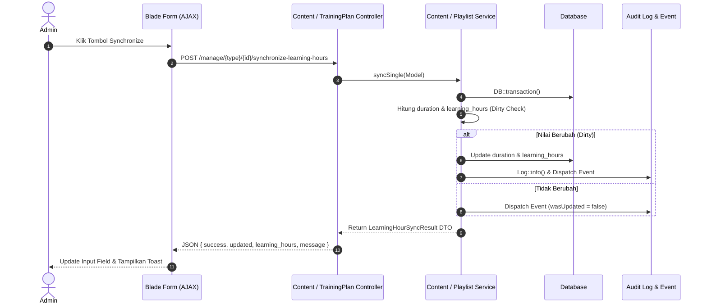

# Learning Hours Synchronization Architecture & Documentation

## Overview

Sistem **Learning Hours** bertugas menghitung kredit jam belajar secara otomatis berdasarkan durasi materi pembelajaran (Content) maupun kumulasi durasi playlist (TrainingPlan). 

Perhitungan dilakukan secara opsional / on-demand melalui tombol **Synchronize** (Single item maupun Batch) atau melalui CLI command, sehingga tidak membebani database setiap kali request halaman dibuka.

---

## 1. Source of Truth & Conversion Rules

1. **Content Duration**: Merupakan *Source of Truth* utama. Format standar `HH:MM:SS`.
2. **Playlist Duration**: Diakumulasikan secara tepat dari `trainingplandetail.content.duration` (bukan dari cache `total_duration_seconds`).
3. **Konversi Learning Hours**:
   - Dihitung menggunakan kelipatan `0.5` jam (`0`, `0.5`, `1`, `1.5`, `2`, `2.5`, dst.) dengan bucket 30 menit (`1800` detik).
   - Formula: `ceil(total_detik / 1800) * 0.5`.

| Durasi Input (`HH:MM:SS`) | Total Detik | Range Bucket (Detik) | Learning Hours (`float`) |
| :--- | :--- | :--- | :--- |
| `00:00:00` | 0 | 0 | `0.0` |
| `00:29:21` | 1761 | 1 .. 1800 | `0.5` |
| `00:31:59` | 1919 | 1801 .. 3600 | `1.0` |
| `01:01:21` | 3681 | 3601 .. 5400 | `1.5` |
| `02:31:00` | 9060 | 9001 .. 10800 | `3.0` |
| `05:59:59` | 21599 | 21600 | `6.0` |
| `08:00:00` | 28800 | 28800 | `8.0` |

---

## 2. Diagram Arsitektur Layanan

```
                                  +------------------------------+
                                  |     DurationParserService    |
                                  +------------------------------+
                                                 |
                                                 v
                                  +------------------------------+
                                  | LearningHourConverterService |
                                  +------------------------------+
                                        /                  \
                                       v                    v
+-------------------------------+             +--------------------------------+
|  ContentLearningHourService   |             |   PlaylistLearningHourService  |
+-------------------------------+             +--------------------------------+
                \                                             /
                 v                                           v
            +-----------------------------------------------------+
            |           LearningHourSynchronizeService            |
            +-----------------------------------------------------+
```

---

## 3. Class & Contract Reference

- `App\Contracts\LearningHourSyncInterface`: Interface standar untuk layanan sinkronisasi.
- `App\DataTransferObjects\LearningHourSyncResult`: DTO hasil sinkronisasi (`success`, `updated`, `learningHours`, `message`, `meta`).
- `App\Events\ContentLearningHourSynchronized`: Dispatched saat content di-sync.
- `App\Events\PlaylistLearningHourSynchronized`: Dispatched saat playlist di-sync.
- `App\Console\Commands\SyncLearningHoursCommand`: Command CLI `php artisan learning-hours:sync`.
- `App\Jobs\SyncContentLearningHourJob` & `SyncPlaylistLearningHourJob`: Queue jobs untuk background worker.

---

## 4. Sequence Diagram: Single Item Synchronize (AJAX)



---

## 5. CLI Command & Background Queue

Untuk keperluan maintenance, deployment, atau batch import data:

```bash
# Full Batch Synchronization
php artisan learning-hours:sync

# Sync Single Content
php artisan learning-hours:sync --content=10

# Sync Single Playlist
php artisan learning-hours:sync --playlist=4

# Dispatch to Background Queue
php artisan learning-hours:sync --queue
```

---

## 6. Configuration

File konfigurasi berada pada `config/learning_hours.php`:

```php
return [
    'step'           => 0.5,
    'bucket_seconds' => 1800,
    'minimum'        => 0.0,
    'chunk_size'     => 200,
];
```
