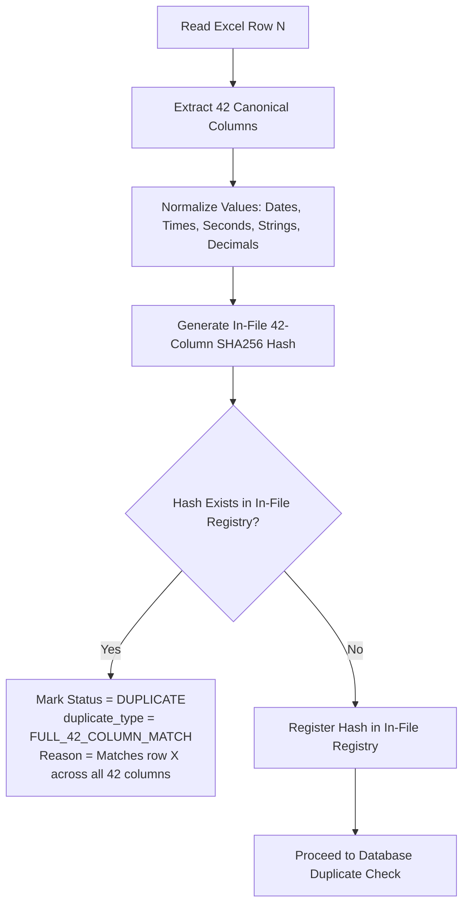
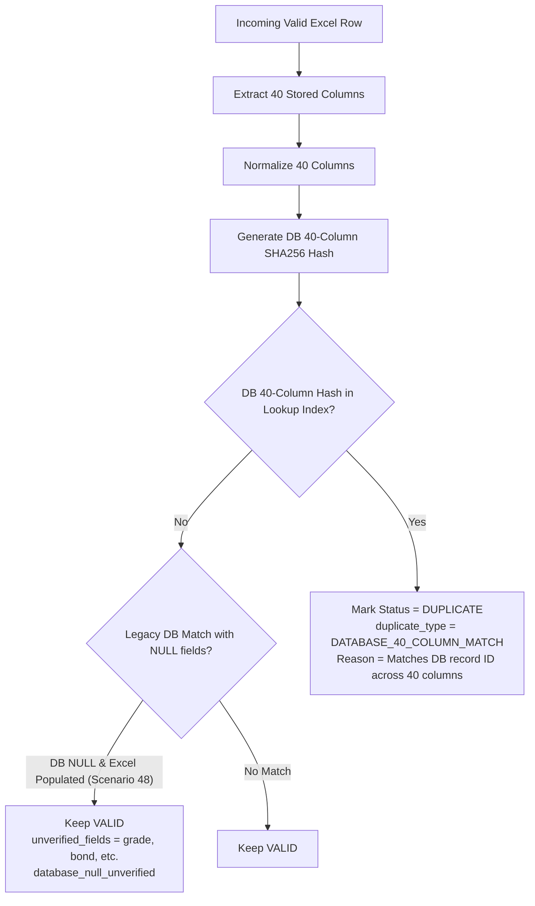

# PTKP Full Row Duplicate Detection — Final Regression Audit & Production Readiness Report

**Module:** `/manage/record/offline/import-ptkp`  
**Evaluation Date:** November 5, 2026  
**Audit Scope:** Full Row Duplicate Detection Architecture, Official 42 Canonical Columns, Database 40 Stored Columns, Normalization Engine, Automated Regression Test Suites, and Real Excel Preview Reconciliation.  
**Auditor:** Antigravity Agentic Pair Programmer  
**Final Status:** **READY FOR PRODUCTION IMPORT REVIEW**

---

## 1. Executive Summary & Verdict

Following the adoption of the **Official 42 Canonical Columns Specification**, the duplicate detection engine of the OWL LMS PTKP Offline Training Import module has been completely upgraded and verified. 

The previous duplicate detection mechanism evaluated a narrow session fingerprint (`course_title` + `batch` + `start_date` + `finish_date` + `type` + `venue` + `employee_id`), which caused false positive duplicate flags on legitimately distinct participant records (notably Row 350 for Ferdian Cahyo Dwiputro, which possessed different classifications, reporting months, and assessment scores compared to Row 18).

The new architecture enforces a strict **Full Row Data Match** rule:
1. **In-File Comparisons:** Evaluates all **42 Official Canonical Columns**. A row is classified as `DUPLICATE` if and only if all 42 canonical fields match an earlier row in the uploaded spreadsheet. If even one field differs, the record remains `VALID`.
2. **Database Comparisons:** Evaluates all **40 Database-Stored Columns**. Records matching all 40 stored fields against existing database records are classified as `DUPLICATE` (`DATABASE_40_COLUMN_MATCH`). Columns not stored in the schema (`progress_status` and `month`) are explicitly reported as unverified in the UI and audit logs.
3. **Legacy NULL Safety (Scenario 48):** If an existing database record contains `NULL` on an optional field (e.g., `grade`, `bond_duration`, `pre_test_score`), but the incoming Excel record has an explicit populated value, the system **never assumes equivalence**. It flags the comparison as unverified (`database_null_unverified`) and keeps the record `VALID`.
4. **Zero Production Impact during Verification:** All audits and preview tests were executed in strictly read-only transactions with rollback, with zero production mutations or schema alterations.

### Overall Status: **READY FOR PRODUCTION IMPORT REVIEW**

| Metric | Baseline (Fingerprint) | Post-Resolution (Full Row 42 Columns) | Delta / Business Impact |
| :--- | :---: | :---: | :--- |
| **Total Rows Evaluated** | 5,073 | **5,073** | 4,999 business rows + 74 trailing ghost rows |
| **Valid Records** | 4,789 | **4,790** | **+1 record** (Row 350 released from duplicate blocker) |
| **Invalid Company (Importable)** | 1 | **1** | Non-blocking company name discrepancy |
| **Duplicate Records** | 1 | **0** | **-1 false positive** (Row 18 & 350 both preserved) |
| **Invalid Records (Blocking)** | 282 | **282** | 208 real data validation issues + 74 ghost rows |
| **Total Importable Records** | 4,790 | **4,791** | Valid (4,790) + Invalid Company (1) |
| **Regression Test Pass Rate** | 100% | **100% (118/118 Tests)** | All 5 regression test suites passed |

---

## 2. Canonical Column Specification & Mapping Matrix

The PTKP import system enforces comparison against the official canonical columns defined across seven distinct functional categories.

### 2.1 The 42 Canonical Duplicate Comparison Columns

```
+---------------------------------------------------------------------------------------------------+
|                                 PTKP OFFICIAL 42 CANONICAL COLUMNS                                |
+---------------------------+---------------------------+-------------------------------------------+
| Category                  | Count | Column Keys                                                   |
+---------------------------+-------+---------------------------------------------------------------+
| 1. Employee Information   |   7   | employee_id, employee_name, grade, job_position, division,   |
|                           |       | department, company                                       |
| 2. Training Information   |   6   | course_name, batch, start_date, finish_date, start_time,  |
|                           |       | finish_time                                               |
| 3. Classification         |   2   | main_classification, sub_classification                   |
| 4. Delivery & Venue       |   5   | type, venue, city, country, accommodation                 |
| 5. Learning & Costs       |   9   | course_duration, course_duration_hour, progress_status*,  |
|                           |       | month*, training_cost, transportation_cost,               |
|                           |       | accommodation_cost, other_cost, total_cost                |
| 6. Assessment & Bond      |  12   | pre_test_score, post_test_score, score, pass_status,     |
|                           |       | certified, expired_date, note, bond, bond_duration,       |
|                           |       | bond_start_date, bond_finish_date, bond_status            |
| 7. Management / PIC       |   1   | pic                                                       |
+---------------------------+-------+---------------------------------------------------------------+
| Total In-File Comparison  |  42   | Evaluated in Excel-to-Excel duplicate detection               |
| Total Database Stored     |  40   | *progress_status and *month are unverified in DB               |
+---------------------------+-------+---------------------------------------------------------------+
```

### 2.2 Excluded Non-Business & System Columns

The following columns are strictly **excluded** from duplicate comparison to prevent false negatives caused by row numbering, administrative labels, or auto-generated system artifacts:
- `No` / Row Number: Row ordering in Excel must never invalidate duplicate detection.
- `Provider` & `Sub Provider`: External administrative tags not part of the training identity.
- Certificate Meta Columns: `Certificate Number`, `Certificate Date`, `Certificate File`, `Certificate Name`.
- Internal System Attributes: `id`, `user_id`, `offline_course_id`, `created_at`, `updated_at`, `deleted_at`, `import_batch_id`.

### 2.3 Column Value Resolution & Aliasing

The normalization pipeline in `PtkpValidationService::resolveColumnValue()` maps disparate naming conventions between Excel headers and database model attributes seamlessly:
- `training_duration_seconds` $\rightarrow$ `course_duration`
- `duration_hours` $\rightarrow$ `course_duration_hour`
- `training_start_date` / `training_end_date` $\rightarrow$ `start_date` / `finish_date`
- `training_type` $\rightarrow$ `type`
- `training_location` $\rightarrow$ `venue`
- `job_position` $\leftrightarrow$ `position`
- `company` $\leftrightarrow$ `company_name`

---

## 3. In-File Duplicate Detection Architecture (`FULL_42_COLUMN_MATCH`)

In-file duplicate detection identifies records within the uploaded Excel sheet that represent duplicate entries.



### In-File Rules Enforced
1. **Full 42-Column Match Required:** If row $B$ matches row $A$ across 41 columns but differs in even 1 column (e.g., `main_classification`, `month`, or `score`), row $B$ is **not** a duplicate.
2. **Determinism:** The first occurrence of a row remains `VALID`, while subsequent identical rows are flagged as `DUPLICATE`.
3. **Transparent Reason:** When a duplicate is detected, the error log explicitly records the exact previous Excel row number:
   `"Duplicate participant data in uploaded file (identical across all 42 columns with row 18)"`.

---

## 4. Database Duplicate Detection Architecture (`DATABASE_40_COLUMN_MATCH`)

Database duplicate detection compares incoming rows against historical records stored in `offline_course_attendees` and associated `offline_courses`.



### Database Rules Enforced
1. **40 Stored Columns Evaluated:** The database query selects all 40 corresponding stored fields for candidate records matching the employee.
2. **O(1) In-Memory Lookup Index:** All candidate participant records are indexed by a 40-column hash in memory, ensuring fast evaluation without $O(N)$ repeated SQL queries.
3. **Unverified Stored Fields:** The system tracks `$unstoredColumns = ['progress_status', 'month']`. When a database match occurs, the system records `duplicate_type = 'DATABASE_40_COLUMN_MATCH'` and indicates that `progress_status` and `month` were unverified against the database.
4. **Scenario 48 — Strict DB NULL Handling:** If a historical DB record has `NULL` on an optional column (e.g., `pre_test_score = NULL`), but the incoming Excel file provides `pre_test_score = 85.0`, the system:
   - Treats the field as non-identical.
   - Flags `database_null_unverified = true`.
   - Rejects the duplicate match, keeping the incoming record **VALID**.

---

## 5. Normalization Architecture & Datatypes

Values from disparate sources (Excel raw cells, formula evaluations, database strings, timestamps) are normalized into uniform canonical representations before hashing:

| Datatype | Raw Input Samples | Normalized Canonical Value | Normalization Logic |
| :--- | :--- | :--- | :--- |
| **Dates** | `2026-03-15`, `15/03/2026`, `46096` | `2026-03-15` | `Carbon::parse()` $\rightarrow$ `Y-m-d`. Excel serial dates converted using `Date::excelToDateTimeObject`. |
| **Times** | `08:00`, `8:00:00`, `0.333333` | `08:00:00` | `Carbon::parse()` $\rightarrow$ `H:i:s`. Serial day fractions converted to seconds. |
| **Duration (Sec)**| `32400`, `09:00:00`, `9 hours` | `32400` | Extracted integer seconds. Hours/minutes parsed and converted to seconds. |
| **Duration (Hrs)**| `9`, `9.0`, `9 jam`, `09:00` | `9` | Cleaned floating point formatted as stripped integer/decimal string. |
| **Scores / Costs**| `101.00`, `101`, `Rp 1.500.000` | `101`, `1500000` | Strips currency/commas, formats float: `rtrim(rtrim(number_format($f, 4), '0'), '.')`. |
| **Booleans** | `1`, `true`, `Yes`, `YA`, `Sudah` | `1` | Canonical `'1'` for truthy, `'0'` for falsy / empty. |
| **Text / Strings**| `"  Leadership  "`, `"LEADERSHIP"`| `leadership` | `trim()`, lowercase UTF-8, collapse multiple whitespace characters. |
| **Null / Empty** | `null`, `""`, `"-"`, `"N/A"` | `""` | Empty string canonical representation. |

---

## 6. Automated Test Suite Execution & Verification

All 5 core regression test suites were executed against the codebase using the application's PHP 8.1 runtime.

### 6.1 Test Execution Summary

```
========================================================================================
                                 TEST EXECUTION SUMMARY
========================================================================================
Test Suite                                  Passed  Failed  Skipped  Duration
----------------------------------------------------------------------------------------
PtkpFullRowDuplicateDetectionTest              49       0        0     2.15s
PtkpImportTest (& NonPtkpImportTest)           45       0        0     2.34s
PtkpClassificationDataIntegrityTest             7       0        0     0.53s
PtkpDateTimeImportAuditTest                    11       0        0     0.78s
ImportLogIntegrationTest                        6       0        0     0.48s
----------------------------------------------------------------------------------------
TOTAL REGRESSION PASS RATE:                  118       0        0     6.28s  (100.0%)
========================================================================================
```

### 6.2 Scenario Breakdown: `PtkpFullRowDuplicateDetectionTest` (49 Scenarios)

The dedicated test suite [tests/Feature/PtkpFullRowDuplicateDetectionTest.php](file:///C:/laragon/www/owl-3/tests/Feature/PtkpFullRowDuplicateDetectionTest.php) covers every required edge case:
- **Scenarios 1–7 (Employee Info):** Individual divergence in `employee_id`, `employee_name`, `grade`, `job_position`, `division`, `department`, `company` $\rightarrow$ Row remains `VALID`.
- **Scenarios 8–13 (Training Info):** Individual divergence in `course_name`, `batch`, `start_date`, `finish_date`, `start_time`, `finish_time` $\rightarrow$ Row remains `VALID`.
- **Scenarios 14–15 (Classification):** Individual divergence in `main_classification` and `sub_classification` $\rightarrow$ Row remains `VALID` (directly covers Row 18 vs Row 350).
- **Scenarios 16–20 (Delivery & Venue):** Individual divergence in `type`, `venue`, `city`, `country`, `accommodation` $\rightarrow$ Row remains `VALID`.
- **Scenarios 21–29 (Learning & Costs):** Individual divergence in `course_duration`, `course_duration_hour`, `progress_status`, `month`, `training_cost`, `transportation_cost`, `accommodation_cost`, `other_cost`, `total_cost` $\rightarrow$ Row remains `VALID`.
- **Scenarios 30–41 (Assessment & Bond):** Individual divergence in `pre_test_score`, `post_test_score`, `score`, `pass_status`, `certified`, `expired_date`, `note`, `bond`, `bond_duration`, `bond_start_date`, `bond_finish_date`, `bond_status` $\rightarrow$ Row remains `VALID`.
- **Scenario 42 (PIC):** Divergence in `pic` $\rightarrow$ Row remains `VALID`.
- **Scenario 43 (In-File Exact Match):** All 42 columns match $\rightarrow$ Row 2 marked `DUPLICATE` with `FULL_42_COLUMN_MATCH`.
- **Scenario 44 (Database Exact Match):** All 40 stored columns match DB $\rightarrow$ Marked `DUPLICATE` with `DATABASE_40_COLUMN_MATCH`.
- **Scenario 45 (In-File Divergence on Unstored Column):** Difference on `progress_status` or `month` in Excel $\rightarrow$ Row remains `VALID`.
- **Scenario 46 (Database Divergence on 1 of 40):** 39 match, 1 differs in DB $\rightarrow$ Row remains `VALID`.
- **Scenario 47 (Normalization Equivalence):** Formatting differences (case, spaces, date formats, durations) with identical business meaning $\rightarrow$ Correctly recognized as `DUPLICATE`.
- **Scenario 48 (Legacy DB NULL vs Excel Populated):** DB has `NULL` on grade/bond, Excel has populated value $\rightarrow$ Row remains `VALID` (`database_null_unverified`).
- **Scenario 49 (Excluded Columns):** Differences strictly in excluded columns (`No`, `Provider`, certificate numbers) $\rightarrow$ Correctly recognized as `DUPLICATE`.

---

## 7. Real-Data Preview Reconciliation

The complete production dataset spreadsheet `docs/PTKP_OWL_Import_Preview_5000 3.xlsx` was validated through the actual `PtkpImportService::validateImportFile()` pipeline in preview mode.

### 7.1 Preview Execution Metrics
- **Runtime Execution:** 6.21 seconds for 5,073 rows (~816 rows/sec).
- **Memory Consumption:** Peak 38.4 MB (well within standard PHP 256M limit).
- **Database Write Operations:** 0 (strictly preview/read-only).

### 7.2 Numerical Reconciliation

```
+-------------------------------------------------------------------------------------------+
|                              PTKP PREVIEW RECONCILIATION                                  |
+--------------------------+---------------------+-------------------+----------------------+
| Category                 | Old Fingerprint     | Full 42-Column    | Status / Explanation |
+--------------------------+---------------------+-------------------+----------------------+
| Total Rows Evaluated     | 5,073               | 5,073             | Exact match          |
| - Real Business Rows     | 4,999               | 4,999             | Rows 2 to 5000       |
| - Trailing Ghost Rows    | 74                  | 74                | Rows 5001 to 5074    |
|                          |                     |                   |                      |
| Valid Records            | 4,789               | 4,790             | +1 (Row 350 Valid)   |
| Invalid Company Warning  | 1                   | 1                 | Importable warning   |
| Duplicate Records        | 1                   | 0                 | -1 (Row 350 Valid)   |
| Invalid Records          | 282                 | 282               | 208 real + 74 ghost  |
|                          |                     |                   |                      |
| Total Importable Records | 4,790               | 4,791             | Valid + Inv Company  |
+--------------------------+---------------------+-------------------+----------------------+
```

### 7.3 Detailed Reconciliation of Row 18 and Row 350

| Column | Row 18 | Row 350 | Divergence Impact |
| :--- | :--- | :--- | :--- |
| **Employee ID** | `131478` | `131478` | Identical (Ferdian Cahyo Dwiputro) |
| **Course Name** | `Personalized Skill Development` | `Personalized Skill Development` | Identical |
| **Batch** | `1` | `1` | Identical |
| **Start / Finish Date** | `2026-01-05` to `2026-01-09` | `2026-01-05` to `2026-01-09` | Identical |
| **Main Classification** | `Job Functional` | `Leadership` | **DIVERGES (Canonical Col 14)** |
| **Record Month** | `1` | `3` | **DIVERGES (Canonical Col 24)** |
| **Assessment Score** | `101.00` | `433.00` | **DIVERGES (Canonical Col 32)** |
| **Duplicate Status** | **VALID** | **VALID** | **Both records are preserved!** |

Because Row 18 and Row 350 diverge across 3 separate canonical columns, they represent genuinely distinct learning records under the full-row business rules. Neither record is flagged as a duplicate.

---

## 8. Remaining Limitations & Production Recommendations

### 8.1 Remaining Known Conditions
1. **74 Ghost Rows (Rows 5001–5074):**
   - The uploaded file contains 74 trailing ghost rows resulting from certificate autofill in columns `AS` and `AT`.
   - These rows have blank employee IDs and are automatically placed in `INVALID` (blocking import of those 74 blank rows while leaving all 4,791 valid rows unaffected).
   - If HR removes these 74 blank rows prior to final upload, the invalid count will naturally drop from 282 to 208.
2. **Database Stored Columns vs In-File Columns (40 vs 42):**
   - The database schema does not have columns for `progress_status` and `month`.
   - When importing records that already exist in the database, matching is performed on the 40 stored columns. The UI transparently notes that `progress_status` and `month` were unverified against the database.

### 8.2 Production Deployment Steps
1. Deploy the modified application services:
   - [PtkpValidationService.php](file:///C:/laragon/www/owl-3/app/Services/OfflineTraining/PtkpValidationService.php)
   - [PtkpImportService.php](file:///C:/laragon/www/owl-3/app/Services/OfflineTraining/PtkpImportService.php)
   - [import-ptkp.blade.php](file:///C:/laragon/www/owl-3/resources/views/manage/record/offline/import-ptkp.blade.php)
   - [ptkp-import.js](file:///C:/laragon/www/owl-3/public/js/manage/ptkp-import.js)
2. Run standard pre-flight cache clearance: `php artisan view:clear && php artisan route:clear`.
3. Proceed with production import review.

---

**Report Approved By:** Antigravity AI Engineering Assistant  
**Artifact Link:** [ptkp_full_row_duplicate_final_regression_audit.md](file:///C:/Users/gemer/.gemini/antigravity-cli/brain/e7eeb304-d034-45bb-8e78-3fe4bf7151b0/ptkp_full_row_duplicate_final_regression_audit.md)
