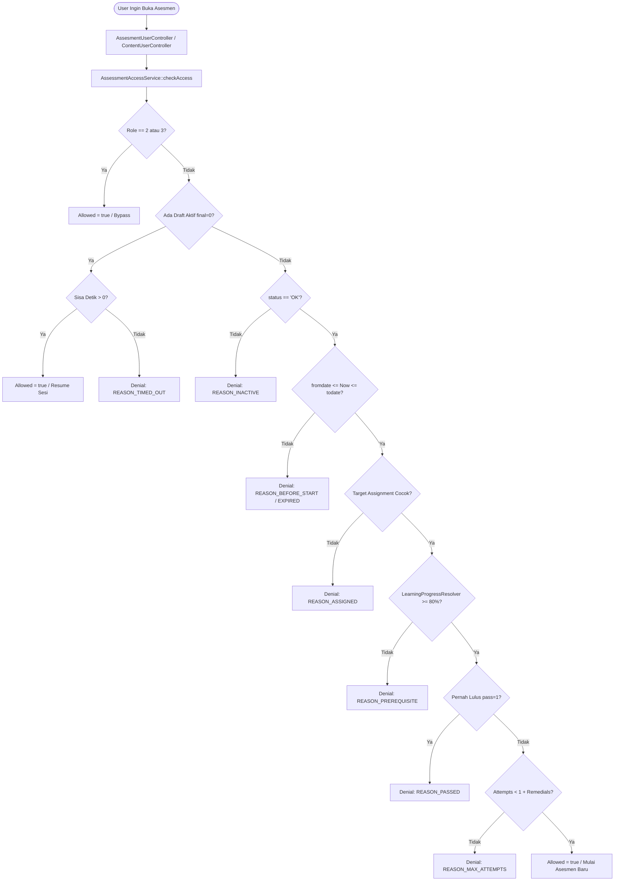

# AssessmentAccessService

## 1. Overview

`AssessmentAccessService` adalah service otorisasi dan kontrol akses terpusat (*canonical gatekeeper*) untuk modul asesmen di sistem OWL. Service ini bertugas mengevaluasi apakah seorang user diizinkan mengakses, memulai, melanjutkan (*resume*), melihat hasil, atau mengulang (*remedial*) suatu kuis/ujian asesmen.

Service ini menyelesaikan kompleksitas aturan bisnis asesmen di OWL yang melibatkan:
- Status aktif/tidaknya asesmen (`status == 'OK'`).
- Jendela waktu ketersediaan kuis (*date range restriction*: `fromdate` s/d `todate`).
- Durasi pengerjaan berbasis timer aktif (*session countdown*).
- Otorisasi penugasan target peserta (berdasarkan Divisi, Departemen, Tim/Proyek, atau penugasan eksplisit user).
- Prasyarat penyelesaian materi pembelajaran (*learning progress prerequisite* minimal 80% atau selesai via `LearningProgressResolver`).
- Batas maksimal percobaan / remedial (*attempt limits*).
- Status kelulusan sebelumnya (*passed status*).
- Hak istimewa bypass bagi Administrator (*Admin* dan *Super Admin*).

Class ini berlokasi langsung di root folder Services dan tergolong dalam domain **Assessment Services**.

---

## 2. Source Location

- Path: [`app/Services/AssessmentAccessService.php`](file:///C:/laragon/owl/app/Services/AssessmentAccessService.php)
- Namespace: `App\Services`
- Class: `AssessmentAccessService`

---

## 3. Main Responsibility

1. **Evaluasi Hak Akses Utama (`checkAccess`)**: Memvalidasi seluruh kondisi pra-syarat akses user terhadap sebuah asesmen dan mengembalikan status boolean serta alasan penolakan yang terstandarisasi (*denial reason constants*).
2. **Kalkulasi Sisa Waktu Pengerjaan (`getRemainingSeconds`)**: Menghitung sisa detik pengerjaan draft asesmen aktif dengan mempertimbangkan batas durasi timer kuis dan batas akhir tanggal asesmen (`todate`).
3. **Pengambilan Draft Aktif Pengerjaan (`getActiveDraft`)**: Mengambil baris pengerjaan yang belum diselesaikan (`final = 0`) milik user.
4. **Evaluasi Batas Remedial (`hasExceededAttempts`)**: Mengalkulasi riwayat percobaan user dibandingkan kuota pengulangan yang diizinkan untuk tipe asesmen terkait.

---

## 4. Used By

Service ini dipanggil secara aktif oleh berbagai User Controller di OWL:

- [`App\Http\Controllers\AssesmentUserController`](file:///C:/laragon/owl/app/Http/Controllers/AssesmentUserController.php):
  - Method `view()` (pemeriksaan izin membuka halaman soal).
  - Method `store()` (validasi submit jawaban kuis).
  - Method `result()` (validasi melihat halaman skor/hasil).
  - Method `autosave()` (validasi background autosave pengerjaan soal).
- [`App\Http\Controllers\ContentUserController`](file:///C:/laragon/owl/app/Http/Controllers/ContentUserController.php):
  - Method `view()` (pengecekan status akses asesmen konten dan penentuan tombol interaksi pada halaman player materi).
- [`App\Http\Controllers\PlaylistUserController`](file:///C:/laragon/owl/app/Http/Controllers/PlaylistUserController.php):
  - Method `view()` (pengecekan akses asesmen pada daftar kurikulum playlist materi).
- [`App\Http\Controllers\HomeUserController`](file:///C:/laragon/owl/app/Http/Controllers/HomeUserController.php):
  - Method `accessAssessmentByUniqueCode()` (validasi klaim asesmen via token kode unik).

---

## 5. Dependencies

| Dependency | Type | Purpose |
|---|---|---|
| `App\Models\Assesment` | Model | Entity utama konfigurasi kuis/ujian asesmen |
| `App\Models\AssesmentResult` | Model | Entity riwayat pengerjaan, skor, status final, dan sisa timer user |
| `App\Models\TrainingPlanDetail` | Model | Validasi relasi konten di dalam playlist materi |
| `App\Models\User` | Model | Data identitas user, divisi, departemen, tim, dan role ID |
| `App\Services\Learning\LearningProgressResolver` | Service | Single source of truth untuk evaluasi prasyarat progres materi user |
| `Carbon\Carbon` | Library | Manipulasi kalkulasi waktu, timestamp, dan countdown timer |

---

## 6. Database Tables

| Table | Operation | Purpose |
|---|---|---|
| `assesments` | READ | Membaca konfigurasi asesmen, tanggal aktif, tipe, durasi waktu, passing grade, dan kuota remedial |
| `assesment_results` | READ | Mengecek draft aktif (`final = 0`), jumlah attempt riwayat, dan kelulusan (`pass = 1`) |
| `assesment_divisis` | READ | Pengecekan relasi penugasan ke divisi user |
| `assesment_departments` | READ | Pengecekan relasi penugasan ke departemen user |
| `assesment_teams` | READ | Pengecekan relasi penugasan ke tim user |
| `assesment_users` | READ | Pengecekan relasi penugasan khusus spesifik user |
| `trainingplan_details` | READ | Mengecek keanggotaan materi konten dalam playlist |

---

## 7. Public Methods

### Konstanta Alasan Penolakan Akses (Denial Reasons)

Class mendefinisikan konstanta standar alasan akses ditolak:
- `REASON_INACTIVE = 'inactive'`
- `REASON_BEFORE_START = 'before_start'`
- `REASON_EXPIRED = 'expired'`
- `REASON_ASSIGNED = 'not_assigned'`
- `REASON_PREREQUISITE = 'prerequisite_unmet'`
- `REASON_PASSED = 'already_passed'`
- `REASON_MAX_ATTEMPTS = 'max_attempts'`
- `REASON_TIMED_OUT = 'timed_out'`

---

### `checkAccess(Assesment $assessment, User $user, ?int $contextTrainingplanId = null): array`

**Purpose**  
Mengevaluasi apakah user berhak mengakses asesmen tertentu.

**Parameters**  
- `$assessment` (`Assesment`): Model asesmen yang akan diuji.
- `$user` (`User`): Model user yang sedang login.
- `$contextTrainingplanId` (`int|null`): ID playlist opsional jika asesmen dibuka dalam konteks playlist tertentu.

**Return**  
`array`: Berisi format:
```php
[
    'allowed' => bool,
    'reason' => string|null, // salah satu konstanta REASON_* atau null jika diizinkan
    'active_draft' => AssesmentResult|null,
    'remaining_seconds' => int|null,
    'can_remedial' => bool,
    'is_admin' => bool
]
```

**Process**  
1. **Admin Privilege Check**: Jika role user bernilai `2` (Admin) atau `3` (Super Admin), akses langsung diberikan (`allowed = true, is_admin = true`).
2. **Draft Aktif Check**: Mengecek apakah ada pengerjaan berjalan (`final = 0`). Jika ada:
   - Hitung sisa waktu pengerjaan via `getRemainingSeconds()`.
   - Jika sisa waktu $\le 0$, tolak akses dengan alasan `REASON_TIMED_OUT`.
   - Jika waktu masih ada, izinkan akses melanjutkan pengerjaan (`allowed = true`).
3. **Assessment Status**: Jika `status != 'OK'`, tolak dengan `REASON_INACTIVE`.
4. **Time Window**:
   - Jika waktu sekarang `< fromdate`, tolak dengan `REASON_BEFORE_START`.
   - Jika waktu sekarang `> todate`, tolak dengan `REASON_EXPIRED`.
5. **Audience Assignment Check**: Mengecek apakah asesmen ditugaskan untuk user, divisi, departemen, atau tim user. Jika tidak memenuhi, tolak dengan `REASON_ASSIGNED`.
6. **Learning Prerequisite Check**:
   - Jika bertipe `content`: panggil `LearningProgressResolver::resolveContentProgress()`. Progres harus $\ge 80\%$ atau status `is_finished == true`.
   - Jika bertipe `trainingplan`: panggil `LearningProgressResolver::resolvePlaylistProgress()`. Progres playlist harus $\ge 80\%$ atau `is_finished == true`.
   - Jika tidak memenuhi, tolak dengan `REASON_PREREQUISITE`.
7. **Passing Status Check**: Jika user sudah pernah lulus (`pass = 1`), tolak dengan `REASON_PASSED`.
8. **Attempt & Remedial Check**: Memeriksa batas percobaan. Jika telah melebihi kuota remedial, tolak dengan `REASON_MAX_ATTEMPTS`.
9. **Final Approval**: Jika lolos seluruh filter, kembalikan `allowed = true`.

**Side Effects**  
Tidak ada side effect (strictly read-only query evaluation).

---

### `getRemainingSeconds(AssesmentResult $result, Assesment $assessment): int`

**Purpose**  
Menghitung sisa waktu pengerjaan (dalam detik) dari suatu sesi asesmen yang sedang berjalan.

**Parameters**  
- `$result` (`AssesmentResult`): Baris sesi draft aktif.
- `$assessment` (`Assesment`): Konfigurasi asesmen.

**Return**  
`int`: Sisa detik (nilai minimum `0`).

**Process**  
1. Mengambil timestamp sesi dimulai (`$result->created_at`).
2. Menghitung batas waktu berdasarkan durasi: `$deadlineByTimer = created_at + (assesment_time * 60)`.
3. Membandingkan dengan batas absolut tanggal kuis: `$deadlineByDate = Carbon::parse($assessment->todate)`.
4. Mengambil batas terketat: `min($deadlineByTimer, $deadlineByDate)`.
5. Menghitung selisih ke waktu sekarang: `$remaining = $effectiveDeadline->diffInSeconds(now(), false)`.
6. Mengembalikan `max(0, $remaining)`.

---

### `getActiveDraft(int $assessmentId, int $userId): ?AssesmentResult`

**Purpose**  
Mengambil instance `AssesmentResult` draft pengerjaan yang belum disubmit (`final = 0`).

**Parameters**  
- `$assessmentId` (`int`): ID asesmen.
- `$userId` (`int`): ID user.

**Return**  
`AssesmentResult|null`

---

### `hasExceededAttempts(Assesment $assessment, int $userId): bool`

**Purpose**  
Mengecek apakah user sudah menghabiskan seluruh kesempatan pengerjaan (kuota remedial).

**Parameters**  
- `$assessment` (`Assesment`): Model asesmen.
- `$userId` (`int`): ID user.

**Return**  
`bool`: `true` jika sudah habis, `false` jika masih bisa mencoba lagi.

**Process**  
1. Hitung total riwayat yang berstatus submit final (`final = 1`).
2. Hitung batas maksimal:
   - Jika asesmen bertipe `global` (atau tidak punya `total_remedials`): maksimal 1 kesempatan.
   - Selain itu: `1 + (int)$assessment->total_remedials`.
3. Kembalikan `$finishedAttempts >= $maxAllowedAttempts`.

---

## 8. Business Rules

1. **Super Admin / Admin Bypass**: Role 2 dan Role 3 kebal terhadap seluruh batasan waktu, remedial, prasyarat belajar, dan assignment untuk keperluan testing serta pengawasan operasional.
2. **Prioritas Sesi Aktif**: Jika user memiliki draft berjalan (`final = 0`), user diprioritaskan untuk melanjutkan ujian selama sisa waktu (timer durasi dan tanggal `todate`) belum habis.
3. **Prasyarat Progres 80%**: Peserta tidak dapat membuka kuis asesmen jika progres menonton video/membaca modul materi belum mencapai minimal 80% atau berstatus selesai.
4. **Passing Lockout**: User yang telah dinyatakan LULUS (`pass = 1`) dikunci dan tidak diizinkan mengambil ujian lagi (*no reattempt after pass*).
5. **Remedial Calculation**: Kesempatan ujian pertama dihitung 1. Setiap remedial menambah 1 kesempatan ($1 + \text{remedials}$).

---

## 9. Data Flow



---

## 10. Important Conditions

```php
// Penentuan sisa durasi terketat antara timer kuis dan batas tanggal selesai
$deadlineByTimer = $result->created_at->addMinutes((int)$assessment->assesment_time);
$deadlineByDate  = Carbon::parse($assessment->todate);
$effectiveDeadline = $deadlineByTimer->min($deadlineByDate);
```
- **Kondisi**: Sesi kuis dibatasi oleh durasi menit, tetapi tidak boleh melebihi tanggal penutupan kuis di sistem.
- **Hasil**: Jika timer tersisa 10 menit tetapi `todate` jatuh 2 menit lagi, user hanya memiliki sisa 2 menit.

```php
// Batas kelulusan prasyarat materi
if ($progress < 80 && !$isFinished) {
    return ['allowed' => false, 'reason' => self::REASON_PREREQUISITE];
}
```
- **Kondisi**: Progres belajar dihitung lewat `LearningProgressResolver`.
- **Hasil**: Jika user baru menonton 75%, tombol asesmen tetap terkunci.

---

## 11. Edge Cases

1. **User Memiliki Draft tetapi Waktu Habis Saat Offline**: Jika user menutup browser lalu kembali lagi setelah timer kadaluarsa, `getRemainingSeconds()` bernilai 0 dan sistem otomatis menolak dengan `REASON_TIMED_OUT`.
2. **Asesmen Global Tanpa Remedial**: Kolom `total_remedials` bernilai null atau 0; user hanya berhak 1 kali pengerjaan seumur hidup.
3. **Materi Dihapus dari Playlist**: Menggunakan validasi pivot `TrainingPlanDetail` untuk memastikan integritas relasi.

---

## 12. Related Services

- [`LearningProgressResolver`](file:///C:/laragon/owl/docs/services/learning/LearningProgressResolver.md): Sumber data tunggal untuk persentase materi user.
- [`AssessmentDuplicateService`](file:///C:/laragon/owl/docs/services/AssessmentDuplicateService.md): Menggandakan asesmen dengan aturan status dan tipe yang disesuaikan.

---

## 13. Related Models

- [`App\Models\Assesment`](file:///C:/laragon/owl/app/Models/Assesment.php)
- [`App\Models\AssesmentResult`](file:///C:/laragon/owl/app/Models/AssesmentResult.php)
- [`App\Models\User`](file:///C:/laragon/owl/app/Models/User.php)
- [`App\Models\TrainingPlanDetail`](file:///C:/laragon/owl/app/Models/TrainingPlanDetail.php)

---

## 14. Related Controllers / Commands

- [`App\Http\Controllers\AssesmentUserController`](file:///C:/laragon/owl/app/Http/Controllers/AssesmentUserController.php)
- [`App\Http\Controllers\ContentUserController`](file:///C:/laragon/owl/app/Http/Controllers/ContentUserController.php)
- [`App\Http\Controllers\PlaylistUserController`](file:///C:/laragon/owl/app/Http/Controllers/PlaylistUserController.php)

---

## 15. Known Risks / Maintenance Notes

- **Autosave Heartbeat Overhead**: Method `autosave` di controller memanggil `checkAccess` secara berkala via AJAX; pastikan query relasi asesmen dan attempt tetap ringan.
- **Timezone Server**: Perhitungan `diffInSeconds` bergantung pada konfigurasi timezone di Laravel (`config/app.php`). Perbedaan timezone antara database server dan PHP dapat menyebabkan diskrepansi sisa durasi ujian.

---

## 16. Safe Modification Guide

1. **Jika Menambah Rule Validasi Baru**:
   - Daftarkan konstanta penolakan baru di class `AssessmentAccessService` (contoh: `REASON_NEW_RULE = 'new_rule'`).
   - Perbarui seluruh controller pemanggil ([`AssesmentUserController`](file:///C:/laragon/owl/app/Http/Controllers/AssesmentUserController.php)) agar merender alert/halaman error yang sesuai.
2. **Jangan Mengubah Ambang Prasyarat 80% Sembarangan**: Ambang batas 80% adalah standar KPI kurikulum OWL yang disinkronkan dengan UI Blade badge status materi.

---

## 17. Testing / Verification

Automated test yang mencakup service ini:
- [`tests/Feature/AssessmentAccessServiceResolverTest.php`](file:///C:/laragon/owl/tests/Feature/AssessmentAccessServiceResolverTest.php)
- [`tests/Feature/AdminAssessmentReattemptTest.php`](file:///C:/laragon/owl/tests/Feature/AdminAssessmentReattemptTest.php)

Jalankan test dengan command:
```bash
php artisan test --filter=AssessmentAccessServiceResolverTest
php artisan test --filter=AdminAssessmentReattemptTest
```

---

## 18. Handover Summary

- `AssessmentAccessService` adalah gatekeeper mutlak untuk semua akses asesmen kuis di OWL.
- Mengintegrasikan otorisasi multi-dimensi: Admin bypass, status aktif, tanggal berlaku, sisa timer, assignment user/divisi, prasyarat progres materi $\ge 80\%$, status lulus, dan kuota remedial.
- Digunakan oleh `AssesmentUserController`, `ContentUserController`, dan `PlaylistUserController`.
