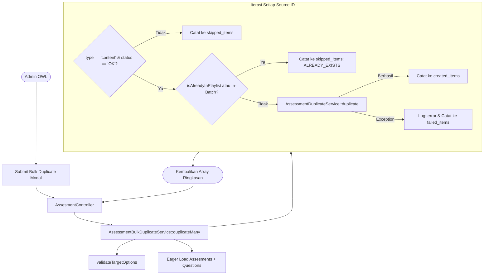

# AssessmentBulkDuplicateService

## 1. Overview

`AssessmentBulkDuplicateService` adalah service orkestrator yang menangani proses duplikasi massal (*batch/bulk duplication*) kuis asesmen di OWL. Service ini memungkinkan admin untuk menduplikasi sekumpulan asesmen bertipe `content` ke dalam konteks tujuan baru, khususnya mengaitkan asesmen materi mandiri ke dalam kurikulum Playlist (`target_context = 'playlist'`).

Service ini menyediakan mekanisme dua tahap:
1. **Fase Preview (`preview`, `previewAllActive`)**: Menganalisis daftar asesmen sumber sebelum eksekusi, memilah mana yang memenuhi syarat (*eligible*), mana yang sudah ada di playlist tujuan (*already exists / duplicate prevention*), dan mana yang tidak valid (*ineligible*).
2. **Fase Eksekusi (`duplicateMany`, `duplicateAllActive`)**: Mengeksekusi kloning asesmen secara berulang dengan mendelegasikan duplikasi unit kepada [`AssessmentDuplicateService`](file:///C:/laragon/owl/docs/services/AssessmentDuplicateService.md), lengkap dengan penanganan idempotensi dan isolasi error per item.

Service ini berada langsung di bawah folder Services dan merupakan bagian dari **Assessment Services**.

---

## 2. Source Location

- Path: [`app/Services/AssessmentBulkDuplicateService.php`](file:///C:/laragon/owl/app/Services/AssessmentBulkDuplicateService.php)
- Namespace: `App\Services`
- Class: `AssessmentBulkDuplicateService`

---

## 3. Main Responsibility

1. **Validasi Opsi Konteks Tujuan (`validateTargetOptions`)**: Memastikan target konteks (`content` atau `playlist`) valid, serta memverifikasi keberadaan `trainingplan_id` jika targetnya adalah playlist.
2. **Analisis Kesiapan Duplikasi (*Dry-run Preview*)**: Memberikan rincian item yang akan dibuat, diskip karena sudah ada, atau tidak memenuhi syarat (inaktif/tipe salah).
3. **Pencegahan Duplikasi Ganda Intra-Batch & Database (`isAlreadyInPlaylist`)**: Mencegah konten yang sama memiliki lebih dari 1 asesmen aktif di playlist tujuan.
4. **Orkestrasi Kloning Massal**: Memanggil `AssessmentDuplicateService::duplicate()` untuk setiap item yang lolos validasi, mencatat hasil sukses, diskip, atau gagal.

---

## 4. Used By

- [`App\Http\Controllers\AssesmentController`](file:///C:/laragon/owl/app/Http/Controllers/AssesmentController.php):
  - Method `previewBulkDuplicate()` (endpoint AJAX untuk menampilkan modal preview sebelum submit massal).
  - Method penanganan submit form duplikasi massal asesmen materi ke playlist.

---

## 5. Dependencies

| Dependency | Type | Purpose |
|---|---|---|
| `App\Services\AssessmentDuplicateService` | Service | Service inti untuk menduplikasi 1 instance asesmen beserta bank soal dan pertanyaannya |
| `App\Models\Assesment` | Model | Entity asesmen sumber dan target |
| `App\Models\TrainingPlan` | Model | Validasi keberadaan playlist tujuan |
| `Illuminate\Support\Facades\Log` | Facade | Pencatatan error saat ada item yang gagal diduplikasi |

---

## 6. Database Tables

| Table | Operation | Purpose |
|---|---|---|
| `assesments` | READ / INSERT | Membaca asesmen sumber; mengecek keberadaan duplikat; menyimpan kuis baru via `AssessmentDuplicateService` |
| `trainingplan` | READ | Validasi eksistensi ID playlist tujuan |
| `trainingplan_details` | INSERT | Dibuat secara otomatis oleh underlying `AssessmentDuplicateService` jika relasi pivot belum ada |

---

## 7. Public Methods

### `preview(array $sourceIds, array $options = []): array`

**Purpose**  
Melakukan simulasi preview kelayakan duplikasi untuk sejumlah ID asesmen terpilih tanpa mengubah database.

**Parameters**  
- `$sourceIds` (`array`): Daftar ID asesmen sumber (`int[]`).
- `$options` (`array`): Opsi target, meliputi:
  - `target_context`: `'playlist'` (default) atau `'content'`.
  - `trainingplan_id`: ID playlist tujuan jika konteksnya playlist.
  - `content_mapping`: Pemetaan khusus opsional ID sumber ke target `content_id`.

**Return**  
`array`: Struktur ringkasan preview:
```php
[
    'total'            => int,
    'will_be_created'  => int,
    'already_exists'   => int,
    'ineligible'       => int,
    'eligible_items'   => array,
    'skipped_items'    => array,
    'ineligible_items' => array,
]
```

**Process**  
1. Validasi opsi target via `validateTargetOptions()`.
2. Query seluruh asesmen sumber berdasarkan `$sourceIds`.
3. Loop setiap ID:
   - Jika record tidak ditemukan: tandai `ineligible` dengan alasan `NOT_FOUND`.
   - Jika `type !== 'content'`: tandai `ineligible` dengan alasan `INVALID_TYPE`.
   - Jika `status !== 'OK'`: tandai `ineligible` dengan alasan `INACTIVE`.
   - Jika `targetContext === 'playlist'`: cek apakah konten tersebut sudah pernah diproses di dalam batch ini atau sudah ada di tabel asesmen playlist (`isAlreadyInPlaylist`). Jika ya, tandai `already_exists`.
   - Jika lolos seluruh kriteria, masukkan ke `will_be_created`.
4. Kembalikan data ringkasan.

---

### `previewAllActive(array $options = []): array`

**Purpose**  
Menjalankan preview untuk seluruh asesmen materi aktif (`type = 'content'`, `status = 'OK'`) yang ada di sistem.

**Parameters**  
- `$options` (`array`): Parameter konfigurasi konteks.

**Return**  
`array`: Hasil pemanggilan `preview()`.

---

### `duplicateMany(array $sourceIds, array $options = []): array`

**Purpose**  
Mengeksekusi proses duplikasi massal secara nyata ke database.

**Parameters**  
- `$sourceIds` (`array`): Daftar ID asesmen sumber.
- `$options` (`array`): Opsi konteks target dan mapping konten.

**Return**  
`array`:
```php
[
    'total'         => int,
    'success'       => int,
    'skipped'       => int,
    'failed'        => int,
    'created_items' => array,
    'skipped_items' => array,
    'failed_items'  => array,
]
```

**Process**  
1. Validasi opsi target.
2. Query seluruh record asesmen sumber beserta relasi `assessment_question_banks` dan `questions` secara eager loading.
3. Looping setiap asesmen:
   - Evaluasi filter kelayakan (`NOT_FOUND`, `INVALID_TYPE`, `INACTIVE`).
   - Evaluasi idempotensi playlist (`isAlreadyInPlaylist` atau intra-batch duplikasi).
   - Jika lolos, siapkan override atribut (`assasment_content_for`, `trainingplan_id`, `content_id`).
   - Eksekusi duplikasi via `$this->duplicateService->duplicate($assessment, $itemOverrides)` di dalam blok `try-catch`.
   - Jika berhasil: catat ke `created_items` dan tandai konten ID ke `batchProcessedContentIds`.
   - Jika exception terjadi: log error via `Log::error` dan catat ke `failed_items`.
4. Kembalikan rekapitulasi batch.

---

### `duplicateAllActive(array $options = []): array`

**Purpose**  
Menduplikasi seluruh asesmen materi aktif di sistem ke target konteks yang ditentukan.

---

### `isAlreadyInPlaylist(int $contentId, int $trainingplanId): bool`

**Purpose**  
Mengecek apakah sudah terdapat asesmen aktif berstatus `OK` untuk materi konten tersebut di playlist tujuan.

---

## 8. Business Rules

1. **Hanya Asesmen Materi Aktif**: Hanya asesmen dengan tipe `content` dan status `OK` yang boleh diduplikasi secara massal. Kuis global, kuis bertipe playlist, atau kuis yang berstatus nonaktif (`NOT`) otomatis dilewati.
2. **Aturan 1 Konten 1 Kuis per Playlist**: Dalam sebuah kurikulum playlist, sebuah materi konten tidak boleh memiliki lebih dari 1 kuis aktif (`assasment_content_for = 'playlist'`). Hal ini mencegah kebingungan user dan duplikasi prasyarat sertifikat.
3. **Isolasi Kegagalan Per Item**: Kegagalan duplikasi pada 1 asesmen (misalnya karena data korup) tidak menggagalkan seluruh transaksi batch. Item lain tetap diproses, sedangkan item gagal dicatat di `failed_items` dan file error log.

---

## 9. Data Flow



---

## 10. Important Conditions

```php
if ($targetContext === 'playlist') {
    if (!$trainingplanId || !TrainingPlan::where('id', $trainingplanId)->exists()) {
        throw new InvalidArgumentException("A valid trainingplan_id is required when target_context is 'playlist'.");
    }
}
```
- **Kondisi**: Jika target duplikasi adalah playlist, `trainingplan_id` wajib disertakan dan harus eksis di database.
- **Hasil**: Mencegah terciptanya data *orphan* kuis playlist tanpa induk training plan.

---

## 11. Edge Cases

1. **ID Duplikat dalam Input `$sourceIds`**: Sistem menggunakan array pelacak `$batchProcessedContentIds` dan `$previewProcessedContentIds` untuk memastikan jika ID konten yang sama dikirim dua kali dalam 1 batch, kemunculan kedua langsung diskip.
2. **Kuis Sumber Tidak Ditemukan**: Diberi flag `NOT_FOUND` dan tidak memicu fatal error.

---

## 12. Related Services

- [`AssessmentDuplicateService`](file:///C:/laragon/owl/docs/services/AssessmentDuplicateService.md): Eksekutor tunggal pembuatan duplikat kuis, bank soal, dan pertanyaan.
- [`AssessmentResultDuplicationService`](file:///C:/laragon/owl/docs/services/AssessmentResultDuplicationService.md): Kerap dipanggil setelah proses bulk duplicate untuk mengkloning riwayat pengerjaan user.

---

## 13. Related Models

- [`App\Models\Assesment`](file:///C:/laragon/owl/app/Models/Assesment.php)
- [`App\Models\TrainingPlan`](file:///C:/laragon/owl/app/Models/TrainingPlan.php)

---

## 14. Related Controllers / Commands

- [`App\Http\Controllers\AssesmentController`](file:///C:/laragon/owl/app/Http/Controllers/AssesmentController.php)

---

## 15. Known Risks / Maintenance Notes

- **Memory Usage pada `previewAllActive`**: Jika jumlah asesmen aktif di OWL mencapai ribuan, pemanggilan `get()` tanpa chunking dapat meningkatkan konsumsi memori. Saat ini ukuran data masih dalam batas wajar, namun perlu diwaspadai jika data bertumbuh sangat besar.

---

## 16. Safe Modification Guide

1. **Menambah Filter Kelayakan Baru**: Selalu sinkronkan logika pemeriksaan antara method `preview()` dan `duplicateMany()` agar hasil preview 100% konsisten dengan eksekusi aktual.
2. **Konteks Tujuan Baru**: Jika di masa depan OWL menambah konteks kuis baru selain `'content'` dan `'playlist'`, tambahkan validasi pada `validateTargetOptions()` dan mapping di `AssessmentDuplicateService`.

---

## 17. Testing / Verification

Automated test yang memverifikasi service ini:
- [`tests/Feature/AssessmentBulkDuplicateTest.php`](file:///C:/laragon/owl/tests/Feature/AssessmentBulkDuplicateTest.php)
- [`tests/Feature/AssessmentBulkDuplicateHttpTest.php`](file:///C:/laragon/owl/tests/Feature/AssessmentBulkDuplicateHttpTest.php)
- [`tests/Feature/AssessmentBulkDuplicateWithResultsTest.php`](file:///C:/laragon/owl/tests/Feature/AssessmentBulkDuplicateWithResultsTest.php)

Jalankan test dengan:
```bash
php artisan test --filter=AssessmentBulkDuplicateTest
```

---

## 18. Handover Summary

- Service ini adalah fasilitator duplikasi massal kuis materi OWL ke dalam playlist materi.
- Memiliki dua fase: Preview (bebas risiko) dan Eksekusi riil.
- Mencegah duplikasi konten ganda di playlist dan mengisolasi error per item.
