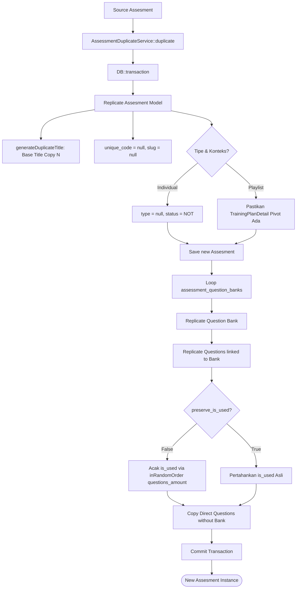

# AssessmentDuplicateService

## 1. Overview

`AssessmentDuplicateService` adalah engine inti (*atomic cloning engine*) untuk menduplikasi entitas kuis/ujian asesmen di OWL. Service ini bertanggung jawab menyalin seluruh atribut konfigurasi asesmen, struktur Bank Soal (`assesment_question_banks`), serta butir-butir pertanyaan (`assesment_questions`) dengan integritas relasi yang tetap terjaga.

Fitur kunci yang diselesaikan oleh service ini:
- **Penamaan Unik Otomatis**: Mendeteksi pola judul dan menambahkan akhiran `Copy N` secara berurutan dan bebas tabrakan (*collision-safe*).
- **Pengacakan / Preservasi Soal**: Mengacak ulang butir soal terpilih berdasarkan konfigurasi kuota bank soal (`questions_amount`) atau mempertahankan status pemakaian (`preserve_is_used`).
- **Pembersihan Data Sensitif**: Tidak menyalin kode unik (`unique_code`), slug (direset agar digenerate ulang), hasil pengerjaan user, maupun penugasan user sebelumnya.
- **Dukungan Duplikasi Individual & Konteks**: Penyesuaian khusus untuk duplikasi mandiri (`type = null`, status nonaktif `NOT` jika sumbernya `OK`).
- **Sinkronisasi Pivot Playlist**: Secara otomatis membuat entri pivot `trainingplan_details` jika kuis dan konten dipetakan ke playlist tertentu.

Class ini berlokasi di root Services dan tergolong dalam **Assessment Services**.

---

## 2. Source Location

- Path: [`app/Services/AssessmentDuplicateService.php`](file:///C:/laragon/owl/app/Services/AssessmentDuplicateService.php)
- Namespace: `App\Services`
- Class: `AssessmentDuplicateService`

---

## 3. Main Responsibility

1. **Generasi Judul Duplikat Bebas Konflik (`generateDuplicateTitle`, `generateDuplicateContentTitle`)**: Menghilangkan imbuhan `Copy N` lama dan mencari nomor urut berikutnya yang belum terpakai di database.
2. **Kloning Asesmen Transaksional (`duplicate`)**: Membungkus seluruh proses duplikasi asesmen, bank soal, dan soal di dalam database transaction (`DB::transaction`).
3. **Penyalinan Bank Soal & Butir Pertanyaan**: Menyalin seluruh record bank soal dan butir pertanyaan terkait, serta mengacak butir soal aktif (`is_used = true`).
4. **Penanganan Duplikasi Individual (`duplicateIndividual`)**: Mode khusus untuk menduplikasi asesmen mandiri di mana tipe dijadikan `null` dan status diubah menjadi `NOT` untuk keamanan.
5. **Kloning File Materi Konten (`duplicateContent`)**: Menyalin record materi beserta aset fisik di storage jika diperlukan.

---

## 4. Used By

- [`App\Services\AssessmentBulkDuplicateService`](file:///C:/laragon/owl/docs/services/AssessmentBulkDuplicateService.md): Engine dasar untuk eksekusi duplikasi massal.
- [`App\Http\Controllers\AssesmentQuestionController`](file:///C:/laragon/owl/app/Http/Controllers/AssesmentQuestionController.php):
  - Method `clone()` (tombol aksi kloning asesmen dari UI admin).
- [`App\Console\Commands\DuplicateActiveContentAssessmentsToPlaylistsCommand`](file:///C:/laragon/owl/app/Console/Commands/DuplicateActiveContentAssessmentsToPlaylistsCommand.php): Command artisan untuk memigrasikan asesmen konten ke playlist.
- [`App\Console\Commands\RestoreAssessmentPlaylistRelationsCommand`](file:///C:/laragon/owl/app/Console/Commands/RestoreAssessmentPlaylistRelationsCommand.php): Command perbaikan relasi integritas asesmen ke playlist.

---

## 5. Dependencies

| Dependency | Type | Purpose |
|---|---|---|
| `App\Models\Assesment` | Model | Entity utama asesmen |
| `App\Models\AssesmentQuestionBank` | Model | Entity hubungan ke bank soal |
| `App\Models\AssesmentQuestion` | Model | Entity butir soal pertanyaan dan kunci jawaban |
| `App\Models\Content` | Model | Entity materi pembelajaran jika menduplikasi konten |
| `App\Models\TrainingPlanDetail` | Model | Pivot table antara playlist dan konten |
| `Illuminate\Support\Facades\DB` | Facade | Manajemen transaksi database (`DB::transaction`) |
| `Illuminate\Support\Facades\File` | Facade | Operasi file system saat kloning direktori storage materi |
| `Carbon\Carbon` | Library | Timestamping record baru |

---

## 6. Database Tables

| Table | Operation | Purpose |
|---|---|---|
| `assesments` | READ / INSERT | Mengecek judul yang ada; membuat baris asesmen baru hasil replikasi |
| `assesment_question_banks` | READ / INSERT | Menyalin pemetaan bank soal ke asesmen baru |
| `assesment_questions` | READ / INSERT / UPDATE | Menyalin soal; memperbarui flag `is_used` hasil pengacakan |
| `trainingplan_details` | READ / INSERT | Memastikan baris pivot materi di dalam playlist tersedia |
| `content` | READ / INSERT | Kloning record konten jika `duplicateContent` dipanggil |

---

## 7. Public Methods

### `extractBaseTitle(?string $title, string $default = 'Assessment'): string`

**Purpose**  
Membersihkan string judul dari akhiran `Copy N` berulang agar nama dasar kuis tetap bersih.

---

### `generateDuplicateTitle(?string $originalTitle): string`

**Purpose**  
Menghasilkan judul baru yang unik dengan pola `{Base Title} Copy N` dengan collision check loop ke database.

---

### `duplicateContent(Content $sourceContent): Content`

**Purpose**  
Menduplikasi model `Content` beserta direktori aset fisik di `storage/files/content/{id}`.

---

### `duplicate(Assesment $assesment, array $overrides = []): Assesment`

**Purpose**  
Menduplikasi satu instance asesmen beserta seluruh struktur soalnya di dalam transaksi atomik.

**Parameters**  
- `$assesment` (`Assesment`): Model asesmen sumber.
- `$overrides` (`array`): Opsi penggantian atribut, meliputi:
  - `title`: Judul kustom (opsional).
  - `assasment_content_for` / `target_context`: `'content'` atau `'playlist'`.
  - `content_id`: ID konten target.
  - `trainingplan_id`: ID playlist target.
  - `is_individual`: Boolean mode individual.
  - `preserve_is_used`: Boolean mempertahankan flag soal aktif persis seperti sumber.

**Return**  
`Assesment`: Instance model asesmen baru yang telah tersimpan di database.

**Process**  
1. Buka `DB::transaction`.
2. Replikasi model: `$newAssesment = $assesment->replicate()`.
3. Set judul via `generateDuplicateTitle` jika tidak dioverride.
4. Kosongkan `slug` dan `unique_code` (agar digenerate ulang).
5. Atur relasi konteks (`type`, `content_id`, `trainingplan_id`, `assasment_content_for`):
   - Jika tipe `content`: sesuaikan dengan `$overrides`. Jika berelasi dengan playlist, buat pivot `TrainingPlanDetail` secara idempoten jika belum ada.
   - Jika `is_individual = true`: set `type = null`, dan jika status sumber `OK`, ubah jadi `NOT`.
6. Simpan `$newAssesment->save()`.
7. Replikasi setiap `assessment_question_banks`:
   - Kloning baris relasi bank soal ke ID kuis baru.
   - Ambil soal-soal terkait bank tersebut di sumber, replikasi ke kuis baru.
   - Jika `preserve_is_used == false` dan bank memiliki kuota `questions_amount > 0`: jalankan `inRandomOrder()->limit($amount)` lalu tandai `is_used = true`.
8. Replikasi soal langsung (*direct questions*) yang tidak terikat ke bank soal (`whereNull('question_bank_id')`).
9. Commit transaksi dan kembalikan instance baru.

---

### `duplicateIndividual(Assesment $assesment, array $overrides = []): Assesment`

**Purpose**  
Shorthand untuk menduplikasi asesmen dalam konteks kuis mandiri (`is_individual = true`).

---

## 8. Business Rules

1. **Keamanan Kloning Individual**: Jika admin menduplikasi kuis secara individu dari antarmuka web, kuis hasil kloning sengaja diubah statusnya menjadi `NOT` (jika asalnya `OK`) dan `type = null`. Tujuannya mencegah kuis duplikat langsung aktif dan diakses peserta sebelum admin selesai mereview/mengeditnya.
2. **Pengacakan Soal Baru**: Soal-soal dari bank soal diacak ulang saat duplikasi dilakukan (kecuali opsi `preserve_is_used` aktif), sehingga paket ujian baru memiliki variasi butir soal yang segar.
3. **Isolasi Riwayat & Otorisasi**: Riwayat nilai (`assesment_results`), attempt pengerjaan, kode token klaim (`unique_code`), dan penugasan audiens lama (`assesment_users`, `assesment_divisis`) TIDAK disalin ke kuis baru.

---

## 9. Data Flow



---

## 10. Important Conditions

```php
if ($isIndividual) {
    $newAssesment->type = null;
    if ($assesment->status === 'OK') {
        $newAssesment->status = 'NOT';
    }
}
```
- **Kondisi**: Duplikasi kuis individual melalui tombol UI.
- **Hasil**: Kuis baru tidak berstatus live (`NOT`) agar aman dari pengerjaan peserta sebelum diedit.

```php
if (!empty($newAssesment->trainingplan_id) && !empty($newAssesment->content_id)) {
    // Pastikan relasi pivot TrainingPlanDetail tersedia
}
```
- **Kondisi**: Duplikasi ke dalam playlist.
- **Hasil**: Materi otomatis didaftarkan sebagai modul di playlist terkait jika belum terdaftar.

---

## 11. Edge Cases

1. **Judul Asal Mengandung Akhiran Angka Biasa**: Fungsi regex `extractBaseTitle` hanya memotong akhiran yang bertuliskan spasi `Copy N` (case-insensitive). Judul asli seperti `Ujian Modul 1` tidak akan terpotong angka `1`-nya.
2. **Bank Soal Memiliki Kuota 0**: Jika `questions_amount` adalah 0, tidak ada soal yang ditandai `is_used = true`.
3. **Soal Tanpa Bank Soal**: Sistem tetap menyalin soal yang dibuat secara langsung (*direct questions*) tanpa melewatkannya.

---

## 12. Related Services

- [`AssessmentBulkDuplicateService`](file:///C:/laragon/owl/docs/services/AssessmentBulkDuplicateService.md): Memanggil service ini secara repetitif dalam batch.
- [`AssessmentResultDuplicationService`](file:///C:/laragon/owl/docs/services/AssessmentResultDuplicationService.md): Menyalin riwayat nilai user setelah service ini selesai menduplikasi struktur kuis.

---

## 13. Related Models

- [`App\Models\Assesment`](file:///C:/laragon/owl/app/Models/Assesment.php)
- [`App\Models\AssesmentQuestionBank`](file:///C:/laragon/owl/app/Models/AssesmentQuestionBank.php)
- [`App\Models\AssesmentQuestion`](file:///C:/laragon/owl/app/Models/AssesmentQuestion.php)
- [`App\Models\TrainingPlanDetail`](file:///C:/laragon/owl/app/Models/TrainingPlanDetail.php)

---

## 14. Related Controllers / Commands

- [`App\Http\Controllers\AssesmentQuestionController`](file:///C:/laragon/owl/app/Http/Controllers/AssesmentQuestionController.php)
- [`App\Console\Commands\DuplicateActiveContentAssessmentsToPlaylistsCommand`](file:///C:/laragon/owl/app/Console/Commands/DuplicateActiveContentAssessmentsToPlaylistsCommand.php)

---

## 15. Known Risks / Maintenance Notes

- **Collision Loop pada Judul Sangat Banyak**: Method `generateDuplicateTitle` menggunakan while-loop pengecekan `where('title', $candidateTitle)->exists()`. Jika duplikasi dilakukan ribuan kali dengan judul sama, query count akan bertambah linier. Saat ini di OWL frekuensinya relatif kecil sehingga tidak berdampak performa signifikan.
- **Transactional Rollback**: Seluruh replikasi berjalan dalam DB transaction; jika terjadi query error di tengah-tengah pada level soal, seluruh asesmen baru di-rollback sehingga tidak meninggalkan data kuis setengah jadi (*orphaned*).

---

## 16. Safe Modification Guide

1. **Jika Menambah Field Baru pada `assesments` atau `assesment_questions`**:
   - Jika field tersebut perlu direset khusus (seperti halnya `unique_code`), pastikan menambahkannya ke blok penanganan atribut sebelum `$newAssesment->save()`.
2. **Jangan Menghapus Logika Idempotensi Pivot**: Pengecekan keberadaan `TrainingPlanDetail` penting agar urutan `content_order` modul materi di playlist tidak rusak atau duplikat.

---

## 17. Testing / Verification

Automated test untuk memverifikasi service ini:
- [`tests/Unit/AssessmentDuplicateServiceTest.php`](file:///C:/laragon/owl/tests/Unit/AssessmentDuplicateServiceTest.php)
- [`tests/Unit/AssessmentIndividualDuplicateTest.php`](file:///C:/laragon/owl/tests/Unit/AssessmentIndividualDuplicateTest.php)
- [`tests/Feature/AssessmentDuplicateFeatureTest.php`](file:///C:/laragon/owl/tests/Feature/AssessmentDuplicateFeatureTest.php)

Jalankan test dengan:
```bash
php artisan test --filter=AssessmentDuplicateServiceTest
php artisan test --filter=AssessmentIndividualDuplicateTest
```

---

## 18. Handover Summary

- Service ini adalah engine tunggal replikasi kuis asesmen di OWL.
- Memastikan replikasi lengkap: Model asesmen, Bank Soal, Pertanyaan, dan relasi Playlist pivot.
- Menjamin penamaan unik format `{Title} Copy N` dan mengamankan status kuis duplikat.
