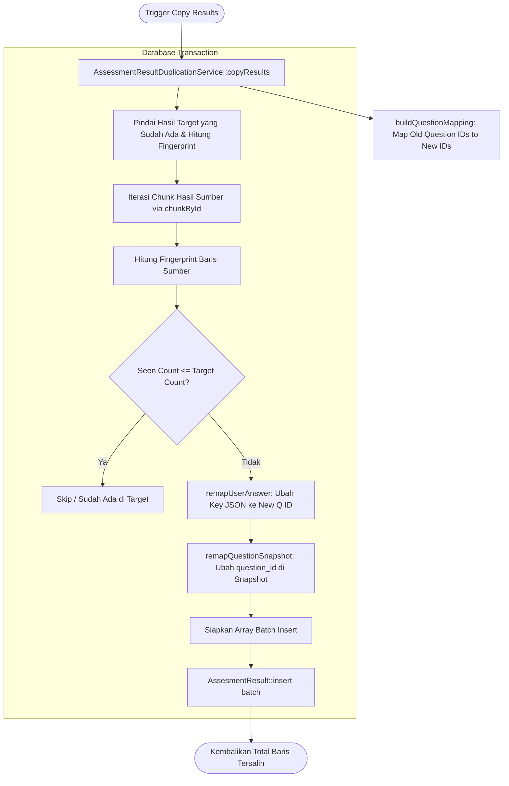

# AssessmentResultDuplicationService

## 1. Overview

`AssessmentResultDuplicationService` adalah service spesialis yang menangani penyalinan riwayat hasil ujian/kuis peserta (`assesment_results`) dari asesmen sumber ke asesmen duplikat baru. 

Tantangan utama yang diselesaikan service ini adalah **integritas pemetaan butir soal** dan **idempotensi berbasis multiset**:
1. Saat sebuah asesmen diduplikasi, butir-butir soal di tabel `assesment_questions` mendapatkan ID auto-increment baru. Jawaban user yang tersimpan dalam format JSON (`user_answer` dan `question_snapshot`) masih merujuk ke ID soal lama. Service ini melakukan remapping deterministik seluruh kunci jawaban JSON ke ID soal yang baru.
2. Memungkinkan migrasi riwayat tanpa kehilangan data, bahkan jika ada peserta yang memiliki beberapa kali submission dengan skor atau atribut yang identik (*twin submissions*), berkat mekanisme *multiset fingerprint tracking*.

Service ini berada langsung di root direktori Services dan merupakan bagian dari domain **Assessment Services**.

---

## 2. Source Location

- Path: [`app/Services/AssessmentResultDuplicationService.php`](file:///C:/laragon/owl/app/Services/AssessmentResultDuplicationService.php)
- Namespace: `App\Services`
- Class: `AssessmentResultDuplicationService`

---

## 3. Main Responsibility

1. **Pemetaan Ulang Soal Deterministik (`buildQuestionMapping`)**: Membangun peta korelasi antara ID soal sumber (`source_question_id`) dan ID soal target (`new_question_id`) baik untuk soal berbasis bank soal maupun soal langsung (*direct questions*).
2. **Transformasi Payload JSON Jawaban & Snapshot (`remapUserAnswer`, `remapQuestionSnapshot`)**: Mengganti referensi ID soal lama di dalam kolom JSON dengan ID soal baru yang bersesuaian.
3. **Kloning Riwayat Idempoten Berbasis Multiset (`copyResults`)**: Menyalin riwayat pengerjaan per chunk (default 100 baris) dengan menghitung kemunculan sidik jari (*fingerprint count*) agar tidak terjadi duplikasi ganda bila dipanggil berulang kali.
4. **Batch Orchestration (`copyResultsForBatch`)**: Menangani penyalinan hasil untuk sekumpulan pasangan kuis yang dihasilkan oleh `AssessmentBulkDuplicateService`.

---

## 4. Used By

- [`App\Http\Controllers\AssesmentController`](file:///C:/laragon/owl/app/Http/Controllers/AssesmentController.php):
  - Terintegrasi pada endpoint eksekusi bulk duplication jika admin mencentang opsi untuk menyertakan penyalinan riwayat pengerjaan user.

---

## 5. Dependencies

| Dependency | Type | Purpose |
|---|---|---|
| `App\Models\Assesment` | Model | Validasi eksistensi asesmen sumber dan target |
| `App\Models\AssesmentQuestion` | Model | Pengambilan butir soal sumber dan target untuk penyusunan mapping ID |
| `App\Models\AssesmentResult` | Model | Pembacaan dan penyimpanan riwayat pengerjaan nilai peserta |
| `Illuminate\Support\Facades\DB` | Facade | Eksekusi transaksi database atomik |
| `Illuminate\Support\Facades\Log` | Facade | Pencatatan error dan peringatan diskrepansi mapping |
| `Carbon\Carbon` | Library | Normalisasi tanggal pembuatan dan pembaruan riwayat |

---

## 6. Database Tables

| Table | Operation | Purpose |
|---|---|---|
| `assesments` | READ | Verifikasi keberadaan asesmen sumber dan target |
| `assesment_questions` | READ | Membaca daftar soal untuk mencocokkan `question_bank_id`, `question_id`, dan urutan pembuatan ordinal |
| `assesment_results` | READ / INSERT | Membaca hasil pengerjaan sumber, mengecek fingerprint target yang sudah ada, dan melakukan bulk insert data remapped |

---

## 7. Public Methods

### `copyResults(int $sourceAssessmentId, int $newAssessmentId, array $options = []): int`

**Purpose**  
Menyalin seluruh riwayat hasil asesmen dari kuis sumber ke kuis target dengan remapping ID soal dan proteksi multiset idempotency.

**Parameters**  
- `$sourceAssessmentId` (`int`): ID asesmen sumber.
- `$newAssessmentId` (`int`): ID asesmen baru target.
- `$options` (`array`): Opsi opsional, seperti `chunk_size` (default: 100).

**Return**  
`int`: Jumlah total baris riwayat hasil pengerjaan yang berhasil disalin.

**Process**  
1. Validasi ID (pastikan keduanya > 0 dan tidak sama).
2. Susun peta relasi soal via `buildQuestionMapping($sourceAssessmentId, $newAssessmentId)`.
3. Buka `DB::transaction`:
   - Ambil seluruh hasil yang sudah ada di kuis target, hitung frekuensi fingerprint-nya (`$targetCounts[$fp]++`).
   - Lakukan chunking pada hasil pengerjaan di kuis sumber (`chunkById($chunkSize)`).
   - Di setiap baris, hitung fingerprint sumber dan lacak frekuensi kemunculannya (`$sourceSeenCounts[$fp]++`).
   - Jika frekuensi kemunculan di sumber $\le$ jumlah kemunculan yang sudah ada di target, lewati (*skip duplicate*).
   - Jika belum ada di target, lakukan remapping pada kolom JSON `user_answer` dan `question_snapshot`.
   - Lakukan batch insert via `AssesmentResult::insert($batchToInsert)`.
   - Update akumulator target count dan counter `$totalCopied`.
4. Kembalikan total baris yang tersalin.

---

### `copyResultsForBatch(array $createdItems, array $options = []): array`

**Purpose**  
Menjalankan `copyResults` untuk daftar pasangan asesmen hasil bulk duplicate.

**Parameters**  
- `$createdItems` (`array`): Array pasangan `['source_assessment_id' => int, 'new_assessment_id' => int]`.
- `$options` (`array`): Opsi chunking.

**Return**  
`array`: Ringkasan status (`SUCCESS`/`FAILED`) dan `copied_results_count` per pasangan.

---

### `computeFingerprint($result): string`

**Purpose**  
Menghitung string sidik jari unik struktural dari sebuah baris `AssesmentResult`.

**Format Sidik Jari**:
`{user_id}|{batch}|{final}|{score}|{pass}|{paper_based}|{evidence}|{created_at}|{md5(sorted_answers)}|{snapshot_count}`

*Catatan*: Kunci ID soal dihilangkan dari kalkulasi hash jawaban agar hasil di sumber dan target dapat saling dikenali secara identik meskipun ID soal telah diremap.

---

### `buildQuestionMapping(int $sourceAssessmentId, int $newAssessmentId): array`

**Purpose**  
Membangun asosiasi `[source_question_id => new_question_id]` secara deterministik.

**Proses**:
1. **Soal Berbasis Bank Soal**: Dicocokkan berdasarkan kombinasi persis `(question_bank_id, question_id)`.
2. **Soal Langsung (*Direct Questions*)**: Dicocokkan berdasarkan urutan pembuatan ordinal (*sequential creation order*) yang mencerminkan loop kloning di `AssessmentDuplicateService`.

---

### `remapUserAnswer(?array $userAnswer, array $questionMapping): array`

**Purpose**  
Mengubah kunci array asosiatif jawaban peserta dari ID soal lama ke ID soal baru.

---

### `remapQuestionSnapshot(?array $questionSnapshot, array $questionMapping): ?array`

**Purpose**  
Memperbarui properti `question_id` di dalam array snapshot pertanyaan.

---

## 8. Business Rules

1. **Multiset Idempotency**: Tidak sekadar mengecek keberadaan user di kuis, melainkan menghitung *frekuensi kemunculan*. Jika user melakukan submit 2 kali dengan data yang sama persis di kuis sumber, sistem memastikan di kuis target juga terdapat tepat 2 record, tanpa terjadi duplikasi saat skrip dipanggil ulang (*re-run safe*).
2. **Preservasi Nilai Historis Asli**: Skor (`score`), kelulusan (`pass`), batch, mode ujian (`paper_based`), bukti kertas (`evidence_paper_based`), dan timestamp `created_at`/`updated_at` dipertahankan persis sesuai aslinya.
3. **Pemisahan Kuis**: Kuis sumber dan target tidak boleh memiliki ID yang sama (`$sourceAssessmentId !== $newAssessmentId`).

---

## 9. Data Flow



---

## 10. Important Conditions

```php
// Multiset idempotency check
if ($seenIndex <= $alreadyInTarget) {
    continue;
}
```
- **Kondisi**: Jika target sudah memiliki jumlah kemunculan record fingerprint tersebut sebanyak atau lebih banyak dari sumber yang sedang dipindai.
- **Hasil**: Item dilewati sehingga operasi bersifat idempoten sempurna.

---

## 11. Edge Cases

1. **User Answer Tersimpan Sebagai JSON String atau Array**: Method `remapUserAnswer` dan `computeFingerprint` menangani keduanya (melakukan `json_decode` jika string).
2. **Soal Sumber Dihapus Sebagian**: Jika ID soal lama tidak ditemukan di mapping, key fallback mempertahankan ID lama untuk mencegah hilangnya jawaban user.
3. **Twin Submissions**: Peserta yang mengklik submit ganda dengan jawaban dan waktu sama tetap disalin dengan jumlah tepat berkat perlakuan multiset.

---

## 12. Related Services

- [`AssessmentDuplicateService`](file:///C:/laragon/owl/docs/services/AssessmentDuplicateService.md): Menghasilkan kuis dan soal baru yang menjadi target pemetaan di service ini.
- [`AssessmentBulkDuplicateService`](file:///C:/laragon/owl/docs/services/AssessmentBulkDuplicateService.md): Mengirimkan batch pasangan kuis untuk disalin hasilnya.

---

## 13. Related Models

- [`App\Models\AssesmentResult`](file:///C:/laragon/owl/app/Models/AssesmentResult.php)
- [`App\Models\AssesmentQuestion`](file:///C:/laragon/owl/app/Models/AssesmentQuestion.php)
- [`App\Models\Assesment`](file:///C:/laragon/owl/app/Models/Assesment.php)

---

## 14. Related Controllers / Commands

- [`App\Http\Controllers\AssesmentController`](file:///C:/laragon/owl/app/Http/Controllers/AssesmentController.php)

---

## 15. Known Risks / Maintenance Notes

- **Kapasitas Memori pada Fingerprint Map**: Untuk kuis dengan puluhan ribu submission, array asosiatif `$targetCounts` dan `$sourceSeenCounts` disimpan di memori. Namun karena kunci fingerprint berbentuk string pendek dan nilai berupa integer counter, konsumsi memori umumnya sangat hemat (< 20 MB).

---

## 16. Safe Modification Guide

1. **Jika Menambah Field pada `AssesmentResult`**:
   - Jika field baru berpengaruh pada identitas unik submission (misalnya `attempt_number`), tambahkan ke method `computeFingerprint()` dan array `$batchToInsert`.
2. **Jangan Mengubah Logika `buildQuestionMapping` Tanpa Memperhatikan Urutan Soal**: Urutan ordinal direct question harus selalu identik dengan urutan replikasi di `AssessmentDuplicateService`.

---

## 17. Testing / Verification

Automated test untuk memverifikasi service ini:
- [`tests/Unit/AssessmentResultDuplicationServiceTest.php`](file:///C:/laragon/owl/tests/Unit/AssessmentResultDuplicationServiceTest.php)
- [`tests/Feature/AssessmentBulkDuplicateWithResultsTest.php`](file:///C:/laragon/owl/tests/Feature/AssessmentBulkDuplicateWithResultsTest.php)

Jalankan test dengan:
```bash
php artisan test --filter=AssessmentResultDuplicationServiceTest
```

---

## 18. Handover Summary

- Service ini memastikan penyalinan riwayat nilai dan jawaban peserta antar kuis berjalan akurat.
- Melakukan remapping JSON jawaban (`user_answer`) dan snapshot pertanyaan (`question_snapshot`) ke ID soal baru.
- Menggunakan arsitektur multiset idempotency untuk menjamin nol duplikasi dan preservasi integritas riwayat.
