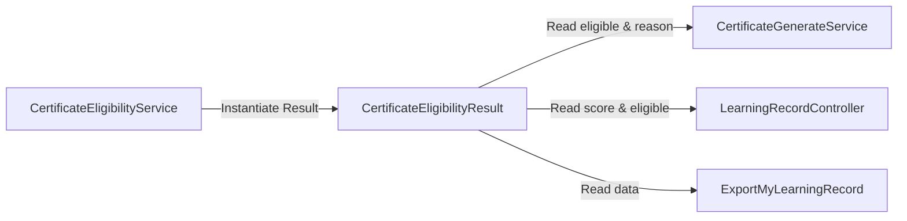

# CertificateEligibilityResult

## 1. Overview

`CertificateEligibilityResult` adalah Data Transfer Object (DTO) berstatus `final` dan *immutable* yang menjadi kontrak resmi (*canonical contract*) antar-layer di OWL untuk menyatakan hasil evaluasi kelayakan sertifikat. Objek ini menggantikan array asosiatif bebas (*untyped associative arrays*) yang sebelumnya rentan terhadap typo nama field atau *implicit null* saat data diteruskan dari Service menuju Controller, Export, maupun view Blade.

Melalui DTO ini, layer pemanggil tidak perlu memahami logika rumit di balik kelayakan sertifikat, melainkan cukup membaca properti readonly yang telah dievaluasi secara konsisten oleh [`CertificateEligibilityService`](file:///C:/laragon/owl/docs/services/CertificateEligibilityService.md).

Class ini berlokasi langsung di folder `app/Services` dan termasuk dalam kelompok **Certificate Services**.

---

## 2. Source Location

- Path: [`app/Services/CertificateEligibilityResult.php`](file:///C:/laragon/owl/app/Services/CertificateEligibilityResult.php)
- Namespace: `App\Services`
- Class: `CertificateEligibilityResult`

---

## 3. Main Responsibility

1. **Enkapsulasi Data Kelayakan Sertifikat**: Menyimpan status boolean kelayakan (`eligible`), alasan penolakan jika tidak layak (`reason`), serta model referensi pembelajaran (`learning`).
2. **Standardisasi Nilai Asesmen Terkait (`score()`)**: Menyediakan nilai asesmen final yang benar-benar digunakan saat evaluasi (baik nilai lulus maupun skor terbaik yang gagal) untuk ditampilkan di tabel UI/Excel tanpa perhitungan ulang di level controller.
3. **Penyajian Metadata Evaluasi Asesmen**: Menyimpan flag apakah asesmen diwajibkan secara dinamis (`assessmentRequired`) dan ambang batas nilai kelulusan efektif (`minimumScore`).

---

## 4. Used By

- [`App\Services\CertificateEligibilityService`](file:///C:/laragon/owl/docs/services/CertificateEligibilityService.md): Dibuat dan dikembalikan sebagai hasil method `check()`, `checkMany()`, dan `evaluate()`.
- [`App\Services\CertificateGenerateService`](file:///C:/laragon/owl/docs/services/CertificateGenerateService.md): Membaca properti `$check->eligible`, `$check->reason`, dan relasi model untuk penerbitan sertifikat.
- [`App\Http\Controllers\LearningRecordController`](file:///C:/laragon/owl/app/Http/Controllers/LearningRecordController.php): Merender status kelayakan sertifikat, skor kuis, dan tombol klaim sertifikat pada tab Learning Record.
- [`App\Exports\ExportMyLearningRecord`](file:///C:/laragon/owl/app/Exports/ExportMyLearningRecord.php): Menentukan status ekspor kolom sertifikat Excel.

---

## 5. Dependencies

| Dependency | Type | Purpose |
|---|---|---|
| `App\Models\AssesmentResult` | Model | Menyimpan instance hasil pengerjaan kuis peserta terbaik/final |
| `App\Models\ContentUser` | Model | Menyimpan instance baris progres materi konten peserta |

---

## 6. Database Tables

DTO ini murni bertindak sebagai *value container in-memory* (tidak melakukan pembacaan atau manipulasi database secara langsung).

---

## 7. Public Methods & Properties

### Constructor Properties (PHP 8.1 Constructor Promotion)

| Property | Type | Description |
|---|---|---|
| `eligible` | `bool` (readonly) | `true` jika user berhak mengklaim/mengunduh sertifikat, `false` jika belum |
| `reason` | `?string` (readonly) | Keterangan alasan jika tidak memenuhi syarat (contoh: `'Minimum content progress has not been reached.'`) |
| `learning` | `?ContentUser` (readonly) | Model progres user (digunakan saat penerbitan sertifikat atau sorting tanggal) |
| `assessmentResult` | `?AssesmentResult` (readonly) | Hasil final terbaik pada asesmen aktif (skor lulus saat eligible, atau skor terbaik saat gagal) |
| `assessmentRequired` | `bool` (readonly) | `true` jika konten/playlist memiliki minimal 1 asesmen aktif sehingga kelulusan kuis menjadi prasyarat sertifikat |
| `minimumScore` | `?float` (readonly) | Ambang nilai lulus efektif yang diterapkan; `null` jika asesmen tidak wajib |

---

### `score(): ?int`

**Purpose**  
Mengembalikan nilai integer skor asesmen yang benar-benar dievaluasi oleh sistem untuk ditampilkan di kolom tabel UI/Export.

**Parameters**  
Tidak menerima parameter.

**Return**  
`int|null`: Nilai skor bulat, atau `null` jika tidak ada hasil final asesmen.

**Process**  
```php
return $this->assessmentResult === null || $this->assessmentResult->score === null
    ? null
    : (int) $this->assessmentResult->score;
```

---

## 8. Business Rules

1. **Single Source of Truth**: UI dan Export dilarang mengalkulasi ulang apakah user lulus atau tidak; seluruh komponen wajib membaca properti `$result->eligible`.
2. **Konsistensi Tampilan Skor**: Properti `assessmentResult` sengaja menyertakan skor terbaik walaupun user belum lulus (`eligible = false`). Hal ini menjamin angka skor di kolom "Assessment Score" tabel selalu sama persis dengan angka yang dievaluasi sistem.
3. **Fail-Fast Typing**: Karena menggunakan kelas bertipe ketat (*typed properties*), kesalahan nama variabel atau tipe data akan langsung melempar exception saat kompilasi/runtime dan tidak menyebabkan kesalahan data yang terselubung.

---

## 9. Data Flow



---

## 10. Important Conditions

- Objek ini bersifat `final` dan seluruh propertinya berstatus `public readonly`, menjamin immutabilitas data pasca dievaluasi oleh `CertificateEligibilityService`.

---

## 11. Edge Cases

- **User Belum Mengerjakan Kuis**: `assessmentResult` bernilai `null`, method `score()` mengembalikan `null`, dan `eligible` bernilai `false` (jika asesmen diwajibkan).
- **Materi Tanpa Asesmen**: `assessmentRequired` bernilai `false`, `minimumScore` bernilai `null`, dan user dapat `eligible = true` murni berdasarkan progres materi.

---

## 12. Related Services

- [`CertificateEligibilityService`](file:///C:/laragon/owl/docs/services/CertificateEligibilityService.md): Factory pembuat DTO ini.
- [`CertificateGenerateService`](file:///C:/laragon/owl/docs/services/CertificateGenerateService.md): Konsumen DTO ini untuk validasi penerbitan sertifikat.

---

## 13. Related Models

- [`App\Models\ContentUser`](file:///C:/laragon/owl/app/Models/ContentUser.php)
- [`App\Models\AssesmentResult`](file:///C:/laragon/owl/app/Models/AssesmentResult.php)

---

## 14. Related Controllers / Commands

- [`App\Http\Controllers\LearningRecordController`](file:///C:/laragon/owl/app/Http/Controllers/LearningRecordController.php)
- [`App\Http\Controllers\UserCertificateController`](file:///C:/laragon/owl/app/Http/Controllers/UserCertificateController.php)

---

## 15. Known Risks / Maintenance Notes

- Jangan mengubah nama properti publik atau tipe data tanpa memeriksa pemanggilan di Blade view tab Learning Record (`learning_record.blade.php`) dan file Export Excel.

---

## 16. Safe Modification Guide

- Jika membutuhkan informasi tambahan pada sertifikat (misalnya: masa berlaku sertifikat atau tanggal kelulusan), tambahkan properti baru berstatus `public readonly ?T $newProperty = null` di constructor DTO ini.

---

## 17. Testing / Verification

Verifikasi class ini tercakup dalam unit dan feature test:
- [`tests/Feature/CertificateEligibilityServiceResolverTest.php`](file:///C:/laragon/owl/tests/Feature/CertificateEligibilityServiceResolverTest.php)

Jalankan test via terminal:
```bash
php artisan test --filter=CertificateEligibilityServiceResolverTest
```

---

## 18. Handover Summary

- DTO kontrak data kelayakan sertifikat yang immutable dan tipe-aman.
- Mengirimkan keputusan eligible, alasan penolakan, model progres belajar, skor asesmen, dan passing grade.
