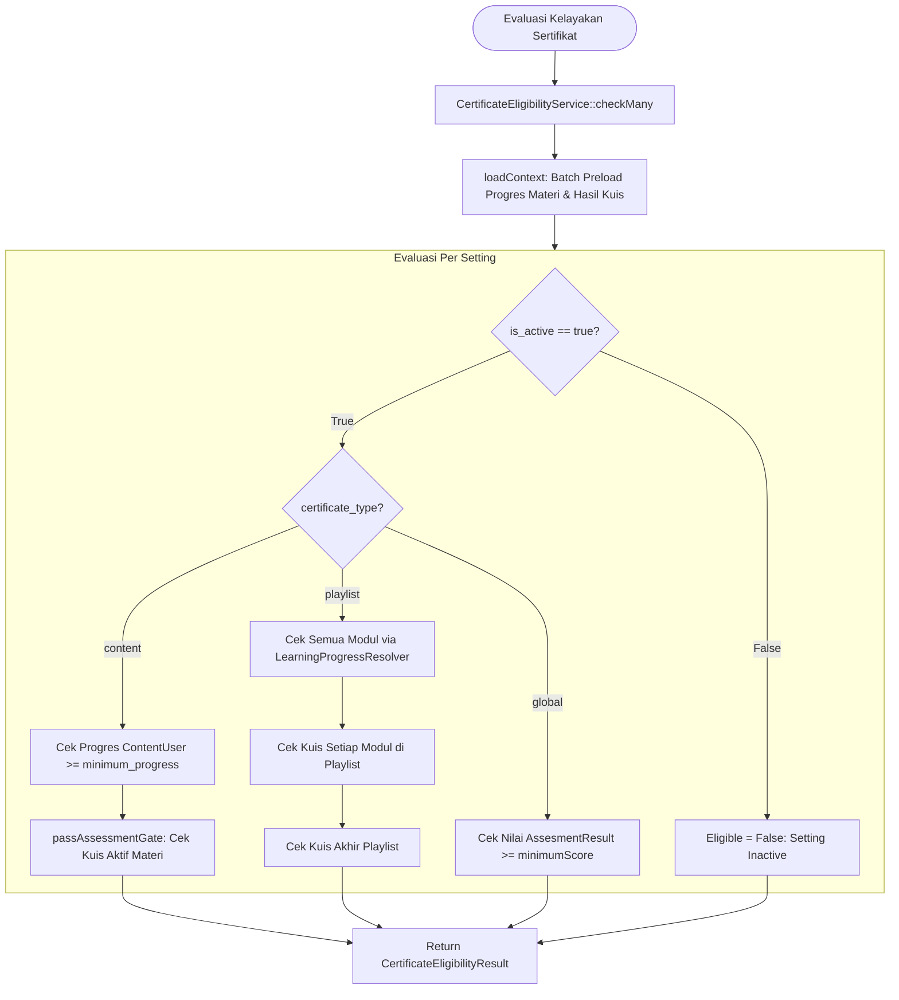

# CertificateEligibilityService

## 1. Overview

`CertificateEligibilityService` adalah *single source of truth* penentu kelayakan sertifikat (*certificate eligibility engine*) di seluruh sistem OWL. Service ini bertugas mengevaluasi apakah seorang user berhak mendapatkan atau mengklaim sertifikat kelulusan untuk materi mandiri (*Content*), kurikulum berseri (*Playlist/Training Plan*), maupun ujian terpusat (*Global Assessment*).

Salah satu perbaikan arsitektural utama pada service ini adalah **Deteksi Kuis Otomatis Berbasis Relasi Data**:
- Sistem tidak lagi bergantung pada flag statis `is_assessment_required` di tabel `certificate_settings`.
- Sebagai gantinya, sistem mendeteksi secara live: jika sebuah konten atau playlist memiliki minimal 1 asesmen aktif (`status != 'NOT'`), maka asesmen tersebut **otomatis menjadi syarat kelulusan sertifikat**. User harus lulus **salah satu** kuis aktif tersebut (post-test atau remedial-nya). Jika materi tidak memiliki kuis aktif, sertifikat cukup mensyaratkan pencapaian progres materi (*progress-only*).

Semua evaluasi dikembalikan dalam bentuk DTO resmi [`CertificateEligibilityResult`](file:///C:/laragon/owl/docs/services/CertificateEligibilityResult.md).

Service ini berada langsung di direktori `app/Services` dan termasuk dalam kelompok **Certificate Services**.

---

## 2. Source Location

- Path: [`app/Services/CertificateEligibilityService.php`](file:///C:/laragon/owl/app/Services/CertificateEligibilityService.php)
- Namespace: `App\Services`
- Class: `CertificateEligibilityService`

---

## 3. Main Responsibility

1. **Evaluasi Kelayakan Tunggal (`check`)**: Mengevaluasi 1 konfigurasi sertifikat untuk seorang user.
2. **Evaluasi Massal Bebas N+1 (`checkMany`)**: Memuat seluruh progres materi dan hasil kuis user dalam 1 kali *batch query* terpadu (*context preloading*), sehingga aman digunakan untuk memproses puluhan hingga ratusan sertifikat pada halaman Learning Record.
3. **Kalkulasi Progres Kuis Playlist (`contentAssessmentProgress`)**: Menghitung persentase kuis materi yang sudah diselesaikan peserta di dalam sebuah playlist.
4. **Gerbang Kelulusan Kuis Fleksibel (`passAssessmentGate`)**: Mengevaluasi apakah peserta telah lulus ambang batas nilai kuis, serta memilih skor terbaik untuk ditampilkan di antarmuka.

---

## 4. Used By

- [`App\Services\CertificateGenerateService`](file:///C:/laragon/owl/docs/services/CertificateGenerateService.md): Memvalidasi hak akses sebelum menerbitkan nomor sertifikat resmi.
- [`App\Http\Controllers\LearningRecordController`](file:///C:/laragon/owl/app/Http/Controllers/LearningRecordController.php):
  - Method `partial()` dan `certificateContext()`: Menampilkan daftar sertifikat yang siap diklaim (*Certificate Ready*) pada tab My Learning Record.
- [`App\Http\Controllers\LearningController`](file:///C:/laragon/owl/app/Http/Controllers/LearningController.php):
  - Method `dashboardPartial()`: Render tab dashboard pencapaian sertifikat user.
- [`App\Http\Controllers\PlaylistUserController`](file:///C:/laragon/owl/app/Http/Controllers/PlaylistUserController.php):
  - Method `view()`: Menampilkan status kelayakan sertifikat playlist dan progress kuis modul di sidebar.
- [`App\Exports\ExportMyLearningRecord`](file:///C:/laragon/owl/app/Exports/ExportMyLearningRecord.php):
  - Mengisi kolom kelayakan sertifikat pada ekspor laporan Excel.

---

## 5. Dependencies

| Dependency | Type | Purpose |
|---|---|---|
| `App\Services\Learning\LearningProgressResolver` | Service | Mengambil status penyelesaian materi playlist per modul via `resolvePlaylistBatch()` |
| `App\Models\CertificateSetting` | Model | Konfigurasi syarat sertifikat (minimum progress, minimum score, status aktif) |
| `App\Models\User` | Model | Identitas peserta yang dievaluasi |
| `App\Models\Assesment` | Model | Entity kuis yang terasosiasi dengan materi atau playlist |
| `App\Models\AssesmentResult` | Model | Entity nilai submit kuis final user |
| `App\Models\ContentUser` | Model | Entity progres belajar materi mandiri |
| `Illuminate\Support\Carbon` | Library | Evaluasi tanggal kedaluwarsa akses kuis |

---

## 6. Database Tables

| Table | Operation | Purpose |
|---|---|---|
| `certificate_settings` | READ | Membaca konfigurasi sertifikat materi/playlist |
| `content_users` | READ | Memeriksa progres materi mandiri (`progress >= minimum_progress`) |
| `playlist_content_users` | READ | Diperiksa secara internal via `LearningProgressResolver` |
| `assesments` | READ | Deteksi otomatis kuis aktif yang terhubung ke `content_id` atau `trainingplan_id` |
| `assesment_results` | READ | Mengambil nilai kuis berstatus submit (`final = 1`) terbaik user |
| `trainingplan_details` | READ | Mengambil daftar materi konten yang tergabung dalam playlist |

---

## 7. Public Methods

### `check(CertificateSetting $setting, User $user): CertificateEligibilityResult`

**Purpose**  
Mengevaluasi kelayakan sebuah konfigurasi sertifikat untuk seorang user.

**Parameters**  
- `$setting` (`CertificateSetting`): Konfigurasi sertifikat target.
- `$user` (`User`): Model user yang diperiksa.

**Return**  
`CertificateEligibilityResult`: Objek status kelayakan.

**Process**  
Membungkus `$setting` ke dalam collection tunggal dan memanggil `checkMany()`.

---

### `checkMany(Collection $settings, User $user): array`

**Purpose**  
Mengevaluasi banyak setting sertifikat sekaligus secara massal tanpa masalah N+1 query.

**Parameters**  
- `$settings` (`Collection<int, CertificateSetting>`): Kumpulan setting sertifikat.
- `$user` (`User`): Model user.

**Return**  
`array<int, CertificateEligibilityResult>`: Map dengan kunci `setting->id` mengarah ke hasil evaluasi.

**Process**  
1. Panggil `loadContext($settings, $user)`:
   - Ambil seluruh `content_id` dan `trainingplan_id` dari kumpulan setting.
   - Muat seluruh `ContentUser` terkait user dalam 1 query.
   - Selesaikan progres modul playlist via `$this->resolver->resolvePlaylistBatch()`.
   - Deteksi seluruh `Assesment` terkait materi dan playlist tersebut.
   - Ambil seluruh `AssesmentResult` final (`final = 1`) milik user yang relevan, urutkan skor tertinggi dan ID terbaru (`orderByDesc('score')->orderByDesc('id')`).
2. Iterasi setiap `$setting`:
   - Jika `!$setting->is_active`: tolak dengan alasan `'Certificate setting is inactive.'`.
   - Dispatch ke evaluator berdasarkan `certificate_type`:
     - `'content'` $\to$ `evaluateContent()`
     - `'playlist'` $\to$ `evaluatePlaylist()`
     - `'global'` $\to$ `evaluateGlobal()`
3. Simpan dan kembalikan array hasil per setting ID.

---

### `getAssessmentResult(CertificateSetting $setting, User $user)`

**Purpose**  
Mengambil hasil asesmen final terbaik user untuk setting yang memiliki `assessment_id` eksplisit (tipe global).

---

### `contentAssessmentProgress(Collection $contentIds, User $user, ?CertificateSetting $setting = null, ?int $trainingPlanId = null): array`

**Purpose**  
Membantu tampilan kurikulum playlist dengan menghitung jumlah dan persentase kuis materi yang sudah diselesaikan peserta.

**Return**  
`array`: Berisi `total`, `completed`, `percentage`, dan `assessmentsByContent`.

---

## 8. Business Rules

1. **Deteksi Asesmen Otomatis**:
   - Jika entitas (Content/Playlist) memiliki minimal 1 kuis dengan `status != 'NOT'` dan masa berlaku belum lewat (`isAssessmentActiveForEntity = true`), maka kelulusan kuis adalah **syarat mutlak**.
   - Jika tidak ada kuis aktif sama sekali, sertifikat **hanya mensyaratkan progres belajar** ($\ge \text{minimum\_progress}$).
2. **Aturan Kelulusan Kuis Multi-Asesmen / Remedial**:
   - Jika sebuah materi memiliki kuis utama dan kuis remedial (disimpan sebagai baris terpisah di tabel `assesments`), peserta dianggap memenuhi syarat jika lulus **salah satu di antaranya** (`passAssessmentGate`).
3. **Syarat Playlist Berseri**:
   - Seluruh modul materi di playlist wajib mencapai `minimum_progress` atau berstatus `isFinished()` (diperiksa via `LearningProgressResolver`).
   - Seluruh kuis materi di dalam playlist yang aktif wajib lulus.
   - Kuis akhir tingkat playlist (tipe `trainingplan`) yang aktif juga wajib lulus.
4. **Passing Grade Hierarki**:
   - Ambang kelulusan kuis ditentukan berurutan: `CertificateSetting.minimum_score` $\to$ `Assesment.passing_grade` $\to$ default sistem `80`.

---

## 9. Data Flow



---

## 10. Important Conditions

```php
// Deteksi kuis aktif untuk suatu entitas
private function isAssessmentActiveForEntity(Collection $assessments): bool
{
    // Jika kuis terbaru berstatus NOT -> Admin menonaktifkan kuis
    $latest = $assessments->sortByDesc('id')->first();
    if (!$latest || strtoupper(trim((string) ($latest->status ?? ''))) === 'NOT') {
        return false;
    }
    // Jika tidak ada yang OK dan belum kedaluwarsa -> OFF
    ...
}
```
- **Kondisi**: Jika admin menonaktifkan kuis (`status = 'NOT'`), kuis tersebut tidak memblokir peserta untuk mengklaim sertifikat berdasarkan progres menonton.

---

## 11. Edge Cases

1. **User Lulus Sebelum Kuis Dinonaktifkan**: Jika kuis kini nonaktif tetapi user pernah lulus di masa lalu, hasil kelulusan historis tersebut tetap disertakan di `CertificateEligibilityResult`.
2. **Playlist Tanpa Materi**: Jika playlist kosong dari konten, langsung ditolak dengan alasan `'Playlist has no content.'`.
3. **Kuis Memiliki Batas Waktu Kadaluarsa (`todate`)**: Kuis yang sudah lewat batas waktu tidak lagi menjadi penghalang kelulusan sertifikat jika statusnya kedaluwarsa.

---

## 12. Related Services

- [`LearningProgressResolver`](file:///C:/laragon/owl/docs/services/learning/LearningProgressResolver.md): Sumber data keabsahan progres modul playlist.
- [`CertificateEligibilityResult`](file:///C:/laragon/owl/docs/services/CertificateEligibilityResult.md): DTO hasil kalkulasi service ini.
- [`CertificateGenerateService`](file:///C:/laragon/owl/docs/services/CertificateGenerateService.md): Memanggil service ini untuk validasi penerbitan.
- [`CertificateSyncService`](file:///C:/laragon/owl/docs/services/CertificateSyncService.md): Memastikan record `CertificateSetting` selalu ada di database.

---

## 13. Related Models

- [`App\Models\CertificateSetting`](file:///C:/laragon/owl/app/Models/CertificateSetting.php)
- [`App\Models\ContentUser`](file:///C:/laragon/owl/app/Models/ContentUser.php)
- [`App\Models\Assesment`](file:///C:/laragon/owl/app/Models/Assesment.php)
- [`App\Models\AssesmentResult`](file:///C:/laragon/owl/app/Models/AssesmentResult.php)
- [`App\Models\TrainingPlan`](file:///C:/laragon/owl/app/Models/TrainingPlan.php)

---

## 14. Related Controllers / Commands

- [`App\Http\Controllers\LearningRecordController`](file:///C:/laragon/owl/app/Http/Controllers/LearningRecordController.php)
- [`App\Http\Controllers\LearningController`](file:///C:/laragon/owl/app/Http/Controllers/LearningController.php)
- [`App\Http\Controllers\PlaylistUserController`](file:///C:/laragon/owl/app/Http/Controllers/PlaylistUserController.php)
- [`App\Exports\ExportMyLearningRecord`](file:///C:/laragon/owl/app/Exports/ExportMyLearningRecord.php)

---

## 15. Known Risks / Maintenance Notes

- **Query `loadContext` pada Daftar Besar**: Di halaman Learning Record, pastikan `$settings` yang diteruskan ke `checkMany` sudah difilter hanya untuk setting yang relevan (misalnya milik konten/playlist yang pernah diikuti user) guna menjaga performa SQL.
- **Konsistensi Konteks Kuis Playlist**: Asesmen modul di playlist wajib memiliki `assasment_content_for = 'playlist'` dan `trainingplan_id` yang sesuai agar tidak tertukar dengan kuis materi mandiri.

---

## 16. Safe Modification Guide

1. **Jika Menyesuaikan Syarat Kelulusan Playlist**: Jangan memotong verifikasi per modul; seluruh modul di playlist harus dipastikan berstatus selesai agar sertifikat kurikulum tetap bernilai valid secara akademik.
2. **Jangan Menggunakan Kolom `is_assessment_required` Secara Manual**: Logika auto-detect di method `isAssessmentActiveForEntity()` adalah desain inti yang sudah menggantikan flag manual tersebut.

---

## 17. Testing / Verification

Automated test untuk memverifikasi service ini:
- [`tests/Feature/CertificateEligibilityServiceResolverTest.php`](file:///C:/laragon/owl/tests/Feature/CertificateEligibilityServiceResolverTest.php)
- [`tests/Feature/MyLearningCertificateFilterExportTest.php`](file:///C:/laragon/owl/tests/Feature/MyLearningCertificateFilterExportTest.php)
- [`tests/Feature/PlaylistCertificateDebugPreviewTest.php`](file:///C:/laragon/owl/tests/Feature/PlaylistCertificateDebugPreviewTest.php)

Jalankan pengujian via command:
```bash
php artisan test --filter=CertificateEligibilityServiceResolverTest
```

---

## 18. Handover Summary

- Engine tunggal penentu kelayakan sertifikat (*single source of truth*).
- Menghadirkan deteksi kuis otomatis: wajib kuis jika ada yang aktif, cukup progres materi jika kuis nonaktif/tidak ada.
- Menangani evaluasi massal bebas N+1 via `checkMany()`, mendukung tipe Content, Playlist, dan Global.
