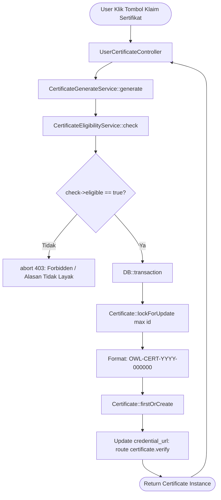

# CertificateGenerateService

## 1. Overview

`CertificateGenerateService` adalah service penerbit (*issuance engine*) sertifikat digital di sistem OWL. Service ini bertugas memvalidasi kelayakan peserta sebelum menerbitkan entri sertifikat resmi ke dalam tabel `certificates`, menghasilkan nomor sertifikat berurutan (*sequential certificate number*), kode unik verifikasi (*credential ID*), serta tautan verifikasi online (*verification URL*).

Service ini terintegrasi erat dengan [`CertificateEligibilityService`](file:///C:/laragon/owl/docs/services/CertificateEligibilityService.md). Jika peserta belum memenuhi syarat (misalnya progres materi belum cukup atau belum lulus kuis), service ini langsung membatalkan proses dengan exception HTTP 403 (*Forbidden*).

Class ini berlokasi di direktori root Services dan tergolong dalam domain **Certificate Services**.

---

## 2. Source Location

- Path: [`app/Services/CertificateGenerateService.php`](file:///C:/laragon/owl/app/Services/CertificateGenerateService.php)
- Namespace: `App\Services`
- Class: `CertificateGenerateService`

---

## 3. Main Responsibility

1. **Otorisasi Pra-Penerbitan**: Mengecek kelayakan peserta via `CertificateEligibilityService::check()`.
2. **Penerbitan Atomik & Idempoten (`generate`)**: Menggunakan `firstOrCreate` di dalam database transaction agar seorang peserta tidak pernah mendapatkan lebih dari satu sertifikat untuk materi/playlist yang sama.
3. **Penyusunan Format Nomor Sertifikat Unik (`number`)**: Menggunakan database locking (`lockForUpdate`) untuk menghindari tabrakan nomor urut (*race condition*).
4. **Pembuatan Kredensial & Tautan Verifikasi Publik**: Menghasilkan token kredensial acak (`credential_id`) dan mengisi URL verifikasi publik untuk pembuktian keaslian sertifikat oleh pihak ketiga.

---

## 4. Used By

- [`App\Http\Controllers\UserCertificateController`](file:///C:/laragon/owl/app/Http/Controllers/UserCertificateController.php):
  - Method `generateSetting()`: Endpoint tombol klaim sertifikat berdasarkan setting ID.
  - Method `generate()`: Endpoint tombol klaim sertifikat berdasarkan objek `ContentUser`.

---

## 5. Dependencies

| Dependency | Type | Purpose |
|---|---|---|
| `App\Services\CertificateEligibilityService` | Service | Validasi pra-syarat kelayakan penerbitan |
| `App\Models\Certificate` | Model | Entity penyimpanan record sertifikat resmi |
| `App\Models\CertificateSetting` | Model | Konfigurasi sumber sertifikat dan template |
| `App\Models\User` | Model | Data peserta yang menerima sertifikat |
| `Illuminate\Support\Facades\DB` | Facade | Transaksi database dan query locking |
| `Illuminate\Support\Str` | Helper | Pembuatan string acak untuk kredensial |

---

## 6. Database Tables

| Table | Operation | Purpose |
|---|---|---|
| `certificates` | READ / INSERT / UPDATE | Membaca nomor ID tertinggi dengan lock; membuat baris sertifikat baru; memperbarui `credential_url` |
| `certificate_settings` | READ | Diperiksa melalui `CertificateEligibilityService` |
| `content_users` | READ | Menghubungkan ID progres belajar ke sertifikat |
| `assesment_results` | READ | Menghubungkan ID hasil nilai ujian ke sertifikat |

---

## 7. Public Methods

### `generate(CertificateSetting $setting, User $user): Certificate`

**Purpose**  
Menerbitkan sertifikat digital resmi untuk user berdasarkan konfigurasi sertifikat yang ditentukan.

**Parameters**  
- `$setting` (`CertificateSetting`): Konfigurasi sertifikat sumber.
- `$user` (`User`): Peserta yang mengklaim sertifikat.

**Return**  
`Certificate`: Model entitas sertifikat yang berhasil diterbitkan atau yang sudah ada sebelumnya.

**Process**  
1. **Eligibility Validation**:
   - Panggil `$check = $this->eligibility->check($setting, $user)`.
   - Jalankan `abort_unless($check->eligible, 403, $check->reason)`.
2. **Transaction & Idempotency**:
   - Masuk ke `DB::transaction`.
   - Eksekusi `Certificate::firstOrCreate`:
     - Kunci Pencarian: `['user_id' => $user->id, 'certificate_setting_id' => $setting->id, 'certificate_type' => $setting->certificate_type, 'source_id' => $setting->sourceId()]`.
     - Atribut Baru:
       - `content_user_id`: `$check->learning?->id`
       - `assessment_result_id`: `$check->assessmentResult?->id`
       - `certificate_number`: `$this->number()`
       - `credential_id`: `'OWL-' . strtoupper(Str::random(11))`
       - `title`: `$setting->sourceTitle()`
       - `participant_name`: `$user->name`
       - `score`: `$check->assessmentResult?->score`
       - `issued_at`: `now()`
3. **URL Verifikasi**:
   - Jika `credential_url` masih kosong, perbarui dengan URL rute publik: `route('certificate.verify', $certificate->credential_id)`.
4. Kembalikan instance `$certificate`.

**Side Effects**  
- Menambah baris baru di tabel `certificates` jika sertifikat baru pertama kali diklaim.

---

## 8. Business Rules

1. **Strict Gatekeeping**: Sertifikat mustahil terbit tanpa persetujuan dari `CertificateEligibilityService`. Jika peserta mencoba memanggil endpoint klaim secara manual melalui manipulasi URL/API, request akan langsung digugurkan dengan HTTP 403.
2. **Satu Sertifikat Per Entitas**: Menggunakan kunci komposit (`user_id`, `certificate_setting_id`, `certificate_type`, `source_id`). Peserta yang menekan tombol klaim berulang kali akan mendapatkan objek sertifikat yang sama tanpa membuat nomor baru.
3. **Penyimpanan Nilai Snapshot**: Nilai skor yang tersimpan pada kolom `certificates.score` adalah snapshot nilai riil saat peserta memenuhi syarat.

---

## 9. Data Flow



---

## 10. Important Conditions

```php
// Format penomoran sertifikat dengan database locking
private function number(): string
{
    $next = ((int) Certificate::lockForUpdate()->max('id')) + 1;
    return 'OWL-CERT-' . now()->format('Y') . '-' . str_pad($next, 6, '0', STR_PAD_LEFT);
}
```
- **Kondisi**: Pengambilan nomor urut sertifikat berikutnya.
- **Hasil**: Menggunakan `lockForUpdate` di dalam transaksi untuk mencegah *race condition* jika dua user mengklaim sertifikat di detik yang sama.

---

## 11. Edge Cases

1. **User Sudah Pernah Mengklaim**: `firstOrCreate` mengembalikan record lama dan nomor sertifikat yang sudah ada tidak pernah berubah.
2. **Asesmen Tidak Wajib**: Nilai `assessment_result_id` dan `score` disimpan sebagai `null` secara sah tanpa memicu error.

---

## 12. Related Services

- [`CertificateEligibilityService`](file:///C:/laragon/owl/docs/services/CertificateEligibilityService.md): Pengecek pra-syarat kelayakan.
- [`CertificateEligibilityResult`](file:///C:/laragon/owl/docs/services/CertificateEligibilityResult.md): DTO pembawa data hasil verifikasi.

---

## 13. Related Models

- [`App\Models\Certificate`](file:///C:/laragon/owl/app/Models/Certificate.php)
- [`App\Models\CertificateSetting`](file:///C:/laragon/owl/app/Models/CertificateSetting.php)
- [`App\Models\User`](file:///C:/laragon/owl/app/Models/User.php)

---

## 14. Related Controllers / Commands

- [`App\Http\Controllers\UserCertificateController`](file:///C:/laragon/owl/app/Http/Controllers/UserCertificateController.php)

---

## 15. Known Risks / Maintenance Notes

- **Format Penomoran Berdasarkan `max('id')`**: Penomoran `OWL-CERT-{YYYY}-{000000}` menggunakan auto-increment ID tabel sebagai nomor urut. Jika database pernah di-truncate atau baris dihapus, pastikan sequence ID tetap selaras dengan kebutuhan audit institusi.
- **Ketergantungan Rute Publik**: Method `generate` memanggil `route('certificate.verify', ...)`. Pastikan rute tersebut selalu terdaftar di file `routes/web.php`.

---

## 16. Safe Modification Guide

1. **Mengubah Format Nomor Sertifikat**: Modifikasi private method `number()`. Pastikan panjang string tidak melebihi kapasitas kolom `certificate_number` di tabel `certificates`.
2. **Menambah Metadata Sertifikat**: Tambahkan atribut pada array kedua di method `firstOrCreate()`.

---

## 17. Testing / Verification

Automated test untuk memverifikasi service ini:
- [`tests/Feature/CertificateGenerateServiceResolverTest.php`](file:///C:/laragon/owl/tests/Feature/CertificateGenerateServiceResolverTest.php)

Jalankan test:
```bash
php artisan test --filter=CertificateGenerateServiceResolverTest
```

---

## 18. Handover Summary

- Service ini adalah mesin pencetak sertifikat digital resmi OWL.
- Mengamankan proses penerbitan dengan validasi strict HTTP 403 via `CertificateEligibilityService`.
- Menjamin nomor urut anti-tabrakan (`lockForUpdate`) dan pembuatan tautan verifikasi kredensial publik.
