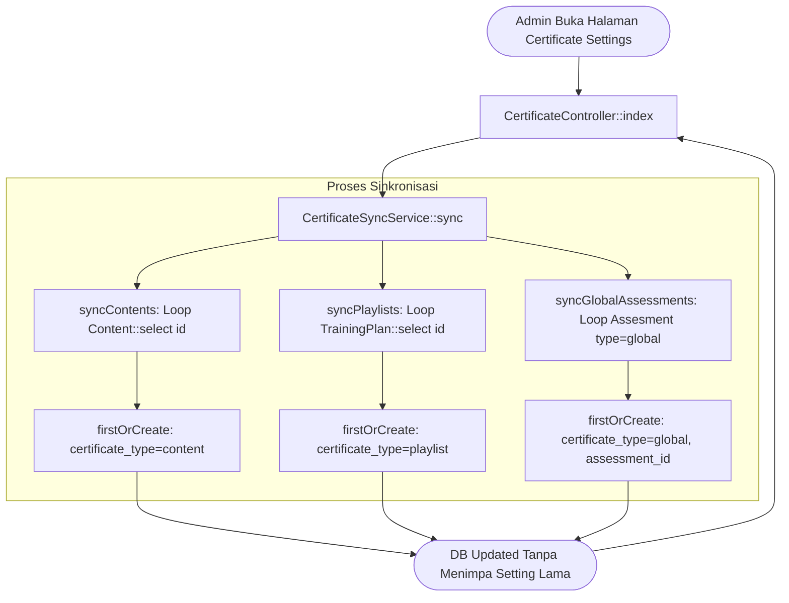

# CertificateSyncService

## 1. Overview

`CertificateSyncService` adalah service utilitas sinkronisasi dan inisialisasi konfigurasi sertifikat di OWL. Service ini bertugas memastikan setiap materi mandiri (*Content*), kurikulum berseri (*Playlist/Training Plan*), dan ujian terpusat (*Global Assessment*) yang baru dibuat memiliki baris konfigurasi padanannya di tabel `certificate_settings`.

Tanpa baris di `certificate_settings`, modul materi atau playlist tidak dapat dikonfigurasi ambang kelulusannya (minimum progress/score), nama penerbitnya (*issuer*), maupun template visual sertifikatnya oleh administrator. Service ini menjamin ketersediaan konfigurasi tersebut secara idempoten menggunakan `firstOrCreate`.

Class ini berlokasi di direktori root Services dan tergolong dalam kelompok **Certificate Services**.

---

## 2. Source Location

- Path: [`app/Services/CertificateSyncService.php`](file:///C:/laragon/owl/app/Services/CertificateSyncService.php)
- Namespace: `App\Services`
- Class: `CertificateSyncService`

---

## 3. Main Responsibility

1. **Sinkronisasi Massal Lengkap (`sync`)**: Menjalankan sinkronisasi sekuensial untuk seluruh konten, playlist, dan asesmen global.
2. **Sinkronisasi Konten Materi (`syncContents`)**: Mengiterasi seluruh materi di tabel `content` dan membuat setting sertifikat jika belum ada.
3. **Sinkronisasi Playlist Materi (`syncPlaylists`)**: Mengiterasi seluruh playlist di tabel `trainingplan` dan memastikan baris setting sertifikat tersedia.
4. **Sinkronisasi Asesmen Global (`syncGlobalAssessments`)**: Memastikan seluruh kuis bertipe `global` memiliki setting sertifikat dengan konfigurasi khusus asesmen wajib.
5. **Standarisasi Pengaturan Default (`defaults`)**: Menyediakan nilai konfigurasi awal yang seragam (minimum progres 100%, skor minimal 80, penerbit 'OWL Training Management', status aktif).

---

## 4. Used By

- [`App\Http\Controllers\CertificateController`](file:///C:/laragon/owl/app/Http/Controllers/CertificateController.php):
  - Method `index()`: Dipanggil setiap kali admin membuka halaman Manajemen Pengaturan Sertifikat untuk memastikan seluruh entitas baru otomatis terdaftar di tabel admin.

---

## 5. Dependencies

| Dependency | Type | Purpose |
|---|---|---|
| `App\Models\Content` | Model | Sumber data seluruh materi pembelajaran mandiri |
| `App\Models\TrainingPlan` | Model | Sumber data seluruh playlist kurikulum materi |
| `App\Models\Assesment` | Model | Sumber data kuis bertipe `global` |
| `App\Models\CertificateSetting` | Model | Penyimpanan baris konfigurasi sertifikat |

---

## 6. Database Tables

| Table | Operation | Purpose |
|---|---|---|
| `content` | READ | Membaca ID materi yang ada |
| `trainingplan` | READ | Membaca ID playlist kurikulum yang ada |
| `assesments` | READ | Memfilter dan membaca ID asesmen bertipe `global` |
| `certificate_settings` | READ / INSERT | Mengecek apakah setting sudah ada; membuat setting baru jika belum ada |

---

## 7. Public Methods

### `sync(): void`

**Purpose**  
Menjalankan sinkronisasi menyeluruh untuk ketiga domain entitas: Content, Playlist, dan Global Assessment.

**Parameters**  
Tidak menerima parameter.

**Return**  
`void`

**Process**  
Memanggil secara berurutan:
1. `$this->syncContents()`
2. `$this->syncPlaylists()`
3. `$this->syncGlobalAssessments()`

---

### `syncContents(): void`

**Purpose**  
Membuat pengaturan default sertifikat untuk materi konten yang belum terdaftar.

**Process**  
```php
Content::select('id')->each(function ($content) {
    CertificateSetting::firstOrCreate(
        ['certificate_type' => 'content', 'content_id' => $content->id],
        $this->defaults()
    );
});
```

---

### `syncPlaylists(): void`

**Purpose**  
Membuat pengaturan default sertifikat untuk playlist yang belum terdaftar.

**Process**  
```php
TrainingPlan::select('id')->each(function ($playlist) {
    CertificateSetting::firstOrCreate(
        ['certificate_type' => 'playlist', 'trainingplan_id' => $playlist->id],
        $this->defaults()
    );
});
```

---

### `syncGlobalAssessments(): void`

**Purpose**  
Membuat pengaturan sertifikat untuk seluruh kuis dengan `type = 'global'`.

**Process**  
```php
Assesment::where('type', 'global')->select('id')->each(function ($assessment) {
    CertificateSetting::firstOrCreate(
        ['certificate_type' => 'global', 'assessment_id' => $assessment->id],
        array_merge($this->defaults(), [
            'is_assessment_required' => true,
            'minimum_progress' => 100,
            'minimum_score' => 80,
        ])
    );
});
```

---

## 8. Business Rules

1. **Idempotensi Total**: Seluruh pembuatan menggunakan Eloquent `firstOrCreate`. Jika konfigurasi sertifikat sudah ada (dan mungkin telah dikustomisasi oleh admin, seperti mengganti nama penerbit atau template desain), nilainya tidak akan ditimpa (*preserve existing customization*).
2. **Nilai Default Seragam**:
   - `minimum_progress`: `100` (peserta wajib menyelesaikan materi penuh).
   - `minimum_score`: `80` (passing grade standar OWL).
   - `issuer_name`: `'OWL Training Management'`.
   - `use_default_template`: `true`.
   - `is_active`: `true`.
3. **Pengecualian Tipe Global**: Untuk asesmen global, flag `is_assessment_required` langsung diset `true` karena sifat kuis global berdiri sendiri (*standalone test*).

---

## 9. Data Flow



---

## 10. Important Conditions

```php
private function defaults(): array
{
    return [
        'is_assessment_required' => false,
        'minimum_progress' => 100,
        'minimum_score' => 80,
        'issuer_name' => 'OWL Training Management',
        'use_default_template' => true,
        'is_active' => true,
    ];
}
```
- **Kondisi**: Konfigurasi template bawaan.
- **Hasil**: Memastikan entitas baru langsung aktif dan siap dievaluasi kelayakannya oleh sistem.

---

## 11. Edge Cases

1. **Tabel Memiliki Ribuan Record**: Menggunakan method cursor `each()` dengan proyeksi `select('id')` saja untuk meminimalkan beban memori saat iterasi.
2. **Entitas Terhapus (*Soft Deleted*)**: Query mematuhi trait `SoftDeletes` bawaan model; konten yang sudah dihapus tidak dibuatkan setting baru.

---

## 12. Related Services

- [`CertificateEligibilityService`](file:///C:/laragon/owl/docs/services/CertificateEligibilityService.md): Membaca baris setting yang dibuat oleh service ini.
- [`CertificateGenerateService`](file:///C:/laragon/owl/docs/services/CertificateGenerateService.md): Menggunakan relasi `CertificateSetting` saat mencetak sertifikat.

---

## 13. Related Models

- [`App\Models\CertificateSetting`](file:///C:/laragon/owl/app/Models/CertificateSetting.php)
- [`App\Models\Content`](file:///C:/laragon/owl/app/Models/Content.php)
- [`App\Models\TrainingPlan`](file:///C:/laragon/owl/app/Models/TrainingPlan.php)
- [`App\Models\Assesment`](file:///C:/laragon/owl/app/Models/Assesment.php)

---

## 14. Related Controllers / Commands

- [`App\Http\Controllers\CertificateController`](file:///C:/laragon/owl/app/Http/Controllers/CertificateController.php)

---

## 15. Known Risks / Maintenance Notes

- **Overhead pada Setiap Kunjungan Index**: Saat ini `CertificateSyncService::sync()` dipanggil setiap kali admin mengakses controller `CertificateController::index`. Meskipun idempoten, jika jumlah konten bertambah hingga puluhan ribu materi, operasi loop `each()` dapat memperlambat load time halaman index. Jika ini terjadi di masa mendatang, sinkronisasi dapat dipindahkan ke Laravel Model Observer (saat event `Content::created` / `TrainingPlan::created`) atau dijadwalkan via background artisan command.

---

## 16. Safe Modification Guide

1. **Mengubah Nilai Standar Default**: Sesuaikan nilai pada private method `defaults()`. Perubahan ini hanya akan berdampak pada materi/playlist baru yang dibuat setelahnya dan tidak akan mengubah setting lama yang sudah ada di database.

---

## 17. Testing / Verification

Automated test untuk memverifikasi service ini:
- [`tests/Feature/CertificateSyncServiceResolverTest.php`](file:///C:/laragon/owl/tests/Feature/CertificateSyncServiceResolverTest.php)

Jalankan test:
```bash
php artisan test --filter=CertificateSyncServiceResolverTest
```

---

## 18. Handover Summary

- Service utilitas idempoten penjamin ketersediaan konfigurasi `CertificateSetting`.
- Menyelaraskan seluruh materi Content, kurikulum Playlist, dan kuis Global Assessment dengan nilai ambang kelulusan standar OWL.
