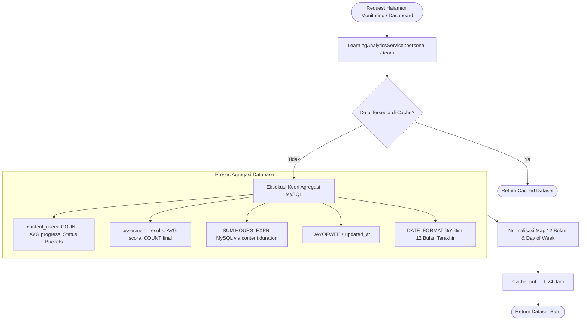

# LearningAnalyticsService

## 1. Overview

`LearningAnalyticsService` adalah service analitik dan agregasi metrik pembelajaran terpusat untuk modul pemantauan (*Learning Monitoring*) dan dasbor pengguna di OWL. Service ini mengolah data aktivitas belajar ribuan user menjadi dataset visual siap pakai, mencakup ringkasan statistik (KPI), tren aktivitas bulanan, distribusi kategori materi, tren penilaian kuis, sebaran status penyelesaian, hingga *heatmap* aktivitas mingguan.

Fitur kunci dan pertimbangan arsitektural:
- **Kueri Agregasi Murni di Level Database**: Menghindari pemuatan ribuan model Eloquent ke dalam memori PHP, melainkan mengandalkan `selectRaw`, `SUM`, `AVG`, `COUNT`, dan ekspresi native MySQL.
- **Cache Berbasis Scope (TTL 24 Jam)**: Seluruh komputasi grafik disimpan dalam layer cache Laravel (`Cache::remember`) dengan TTL 1 hari (`TTL = 86400`) untuk mencegah beban database berulang.
- **Dukungan Multi-Tingkat**: Mendukung metrik personal per user tunggal (`personal`), metrik tim/departemen berbasis filter closure (`team`), grafik grup multi-user (`groupCharts`), hingga widget ringkasan hero home (`heroSummary`).
- **Integrasi Jam Belajar Kanonikal**: Terhubung langsung ke [`LearningRecordLearningHourService`](file:///C:/laragon/owl/docs/services/learning/LearningRecordLearningHourService.md) untuk memastikan angka jam belajar pada kartu dasbor identik dengan angka di laporan resmi.

Class ini berlokasi di direktori `app/Services` dan tergolong dalam domain **Analytics & Reporting Services**.

---

## 2. Source Location

- Path: [`app/Services/LearningAnalyticsService.php`](file:///C:/laragon/owl/app/Services/LearningAnalyticsService.php)
- Namespace: `App\Services`
- Class: `LearningAnalyticsService`

---

## 3. Main Responsibility

1. **Penyusunan Dataset Analitik Personal (`personal`)**: Mengagregasi metrik belajar spesifik untuk satu user (ringkasan, kategori, tren bulanan 12 bulan terakhir, tren skor ujian, heatmap hari).
2. **Penyusunan Dataset Analitik Tim & Organisasi (`team`, `groupCharts`)**: Mengagregasi performa belajar multi-user berdasarkan closure query fleksibel (divisi, tim, atau seluruh perusahaan) beserta daftar *Top Learners*.
3. **Penyedia Data Hero Home & Global Badge (`heroSummary`, `ongoingLearningCount`)**: Menyediakan total kursus selesai, kursus berjalan, dan jam belajar untuk banner utama beranda dan badge notifikasi navigasi navbar (`AppServiceProvider`).
4. **Invalidasi Cache Spesifik (`forgetPersonal`)**: Menghapus cache analitik personal saat data user mengalami pembaruan signifikan.

---

## 4. Used By

- [`App\Http\Controllers\HomeUserController`](file:///C:/laragon/owl/app/Http/Controllers/HomeUserController.php):
  - Method `index()`: Memanggil `heroSummary()` untuk menampilkan metrik di hero section beranda user.
- [`App\Http\Controllers\LearningMonitoringController`](file:///C:/laragon/owl/app/Http/Controllers/LearningMonitoringController.php):
  - Endpoint monitoring tim/organisasi dan profil analitik personal karyawan.
- [`App\Http\Controllers\MonitoringController`](file:///C:/laragon/owl/app/Http/Controllers/MonitoringController.php):
  - Injeksi konstruktor untuk halaman monitoring eksekutif.
- [`App\Http\Controllers\LearningController`](file:///C:/laragon/owl/app/Http/Controllers/LearningController.php):
  - Pengambilan jam belajar dan progres di tab My Learning.
- [`App\Http\Controllers\ContentUserController`](file:///C:/laragon/owl/app/Http/Controllers/ContentUserController.php):
  - Rendering widget analitik materi.
- [`App\Providers\AppServiceProvider`](file:///C:/laragon/owl/app/Providers/AppServiceProvider.php):
  - Method `boot()`: Memanggil `ongoingLearningCount()` untuk menampilkan angka badge materi yang sedang berjalan di menu navigasi layout aplikasi.

---

## 5. Dependencies

| Dependency | Type | Purpose |
|---|---|---|
| `App\Services\Learning\LearningHourService` | Service | Service kalkulasi jam belajar dasar |
| `App\Services\Learning\LearningRecordLearningHourService` | Service | Sumber kanonikal kalkulasi total jam belajar aktual 4 desimal |
| `App\Models\ContentUser` | Model | Agregasi progres, status selesai (`finish`), dan timestamp interaksi materi |
| `App\Models\AssesmentResult` | Model | Agregasi rata-rata nilai kuis dan total kuis yang diselesaikan |
| `App\Models\Certificate` | Model | Menghitung total sertifikat yang telah diraih user |
| `Illuminate\Support\Facades\Cache` | Facade | Caching dataset hasil komputasi berat |
| `Illuminate\Support\Facades\DB` | Facade | Query builder agregasi mentah, JOIN multi-tabel, dan `selectRaw` |
| `Illuminate\Support\Carbon` | Library | Normalisasi deret waktu 12 bulan dan hari dalam sepekan |

---

## 6. Database Tables

| Table | Operation | Purpose |
|---|---|---|
| `content_users` | READ | Menghitung total materi, progres rata-rata, status selesai, dan aktivitas bulanan |
| `content` | READ | Menghubungkan tipe konten, durasi materi, dan relasi klasifikasi (hanya record non-deleted) |
| `classification` | READ | Pengelompokan materi berdasarkan kategori/klasifikasi |
| `assesments` | READ | Identifikasi kuis materi/playlist |
| `assesment_results` | READ | Menghitung rata-rata skor (`AVG(score)`) dan total pengerjaan kuis |
| `certificates` | READ | Menghitung jumlah perolehan sertifikat |
| `users` | READ | Subquery penentuan audiens tim dan pengambilan metadata nama/NIP (*Top Learners*) |

---

## 7. Public Methods

### `personal(int $userId): array`

**Purpose**  
Mengambil paket dataset grafik lengkap untuk dasbor analitik personal user (disimpan di cache 24 jam).

**Parameters**  
- `$userId` (`int`): ID user target.

**Return**  
`array`: Berisi kunci:
`summary`, `category`, `monthly_activity`, `completion_trend`, `assessment_trend`, `type_distribution`, `status_distribution`, `top_categories`, `weekly_heatmap`, `hours_trend`.

---

### `team(string $cacheKey, \Closure $idsFactory): array`

**Purpose**  
Mengagregasi metrik performa tim/organisasi berdasarkan closure query audiens.

**Parameters**  
- `$cacheKey` (`string`): Kunci unik pengenal cakupan (contoh: `'team_it'`).
- `$idsFactory` (`\Closure`): Fungsi tanpa parameter yang mengembalikan fresh query builder `User`.

**Return**  
`array`: Berisi `summary`, `progress_distribution`, `top_learners`, `monthly_activity`.

---

### `groupCharts(string $cacheKey, \Closure $idsFactory): array`

**Purpose**  
Menghasilkan struktur grafik grup multi-user dengan skema kunci yang identik dengan output `personal()` sehingga dapat dirender oleh komponen Blade yang sama.

---

### `userLearningHours(int $userId): float`

**Purpose**  
Mengambil total jam belajar kanonikal seorang user yang bersumber langsung dari `LearningRecordLearningHourService::getTotalLearningHours()`.

---

### `ongoingLearningCount(int $userId): int`

**Purpose**  
Menghitung total materi berstatus `finish = '0'` yang kontennya masih aktif dan tersedia (scope `withAvailableContent()`). Digunakan untuk counter badge navbar.

---

### `heroSummary(int $userId): array`

**Purpose**  
Menyediakan ringkasan cepat untuk Hero Section beranda: daftar kursus, total kursus selesai, kursus ongoing, dan total jam belajar.

---

### `forgetPersonal(int $userId): void`

**Purpose**  
Menghapus kunci cache `learning_analytics_personal_{$userId}`.

---

## 8. Business Rules

1. **Konversi Jam Native MySQL (`HOURS_EXPR`)**:
   - Format `HH:MM:SS` dikonversi via `TIME_TO_SEC(duration) / 3600`.
   - Format `MM:SS` dikonversi via `TIME_TO_SEC(CONCAT('00:', duration)) / 3600`.
   - Durasi tidak valid menghasilkan 0.
2. **Rentang Tren 12 Bulan Kontinu (`mapMonthly`)**:
   - Menghasilkan deret 12 bulan ke belakang dari bulan berjalan. Bulan yang tidak memiliki aktivitas tetap diisi dengan nilai `0` agar sumbu-X grafik tidak terputus.
3. **Penyortiran Top Learners**:
   - Diurutkan berdasarkan jumlah materi yang selesai (`finished DESC`), disusul oleh rata-rata progres belajar (`avg_progress DESC`), dibatasi maksimal 10 peserta.
4. **Distribusi Status Progres**:
   - `Completed`: `finish = '1'` ATAU `progress >= 100`.
   - `Ongoing`: `finish = '0'` DAN `progress BETWEEN 1 AND 99`.
   - `Not Started / Pending`: `finish = '0'` DAN `progress = 0`.

---

## 9. Data Flow



---

## 10. Important Conditions

```php
// SQL Expression untuk kalkulasi durasi jam belajar di MySQL
CASE
    WHEN LENGTH(content.duration) - LENGTH(REPLACE(content.duration, ':', '')) = 2
    THEN TIME_TO_SEC(content.duration) / 3600
    WHEN LENGTH(content.duration) - LENGTH(REPLACE(content.duration, ':', '')) = 1
    THEN TIME_TO_SEC(CONCAT('00:', content.duration)) / 3600
    ELSE 0
END
```
- **Kondisi**: Deteksi jumlah tanda pemisah titik dua (`:`) pada string durasi konten.
- **Hasil**: Menjamin query SUM jam belajar berjalan secepat kilat langsung di dalam server MySQL tanpa membebani PHP.

---

## 11. Edge Cases

1. **User Baru Tanpa Aktivitas**: Seluruh agregasi menghasilkan `0`, daftar kategori menghasilkan array kosong, dan grafik 12 bulan berisi angka 0 datar tanpa menimbulkan error division by zero.
2. **Durasi Konten Kosong atau Rusak**: Ekspresi SQL menangani fallback ke `0` secara aman.

---

## 12. Related Services

- [`LearningRecordLearningHourService`](file:///C:/laragon/owl/docs/services/learning/LearningRecordLearningHourService.md): Sumber kanonikal kalkulasi total jam belajar riil.
- [`LearningHourService`](file:///C:/laragon/owl/docs/services/learning/LearningHourService.md): Kalkulator jam belajar diskrit dasar.

---

## 13. Related Models

- [`App\Models\ContentUser`](file:///C:/laragon/owl/app/Models/ContentUser.php)
- [`App\Models\Content`](file:///C:/laragon/owl/app/Models/Content.php)
- [`App\Models\AssesmentResult`](file:///C:/laragon/owl/app/Models/AssesmentResult.php)
- [`App\Models\Certificate`](file:///C:/laragon/owl/app/Models/Certificate.php)
- [`App\Models\User`](file:///C:/laragon/owl/app/Models/User.php)

---

## 14. Related Controllers / Commands

- [`App\Http\Controllers\HomeUserController`](file:///C:/laragon/owl/app/Http/Controllers/HomeUserController.php)
- [`App\Http\Controllers\LearningMonitoringController`](file:///C:/laragon/owl/app/Http/Controllers/LearningMonitoringController.php)
- [`App\Http\Controllers\MonitoringController`](file:///C:/laragon/owl/app/Http/Controllers/MonitoringController.php)
- [`App\Providers\AppServiceProvider`](file:///C:/laragon/owl/app/Providers/AppServiceProvider.php)

---

## 15. Known Risks / Maintenance Notes

- **TTL Cache 24 Jam**: Karena cache disetel 1 hari (`self::TTL = 86400`), jika seorang peserta baru saja menyelesaikan modul belajar, grafik analitik personal di halaman monitoring mungkin belum langsung terbarukan sebelum cache kedaluwarsa atau `forgetPersonal($userId)` dipanggil secara eksplisit.
- **Dua Rumus Jam Belajar**: Grafik tren jam belajar bulanan (`hoursTrend`) menggunakan estimasi durasi konten via SQL expression `HOURS_EXPR`, sedangkan kartu total jam belajar (`userLearningHours`) menggunakan total actual continuous jam belajar dari `LearningRecordLearningHourService`. Hal ini disengaja untuk menjaga kecepatan render grafik tanpa batch loop yang berat.

---

## 16. Safe Modification Guide

1. **Jika Menambah Metrik Baru pada `personal()`**: Selalu sediakan padanannya pada `groupCharts()` agar komponen grafik Blade serbaguna tidak mengalami *undefined key* saat menampilkan tampilan tim/organisasi.
2. **Jangan Mengubah TTL Cache Menjadi 0 di Production**: Pengecekan tanpa cache akan memicu puluhan query agregasi berat setiap kali user membuka beranda.

---

## 17. Testing / Verification

Automated test yang memverifikasi service ini:
- [`tests/Feature/LearningRecordCanonicalTotalTest.php`](file:///C:/laragon/owl/tests/Feature/LearningRecordCanonicalTotalTest.php)

Jalankan test:
```bash
php artisan test --filter=LearningRecordCanonicalTotalTest
```

---

## 18. Handover Summary

- Service analitik performa pembelajaran dengan fokus performa tinggi dan caching terintegrasi.
- Menggunakan kalkulasi agregasi SQL native tanpa memuat koleksi model raksasa ke memori PHP.
- Melayani analitik personal, tim, grup organisasi, serta widget counter navbar global.
