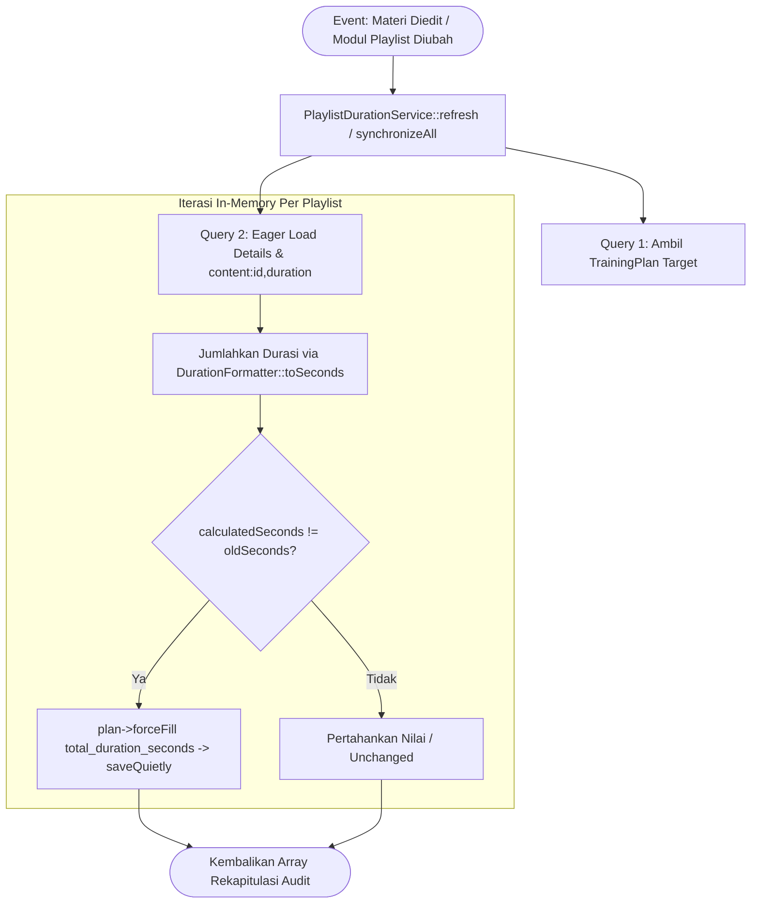

# PlaylistDurationService

## 1. Overview

`PlaylistDurationService` adalah service pemelihara integritas data durasi playlist di OWL. Service ini bertugas mengkalkulasi ulang dan menyinkronkan kolom `trainingplan.total_duration_seconds` (akumulasi total detik dari seluruh materi konten yang tergabung dalam sebuah kurikulum playlist).

Di OWL, setiap materi pembelajaran memiliki durasi masing-masing (format `HH:MM:SS` atau `MM:SS`). Saat materi ditambahkan, diubah durasinya, atau dihapus dari playlist, kolom `total_duration_seconds` pada tabel `trainingplan` harus diperbarui agar antarmuka pengguna dapat menampilkan estimasi total waktu belajar playlist secara akurat dan instan tanpa harus menghitung ulang setiap kali halaman dibuka (*precalculated cache column*).

Service ini berlokasi di direktori root Services dan tergolong dalam **Utility & Core Services**.

---

## 2. Source Location

- Path: [`app/Services/PlaylistDurationService.php`](file:///C:/laragon/owl/app/Services/PlaylistDurationService.php)
- Namespace: `App\Services`
- Class: `PlaylistDurationService`

---

## 3. Main Responsibility

1. **Sinkronisasi Reaktif Berbasis Materi Konten (`refreshForContent`)**: Menemukan seluruh playlist yang memuat konten tertentu lalu memperbarui durasi seluruh playlist tersebut saat materi diedit.
2. **Sinkronisasi Playlist Tunggal & Terpilih (`refresh`, `refreshMany`)**: Memperbarui satu atau sekumpulan playlist secara efisien.
3. **Kalkulasi & Sinkronisasi Massal Teroptimasi (`synchronizeAll`)**: Memproses seluruh playlist di sistem (atau subset ID yang ditentukan) menggunakan strategi eager loading 2 query untuk mencegah N+1, melakukan dirty-checking, dan menyimpan perubahan via `saveQuietly()`.

---

## 4. Used By

- [`App\Models\TrainingPlanDetail`](file:///C:/laragon/owl/app/Models/TrainingPlanDetail.php):
  - Model events (`created`, `deleted`): Otomatis memicu `refresh()` saat item materi ditambahkan atau dikeluarkan dari playlist.
- [`App\Models\Content`](file:///C:/laragon/owl/app/Models/Content.php):
  - Model event (`saved` / `deleted`): Memicu pembaruan playlist terkait via `refreshMany()`.
- [`App\Http\Controllers\ContentController`](file:///C:/laragon/owl/app/Http/Controllers/ContentController.php):
  - Method update materi memanggil `refreshForContent()` ketika admin mengubah durasi video/dokumen.
- [`App\Http\Controllers\TrainingPlanController`](file:///C:/laragon/owl/app/Http/Controllers/TrainingPlanController.php):
  - Method update/reorder modul playlist memanggil `refresh()`.
  - Method `synchronizeDurations()`: Endpoint AJAX tombol sinkronisasi manual di panel admin.

---

## 5. Dependencies

| Dependency | Type | Purpose |
|---|---|---|
| `App\Models\TrainingPlan` | Model | Entity playlist kurikulum materi target pembaruan |
| `App\Models\TrainingPlanDetail` | Model | Pivot table yang memetakan relasi ke materi konten |
| `App\Support\DurationFormatter` | Helper | Parser string durasi (`HH:MM:SS`) ke total detik (`toSeconds`) dan sebaliknya (`fromSeconds`) |

---

## 6. Database Tables

| Table | Operation | Purpose |
|---|---|---|
| `trainingplan` | READ / UPDATE | Membaca data playlist; memperbarui kolom `total_duration_seconds` via `saveQuietly()` |
| `trainingplan_details` | READ | Mengambil daftar materi yang tergabung dalam setiap playlist |
| `content` | READ | Mengambil kolom `duration` materi via eager loading lean (`select('id', 'duration')`) |

---

## 7. Public Methods

### `refreshForContent(int $contentId): void`

**Purpose**  
Mencari seluruh playlist yang memuat materi `$contentId` lalu menyinkronkan durasinya.

**Parameters**  
- `$contentId` (`int`): ID materi yang durasinya berubah.

**Process**  
1. Ambil daftar `trainingplan_id` dari `TrainingPlanDetail::where('content_id', $contentId)->pluck('trainingplan_id')`.
2. Teruskan ke `refreshMany($planIds)`.

---

### `refresh(int $trainingPlanId): void`

**Purpose**  
Menyinkronkan total durasi untuk satu playlist tertentu.

---

### `refreshMany(iterable $trainingPlanIds): void`

**Purpose**  
Menyinkronkan total durasi untuk sekumpulan ID playlist.

---

### `synchronizeAll(?iterable $trainingPlanIds = null): array`

**Purpose**  
Menghitung ulang dan menyinkronkan nilai `total_duration_seconds` untuk seluruh (atau daftar terpilih) playlist dengan performa tinggi.

**Parameters**  
- `$trainingPlanIds` (`iterable<int>|null`): Kumpulan ID playlist spesifik, atau `null` untuk memproses seluruh playlist yang ada di database.

**Return**  
`array`: Laporan audit hasil sinkronisasi:
```php
[
    'total_playlists' => int,
    'updated'         => int,
    'unchanged'       => int,
    'total_materials' => int,
    'durations'       => array, // rincian per playlist (old_seconds, new_seconds, updated)
]
```

**Process**  
1. Ambil record playlist target via `$planQuery->get()`. Jika kosong, kembalikan array nol.
2. Ambil seluruh detail pivot beserta durasi kontennya dalam **1 kali query eager loading lean**:
   ```php
   TrainingPlanDetail::with(['content' => fn ($q) => $q->select('id', 'duration')])
       ->whereIn('trainingplan_id', $targetIds)
       ->get()
       ->groupBy('trainingplan_id');
   ```
3. Iterasi setiap playlist:
   - Ambil kumpulan modul terkait dari memori.
   - Jumlahkan detik durasi menggunakan `DurationFormatter::toSeconds($duration)`.
   - Bandingkan `$calculatedSeconds` dengan nilai tersimpan saat ini `$oldSeconds`.
   - Jika berbeda (`$isChanged = true`): simpan via `$plan->forceFill(['total_duration_seconds' => $calculatedSeconds])->saveQuietly()` dan tambah counter `$updatedCount`.
   - Jika sama: tambah `$unchangedCount`.
4. Kembalikan rekapitulasi audit.

**Side Effects**  
- Mengubah kolom `trainingplan.total_duration_seconds` jika terdapat diskrepansi nilai.

---

## 8. Business Rules

1. **Efisiensi Kueri (Zero N+1)**: Seluruh modul materi dari puluhan playlist dimuat hanya dalam 2 kueri database (1 ke `trainingplan`, 1 ke `trainingplan_details` + `content`).
2. **Penggunaan `saveQuietly()`**: Pembaruan kolom durasi tidak memicu event model Eloquent tambahan (`updating`, `updated`) untuk mencegah loop tak terbatas (*infinite event recursion*) saat dipanggil dari observer `TrainingPlanDetail`.
3. **Dirty-Checking & Idempotensi**: Baris playlist hanya diupdate jika nilai detik baru benar-benar berbeda dari nilai yang lama, meminimalkan operasi penulisan disk database (*write IOPS*).

---

## 9. Data Flow



---

## 10. Important Conditions

```php
$calculatedSeconds = (int) $planDetails->sum(function (TrainingPlanDetail $detail) {
    $duration = $detail->content?->duration;
    return DurationFormatter::toSeconds($duration) ?? 0;
});
```
- **Kondisi**: Konversi dan penjumlahan setiap modul materi di playlist.
- **Hasil**: Menjamin modul dengan durasi null atau tidak valid dinilai 0 detik dan tidak merusak total durasi modul lainnya.

---

## 11. Edge Cases

1. **Playlist Kosong Tanpa Modul Materi**: `$calculatedSeconds` bernilai 0 detik dan tersimpan dengan aman tanpa error.
2. **Materi yang Dihapus Secara Soft Delete**: Relasi eager loading mematuhi kondisi soft delete sehingga konten yang dihapus tidak dihitung durasinya.

---

## 12. Related Services

- [`PlaylistLearningHourService`](file:///C:/laragon/owl/docs/services/learning-hours/PlaylistLearningHourService.md): Menghitung jam belajar desimal (`learning_hours`) playlist berdasarkan durasi modul.
- [`DurationParserService`](file:///C:/laragon/owl/docs/services/learning-hours/DurationParserService.md): Utilitas parsing string durasi sejenis.

---

## 13. Related Models

- [`App\Models\TrainingPlan`](file:///C:/laragon/owl/app/Models/TrainingPlan.php)
- [`App\Models\TrainingPlanDetail`](file:///C:/laragon/owl/app/Models/TrainingPlanDetail.php)
- [`App\Models\Content`](file:///C:/laragon/owl/app/Models/Content.php)

---

## 14. Related Controllers / Commands

- [`App\Http\Controllers\TrainingPlanController`](file:///C:/laragon/owl/app/Http/Controllers/TrainingPlanController.php)
- [`App\Http\Controllers\ContentController`](file:///C:/laragon/owl/app/Http/Controllers/ContentController.php)

---

## 15. Known Risks / Maintenance Notes

- **Perubahan Format Durasi Materi**: Jika di masa mendatang OWL menerima format durasi di luar `HH:MM:SS` atau `MM:SS`, pastikan [`App\Support\DurationFormatter`](file:///C:/laragon/owl/app/Support/DurationFormatter.php) diperbarui agar sinkronisasi detik tetap akurat.

---

## 16. Safe Modification Guide

1. **Jangan Mengganti `saveQuietly()` dengan `save()` Biasa**: Menggunakan `save()` biasa berisiko memicu recursion loop jika dipanggil dari model observer.
2. **Pertahankan Eager Loading Lean**: Proyeksi kolom `select('id', 'duration')` penting untuk mencegah pemuatan kolom teks panjang (seperti deskripsi materi) ke memori.

---

## 17. Testing / Verification

Automated test yang memverifikasi service ini:
- [`tests/Feature/PlaylistDurationSynchronizationTest.php`](file:///C:/laragon/owl/tests/Feature/PlaylistDurationSynchronizationTest.php)

Jalankan test:
```bash
php artisan test --filter=PlaylistDurationSynchronizationTest
```

---

## 18. Handover Summary

- Service utilitas yang menjamin integritas data `trainingplan.total_duration_seconds`.
- Terintegrasi otomatis dengan lifecycle event `TrainingPlanDetail` dan `Content`.
- Dirancang bebas N+1 (2 kueri database untuk ribuan playlist) dan menggunakan `saveQuietly()`.
