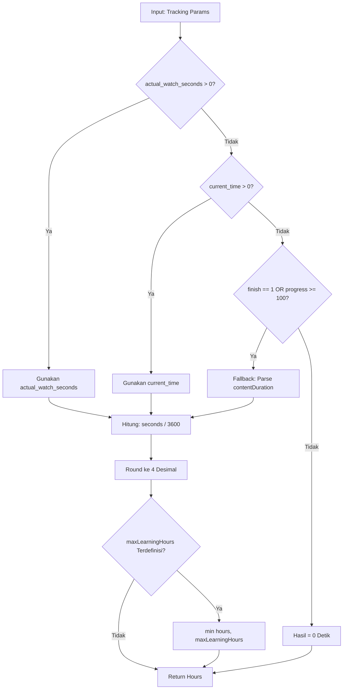

# ActualLearningHourCalculator

## 1. Overview
`ActualLearningHourCalculator` adalah kalkulator stateless murni (pure calculator) yang bertindak sebagai mesin komputasi matematis standar untuk mengubah waktu konsumsi belajar (dalam detik) menjadi **Actual Learning Hours** dalam bentuk angka desimal presisi tinggi (4 angka di belakang koma).

Service ini memecahkan masalah perbedaan perhitungan durasi tonton antara data tracking langsung video player (`actual_watch_seconds`), bookmark posisi tonton (`current_time`), dan data historis kelulusan (`finish = '1'` / `progress >= 100`).

## 2. Source Location
[ActualLearningHourCalculator.php](file:///C:/laragon/owl/app/Services/LearningHours/ActualLearningHourCalculator.php) (`app/Services/LearningHours/ActualLearningHourCalculator.php`)

## 3. Main Responsibility
- **Kalkulasi Matematis Murni:** Menghitung jam belajar desimal dengan formula: $\text{round}(\frac{\text{seconds}}{3600}, 4)$.
- **Resolusi Hierarki Detik Aktual (`resolveActualSeconds`):** Menentukan jumlah detik riil dari parameter tracking user dengan urutan prioritas: `actual_watch_seconds` $\rightarrow$ `current_time` $\rightarrow$ durasi katalog resmi konten jika tuntas $\rightarrow$ 0 detik jika belum tuntas.
- **Kalkulasi Batas Maksimal (Cap):** Menghitung batas atas jam belajar maksimal ($\text{baseHours} \times 2$) untuk mencegah kecurangan tonton berlebih.
- **Komputasi In-Memory Massal (`calculateBatch`):** Memproses ribuan data tracking di memori tanpa query database (0 database queries).

## 4. Used By
- [`ContentUserBatchCalculatorService`](file:///C:/laragon/owl/app/Services/LearningHours/ContentUserBatchCalculatorService.php)
- [`PlaylistContentUserBatchCalculatorService`](file:///C:/laragon/owl/app/Services/LearningHours/PlaylistContentUserBatchCalculatorService.php)
- [`ManualPlaylistContentUserLearningHourService`](file:///C:/laragon/owl/app/Services/LearningHours/ManualPlaylistContentUserLearningHourService.php)
- [`ContentUserLearningHourManagementService`](file:///C:/laragon/owl/app/Services/LearningHours/ContentUserLearningHourManagementService.php)
- [`LearningHourConverterService`](file:///C:/laragon/owl/app/Services/LearningHours/LearningHourConverterService.php)
- [`ContentUser`](file:///C:/laragon/owl/app/Models/ContentUser.php) (via model helper)
- [`PlaylistContentUser`](file:///C:/laragon/owl/app/Models/PlaylistContentUser.php) (via model helper)

## 5. Dependencies
Class ini tidak memiliki dependency eksternal maupun framework injection; murni native PHP math logic.

## 6. Database Tables
Class ini **100% bebas interaksi database (0 database queries)**. Class ini beroperasi secara in-memory terhadap nilai yang di-pass melalui parameter.

## 7. Public Methods

### `calculate(mixed $seconds): ?float`
**Purpose**
Mengonversi total detik ke jam belajar dengan formula $\text{round}(\frac{\text{seconds}}{3600}, 4)$.

**Parameters**
| Parameter | Type | Description |
|---|---|---|
| `$seconds` | `mixed` | Total detik |

**Return**
`?float` — Jam belajar desimal 4 digit atau `null` jika input null/non-numeric. Nilai detik <= 0 menghasilkan `0.0`.

---

### `resolveActualSeconds(mixed $currentTime, mixed $finish = '0', mixed $progress = 0, mixed $contentDuration = null, mixed $actualWatchSeconds = null): int`
**Purpose**
Menentukan angka detik aktual yang valid berdasarkan hierarki aturan tracking dan data historis.

**Process / Hierarki Aturan:**
1. Jika `actual_watch_seconds > 0`: Gunakan `actual_watch_seconds` (akumulasi tonton riil dari heartbeat player).
2. Jika `actual_watch_seconds == 0` dan `current_time > 0`: Gunakan `current_time` (fallback rekam jejak player lama).
3. Jika keduanya 0 DAN berstatus selesai (`finish == '1'` ATAU `progress >= 100`): Gunakan durasi resmi konten (`contentDuration`) sebagai fallback historis.
4. Jika keduanya 0 dan belum selesai: Kembalikan `0` detik.

---

### `calculateMaxLearningHours(mixed $baseHours): ?float`
**Purpose**
Menghitung batas atas jam belajar: $\text{round}(\text{baseHours} \times 2, 4)$.

---

### `calculateMaxCapSeconds(mixed $baseHours): ?int`
**Purpose**
Menghitung batas maksimal detik tonton: $\text{round}(\text{maxLearningHours} \times 3600)$.

---

### `calculateFromTracking(...)`
**Purpose**
Menggabungkan `resolveActualSeconds`, `calculate`, dan pembatasan `maxLearningHours` dalam 1 pemanggilan praktis.

---

### `calculateBatch(iterable $records, array $contentDurationsMap = []): array`
**Purpose**
Menghitung jam belajar untuk koleksi record dalam memori menggunakan peta durasi konten yang telah di-preload.

---

### `parseContentDurationToSeconds(mixed $duration): int`
**Purpose**
Parsing string durasi (`HH:MM:SS`, `MM:SS`, atau angka detik) menjadi integer detik secara aman.

## 8. Business Rules
1. **Formula Continuous Actual Hours**:
   $$\text{Learning Hours} = \text{round}\left(\frac{\text{Actual Seconds}}{3600}, 4\right)$$
   Contoh: 1200 detik $\rightarrow$ 0.3333 h; 1800 detik $\rightarrow$ 0.5000 h; 3600 detik $\rightarrow$ 1.0000 h.
2. **Aturan Fallback Historis**:
   Bagi siswa lama yang telah lulus (`finish = 1`) sebelum sistem heartbeat `actual_watch_seconds` diimplementasikan, jika kolom `current_time` mereka bernilai 0, sistem TIDAK BOLEH memberikan 0 jam belajar, melainkan memberikan jam belajar penuh dari durasi konten katalog resmi (`contentDuration`).
3. **Pemberian Jam Konten Belum Selesai**:
   Jika user belum selesai (`finish = 0` dan `progress < 100`) dan tidak memiliki waktu tonton (`current_time = 0`), jam belajar yang dihasilkan adalah 0.0 jam.

## 9. Data Flow


## 10. Important Conditions
- `if ($sec <= 0) { return 0.0; }`
  - *Alasan:* Mencegah nilai negatif pada jam belajar jika ada timestamp player yang rusak.
- `if ($isFinished && $contentDuration !== null)`
  - *Alasan:* Menjamin hak jam belajar bagi user lama yang menyelesaikan kursus sebelum adanya fitur analitik watch time modern.

## 11. Edge Cases
- **String Non-Numeric:** Mengembalikan `null` tanpa memicu fatal error PHP.
- **Durasi Melebihi Batas (Cheating Watch Time):** Dibatasi oleh cap `maxLearningHours`.

## 12. Related Services
- [`DurationParserService`](file:///C:/laragon/owl/app/Services/LearningHours/DurationParserService.php): Helper konversi string format waktu.
- [`LearningHourConverterService`](file:///C:/laragon/owl/app/Services/LearningHours/LearningHourConverterService.php): Wrapper converter yang menginjeksi kalkulator ini.
- [`ContentUserBatchCalculatorService`](file:///C:/laragon/owl/app/Services/LearningHours/ContentUserBatchCalculatorService.php): Konsumen utama kalkulator ini untuk batch processing.

## 13. Related Models
- [`ContentUser`](file:///C:/laragon/owl/app/Models/ContentUser.php)
- [`PlaylistContentUser`](file:///C:/laragon/owl/app/Models/PlaylistContentUser.php)

## 14. Related Controllers / Commands
- [`BackfillContentUserLearningHoursCommand`](file:///C:/laragon/owl/app/Console/Commands/BackfillContentUserLearningHoursCommand.php)
- [`CalculatePlaylistContentUserLearningHoursCommand`](file:///C:/laragon/owl/app/Console/Commands/CalculatePlaylistContentUserLearningHoursCommand.php)

## 15. Known Risks / Maintenance Notes
- Class ini merupakan inti kalkulasi yang digunakan bersama oleh sistem batch, manual sync, dan model accessor. Jangan mengubah konstanta `SECONDS_IN_HOUR (3600)` atau `PRECISION (4)` karena akan mengubah nilai pada puluhan ribu data riwayat pembelajaran.

## 16. Safe Modification Guide
- Jika ingin menyesuaikan toleransi durasi:
  1. Ubah method `resolveActualSeconds`.
  2. Pastikan urutan prioritas tidak terbalik (`actual_watch_seconds` harus tetap mendahului `current_time`).
  3. Jalankan automated test `tests/Unit/ActualLearningHourCalculatorTest.php`.

## 17. Testing / Verification
- **Automated Test Terkait:**
  - `tests/Unit/ActualLearningHourCalculatorTest.php`
- **Command:**
  ```powershell
  php artisan test --filter=ActualLearningHourCalculatorTest
  ```

## 18. Handover Summary
- **Criticality:** Critical (Rumus inti seluruh pembelajaran continuous learning hours di OWL)
- **Main Function:** Pure calculator stateless untuk mengonversi detik ke jam belajar 4 desimal beserta hierarki fallback.
- **Main Tables:** None (In-memory pure function).
- **Main Caller:** Seluruh batch calculator service, management service, dan console command learning hours.
- **Be Careful When Changing:** Urutan prioritas `resolveActualSeconds()` dan pembulatan `PRECISION = 4`.
