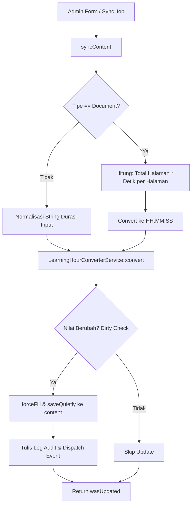

# ContentLearningHourService

## 1. Overview
`ContentLearningHourService` adalah service yang bertanggung jawab atas sinkronisasi dan persistensi nilai durasi (`duration`) dan jam pembelajaran (`learning_hours`) pada tabel katalog materi (**`content`**).

Service ini menangani:
- Kalkulasi otomatis durasi dokumen PDF/buku berdasarkan perkalian jumlah halaman $\times$ durasi per halaman (default 30 detik per halaman).
- Sinkronisasi massal seluruh modul materi menggunakan teknik **chunking** dan **dirty checking** agar tidak melakukan penulisan database yang tidak perlu.
- Pencatatan log audit perubahan durasi serta penyiaran event Laravel (`ContentLearningHourSynchronized`).

## 2. Source Location
[ContentLearningHourService.php](file:///C:/laragon/owl/app/Services/LearningHours/ContentLearningHourService.php) (`app/Services/LearningHours/ContentLearningHourService.php`)

## 3. Main Responsibility
- **Atomic Single Synchronization (`syncContent`):** Memvalidasi perubahan durasi, menghitung jam belajar baru, dan memperbarui database secara atomik di dalam database transaction dengan `saveQuietly()`.
- **Document Page-Based Calculation:** Mengkalkulasi durasi dokumen dari `total_pages * page_duration`.
- **Bulk Batch Synchronization (`syncAll`):** Melakukan audit dan pembaruan terhadap seluruh materi dalam batch chunk (default 200 record).
- **Audit Logging & Event Dispatching:** Mencatat rekam jejak admin yang mengubah durasi dan men-dispatch event untuk modul downstream.

## 4. Used By
- [`LearningHourSynchronizeService`](file:///C:/laragon/owl/app/Services/LearningHours/LearningHourSynchronizeService.php) — dipanggil pada sinkronisasi penuh katalog.
- [`ContentController`](file:///C:/laragon/owl/app/Http/Controllers/ContentController.php) — saat form create/edit konten disimpan oleh admin.
- [`SyncContentLearningHourJob`](file:///C:/laragon/owl/app/Jobs/SyncContentLearningHourJob.php) — job background queue untuk sinkronisasi konten.
- [`SyncLearningHoursCommand`](file:///C:/laragon/owl/app/Console/Commands/SyncLearningHoursCommand.php) — command CLI artisan.

## 5. Dependencies
| Dependency | Type | Purpose |
|---|---|---|
| `LearningHourConverterService` | Service | Konversi durasi string/detik ke angka jam |
| `DurationParserService` | Service | Normalisasi string format durasi |
| `App\Contracts\LearningHourSyncInterface` | Interface | Kontrak standar sinkronisasi |
| `App\DataTransferObjects\LearningHourSyncResult` | DTO | Objek hasil status sinkronisasi |
| `App\Events\ContentLearningHourSynchronized` | Event | Event pemberitahuan update jam konten |
| `App\Models\Content` | Model | Entitas tabel konten |

## 6. Database Tables
| Table | Operation | Purpose |
|---|---|---|
| `content` | READ / UPDATE | Membaca durasi lama dan memperbarui kolom `duration` dan `learning_hours` |

## 7. Public Methods

### `syncContent(Content $content, array $requestData = []): bool`
**Purpose**
Melakukan sinkronisasi durasi dan learning hours untuk satu konten. Mengembalikan `true` jika data berubah di DB, `false` jika tidak berubah (skipped).

**Parameters**
| Parameter | Type | Description |
|---|---|---|
| `$content` | `Content` | Model konten yang disinkronkan |
| `$requestData` | `array` | Data opsional dari form request (`duration`, `type`, `page_duration`, `total_page`) |

**Process**
1. Dibungkus dalam `DB::transaction`.
2. Simpan nilai lama (`oldDuration`, `oldLearningHours`).
3. Jika tipe konten adalah **`Document`**:
   - Ambil `totalPages` dari input atau kolom model `document_total_pages` / `total_page`.
   - Ambil `pageDuration` (default 30 detik jika tidak diisi).
   - Hitung durasi total: $\text{totalPages} \times \text{pageDuration}$ detik.
   - Konversi detik ke format `HH:MM:SS` via `DurationParserService::fromSeconds()`.
4. Jika bukan Document: normalisasi string durasi input atau string durasi yang sudah ada.
5. Hitung jam belajar baru via `converter->convert($newDuration)`.
6. Lakukan **Dirty Checking**: periksa apakah durasi berubah atau selisih jam $\ge 0.0001$.
7. Jika berubah:
   - Simpan perubahan secara silent: `$content->forceFill(['duration' => $newDuration, 'learning_hours' => $newLearningHours])->saveQuietly()`.
   - Tulis audit log dengan context user admin yang melakukan update.
8. Dispatch event `ContentLearningHourSynchronized`.
9. Kembalikan flag `wasUpdated`.

---

### `syncAll(): array` / `syncBatch(): array`
**Purpose**
Menyinkronkan seluruh konten di database dalam potongan chunk (default 200).

**Return**
`array{updated: int, skipped: int, total: int}`

---

### `syncSingle(mixed $model, array $requestData = []): LearningHourSyncResult`
Implementasi antarmuka standar yang mengembalikan instance DTO `LearningHourSyncResult`.

## 8. Business Rules
1. **Formula Durasi Dokumen**:
   $$\text{Durasi Dokumen (detik)} = \text{Total Halaman} \times \text{Detik per Halaman}$$
   Secara default, OWL mengalokasikan **30 detik membaca untuk setiap 1 halaman dokumen PDF**. Contoh: dokumen 10 halaman memiliki durasi $10 \times 30 = 300$ detik (`00:05:00` $\approx 0.0833$ jam).
2. **Dirty Checking Safety**:
   Jika hasil perhitungan jam baru identik dengan data yang sudah tersimpan di database ($|\text{old} - \text{new}| < 0.0001$), query UPDATE dilewati (`skipped`) guna menghemat I/O database dan mencegah trigger update timestamp yang tidak relevan.
3. **Penyimpanan Silent (`saveQuietly`)**:
   Pembaruan jam belajar master dilakukan tanpa memicu event model Eloquent standar untuk mencegah loop rekursif event.

## 9. Data Flow


## 10. Important Conditions
- `if ($contentType === 'Document')`
  - *Alasan:* Menjamin dokumen PDF dihitung dari parameter halaman secara konsisten.
- `if ($pageDuration === 0) { $newDuration = '00:00:00'; }`
  - *Alasan:* Menghindari error pembagian jika durasi per halaman disetel 0.

## 11. Edge Cases
- **Dokumen Tanpa Halaman (`totalPages == 0`):** Durasi tetap mempertahankan nilai sebelumnya jika ada.
- **Admin Tidak Login (CLI / Job):** `Auth::id()` bernilai null tercatat di log audit secara aman.

## 12. Related Services
- [`LearningHourConverterService`](file:///C:/laragon/owl/app/Services/LearningHours/LearningHourConverterService.php): Dependency kalkulasi jam.
- [`PlaylistLearningHourService`](file:///C:/laragon/owl/app/Services/LearningHours/PlaylistLearningHourService.php): Sinkronisasi durasi playlist yang bergantung pada durasi konten yang dihasilkan service ini.
- [`LearningHourSynchronizeService`](file:///C:/laragon/owl/app/Services/LearningHours/LearningHourSynchronizeService.php): Orkestrator gabungan konten + playlist.

## 13. Related Models
- [`Content`](file:///C:/laragon/owl/app/Models/Content.php)

## 14. Related Controllers / Commands
- [`ContentController`](file:///C:/laragon/owl/app/Http/Controllers/ContentController.php)
- [`SyncContentLearningHourJob`](file:///C:/laragon/owl/app/Jobs/SyncContentLearningHourJob.php)
- [`SyncLearningHoursCommand`](file:///C:/laragon/owl/app/Console/Commands/SyncLearningHoursCommand.php)

## 15. Known Risks / Maintenance Notes
- Mengubah durasi pada materi `content` tidak secara otomatis memperbarui nilai jam yang sudah terekam pada `content_users` siswa yang telah selesai sebelumnya. Hal ini disengaja agar data histori jam belajar siswa tidak berubah secara retroaktif tanpa izin (harus melalui batch recalibration terpisah jika diinginkan).

## 16. Safe Modification Guide
- Jika ingin mengubah estimasi waktu membaca per halaman dokumen:
  1. Sesuaikan nilai default pada `$content->page_duration ?? 30` di method `syncContent()`.
  2. Jalankan command `php artisan learning-hours:sync` untuk memperbarui seluruh katalog.
  3. Uji dengan test `ContentLearningHourServiceTest`.

## 17. Testing / Verification
- **Automated Test Terkait:**
  - `tests/Feature/PlaylistLearningHoursSynchronizationTest.php`
- **Command:**
  ```powershell
  php artisan learning-hours:sync --content-only
  ```

## 18. Handover Summary
- **Criticality:** High (Penentu durasi dan jam belajar resmi katalog materi)
- **Main Function:** Sinkronisasi durasi materi (termasuk perkalian halaman dokumen) dan kolom `content.learning_hours`.
- **Main Tables:** `content` (READ / UPDATE).
- **Main Caller:** `ContentController`, `LearningHourSynchronizeService`, `SyncContentLearningHourJob`.
- **Be Careful When Changing:** Rumus dokumen `$totalPages * $pageDuration` dan toleransi dirty checking `0.0001`.
