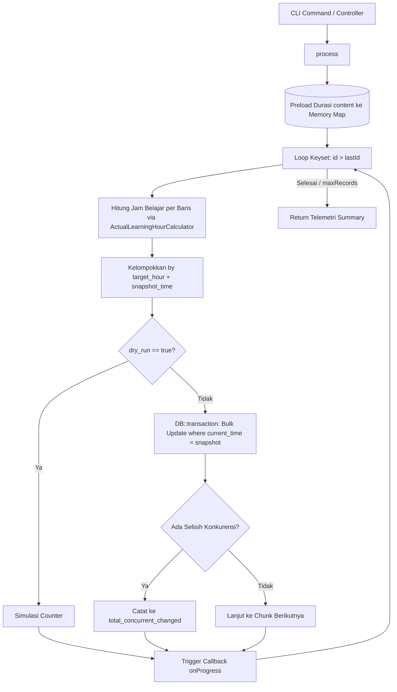

# ContentUserBatchCalculatorService

## 1. Overview
`ContentUserBatchCalculatorService` adalah service pemrosesan massal (high-throughput batch calculator) yang bertugas menghitung dan mengisikan nilai jam belajar aktual ke tabel **`content_users`** untuk data pembelajaran mandiri.

Service ini dirancang untuk memproses ratusan ribu baris data secara aman dengan fitur:
- **Keyset Pagination:** Menggunakan index primary key (`id > $lastId`) alih-alih `OFFSET` untuk kecepatan query konstan.
- **Preloading Durasi Master (Zero N+1):** Seluruh durasi konten katalog dimuat ke dalam memori dalam 1 query awal.
- **Concurrency Protection:** Mencegah race condition dengan siswa yang sedang aktif menonton video secara langsung (live heartbeat) saat batch dijalankan.
- **Mode Dry-Run:** Menganalisis estimasi perubahan tanpa menulis ke database.

## 2. Source Location
[ContentUserBatchCalculatorService.php](file:///C:/laragon/owl/app/Services/LearningHours/ContentUserBatchCalculatorService.php) (`app/Services/LearningHours/ContentUserBatchCalculatorService.php`)

## 3. Main Responsibility
- **Bulk Keyset Processing (`process`):** Mengambil data dalam potongan chunk besar (default 2500 baris) berurutan berdasarkan ID.
- **Optimistic Concurrency Control:** Melakukan update massal dengan klausul WHERE tambahan `where('current_time', $snapshotTime)`. Jika siswa sedang menonton video dan detik tontonnya berubah di tengah eksekusi batch, row tersebut dilewati demi keamanan data siswa.
- **Telemetry & Sample Tracking:** Menghasilkan statistik lengkap (`total_scanned`, `total_updated`, `total_skipped`, `total_historical_fallback`, `total_zero`, `total_concurrent_changed`) dan mencuplik 10 record contoh.

## 4. Used By
- [`BackfillContentUserLearningHoursCommand`](file:///C:/laragon/owl/app/Console/Commands/BackfillContentUserLearningHoursCommand.php) — command CLI artisan `php artisan learning-hours:backfill-content-users`.

## 5. Dependencies
| Dependency | Type | Purpose |
|---|---|---|
| `ActualLearningHourCalculator` | Service | Engine matematis penghitungan jam dari detik tonton |
| `Illuminate\Support\Facades\DB` | DB Facade | Eksekusi query database performa tinggi |
| `Illuminate\Support\Facades\Log` | Log Facade | Pencatatan error batch |

## 6. Database Tables
| Table | Operation | Purpose |
|---|---|---|
| `content` | READ | Preload seluruh durasi konten aktif dalam 1 query |
| `content_users` | READ / UPDATE | Membaca riwayat pembelajaran dan memperbarui `learning_hours` serta `completed_at` |

## 7. Public Methods

### `process(array $options = [], ?callable $onProgress = null): array`
**Purpose**
Mengeksekusi perhitungan dan penulisan massal jam belajar pada tabel `content_users`.

**Options Parameters**
| Parameter | Type | Default | Description |
|---|---|---|---|
| `chunk_size` | `int` | 2500 | Jumlah baris per putaran query (min: 50) |
| `dry_run` | `bool` | false | Jika true, hanya simulasi tanpa penulisan DB |
| `force` | `bool` | false | Jika true, menghitung ulang baris yang sudah terisi |
| `user_id` | `?int` | null | Filter khusus user ID tertentu |
| `content_id` | `?int` | null | Filter khusus konten ID tertentu |
| `max_records` | `?int` | null | Batas maksimal total baris yang diproses |

**Process**
1. Preload semua durasi konten dari tabel `content` ke dalam array map PHP (`$contentsMap`).
2. Looping Keyset Pagination menggunakan `where('id', '>', $lastId)->limit($chunkSize)`.
3. Untuk setiap baris dalam chunk:
   - Ambil durasi konten dari memory map atau kolom `duration_seconds`.
   - Deteksi orphan record (konten terhapus dan tidak ada durasi tersimpan).
   - Jalankan `ActualLearningHourCalculator::resolveActualSeconds()` dan `calculate()`.
   - Deteksi data selesai yang belum memiliki `completed_at`.
   - Skip jika nilai `learning_hours` sudah sama persis (kecuali `force = true`).
   - Kelompokkan record ke dalam `$updateGroups` berdasarkan kombinasi target jam dan snapshot `current_time`.
4. Jika bukan dry-run, eksekusi pembaruan dalam transaksi `DB::transaction`:
   - Update `content_users` secara bulk berdasarkan grup ID dan snapshot waktu.
   - Deteksi selisih konkurensi (`totalConcurrentChanged`) jika baris termodifikasi oleh siswa saat batch berjalan.
5. Panggil closure `$onProgress` jika disediakan untuk update progress bar di CLI.
6. Kembalikan array telemetri ringkasan eksekusi.

## 8. Business Rules
1. **Perlindungan Siswa Aktif (Learner-First Concurrency)**:
   Aplikasi menolak menimpa data siswa jika siswa tersebut sedang aktif belajar di platform saat batch berlangsung. Hal ini dicapai dengan mencocokkan `current_time` saat UPDATE.
2. **Penetapan Timestamp Kelulusan Historis**:
   Baris pembelajaran yang sudah selesai (`finish = '1'` atau `progress >= 100`) tetapi kolom `completed_at`-nya masih NULL ditandai untuk diisi dengan `COALESCE(updated_at, created_at, NOW())`.
3. **Pembersihan Record Yatim (Orphan Records)**:
   Record yang merujuk ke konten yang sudah terhapus permanen tanpa memiliki data durasi di-reset ke `NULL` agar tidak menampilkan jam palsu.

## 9. Data Flow


## 10. Important Conditions
- `->where('current_time', $group['snapshot_time'])`
  - *Alasan:* Kunci Concurrency Protection agar update batch tidak menimpa posisi video terbaru yang baru saja dikirim oleh player siswa.
- `if (!$force && abs($record->learning_hours - $calculatedHour) < 0.0001)`
  - *Alasan:* Mencegah update data yang sudah benar untuk menghemat jutaan operasi I/O database.

## 11. Edge Cases
- **Orphan Record (Konten Dihapus Permanen):** Masuk ke kategori `total_missing_content` dan jam belajar di-set `null`.
- **Learner Heartbeat Collision:** Terdeteksi otomatis sebagai `total_concurrent_changed`.

## 12. Related Services
- [`ActualLearningHourCalculator`](file:///C:/laragon/owl/app/Services/LearningHours/ActualLearningHourCalculator.php): Mesin kalkulasi waktu.
- [`PlaylistContentUserBatchCalculatorService`](file:///C:/laragon/owl/app/Services/LearningHours/PlaylistContentUserBatchCalculatorService.php): Layanan kembaran untuk tabel `playlist_content_users`.
- [`ContentUserLearningHourManagementService`](file:///C:/laragon/owl/app/Services/LearningHours/ContentUserLearningHourManagementService.php): Layanan interaktif UI.

## 13. Related Models
- [`ContentUser`](file:///C:/laragon/owl/app/Models/ContentUser.php)
- [`Content`](file:///C:/laragon/owl/app/Models/Content.php)

## 14. Related Controllers / Commands
- [`BackfillContentUserLearningHoursCommand`](file:///C:/laragon/owl/app/Console/Commands/BackfillContentUserLearningHoursCommand.php)

## 15. Known Risks / Maintenance Notes
- **Bug Penamaan Variabel Teridentifikasi di Baris 273:**
  Pada baris 199, ID baris yang membutuhkan update `completed_at` ditampung ke array variabel `$completedAtIds[] = (int) $record->id;`. Namun pada blok penulisan transaksi di baris 273, kode memeriksa `if (!empty($completedIds))`. Karena variabel `$completedIds` tidak didefinisikan sebelumnya, blok query update `completed_at` tidak pernah tereksekusi. *(Catatan Handover: Jangan perbaiki kode ini tanpa instruksi langsung; dokumentasikan sebagai catatan temuan audit)*.

## 16. Safe Modification Guide
- Jika ingin menjalankan perbaikan data dalam jumlah terbatas untuk pengujian:
  1. Selalu gunakan opsi `'dry_run' => true` terlebih dahulu.
  2. Batasi dengan `'max_records' => 100` dan `'user_id' => <test_id>`.
  3. Cek hasil telemetri sampel sebelum menjalankan dengan `'force' => true`.

## 17. Testing / Verification
- **Automated Test Terkait:**
  - `tests/Unit/ContentUserLearningHourManagementServiceTest.php`
- **Manual Verification:**
  ```powershell
  php artisan learning-hours:backfill-content-users --dry-run --limit=50
  ```

## 18. Handover Summary
- **Criticality:** High (Mesin batch massal pengisian jam belajar konten mandiri)
- **Main Function:** Batch keyset pagination untuk kalkulasi dan update jam belajar pada `content_users` dengan concurrency protection.
- **Main Tables:** `content_users` (READ / UPDATE), `content` (READ).
- **Main Caller:** `BackfillContentUserLearningHoursCommand`.
- **Be Careful When Changing:** Keyset pagination logic (`id > $lastId`) dan mekanisme snapshot concurrency.
