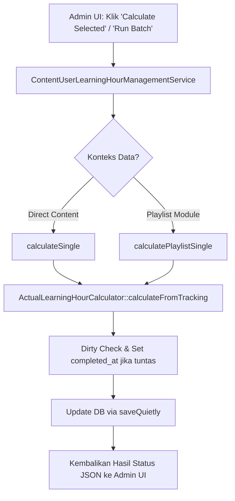

# ContentUserLearningHourManagementService

## 1. Overview
`ContentUserLearningHourManagementService` adalah service manajemen komprehensif yang melayani antarmuka administrasi (Admin Dashboard & DataTables) untuk pemantauan, penghitungan individual, penghitungan selektif, dan eksekusi batch langkah demi langkah (step-by-step batch) bagi jam belajar pengguna.

Service ini mendukung dua konteks sekaligus:
1. **Direct Content Mode:** Mengelola tabel `content_users` (kolom `learning_hours`).
2. **Playlist Module Mode:** Mengelola tabel `playlist_content_users` (kolom `learning_hour`).

## 2. Source Location
[ContentUserLearningHourManagementService.php](file:///C:/laragon/owl/app/Services/LearningHours/ContentUserLearningHourManagementService.php) (`app/Services/LearningHours/ContentUserLearningHourManagementService.php`)

## 3. Main Responsibility
- **Single Record Calculation (`calculateSingle` & `calculatePlaylistSingle`):** Menghitung jam belajar untuk satu baris data terpilih dan mengisi `completed_at` jika sudah selesai.
- **Bulk Selected Calculation (`calculateSelected` / `recalculateSelected`):** Memproses baris-baris yang dipilih melalui checkbox di UI DataTables admin dengan deteksi konteks otomatis (`auto`, `direct`, `playlist`).
- **Interactive Batch Step Execution (`startBatch`, `processBatchStep`, `cancelBatch`):** Mengelola sesi background batch yang dapat dipantau progresnya via polling AJAX di browser menggunakan model `LearningHourCalculationBatch`.
- **Admin KPI Dashboard & DataTables Server-Side:** Menyediakan kueri statistik (`getStatistics`, `getPlaylistStatistics`) dan builder DataTables (`buildDatatableQuery`, `buildPlaylistDatatableQuery`).

## 4. Used By
- [`ContentUserLearningHourController`](file:///C:/laragon/owl/app/Http/Controllers/Manage/LearningHours/ContentUserLearningHourController.php) — controller UI manajemen jam belajar konten langsung.
- [`PlaylistContentUserLearningHourController`](file:///C:/laragon/owl/app/Http/Controllers/Manage/LearningHours/PlaylistContentUserLearningHourController.php) — controller UI manajemen jam belajar modul playlist.

## 5. Dependencies
| Dependency | Type | Purpose |
|---|---|---|
| `LearningHourConverterService` | Service | Konversi durasi |
| `DurationParserService` | Service | Parsing format string durasi |
| `ActualLearningHourCalculator` | Service | Kalkulator jam aktual 4 desimal |
| `App\Models\ContentUser` | Model | Akses tabel progres konten |
| `App\Models\PlaylistContentUser` | Model | Akses tabel progres playlist |
| `App\Models\LearningHourCalculationBatch` | Model | Penyimpanan status sesi batch |

## 6. Database Tables
| Table | Operation | Purpose |
|---|---|---|
| `content_users` | READ / UPDATE | Mengambil data siswa dan memperbarui `learning_hours` serta `completed_at` |
| `playlist_content_users` | READ / UPDATE | Mengambil data modul playlist dan memperbarui `learning_hour` serta `completed_at` |
| `content` | READ | Join metadata judul, durasi, dan klasifikasi konten |
| `trainingplan` | READ | Join judul playlist untuk tabel modul playlist |
| `users` | READ | Join informasi pegawai (nama, NIP, peran) |
| `learning_hour_calculation_batches` | INSERT / UPDATE | Menyimpan progres persentase batch langkah |

## 7. Public Methods

### `calculateSingle(ContentUser|PlaylistContentUser|int $record, bool $force = false, string $context = 'auto'): array`
**Purpose**
Menghitung jam belajar untuk 1 record tunggal (bisa instance model atau ID integer).

**Process**
- Jika context `'playlist'` atau instance `PlaylistContentUser`, teruskan ke `calculatePlaylistSingle()`.
- Jika `ContentUser`, load relasi `content`.
- Hitung jam via `$this->calculator->calculateFromTracking()`.
- Lakukan dirty check. Jika tidak force dan selisih $< 0.0001$, lewati update.
- Jika selesai (`isFinished()`) dan `completed_at` bernilai null, isi `completed_at = now()`.
- Simpan via `saveQuietly()`.

---

### `calculatePlaylistSingle(PlaylistContentUser|int $record, bool $force = false): array`
**Purpose**
Menghitung jam belajar khusus untuk modul `PlaylistContentUser` secara terisolasi dan menulis ke kolom `playlist_content_users.learning_hour`.

---

### `calculateSelected(array $ids, bool $force = false, string $context = 'auto'): array`
**Purpose**
Menghitung jam belajar untuk daftar ID terpilih dari checkbox UI. Pada mode `auto`, service memisahkan ID mana yang milik `content_users` dan ID mana yang milik `playlist_content_users` lalu memproses masing-masing secara tepat.

---

### `startBatch(string $type = 'all_remaining', ?int $userId = null): LearningHourCalculationBatch`
**Purpose**
Membuat sesi batch baru di tabel `learning_hour_calculation_batches` dan menghitung total record yang perlu diproses.

---

### `processBatchStep(int $batchId, int $chunkSize = 2500): array`
**Purpose**
Memproses 1 langkah (chunk) untuk sesi batch tertentu. Menggunakan pengelompokan bulk update dengan snapshot `current_time` untuk concurrency safety. Mengembalikan persentase progres untuk UI progress bar.

---

### `getStatistics()` / `getPlaylistStatistics(): array`
**Purpose**
Menghitung metrik ringkasan kartu KPI atas (Total records, Calculated, Remaining, Failed, Percentage).

---

### `buildDatatableQuery(Request $request)` / `buildPlaylistDatatableQuery(Request $request)`
**Purpose**
Menyiapkan query builder Eloquent dengan eager loading user dan content untuk server-side DataTables.

## 8. Business Rules
1. **Isolasi Kolom Database Target**:
   - Konten mandiri selalu dan hanya menulis ke `content_users.learning_hours`.
   - Modul playlist selalu dan hanya menulis ke `playlist_content_users.learning_hour` (tanpa huruf 's').
2. **Otomasi Timestamp Kelulusan (`completed_at`)**:
   Setiap kali kalkulasi dijalankan pada record yang berstatus selesai (`isFinished() == true`), jika kolom `completed_at` masih kosong, sistem wajib mengisinya dengan waktu saat ini (`now()`).
3. **Pembedaan Failure Status**:
   Record dikategorikan "Failed" di dashboard jika konten relasinya terhapus atau string durasi konten kosong/rusak sehingga tidak dapat dihitung.

## 9. Data Flow


## 10. Important Conditions
- `if ($isFinished && $contentUser->completed_at === null)`
  - *Alasan:* Menjamin seluruh riwayat pembelajaran yang tuntas memiliki timestamp resmi untuk pelaporan tahunan.
- `if (!$force && abs($existing - $new) < 0.0001)`
  - *Alasan:* Menghemat operasi tulis dan mencegah perubahan `updated_at` pada data yang sudah konsisten.

## 11. Edge Cases
- **Record Dihapus oleh User Lain di Tengah Batch:** Terdeteksi via pengecekan `$contentUser === null` dan dilaporkan sebagai skipped/failed.
- **Batch Dibatalkan Admin di Tengah Jalan:** Method `cancelBatch()` memperbarui status menjadi `'cancelled'` dan step berikutnya langsung berhenti.

## 12. Related Services
- [`ActualLearningHourCalculator`](file:///C:/laragon/owl/app/Services/LearningHours/ActualLearningHourCalculator.php)
- [`ContentUserBatchCalculatorService`](file:///C:/laragon/owl/app/Services/LearningHours/ContentUserBatchCalculatorService.php)
- [`PlaylistContentUserLearningHourManagementService`](file:///C:/laragon/owl/app/Services/LearningHours/PlaylistContentUserLearningHourManagementService.php)

## 13. Related Models
- [`ContentUser`](file:///C:/laragon/owl/app/Models/ContentUser.php)
- [`PlaylistContentUser`](file:///C:/laragon/owl/app/Models/PlaylistContentUser.php)
- [`LearningHourCalculationBatch`](file:///C:/laragon/owl/app/Models/LearningHourCalculationBatch.php)

## 14. Related Controllers / Commands
- [`ContentUserLearningHourController`](file:///C:/laragon/owl/app/Http/Controllers/Manage/LearningHours/ContentUserLearningHourController.php)
- [`PlaylistContentUserLearningHourController`](file:///C:/laragon/owl/app/Http/Controllers/Manage/LearningHours/PlaylistContentUserLearningHourController.php)

## 15. Known Risks / Maintenance Notes
- Pada method `processBatchStep()`, pembaruan massal mengeksekusi `DB::table('content_users')->whereIn('id', ...)->update(...)`. Pastikan koneksi database tidak memiliki batasan paket statement SQL yang terlalu kecil jika `chunkSize` dinaikkan di atas 5000.

## 16. Safe Modification Guide
- Jika ingin menambah filter baru di tabel monitoring DataTables:
  1. Tambahkan kondisi pada `applyDatatableFilters()`.
  2. Tambahkan elemen input dropdown yang sesuai di view Blade `manage/learning-hours/content-users.blade.php`.
  3. Uji query dengan test suite `ContentUserLearningHourManagementServiceTest`.

## 17. Testing / Verification
- **Automated Test Terkait:**
  - `tests/Unit/ContentUserLearningHourManagementServiceTest.php`
- **Command:**
  ```powershell
  php artisan test --filter=ContentUserLearningHourManagementServiceTest
  ```

## 18. Handover Summary
- **Criticality:** High (Service utama yang menghubungkan dashboard manajemen admin dengan mesin kalkulasi jam belajar)
- **Main Function:** Manajemen kalkulasi jam belajar individual, selektif, batch langkah, dan data query DataTables.
- **Main Tables:** `content_users` (READ / UPDATE), `playlist_content_users` (READ / UPDATE), `learning_hour_calculation_batches` (INSERT / UPDATE).
- **Main Caller:** `ContentUserLearningHourController`, `PlaylistContentUserLearningHourController`.
- **Be Careful When Changing:** Penulisan kolom target (`learning_hours` vs `learning_hour`) dan logika update `completed_at`.
