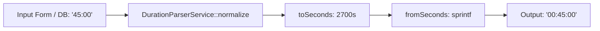

# DurationParserService

## 1. Overview
`DurationParserService` adalah service utilitas untuk normalisasi dan parsing format waktu durasi pembelajaran. Service ini bertanggung jawab untuk mengubah format waktu antara representasi string manusia (`HH:MM:SS` atau `MM:SS`) dan integer detik komputer, serta melakukan standardisasi format durasi konten katalog.

## 2. Source Location
[DurationParserService.php](file:///C:/laragon/owl/app/Services/LearningHours/DurationParserService.php) (`app/Services/LearningHours/DurationParserService.php`)

## 3. Main Responsibility
- **String to Seconds Conversion (`toSeconds`):** Mengonversi string format `HH:MM:SS`, `MM:SS`, atau string numerik ke total detik integer.
- **Seconds to String Conversion (`fromSeconds`):** Mengonversi detik integer ke string format standar `HH:MM:SS` dengan zero-padding (misal: 65 detik $\rightarrow$ `"00:01:05"`).
- **Duration Normalization (`normalize`):** Memastikan format string durasi input admin selalu diseragamkan ke format standar `HH:MM:SS`.

## 4. Used By
- [`LearningHourConverterService`](file:///C:/laragon/owl/app/Services/LearningHours/LearningHourConverterService.php)
- [`ContentLearningHourService`](file:///C:/laragon/owl/app/Services/LearningHours/ContentLearningHourService.php)
- [`PlaylistLearningHourService`](file:///C:/laragon/owl/app/Services/LearningHours/PlaylistLearningHourService.php)
- [`ContentUserLearningHourManagementService`](file:///C:/laragon/owl/app/Services/LearningHours/ContentUserLearningHourManagementService.php)

## 5. Dependencies
Class ini tidak memiliki dependency eksternal; pure native PHP string formatting functions.

## 6. Database Tables
Class ini murni fungsi manipulasi string/angka in-memory (**0 database queries**).

## 7. Public Methods

### `toSeconds(?string $duration): int`
**Purpose**
Mengonversi durasi waktu ke total detik.

**Parameters**
| Parameter | Type | Description |
|---|---|---|
| `$duration` | `?string` | String durasi (misal `"01:30"`, `"02:15:00"`, `"3600"`) |

**Return**
`int` — Total detik. Input kosong/null menghasilkan `0`.

**Process**
1. Trim string input. Jika kosong, kembalikan 0.
2. Explode dengan delimiter titik dua (`:`).
3. Jika 2 bagian (`MM:SS`): $(\text{parts}[0] \times 60) + \text{parts}[1]$.
4. Jika 3 bagian (`HH:MM:SS`): $(\text{parts}[0] \times 3600) + (\text{parts}[1] \times 60) + \text{parts}[2]$.
5. Jika string numerik tunggal: cast langsung ke integer.

---

### `fromSeconds(int $seconds): string`
**Purpose**
Mengonversi integer detik ke string berformat standar `HH:MM:SS`.

**Parameters**
| Parameter | Type | Description |
|---|---|---|
| `$seconds` | `int` | Jumlah detik (nilai negatif dinetralkan ke 0 via `max(0, $seconds)`) |

**Return**
`string` — String format `%02d:%02d:%02d` (misal `"00:45:00"`).

---

### `normalize(?string $duration): ?string`
**Purpose**
Menstandarkan string durasi input bebas menjadi format `HH:MM:SS`.

**Parameters**
| Parameter | Type | Description |
|---|---|---|
| `$duration` | `?string` | String durasi asli |

**Return**
`?string` — String normal atau `null` jika input kosong.

## 8. Business Rules
1. **Standarisasi Format Katalog**:
   Semua durasi materi di OWL (video maupun dokumen) dinormalisasi ke format 3 bagian `HH:MM:SS`.
2. **Toleransi Input Pengguna**:
   Input durasi dari form CMS atau Excel yang hanya berisi menit dan detik (misal `15:30`) secara otomatis dipahami sebagai 15 menit 30 detik (930 detik) dan dinormalisasi menjadi `00:15:30`.
3. **Ketahanan Nilai Negatif**:
   Detik negatif dicegah masuk ke sistem dengan fungsi `max(0, $seconds)`.

## 9. Data Flow


## 10. Important Conditions
- `if (count($parts) === 2)` vs `if (count($parts) === 3)`
  - *Alasan:* Membedakan parsing antara format menit:detik dan format jam:menit:detik.

## 11. Edge Cases
- **Input Null / Spasi Kosong:** Mengembalikan 0 untuk `toSeconds` dan `null` untuk `normalize`.
- **String Angka Murni Tanpa Titik Dua:** Dianggap sebagai total detik (`is_numeric`).

## 12. Related Services
- [`LearningHourConverterService`](file:///C:/laragon/owl/app/Services/LearningHours/LearningHourConverterService.php): Memanfaatkan service ini untuk konversi ke jam desimal.
- [`ContentLearningHourService`](file:///C:/laragon/owl/app/Services/LearningHours/ContentLearningHourService.php): Menggunakan `normalize()` saat form konten disimpan.

## 13. Related Models
- [`Content`](file:///C:/laragon/owl/app/Models/Content.php)

## 14. Related Controllers / Commands
- [`ContentController`](file:///C:/laragon/owl/app/Http/Controllers/ContentController.php)
- [`TrainingPlanController`](file:///C:/laragon/owl/app/Http/Controllers/TrainingPlanController.php)

## 15. Known Risks / Maintenance Notes
- Format dengan 4 segmen (misal hari:jam:menit:detik) tidak didukung dan akan di-fallback ke 0. Pastikan kurikulum kursus tidak menggunakan format melebihi jam.

## 16. Safe Modification Guide
- Jika ingin mendukung format hari:
  1. Tambahkan kondisi `count($parts) === 4`.
  2. Pastikan backward compatibility untuk 2 dan 3 bagian tidak terganggu.
  3. Uji dengan test suite `tests/Unit/DurationFormatterTest.php`.

## 17. Testing / Verification
- **Automated Test Terkait:**
  - `tests/Unit/DurationFormatterTest.php`
- **Command:**
  ```powershell
  php artisan test --filter=DurationFormatterTest
  ```

## 18. Handover Summary
- **Criticality:** Medium (Utility dasar parsing format durasi)
- **Main Function:** Parsing dan normalisasi string durasi waktu antara `HH:MM:SS`, `MM:SS`, dan detik.
- **Main Tables:** None (In-memory utility).
- **Main Caller:** `ContentLearningHourService`, `PlaylistLearningHourService`, `LearningHourConverterService`.
- **Be Careful When Changing:** Rumus parsing menit vs jam pada jumlah bagian array explode.
