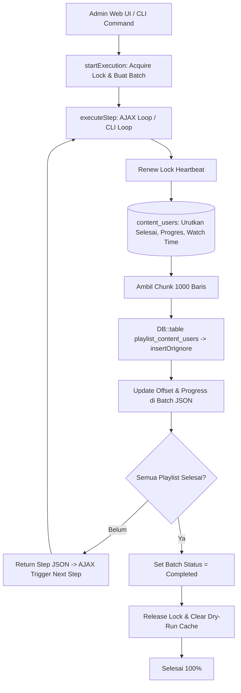

# HistoricalPlaylistProgressExecutionService

## 1. Overview
`HistoricalPlaylistProgressExecutionService` adalah service eksekutor migrasi data historis progres playlist dari tabel `content_users` ke tabel `playlist_content_users`.

Service ini bertindak sebagai **Single Source of Truth** yang digunakan secara bersamaan oleh:
1. Panel Web Admin: eksekusi interaktif berbasis chunked AJAX polling step-by-step dengan progress bar live.
2. CLI Command: Artisan command `php artisan playlist:migrate-historical-progress`.

Service ini menjamin keamanan data mutlak dengan teknik:
- **Lock Management & Heartbeat:** Distributed lock dengan perpanjangan otomatis pada setiap chunk step.
- **Idempotency Guarantee:** Menggunakan `insertOrIgnore` sehingga eksekusi berulang kali tidak pernah menduplikasi data atau merusak baris PCU yang sudah ada.
- **State Persistence:** Status eksekusi disimpan di database (`learning_hour_calculation_batches`), sehingga jika browser tertutup atau koneksi terputus, proses dapat dilanjutkan kembali tanpa mengulang dari awal.

## 2. Source Location
[HistoricalPlaylistProgressExecutionService.php](file:///C:/laragon/owl/app/Services/LearningHours/HistoricalPlaylistProgressExecutionService.php) (`app/Services/LearningHours/HistoricalPlaylistProgressExecutionService.php`)

## 3. Main Responsibility
- **Session Lifecycle Management (`startExecution`):** Memvalidasi status aktif, mengunci sistem, menghitung jumlah calon baris via `PlaylistProgressDryRunService`, dan membuat entri batch di database.
- **Chunk Step Execution (`executeStep`):** Memproses satu potongan chunk record (default 1000 baris) per request AJAX, memindahkan playlist satu demi satu hingga tuntas.
- **Prioritas Rekam Jejak Terbaik (Phase 3 Rule):** Mengambil progres terbaik dari `content_users` dengan ordering: `user_id ASC, finish DESC, progress DESC, current_time DESC, id DESC`.
- **Safe Insertion (`insertOrIgnore`):** Menulis baris baru ke `playlist_content_users` tanpa menimpa data yang sudah ada sebelumnya.
- **Auto Cache Invalidation:** Menghapus cache metrik dry-run setelah seluruh proses migrasi selesai.

## 4. Used By
- [`PlaylistProgressDryRunController`](file:///C:/laragon/owl/app/Http/Controllers/Manage/LearningHours/PlaylistProgressDryRunController.php) — controller endpoint AJAX start, step, dan status migrasi.
- [`MigrateHistoricalPlaylistProgressCommand`](file:///C:/laragon/owl/app/Console/Commands/MigrateHistoricalPlaylistProgressCommand.php) — command CLI artisan.

## 5. Dependencies
| Dependency | Type | Purpose |
|---|---|---|
| `PlaylistProgressDryRunService` | Service | Penyedia metrik ringkasan kandidat & manajemen cache dry-run |
| `App\Models\LearningHourCalculationBatch` | Model | Penyimpanan status sesi batch migrasi |
| `Illuminate\Support\Facades\Cache` | Cache Facade | Distributed lock dan session cache |
| `Illuminate\Support\Facades\DB` | DB Facade | Query builder dan `insertOrIgnore` |

## 6. Database Tables
| Table | Operation | Purpose |
|---|---|---|
| `trainingplan` | READ | Resolusi lingkup playlist historis ($\le$ cutoff) |
| `trainingplandetail` | READ | Mengambil daftar materi dalam playlist |
| `content_users` | READ | Mengambil data riwayat belajar lama dengan urutan prioritas |
| `playlist_content_users` | INSERT (`insertOrIgnore`) | Menyimpan baris baru hasil migrasi tanpa menimpa data eksis |
| `learning_hour_calculation_batches` | INSERT / UPDATE | Menyimpan state persisten eksekusi migrasi |

## 7. Public Methods

### `startExecution(string $cutoff = self::DEFAULT_CUTOFF, ?int $playlistId = null, int $chunkSize = 1000, ?int $userId = null): array`
**Purpose**
Menginisialisasi sesi migrasi baru.

**Process**
1. Periksa apakah ada sesi migrasi yang sedang berjalan (`getRunningExecution`). Jika ada, lempar exception.
2. Dapatkan atomic lock (`acquireLock`).
3. Ambil ringkasan kandidat via `PlaylistProgressDryRunService::getSummaryMetrics(..., fresh: true)`.
4. Jika semua data sudah pernah dimigrasikan (`isAlreadyCompleted`), tandai batch langsung selesai.
5. Buat baris baru di tabel `learning_hour_calculation_batches` dengan tipe `'historical_playlist_progress'`.
6. Simpan seluruh metadata (daftar playlist, offset saat ini, total kandidat) dalam kolom JSON `error_message`.
7. Kembalikan payload JSON respon awal.

---

### `executeStep(string|int $executionIdOrBatchId): array`
**Purpose**
Mengeksekusi satu langkah chunk (default 1000 baris) dari playlist yang sedang aktif.

**Process**
1. Ambil data batch dan decode metadata.
2. Perpanjang waktu lock heartbeat (`renewLock`).
3. Ambil chunk data dari `content_users` untuk materi playlist aktif dengan urutan:
   `orderBy('user_id')->orderByDesc('finish')->orderByDesc('progress')->orderByDesc('current_time')->orderByDesc('id')`.
4. Susun payload untuk tabel `playlist_content_users`.
5. Eksekusi `DB::table('playlist_content_users')->insertOrIgnore($payload)`.
6. Hitung jumlah record yang berhasil di-insert (`$affected`) vs yang di-skip karena sudah ada sebelumnya.
7. Update offset dan index playlist aktif.
8. Jika seluruh playlist selesai:
   - Update batch status menjadi `'completed'`.
   - Lepas distributed lock (`releaseLock`).
   - Bersihkan cache dry-run summary via `clearSummaryCache()`.
9. Kembalikan progres persentase terkini ke frontend.

---

### `getStatus(string|int $executionIdOrBatchId): ?array`
Membaca status progres tanpa melakukan eksekusi mutasi (polling-safe).

---

### `getActiveExecution(): ?array` / `getRunningExecution(): ?array`
Mencari sesi yang sedang aktif atau yang baru selesai dalam 15 menit terakhir (agar admin yang me-refresh halaman otomatis melihat kembali layar progress).

## 8. Business Rules
1. **Preservasi Mutlak PCU Baru (`insertOrIgnore`)**:
   Data yang sudah ada di `playlist_content_users` (misalnya siswa yang baru saja belajar menggunakan alur playlist baru) TIDAK BOLEH ditimpa oleh data historis lama dari `content_users`. `insertOrIgnore` menjamin integritas ini pada level engine MySQL.
2. **Phase 3 Prioritization Rule**:
   Jika terdapat beberapa record duplikat di `content_users` untuk materi yang sama, record dengan status selesai (`finish = 1`) dan progres tertinggi mutlak diprioritaskan untuk dimasukkan ke modul playlist.
3. **Idempotensi & Kemampuan Melanjutkan (Resumable)**:
   Jika proses berhenti di tengah jalan (misal mati lampu atau server restart), eksekusi berikutnya melanjutkan dari playlist dan offset yang tersimpan di metadata batch.

## 9. Data Flow


## 10. Important Conditions
- `insertOrIgnore($payload)`
  - *Alasan:* Kunci idempotensi migrasi. Mencegah error duplikasi primary key / unique index dan melindungi data progres baru siswa.
- `orderByDesc('finish')->orderByDesc('progress')`
  - *Alasan:* Menjamin siswa mendapatkan status kelulusan terbaik dari riwayat lamanya.

## 11. Edge Cases
- **Koneksi Browser Terputus:** Batch tetap tersimpan di database; saat admin membuka kembali menu, `getActiveExecution()` mendeteksi sesi dan melanjutkan polling.
- **Playlist Tanpa Materi:** Dilewati otomatis (`currentIdx++`).

## 12. Related Services
- [`PlaylistProgressDryRunService`](file:///C:/laragon/owl/app/Services/LearningHours/PlaylistProgressDryRunService.php): Layanan simulasi sebelum eksekusi.
- [`LearningProgressResolver`](file:///C:/laragon/owl/app/Services/Learning/LearningProgressResolver.php): Konsumen data PCU hasil migrasi service ini.

## 13. Related Models
- [`LearningHourCalculationBatch`](file:///C:/laragon/owl/app/Models/LearningHourCalculationBatch.php)
- [`PlaylistContentUser`](file:///C:/laragon/owl/app/Models/PlaylistContentUser.php)
- [`ContentUser`](file:///C:/laragon/owl/app/Models/ContentUser.php)
- [`TrainingPlan`](file:///C:/laragon/owl/app/Models/TrainingPlan.php)

## 14. Related Controllers / Commands
- [`PlaylistProgressDryRunController`](file:///C:/laragon/owl/app/Http/Controllers/Manage/LearningHours/PlaylistProgressDryRunController.php)
- [`MigrateHistoricalPlaylistProgressCommand`](file:///C:/laragon/owl/app/Console/Commands/MigrateHistoricalPlaylistProgressCommand.php)

## 15. Known Risks / Maintenance Notes
- Jika menjalankan migrasi via CLI pada database production berukuran masif, jalankan di dalam sesi `tmux` atau background screen dan perhatikan penggunaan koneksi database pool. Jangan mematikan command secara paksa menggunakan `SIGKILL` agar lock cache tidak tertinggal (meskipun TTL 1800 detik akan melepaskannya otomatis setelah 30 menit).

## 16. Safe Modification Guide
- Jika ingin memodifikasi ukuran default chunk:
  1. Ubah konstanta `DEFAULT_CHUNK_SIZE` (disarankan 500 s/d 1000).
  2. Jangan pernah mengganti `insertOrIgnore` dengan `insert` atau `upsert` karena dapat merusak progres siswa yang sedang aktif.
  3. Jalankan automated test `tests/Feature/PlaylistProgressDryRunTest.php`.

## 17. Testing / Verification
- **Automated Test Terkait:**
  - `tests/Feature/PlaylistProgressDryRunTest.php`
- **Command:**
  ```powershell
  php artisan playlist:migrate-historical-progress --dry-run
  ```

## 18. Handover Summary
- **Criticality:** Critical (Eksekutor migrasi data historis playlist aplikasi)
- **Main Function:** Migrasi chunked idempoten progres historis dari `content_users` ke `playlist_content_users` via web dan CLI.
- **Main Tables:** `content_users` (READ), `playlist_content_users` (INSERT IGNORE), `learning_hour_calculation_batches` (INSERT/UPDATE).
- **Main Caller:** `PlaylistProgressDryRunController`, `MigrateHistoricalPlaylistProgressCommand`.
- **Be Careful When Changing:** Penggunaan `insertOrIgnore` dan aturan urutan prioritas baris terbaik.
