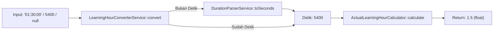

# LearningHourConverterService

## 1. Overview
`LearningHourConverterService` adalah service perantara (orchestrator converter) yang menghubungkan parsing string durasi (`DurationParserService`) dengan mesin kalkulasi jam belajar (`ActualLearningHourCalculator`).

Service ini menyederhanakan konversi berbagai tipe data durasi input (string durasi `HH:MM:SS`, `MM:SS`, integer detik, float, maupun null) menjadi nilai float learning hours dengan presisi 4 desimal.

## 2. Source Location
[LearningHourConverterService.php](file:///C:/laragon/owl/app/Services/LearningHours/LearningHourConverterService.php) (`app/Services/LearningHours/LearningHourConverterService.php`)

## 3. Main Responsibility
- **Multi-Type Duration Conversion (`convert`):** Menerima durasi dalam berbagai tipe data dan mengonversinya menjadi angka desimal jam belajar.
- **Seconds Conversion (`convertFromSeconds`):** Mendelegasikan penghitungan detik ke `ActualLearningHourCalculator`.

## 4. Used By
- [`ContentLearningHourService`](file:///C:/laragon/owl/app/Services/LearningHours/ContentLearningHourService.php) — menghitung `content.learning_hours` dari durasi materi.
- [`PlaylistLearningHourService`](file:///C:/laragon/owl/app/Services/LearningHours/PlaylistLearningHourService.php) — menghitung `trainingplan.learning_hours` dari akumulasi durasi modul.
- [`ContentUserLearningHourManagementService`](file:///C:/laragon/owl/app/Services/LearningHours/ContentUserLearningHourManagementService.php) — kalkulasi master jam belajar.
- [`Content`](file:///C:/laragon/owl/app/Models/Content.php) — mutator/accessor model.

## 5. Dependencies
| Dependency | Type | Purpose |
|---|---|---|
| `DurationParserService` | Service | Mengurai string format waktu ke detik |
| `ActualLearningHourCalculator` | Service | Menghitung $\text{round}(\frac{\text{seconds}}{3600}, 4)$ |

## 6. Database Tables
Service ini tidak berinteraksi langsung dengan database (**0 database queries**).

## 7. Public Methods

### `convert(string|int|float|null $duration): float`
**Purpose**
Mengonversi durasi dalam bentuk string, integer, float, atau null ke satuan jam belajar (float).

**Parameters**
| Parameter | Type | Description |
|---|---|---|
| `$duration` | `string\|int\|float\|null` | Input durasi dalam berbagai representasi |

**Return**
`float` — Nilai jam belajar 4 desimal (misal: 1800 detik / `"00:30:00"` $\rightarrow$ `0.5`).

**Process**
1. Jika null: kembalikan `0.0`.
2. Jika integer atau float: teruskan langsung ke `convertFromSeconds((int) $duration)`.
3. Jika string kosong: kembalikan `0.0`.
4. Jika string numerik tanpa tanda titik dua: cast ke integer detik dan konversi.
5. Jika string format waktu (`HH:MM:SS`): parse ke detik via `DurationParserService::toSeconds()` lalu konversi via `convertFromSeconds()`.

---

### `convertFromSeconds(?int $seconds): float`
**Purpose**
Menghitung jam belajar dari jumlah detik.

**Parameters**
| Parameter | Type | Description |
|---|---|---|
| `$seconds` | `?int` | Total detik |

**Return**
`float` — Nilai jam belajar desimal ($\text{round}(\frac{\text{seconds}}{3600}, 4)$).

## 8. Business Rules
1. **Standarisasi Konversi Katalog Konten**:
   Setiap modul materi baru yang dibuat atau diedit di sistem OWL dihitung jam belajarnya menggunakan service ini sebelum disimpan ke kolom `content.learning_hours`.
2. **Formula Jam Desimal**:
   Mengikuti standar formula `ActualLearningHourCalculator`: $\frac{\text{seconds}}{3600}$ dengan pembulatan 4 desimal.

## 9. Data Flow


## 10. Important Conditions
- `if ($seconds === 0) { return 0.0; }`
  - *Alasan:* Mencegah komputasi berlebih untuk durasi 0 detik.

## 11. Edge Cases
- **Input Durasi Null atau String Kosong:** Mengembalikan nilai aman `0.0`.
- **String Format Tidak Valid:** `toSeconds()` menghasilkan 0 $\rightarrow$ output `0.0`.

## 12. Related Services
- [`DurationParserService`](file:///C:/laragon/owl/app/Services/LearningHours/DurationParserService.php)
- [`ActualLearningHourCalculator`](file:///C:/laragon/owl/app/Services/LearningHours/ActualLearningHourCalculator.php)
- [`ContentLearningHourService`](file:///C:/laragon/owl/app/Services/LearningHours/ContentLearningHourService.php)

## 13. Related Models
- [`Content`](file:///C:/laragon/owl/app/Models/Content.php)
- [`TrainingPlan`](file:///C:/laragon/owl/app/Models/TrainingPlan.php)

## 14. Related Controllers / Commands
- [`ContentController`](file:///C:/laragon/owl/app/Http/Controllers/ContentController.php)
- [`TrainingPlanController`](file:///C:/laragon/owl/app/Http/Controllers/TrainingPlanController.php)

## 15. Known Risks / Maintenance Notes
- Class ini mengasumsikan input angka string tanpa `:` adalah detik, bukan menit. Jika admin menginput `"30"` dengan asumsi 30 menit, sistem akan mencatatnya sebagai 30 detik (0.0083 h). Pastikan form di UI selalu menampilkan format placeholder `HH:MM:SS`.

## 16. Safe Modification Guide
- Jika formula pembulatan jam ingin diubah, lakukan di `ActualLearningHourCalculator`, jangan di-override di class ini agar kalkulasi tetap seragam di seluruh modul.

## 17. Testing / Verification
- **Automated Test Terkait:**
  - `tests/Unit/LearningHoursServiceTest.php`
- **Command:**
  ```powershell
  php artisan test --filter=LearningHoursServiceTest
  ```

## 18. Handover Summary
- **Criticality:** High (Fasilitator konversi format durasi ke jam belajar pada form katalog)
- **Main Function:** Mengonversi berbagai tipe input durasi waktu menjadi nilai float learning hours 4 desimal.
- **Main Tables:** None (In-memory bridge service).
- **Main Caller:** `ContentLearningHourService`, `PlaylistLearningHourService`.
- **Be Careful When Changing:** Penanganan string numerik vs string berformat titik dua.
