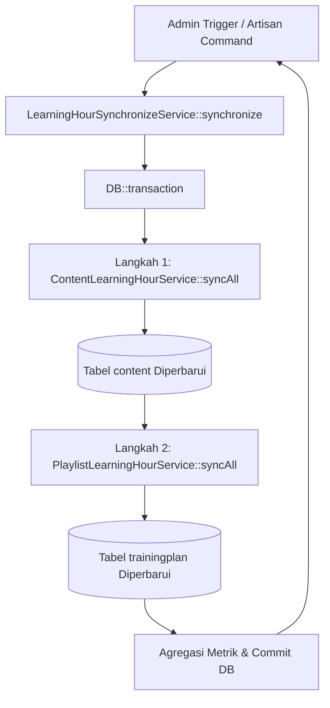

# LearningHourSynchronizeService

## 1. Overview
`LearningHourSynchronizeService` adalah service orkestrator tingkat tinggi (high-level sync orchestrator) yang mengeksekusi proses sinkronisasi katalog dua arah: pertama menyelaraskan seluruh materi konten tunggal (`ContentLearningHourService`), lalu dilanjutkan dengan menyelaraskan seluruh kurikulum playlist (`PlaylistLearningHourService`).

Eksekusi berurutan ini memastikan bahwa playlist selalu menghitung total jam belajar berdasarkan nilai durasi konten yang sudah diperbarui dan paling mutakhir.

## 2. Source Location
[LearningHourSynchronizeService.php](file:///C:/laragon/owl/app/Services/LearningHours/LearningHourSynchronizeService.php) (`app/Services/LearningHours/LearningHourSynchronizeService.php`)

## 3. Main Responsibility
- **Sequential Synchronization Pipeline:** Menjamin urutan sinkronisasi yang benar: Konten $\rightarrow$ Playlist.
- **Transaction Safety:** Membungkus seluruh siklus sinkronisasi di dalam database transaction atomik.
- **Aggregated Telemetry:** Menggabungkan metrik hasil sinkronisasi (`updated`, `skipped`, `total`) untuk laporan CLI maupun UI controller.

## 4. Used By
- [`LearningHourSyncController`](file:///C:/laragon/owl/app/Http/Controllers/LearningHourSyncController.php) — dipanggil saat tombol admin "Sync All Learning Hours" ditekan di panel kontrol.
- [`SyncLearningHoursCommand`](file:///C:/laragon/owl/app/Console/Commands/SyncLearningHoursCommand.php) — perintah artisan `php artisan learning-hours:sync`.

## 5. Dependencies
| Dependency | Type | Purpose |
|---|---|---|
| `ContentLearningHourService` | Service | Pelaksana sinkronisasi materi konten |
| `PlaylistLearningHourService` | Service | Pelaksana sinkronisasi kurikulum playlist |
| `Illuminate\Support\Facades\DB` | DB Facade | Pengelola transaksi database atomik |

## 6. Database Tables
Service ini tidak mengeksekusi query langsung, melainkan mendelegasikannya ke:
| Table | Operation | Delegated Via |
|---|---|---|
| `content` | READ / UPDATE | `ContentLearningHourService` |
| `trainingplan` | READ / UPDATE | `PlaylistLearningHourService` |
| `trainingplandetail` | READ | `PlaylistLearningHourService` |

## 7. Public Methods

### `synchronize(): array`
**Purpose**
Mengeksekusi siklus sinkronisasi katalog lengkap secara sekuensial.

**Parameters**
Tidak ada.

**Return**
```php
array{
    content_updated: int,
    content_skipped: int,
    content_total: int,
    playlist_updated: int,
    playlist_skipped: int,
    playlist_total: int,
    total_updated: int,
    total_skipped: int
}
```

**Process**
1. Membuka transaksi database atomik (`DB::transaction`).
2. Menjalankan `$this->contentService->syncAll()`. Seluruh baris di tabel `content` diperiksa dan diperbarui jika durasi/jam berubah.
3. Menjalankan `$this->playlistService->syncAll()`. Seluruh baris di tabel `trainingplan` dihitung ulang berdasarkan durasi modul-modul materi terkini.
4. Menjumlahkan total metrik dan mengembalikannya ke pemanggil.

## 8. Business Rules
1. **Aturan Urutan Dependensi**:
   Sinkronisasi konten WAJIB diselesaikan sebelum sinkronisasi playlist. Karena durasi playlist merupakan jumlah durasi modul-modul penyusunnya, mengeksekusi playlist sebelum konten akan menghasilkan perhitungan jam playlist dari data durasi konten yang usang.
2. **Semua-atau-Tidak-Sama-Sekali (All-or-Nothing Atomicity)**:
   Jika terjadi kegagalan fatal pada sinkronisasi playlist, pembaruan konten dalam siklus tersebut di-rollback secara otomatis untuk mencegah inkonsistensi state data.

## 9. Data Flow


## 10. Important Conditions
- `DB::transaction(...)`
  - *Alasan:* Menjamin integritas relasi data katalog OWL jika terjadi error di tengah proses.

## 11. Edge Cases
- **Database Lock Timeout:** Jika tabel `content` sangat besar, transaksi panjang berpotensi lock timeout jika ada trafik write bersamaan. Oleh karena itu disarankan menjalankan proses ini saat low-traffic atau via scheduled CLI command.

## 12. Related Services
- [`ContentLearningHourService`](file:///C:/laragon/owl/app/Services/LearningHours/ContentLearningHourService.php)
- [`PlaylistLearningHourService`](file:///C:/laragon/owl/app/Services/LearningHours/PlaylistLearningHourService.php)

## 13. Related Models
- [`Content`](file:///C:/laragon/owl/app/Models/Content.php)
- [`TrainingPlan`](file:///C:/laragon/owl/app/Models/TrainingPlan.php)

## 14. Related Controllers / Commands
- [`LearningHourSyncController`](file:///C:/laragon/owl/app/Http/Controllers/LearningHourSyncController.php)
- [`SyncLearningHoursCommand`](file:///C:/laragon/owl/app/Console/Commands/SyncLearningHoursCommand.php)

## 15. Known Risks / Maintenance Notes
- Jika data katalog bertambah hingga puluhan ribu record, menjalankan `synchronize()` dalam 1 HTTP request controller berpotensi terkena PHP max execution time (30/60s). Dalam kondisi tersebut, gunakan background job (`SyncContentLearningHourJob` & `SyncPlaylistLearningHourJob`) atau Artisan command.

## 16. Safe Modification Guide
- Jika ingin memisahkan proses konten dan playlist agar tidak dalam satu transaksi raksasa:
  1. Hapus wrapper `DB::transaction`.
  2. Pastikan urutan `$contentService->syncAll()` lalu `$playlistService->syncAll()` tetap dipertahankan.

## 17. Testing / Verification
- **Automated Test Terkait:**
  - `tests/Feature/PlaylistLearningHoursSynchronizationTest.php`
- **Command:**
  ```powershell
  php artisan learning-hours:sync
  ```

## 18. Handover Summary
- **Criticality:** High (Orkestrator pembaruan total seluruh jam belajar katalog aplikasi)
- **Main Function:** Menjalankan sinkronisasi sekuensial konten lalu playlist secara atomik.
- **Main Tables:** `content` dan `trainingplan` (via delegated services).
- **Main Caller:** `LearningHourSyncController`, `SyncLearningHoursCommand`.
- **Be Careful When Changing:** Urutan eksekusi konten sebelum playlist.
