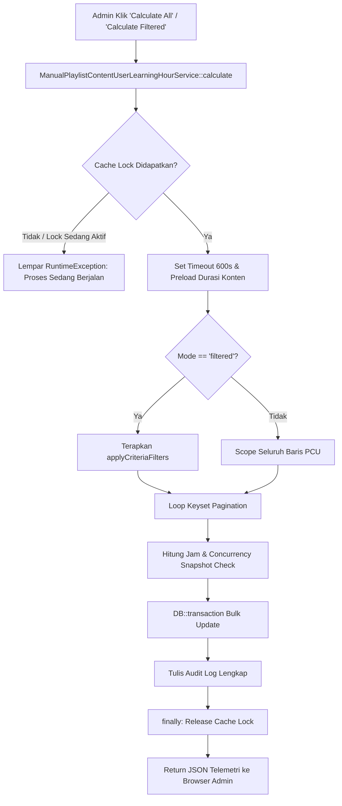

# ManualPlaylistContentUserLearningHourService

## 1. Overview
`ManualPlaylistContentUserLearningHourService` adalah service kalkulasi manual massal terproteksi (protected manual bulk calculator) untuk jam belajar modul playlist (`playlist_content_users`).

Service ini digunakan ketika admin secara eksplisit menekan tombol **"Calculate All"** atau **"Calculate Filtered"** pada panel manajemen jam belajar playlist. Fitur pembeda utama service ini adalah adanya **Distributed Cache Lock** untuk mencegah dua admin menjalankan kalkulasi massal secara bersamaan, serta pencatatan audit log lengkap atas identitas admin yang mengeksekusi proses.

## 2. Source Location
[ManualPlaylistContentUserLearningHourService.php](file:///C:/laragon/owl/app/Services/LearningHours/ManualPlaylistContentUserLearningHourService.php) (`app/Services/LearningHours/ManualPlaylistContentUserLearningHourService.php`)

## 3. Main Responsibility
- **Admin Distributed Lock (`Cache::lock`):** Mengunci eksekusi selama 300 detik (5 menit) menggunakan key `manual_playlist_content_user_learning_hour_calc`. Jika admin lain mencoba menekan tombol kalkulasi bersamaan, eksekusi langsung ditolak dengan pesan yang ramah.
- **Dukungan Dua Mode Eksekusi:**
  - Mode `all`: Memproses seluruh baris di tabel `playlist_content_users`.
  - Mode `filtered`: Hanya memproses data yang sesuai dengan filter aktif admin di layar (playlist tertentu, modul tertentu, status selesai, kategori materi, dll).
- **Snapshot Concurrency Protection:** Melindungi record dari penimpaan tidak sengaja jika siswa sedang memutar video saat kalkulasi manual admin berlangsung.
- **Comprehensive Audit Trail:** Mencatat log audit JSON lengkap (ID admin, nama admin, durasi eksekusi, jumlah row di-update, jumlah row di-skip karena konkurensi).

## 4. Used By
- [`PlaylistContentUserLearningHourController`](file:///C:/laragon/owl/app/Http/Controllers/Manage/LearningHours/PlaylistContentUserLearningHourController.php) — dipanggil dari endpoint AJAX eksekusi tombol kalkulasi manual admin.
- [`ManualCalculatePlaylistContentUserLearningHoursJob`](file:///C:/laragon/owl/app/Jobs/ManualCalculatePlaylistContentUserLearningHoursJob.php) — background queue job.

## 5. Dependencies
| Dependency | Type | Purpose |
|---|---|---|
| `ActualLearningHourCalculator` | Service | Kalkulasi nilai jam dari detik |
| `Illuminate\Support\Facades\Cache` | Cache Facade | Atomic distributed lock |
| `Illuminate\Support\Facades\DB` | DB Facade | Query keyset dan update atomik |
| `Illuminate\Support\Facades\Log` | Log Facade | Audit logging terstruktur |

## 6. Database Tables
| Table | Operation | Purpose |
|---|---|---|
| `content` | READ | Preload durasi materi aktif dalam 1 query awal |
| `playlist_content_users` | READ / UPDATE | Membaca data target dan memperbarui `learning_hour` serta `completed_at` |

## 7. Public Methods

### `calculate(array $criteria = [], array $options = []): array`
**Purpose**
Mengeksekusi kalkulasi massal manual dengan proteksi lock dan audit logging.

**Parameters**
- `$criteria`: Array filter jika mode `filtered` (trainingplan_id, content_id, finish_status, calculation_source, min_hour, max_hour, content_type, classification_slug, year).
- `$options`: Parameter eksekusi (`mode`, `dry_run`, `force`, `chunk_size`, `max_records`, `admin_id`, `admin_name`).

**Process**
1. Minta lock via `Cache::lock(self::LOCK_KEY, 300)`. Jika gagal, lempar `\RuntimeException('Another bulk calculation is currently in progress...')`.
2. Naikkan `set_time_limit(600)` dan `memory_limit` ke 512M.
3. Preload seluruh durasi konten aktif ke memory map `$contentsMap`.
4. Susun base query ke `playlist_content_users` (terapkan filter jika mode `filtered`).
5. Eksekusi Keyset Pagination `where('id', '>', $lastId)->limit($chunkSize)`.
6. Untuk setiap chunk:
   - Evaluasi detik aktual dan jam belajar per baris via `ActualLearningHourCalculator`.
   - Skip jika nilai jam sudah sama persis (kecuali `force = true`).
   - Kelompokkan ke `$updateGroups` berdasarkan target jam dan snapshot `current_time`.
7. Jika bukan dry-run, jalankan `DB::transaction`:
   - Eksekusi bulk update per grup dengan kondisi `where('current_time', snapshot_time)`.
   - Jika `affected < expected`, periksa snapshot terbaru untuk membedakan antara benturan konkurensi siswa vs nilai DB yang sudah sama.
   - Perbarui `completed_at` yang kosong pada data tuntas.
8. Tulis structured audit log ke file log aplikasi.
9. **Blok `finally`:** Selalu melepas distributed lock (`$lock->release()`).
10. Kembalikan array hasil telemetri eksekusi.

## 8. Business Rules
1. **Pencegahan Double Execution Lintas Admin**:
   Jika dua admin membuka halaman manajemen jam belajar playlist pada saat yang sama dan keduanya menekan "Calculate All", hanya satu admin yang diizinkan jalan. Admin kedua langsung menerima notifikasi bahwa proses sedang berjalan.
2. **Kepatuhan Filter (WYSIWYG Calculation)**:
   Pada mode `filtered`, kriteria filter yang diterapkan ke query update identik dengan kriteria tampilan DataTables. Admin dapat menargetkan kalkulasi hanya untuk playlist tertentu tanpa khawatir mengubah data playlist lainnya.
3. **Pelepasan Lock yang Terjamin (`finally` Block)**:
   Lock cache wajib dilepaskan di dalam blok `finally` agar jika terjadi error tak terduga (misal database exception), lock tidak menggantung dan sistem tidak terkunci selama 5 menit.

## 9. Data Flow


## 10. Important Conditions
- `$lock = Cache::lock(self::LOCK_KEY, self::LOCK_TTL); if (!$lock->get())`
  - *Alasan:* Proteksi mutlak race condition antar-sesi administrator.
- `try { ... } finally { $lock->release(); }`
  - *Alasan:* Menjamin sistem tidak deadlock jika terjadi unhandled exception.

## 11. Edge Cases
- **Pengecekan Konkurensi Siswa Aktif:** Siswa yang sedang menonton video saat tombol ditekan tidak akan kehilangan progres tontonnya (`totalConcurrentChanged` meningkat dan baris siswa tersebut dilewati dengan aman).

## 12. Related Services
- [`ActualLearningHourCalculator`](file:///C:/laragon/owl/app/Services/LearningHours/ActualLearningHourCalculator.php)
- [`PlaylistContentUserBatchCalculatorService`](file:///C:/laragon/owl/app/Services/LearningHours/PlaylistContentUserBatchCalculatorService.php)
- [`PlaylistContentUserLearningHourManagementService`](file:///C:/laragon/owl/app/Services/LearningHours/PlaylistContentUserLearningHourManagementService.php)

## 13. Related Models
- [`PlaylistContentUser`](file:///C:/laragon/owl/app/Models/PlaylistContentUser.php)
- [`TrainingPlan`](file:///C:/laragon/owl/app/Models/TrainingPlan.php)

## 14. Related Controllers / Commands
- [`PlaylistContentUserLearningHourController`](file:///C:/laragon/owl/app/Http/Controllers/Manage/LearningHours/PlaylistContentUserLearningHourController.php)
- [`ManualCalculatePlaylistContentUserLearningHoursJob`](file:///C:/laragon/owl/app/Jobs/ManualCalculatePlaylistContentUserLearningHoursJob.php)

## 15. Known Risks / Maintenance Notes
- TTL lock disetel selama 300 detik. Jika jumlah data sangat masif dan proses memakan waktu lebih dari 5 menit, lock cache berisiko kedaluwarsa sebelum eksekusi tuntas. Untuk volume data di atas 100.000 baris, disarankan menggunakan CLI command `learning-hours:calculate-playlist-content-users` yang berjalan tanpa batas web lock.

## 16. Safe Modification Guide
- Jika ingin menambah filter baru pada mode `filtered`:
  1. Daftarkan filter pada method `applyCriteriaFilters()`.
  2. Gunakan whitelist dan casting tipe data yang ketat (`(int)`, `(float)`).
  3. Jalankan automated test `ManualPlaylistContentUserLearningHourServiceTest`.

## 17. Testing / Verification
- **Automated Test Terkait:**
  - `tests/Unit/ManualPlaylistContentUserLearningHourServiceTest.php`
  - `tests/Feature/PlaylistContentUserManualLearningHourTest.php`
- **Command:**
  ```powershell
  php artisan test --filter=ManualPlaylistContentUserLearningHourServiceTest
  ```

## 18. Handover Summary
- **Criticality:** High (Service eksekusi tombol kalkulasi manual admin untuk playlist)
- **Main Function:** Eksekusi kalkulasi massal manual (all / filtered) dengan distributed cache lock dan snapshot concurrency protection.
- **Main Tables:** `playlist_content_users` (READ / UPDATE), `content` (READ).
- **Main Caller:** `PlaylistContentUserLearningHourController`, `ManualCalculatePlaylistContentUserLearningHoursJob`.
- **Be Careful When Changing:** Pelepasan lock di blok `finally` dan penanganan concurrency skip.
