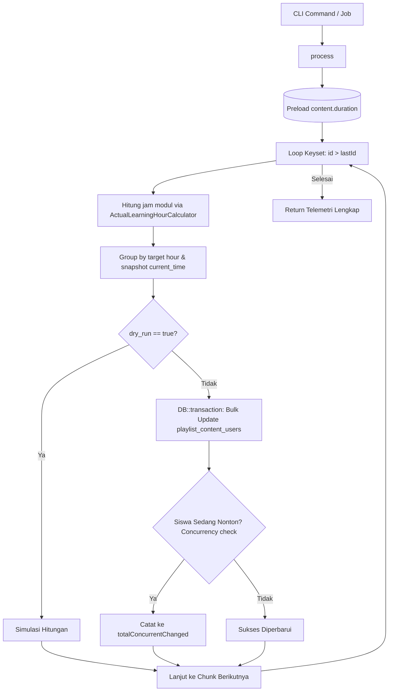

# PlaylistContentUserBatchCalculatorService

## 1. Overview
`PlaylistContentUserBatchCalculatorService` adalah service pemrosesan massal (bulk batch calculator) yang secara spesifik bertugas menghitung dan memperbarui nilai jam belajar aktual pada tabel **`playlist_content_users`** (progres modul dalam konteks kurikulum playlist).

Service ini memproses riwayat pembelajaran modul playlist dalam jumlah masif menggunakan teknik **Keyset Pagination**, **In-Memory Master Duration Preloading**, dan **Optimistic Concurrency Protection** untuk mencegah benturan data dengan proses belajar langsung siswa.

## 2. Source Location
[PlaylistContentUserBatchCalculatorService.php](file:///C:/laragon/owl/app/Services/LearningHours/PlaylistContentUserBatchCalculatorService.php) (`app/Services/LearningHours/PlaylistContentUserBatchCalculatorService.php`)

## 3. Main Responsibility
- **Keyset Batch Processing (`process`):** Membaca baris tabel `playlist_content_users` dalam potongan chunk (default 500) menggunakan `id > $lastId`.
- **Preload Durasi Modul (Zero N+1):** Memuat durasi seluruh konten katalog aktif dalam 1 query SQL awal.
- **Hierarki Resolusi Detik Modul:** Menghitung jam belajar dari `actual_watch_seconds` $\rightarrow$ `current_time` $\rightarrow$ durasi konten master jika tuntas $\rightarrow$ 0 detik jika belum tuntas.
- **Concurrency Difference Detection:** Mendeteksi baris yang gagal diupdate karena posisi video siswa berubah (heartbeat aktif) di tengah transaksi.

## 4. Used By
- [`CalculatePlaylistContentUserLearningHoursCommand`](file:///C:/laragon/owl/app/Console/Commands/CalculatePlaylistContentUserLearningHoursCommand.php) — command CLI artisan `php artisan learning-hours:calculate-playlist-content-users`.
- [`CalculatePlaylistContentUserLearningHoursJob`](file:///C:/laragon/owl/app/Jobs/CalculatePlaylistContentUserLearningHoursJob.php) — background job queue.

## 5. Dependencies
| Dependency | Type | Purpose |
|---|---|---|
| `ActualLearningHourCalculator` | Service | Kalkulator matematis nilai jam 4 desimal |
| `Illuminate\Support\Facades\DB` | DB Facade | Query builder dan transaksi database |

## 6. Database Tables
| Table | Operation | Purpose |
|---|---|---|
| `content` | READ | Preload seluruh durasi konten aktif |
| `playlist_content_users` | READ / UPDATE | Membaca data progres modul dan memperbarui `learning_hour` serta `completed_at` |

## 7. Public Methods

### `process(array $options = [], ?callable $onProgress = null): array`
**Purpose**
Mengeksekusi perhitungan dan penulisan massal jam belajar pada tabel `playlist_content_users`.

**Options Parameters**
| Parameter | Type | Default | Description |
|---|---|---|---|
| `chunk_size` | `int` | 500 | Ukuran batch data per iterasi |
| `dry_run` | `bool` | false | Mode simulasi tanpa penulisan ke database |
| `force` | `bool` | false | Hitung ulang meskipun `learning_hour` sudah terisi |
| `playlist_id`| `?int` | null | Filter spesifik ID playlist |
| `user_id` | `?int` | null | Filter spesifik ID user |
| `content_id` | `?int` | null | Filter spesifik ID konten |
| `max_records`| `?int` | null | Batas maksimal total record |

**Process**
1. Preload seluruh durasi konten aktif ke memory map `$contentsMap`.
2. Bangun query dasar ke `playlist_content_users` dengan filter opsional (playlist, user, content).
3. Loop Keyset Pagination: `where('id', '>', $lastId)->orderBy('id')->limit($chunkSize)`.
4. Untuk setiap baris dalam chunk:
   - Ambil durasi materi dari memory map atau `duration_seconds`.
   - Hitung jam belajar via `ActualLearningHourCalculator`.
   - Catat sampel telemetri (hingga 10 sampel).
   - Periksa `completed_at` pada data yang sudah tuntas (`finish = 1` atau `progress >= 100`).
   - Lewati record jika nilai jam sudah identik (kecuali `force = true`).
   - Kelompokkan ke `$updateGroups` berdasarkan target jam dan snapshot `current_time`.
5. Jika bukan dry-run, eksekusi dalam `DB::transaction`:
   - Bulk UPDATE dengan kondisi `whereIn('id', ...)->where('current_time', snapshot_time)`.
   - Hitung selisih konkurensi: jika `affected < expected`, selisihnya dicatat ke `totalConcurrentChanged`.
   - Update `completed_at` yang masih kosong pada record yang tuntas.
6. Trigger callback progress bar dan lanjutkan chunk berikutnya.

## 8. Business Rules
1. **Target Kolom Spesifik (`learning_hour`)**:
   Berbeda dari `content_users` yang menggunakan nama jamak `learning_hours`, tabel `playlist_content_users` secara arsitektural menggunakan nama tunggal `learning_hour`. Service ini menjamin tidak terjadi salah penulisan kolom.
2. **Prioritas Watch Time**:
   Modul playlist memprioritaskan waktu tonton riil (`actual_watch_seconds`) dari heartbeat video player sebelum memeriksa bookmark `current_time`.
3. **Penyelamatan Timestamp Selesai**:
   Setiap modul yang telah tuntas dijamin memiliki nilai `completed_at` yang valid (`COALESCE(updated_at, created_at, NOW())`).

## 9. Data Flow


## 10. Important Conditions
- `->where('current_time', $group['snapshot_time'])`
  - *Alasan:* Concurrency protection krusial agar tidak menimpa posisi video terkini jika ada siswa yang sedang memutar modul tersebut saat admin menjalankan kalkulasi massal.

## 11. Edge Cases
- **Konten Dihapus dari Katalog:** Dicatat dalam metrik `total_missing_content`.
- **Modul dengan Durasi Kosong:** Diberikan fallback aman 0.0 jam tanpa menyebabkan pembagian nol.

## 12. Related Services
- [`ActualLearningHourCalculator`](file:///C:/laragon/owl/app/Services/LearningHours/ActualLearningHourCalculator.php)
- [`ManualPlaylistContentUserLearningHourService`](file:///C:/laragon/owl/app/Services/LearningHours/ManualPlaylistContentUserLearningHourService.php)
- [`ContentUserBatchCalculatorService`](file:///C:/laragon/owl/app/Services/LearningHours/ContentUserBatchCalculatorService.php)

## 13. Related Models
- [`PlaylistContentUser`](file:///C:/laragon/owl/app/Models/PlaylistContentUser.php)
- [`Content`](file:///C:/laragon/owl/app/Models/Content.php)
- [`TrainingPlan`](file:///C:/laragon/owl/app/Models/TrainingPlan.php)

## 14. Related Controllers / Commands
- [`CalculatePlaylistContentUserLearningHoursCommand`](file:///C:/laragon/owl/app/Console/Commands/CalculatePlaylistContentUserLearningHoursCommand.php)
- [`CalculatePlaylistContentUserLearningHoursJob`](file:///C:/laragon/owl/app/Jobs/CalculatePlaylistContentUserLearningHoursJob.php)

## 15. Known Risks / Maintenance Notes
- Jika volume baris pada `playlist_content_users` mencapai jutaan record, pastikan batch dijalankan menggunakan Artisan CLI dengan opsi `--chunk=1000` pada server background worker agar tidak membebani memori web server utama.

## 16. Safe Modification Guide
- Jika ingin memodifikasi ukuran default batch:
  1. Sesuaikan file konfigurasi `config('learning_hours.playlist_content_user.chunk_size')`.
  2. Jangan mengubah query keyset `orderBy('id', 'asc')` menjadi ordering lain karena akan membatalkan optimasi primary key B-Tree index.

## 17. Testing / Verification
- **Automated Test Terkait:**
  - `tests/Feature/PlaylistContentUserLearningHourManagementTest.php`
- **Command:**
  ```powershell
  php artisan learning-hours:calculate-playlist-content-users --dry-run --limit=50
  ```

## 18. Handover Summary
- **Criticality:** High (Mesin batch massal jam belajar seluruh modul playlist)
- **Main Function:** Batch keyset pagination untuk menghitung dan memperbarui jam belajar pada `playlist_content_users`.
- **Main Tables:** `playlist_content_users` (READ / UPDATE), `content` (READ).
- **Main Caller:** `CalculatePlaylistContentUserLearningHoursCommand`.
- **Be Careful When Changing:** Nama kolom database target `learning_hour` dan proteksi snapshot `current_time`.
