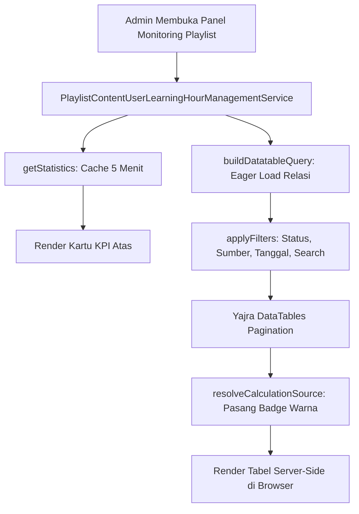

# PlaylistContentUserLearningHourManagementService

## 1. Overview
`PlaylistContentUserLearningHourManagementService` adalah service presentasi dan filtering data yang melayani panel administrasi **Playlist Content User Learning Hours** (halaman monitoring jam belajar modul playlist bagi administrator).

Service ini menyediakan:
- Query builder DataTables server-side dengan filter multi-dimensi (playlist, modul, pegawai, status selesai, sumber kalkulasi, tipe materi, kategori, dan tahun kelulusan).
- Kartu KPI statistik ter-cache (`getStatistics`) yang memetakan komposisi data antara tracking aktual, fallback historis, dan status belum selesai.
- Utilitas pemformatan data UI (badge klasifikasi sumber kalkulasi, format detik ke menit-detik, dan format jam belajar 4 desimal).

## 2. Source Location
[PlaylistContentUserLearningHourManagementService.php](file:///C:/laragon/owl/app/Services/LearningHours/PlaylistContentUserLearningHourManagementService.php) (`app/Services/LearningHours/PlaylistContentUserLearningHourManagementService.php`)

## 3. Main Responsibility
- **DataTables Server-Side Builder (`buildDatatableQuery`):** Merangkai query Eloquent dengan eager loading lengkap (`user`, `trainingPlan`, `content.classification`).
- **Penyaringan Database Tingkat Lanjut (`applyFilters`):** Menerapkan logika klasifikasi sumber perhitungan (`actual`, `historical`, `zero`) langsung ke kueri SQL MySQL.
- **KPI Metrics Aggregation (`getStatistics`):** Menghitung ringkasan metrik dengan cache 5 menit untuk menjaga performa server pada tabel besar.
- **Badging & Source Presentation (`resolveCalculationSource`):** Menentukan label badge visual (Actual Tracking, Historical Fallback, Zero/Unfinished) untuk kolom DataTables.

## 4. Used By
- [`PlaylistContentUserLearningHourController`](file:///C:/laragon/owl/app/Http/Controllers/Manage/LearningHours/PlaylistContentUserLearningHourController.php) — controller utama antarmuka monitoring jam belajar playlist.

## 5. Dependencies
| Dependency | Type | Purpose |
|---|---|---|
| `App\Models\PlaylistContentUser` | Model | Model Eloquent utama |
| `App\Support\DurationFormatter` | Support Helper | Konversi detik ke format HMS |
| `Illuminate\Support\Facades\Cache` | Cache Facade | Caching metrik KPI 5 menit |
| `Illuminate\Support\Facades\DB` | DB Facade | Eksekusi kueri agregasi cepat |

## 6. Database Tables
| Table | Operation | Purpose |
|---|---|---|
| `playlist_content_users` | READ | Sumber data utama tabel dan statistik KPI |
| `users` | READ | Join nama pegawai, NIP, peran |
| `trainingplan` | READ | Join judul dan slug playlist |
| `content` | READ | Join judul, tipe, durasi materi |
| `classification` | READ | Join kategori materi |

Service ini murni read-only.

## 7. Public Methods

### `buildDatatableQuery(Request $request): Builder`
**Purpose**
Membangun query builder Eloquent siap saji untuk Yajra DataTables server-side.

**Parameters**
| Parameter | Type | Description |
|---|---|---|
| `$request` | `Request` | HTTP Request berisi filter dan pencarian DataTables |

---

### `applyFilters(Builder $query, Request $request): void`
**Purpose**
Menerapkan filter dinamis pada query builder.

**Filter yang Didukung:**
1. **Training Plan:** `where('trainingplan_id', $id)`.
2. **Content ID:** `where('content_id', $id)`.
3. **User ID:** `where('user_id', $id)`.
4. **Finish Status:** `completed` (`finish = 1` atau `progress >= 100`) vs `in_progress`.
5. **Calculation Source:**
   - `actual`: `actual_watch_seconds > 0` ATAU `current_time > 0`.
   - `historical`: tidak ada watch time dan berstatus selesai.
   - `zero`: tidak ada watch time dan belum selesai.
6. **Range Jam Belajar:** Filter numerik `min_hour` dan `max_hour`.
7. **Tipe Konten:** Filter tipe `Video`, `Document`, atau `YouTube`.
8. **Klasifikasi:** Filter berdasarkan slug kategori materi.
9. **Tahun Kelulusan:** `whereYear('completed_at', $year)`.
10. **Pencarian Global:** Pencarian keyword lintas nama pegawai, NIP, judul konten, dan judul playlist.

---

### `getStatistics(): array`
**Purpose**
Mengembalikan data statistik ringkasan yang di-cache selama 300 detik (5 menit).

**Return Structure:**
```php
array{
    total_records: int,
    total_learning_hours: float,
    actual_tracking_count: int,
    historical_fallback_count: int,
    zero_count: int
}
```

---

### `resolveCalculationSource(PlaylistContentUser $row): array`
**Purpose**
Menganalisis satu baris record PCU dan mengembalikan representasi badge HTML/CSS UI:
- **Actual Tracking:** Badge hijau (`bg-green-lt`), icon `ti-device-analytics`.
- **Historical Fallback:** Badge biru/azure (`bg-azure-lt`), icon `ti-history`.
- **Zero / Unfinished:** Badge abu-abu (`bg-secondary-lt`), icon `ti-clock-pause`.

---

### `formatCurrentTime(int $seconds): array`
Memformat detik posisi video menjadi representasi ganda: format jam-menit-detik (`"00:20:30"`) dan teks ringkas (`"20m 30s"`).

## 8. Business Rules
1. **Klasifikasi Tiga Pilar Sumber Perhitungan**:
   - *Actual Tracking*: Data yang dihitung dari rekaman waktu tonton riil siswa.
   - *Historical Fallback*: Data siswa terdahulu yang telah lulus namun belum memiliki tracking detik, sehingga dihitung dari durasi materi katalog resmi.
   - *Zero / Unfinished*: Siswa yang baru mendaftar atau belum menyelesaikan materi dan belum memiliki rekaman tonton.
2. **Caching Statistik KPI untuk Skalabilitas**:
   Karena tabel `playlist_content_users` dapat berisi ratusan ribu baris, pemanggilan COUNT dan SUM dengan pengelompokan kondisi dibatasi dalam cache 5 menit agar tidak memperlambat loading dashboard admin.

## 9. Data Flow


## 10. Important Conditions
- `if ($request->calculation_source === 'historical')`
  - *Alasan:* Filter penting bagi auditor untuk melihat berapa banyak kredit jam pelatihan yang berasal dari aturan konversi data lama vs waktu tonton riil.

## 11. Edge Cases
- **Pencarian Kata Kunci Kosong:** Klausa pencarian `whereHas` dilewati secara otomatis untuk mencegah overhead join yang tidak perlu.

## 12. Related Services
- [`PlaylistContentUserBatchCalculatorService`](file:///C:/laragon/owl/app/Services/LearningHours/PlaylistContentUserBatchCalculatorService.php): Pelaksana eksekusi batch untuk data yang dipantau service ini.
- [`ManualPlaylistContentUserLearningHourService`](file:///C:/laragon/owl/app/Services/LearningHours/ManualPlaylistContentUserLearningHourService.php): Layanan kalkulasi manual terpilih dari halaman ini.

## 13. Related Models
- [`PlaylistContentUser`](file:///C:/laragon/owl/app/Models/PlaylistContentUser.php)
- [`TrainingPlan`](file:///C:/laragon/owl/app/Models/TrainingPlan.php)
- [`Content`](file:///C:/laragon/owl/app/Models/Content.php)

## 14. Related Controllers / Commands
- [`PlaylistContentUserLearningHourController`](file:///C:/laragon/owl/app/Http/Controllers/Manage/LearningHours/PlaylistContentUserLearningHourController.php)

## 15. Known Risks / Maintenance Notes
- Pencarian kata kunci global menggunakan `whereHas` bersarang ke tiga tabel (`users`, `content`, `trainingPlan`). Di database berskala sangat besar dengan jutaan record, pencarian teks bebas yang tidak spesifik dapat memakan waktu beberapa detik. Pastikan indeks pada kolom `name`, `id_emp`, dan `title` pada masing-masing tabel selalu aktif.

## 16. Safe Modification Guide
- Jika ingin menambah opsi klasifikasi sumber baru:
  1. Sesuaikan filter SQL di `applyFilters()`.
  2. Sesuaikan logika agregasi di `getStatistics()`.
  3. Sesuaikan badge di `resolveCalculationSource()`.

## 17. Testing / Verification
- **Automated Test Terkait:**
  - `tests/Feature/PlaylistLearningHourMenuTest.php`
  - `tests/Feature/PlaylistLearningHourTerminologyAndInfoTest.php`
- **Manual Verification:**
  - Buka menu Admin: `/manage/learning-hours/playlist-content-users`
  - Coba filter "Calculation Source: Historical" dan verifikasi badge biru muncul.

## 18. Handover Summary
- **Criticality:** Medium-High (Penyaji data monitoring jam modul playlist admin)
- **Main Function:** Query builder DataTables server-side, statistik KPI ter-cache, dan badging sumber kalkulasi jam belajar playlist.
- **Main Tables:** `playlist_content_users` (READ), `users` (READ), `trainingplan` (READ), `content` (READ).
- **Main Caller:** `PlaylistContentUserLearningHourController`.
- **Be Careful When Changing:** Logika query klasifikasi tiga sumber (`actual`, `historical`, `zero`) dan TTL cache 300 detik.
