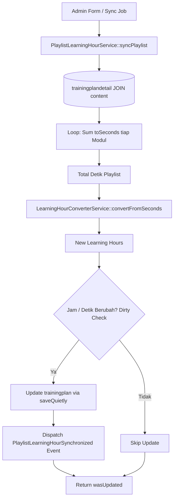

# PlaylistLearningHourService

## 1. Overview
`PlaylistLearningHourService` adalah service sinkronisasi durasi dan jam pembelajaran pada tingkat Playlist kurikulum (**`trainingplan`**).

Service ini bertugas:
- Menghitung total durasi dan jam belajar suatu playlist secara agregat dari seluruh modul materi yang terdaftar di dalamnya (`trainingplandetail.content`).
- Memperbarui kolom `trainingplan.learning_hours` dan (opsional) `trainingplan.total_duration_seconds`.
- Menyediakan utilitas kalkulasi jam instan untuk form pembuatan playlist yang belum disimpan ke database (`calculateLearningHoursFromContentIds`).

## 2. Source Location
[PlaylistLearningHourService.php](file:///C:/laragon/owl/app/Services/LearningHours/PlaylistLearningHourService.php) (`app/Services/LearningHours/PlaylistLearningHourService.php`)

## 3. Main Responsibility
- **Curriculum Aggregation:** Menjumlahkan detik durasi seluruh konten di `trainingplandetail` untuk menentukan total jam pelatihan playlist.
- **Controlled Duration Sync (`syncDuration` flag):** Memberikan opsi apakah `total_duration_seconds` boleh ikut diubah atau hanya menyinkronkan kolom `learning_hours`.
- **Pre-Save Form Calculation (`calculateLearningHoursFromContentIds`):** Menghitung total jam belajar dari sekumpulan ID konten saat admin menyusun silabus di form frontend sebelum data disimpan.
- **Batch Chunking & Dirty Checking (`syncAll`):** Sinkronisasi massal seluruh playlist dengan eager loading `trainingplandetail.content:id,duration` (Zero N+1).

## 4. Used By
- [`TrainingPlanController`](file:///C:/laragon/owl/app/Http/Controllers/TrainingPlanController.php) — saat create/update playlist di CMS admin.
- [`LearningHourSynchronizeService`](file:///C:/laragon/owl/app/Services/LearningHours/LearningHourSynchronizeService.php) — dipanggil pada sinkronisasi menyeluruh.
- [`SyncPlaylistLearningHourJob`](file:///C:/laragon/owl/app/Jobs/SyncPlaylistLearningHourJob.php) — background job sinkronisasi playlist.
- [`SyncLearningHoursCommand`](file:///C:/laragon/owl/app/Console/Commands/SyncLearningHoursCommand.php) — command CLI artisan.

## 5. Dependencies
| Dependency | Type | Purpose |
|---|---|---|
| `LearningHourConverterService` | Service | Konversi detik ke float jam belajar |
| `DurationParserService` | Service | Konversi string durasi materi ke detik |
| `App\Contracts\LearningHourSyncInterface` | Interface | Kontrak standar sinkronisasi |
| `App\DataTransferObjects\LearningHourSyncResult` | DTO | Objek hasil status sinkronisasi |
| `App\Events\PlaylistLearningHourSynchronized` | Event | Event Laravel saat jam playlist diperbarui |
| `App\Models\TrainingPlan` | Model | Model entitas playlist |
| `App\Models\Content` | Model | Model konten materi |

## 6. Database Tables
| Table | Operation | Purpose |
|---|---|---|
| `trainingplan` | READ / UPDATE | Membaca dan memperbarui `learning_hours` dan `total_duration_seconds` |
| `trainingplandetail` | READ | Mengambil daftar relasi modul di dalam playlist |
| `content` | READ | Mengambil durasi masing-masing modul (`duration`) |

## 7. Public Methods

### `syncPlaylist(TrainingPlan $plan, bool $syncDuration = false): bool`
**Purpose**
Menyinkronkan total jam untuk satu playlist.

**Parameters**
| Parameter | Type | Description |
|---|---|---|
| `$plan` | `TrainingPlan` | Instance model playlist |
| `$syncDuration` | `bool` | Default `false`. Jika true, memperbarui juga kolom `total_duration_seconds` |

**Process**
1. Dibungkus dalam transaksi `DB::transaction`.
2. Pastikan relasi `trainingplandetail.content:id,duration` telah dimuat.
3. Hitung akumulasi `totalSeconds` dari setiap modul: `$totalSeconds += $this->parser->toSeconds($detail->content->duration)`.
4. Hitung jam belajar baru via `converter->convertFromSeconds($totalSeconds)`.
5. Lakukan dirty checking pada `learning_hours` dan `total_duration_seconds`.
6. Jika berubah, simpan dengan `forceFill()->saveQuietly()`.
7. Catat audit log dan dispatch event `PlaylistLearningHourSynchronized`.
8. Kembalikan flag `wasUpdated`.

---

### `syncAll(bool $syncDuration = false): array`
**Purpose**
Sinkronisasi seluruh playlist di database secara batch dengan eager loading untuk mencegah query N+1.

**Return**
`array{updated: int, skipped: int, total: int}`

---

### `syncSinglePlaylist(TrainingPlan $plan, bool $syncDuration = true): LearningHourSyncResult`
Menyinkronkan single playlist dengan flag `$syncDuration = true` dan mengembalikan DTO detail hasil.

---

### `calculateLearningHoursFromContentIds(array $contentIds): float`
**Purpose**
Menghitung estimasi total jam belajar dari array ID konten (berguna untuk AJAX kalkulasi live saat admin memilih materi di form tambah playlist).

**Parameters**
| Parameter | Type | Description |
|---|---|---|
| `$contentIds` | `array` | Array ID konten materi |

**Return**
`float` — Total jam belajar gabungan.

## 8. Business Rules
1. **Komposisi Jam Belajar Playlist**:
   Jam belajar resmi sebuah playlist merupakan jumlah linear dari seluruh modul konten aktif yang terdaftar di dalamnya.
2. **Kontrol Pembaruan Durasi Detik (`syncDuration`)**:
   Secara default pada sinkronisasi massal (`syncAll`), parameter `$syncDuration = false`. Hal ini menjaga agar kolom `total_duration_seconds` yang mungkin telah disetel secara khusus oleh admin kurikulum tidak tertimpa tanpa izin, dan hanya kolom `learning_hours` yang diselaraskan.
3. **Dirty Checking Threshold**:
   Pembaruan di database dilewati jika perbedaan jam kurang dari $0.0001$ jam (setara $< 0.36$ detik).

## 9. Data Flow


## 10. Important Conditions
- `if (!$plan->relationLoaded('trainingplandetail'))`
  - *Alasan:* Menjamin relasi di-load dengan seleksi kolom minimal (`id, duration`) untuk efisiensi memori.
- `if ($syncDuration) { $attributes['total_duration_seconds'] = $totalSeconds; }`
  - *Alasan:* Menjaga keamanan data jika admin hanya bermaksud menyinkronkan jam desimal.

## 11. Edge Cases
- **Playlist Tanpa Modul:** `totalSeconds = 0`, menghasilkan `learning_hours = 0.0`.
- **Modul Tanpa Durasi di Database:** Diabaikan tanpa menyebabkan error perhitungan.

## 12. Related Services
- [`ContentLearningHourService`](file:///C:/laragon/owl/app/Services/LearningHours/ContentLearningHourService.php): Penyedia nilai durasi konten yang diakumulasi oleh service ini.
- [`LearningHourSynchronizeService`](file:///C:/laragon/owl/app/Services/LearningHours/LearningHourSynchronizeService.php): Orkestrator batch.

## 13. Related Models
- [`TrainingPlan`](file:///C:/laragon/owl/app/Models/TrainingPlan.php)
- [`TrainingPlanDetail`](file:///C:/laragon/owl/app/Models/TrainingPlanDetail.php)
- [`Content`](file:///C:/laragon/owl/app/Models/Content.php)

## 14. Related Controllers / Commands
- [`TrainingPlanController`](file:///C:/laragon/owl/app/Http/Controllers/TrainingPlanController.php)
- [`SyncPlaylistLearningHourJob`](file:///C:/laragon/owl/app/Jobs/SyncPlaylistLearningHourJob.php)
- [`SyncLearningHoursCommand`](file:///C:/laragon/owl/app/Console/Commands/SyncLearningHoursCommand.php)

## 15. Known Risks / Maintenance Notes
- Jika admin menambah atau menghapus modul dari suatu playlist di menu kurikulum, pastikan pemanggilan `syncPlaylist($plan, syncDuration: true)` dipanggil setelah perubahan relasi `trainingplandetail` selesai disimpan agar data jam playlist di katalog langsung ter-update.

## 16. Safe Modification Guide
- Jika ingin mewajibkan update `total_duration_seconds` selalu aktif:
  1. Periksa efek samping terhadap display frontend yang membaca kolom tersebut.
  2. Pastikan tidak menimpa durasi kustom jika ada kebijakan kurikulum khusus.
  3. Jalankan automated test `tests/Feature/PlaylistDurationSynchronizationTest.php`.

## 17. Testing / Verification
- **Automated Test Terkait:**
  - `tests/Feature/PlaylistDurationSynchronizationTest.php`
  - `tests/Feature/PlaylistLearningHoursSynchronizationTest.php`
- **Command:**
  ```powershell
  php artisan learning-hours:sync --playlist-only
  ```

## 18. Handover Summary
- **Criticality:** High (Penentu durasi dan jam resmi katalog playlist pelatihan)
- **Main Function:** Akumulasi durasi seluruh modul materi ke dalam kolom `trainingplan.learning_hours`.
- **Main Tables:** `trainingplan` (READ / UPDATE), `trainingplandetail` (READ), `content` (READ).
- **Main Caller:** `TrainingPlanController`, `LearningHourSynchronizeService`, `SyncPlaylistLearningHourJob`.
- **Be Careful When Changing:** Parameter `$syncDuration` dan eager loading relasi `trainingplandetail.content:id,duration`.
