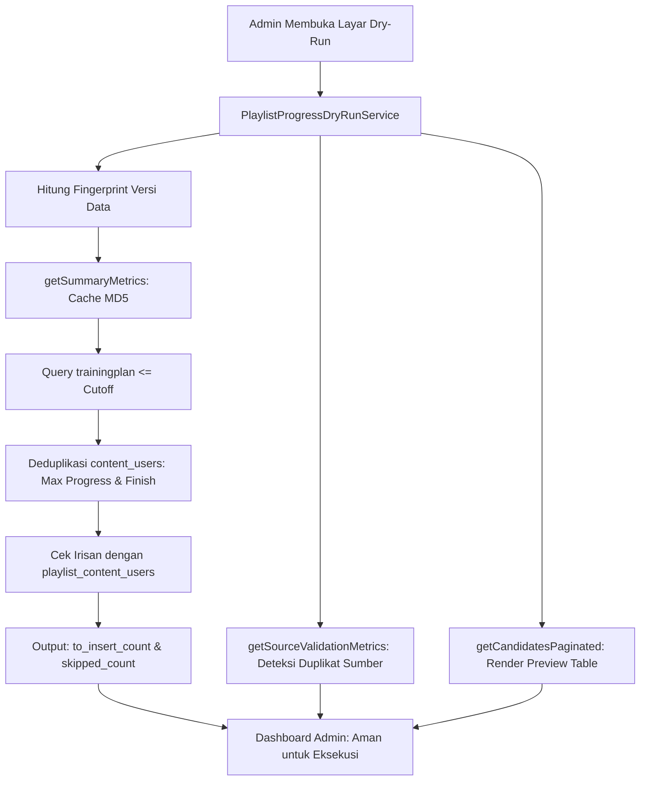

# PlaylistProgressDryRunService

## 1. Overview
`PlaylistProgressDryRunService` adalah service simulasi dan pratinjau (read-only dry-run previewer) untuk migrasi data histori progres playlist.

Sebelum sistem migrasi memindahkan data progres siswa lama dari `content_users` ke `playlist_content_users`, service ini bertugas:
- Menganalisis dan menyajikan metrik statistik kelayakan secara akurat tanpa mengubah satu byte pun data di database (**Strictly Read-Only**).
- Mendeteksi duplikasi dan konflik data pada sumber `content_users` (misalnya seorang user memiliki lebih dari satu baris progres untuk video yang sama).
- Menyediakan tabel pratinjau server-side paginasi dari calon baris data yang akan dibuat.

## 2. Source Location
[PlaylistProgressDryRunService.php](file:///C:/laragon/owl/app/Services/LearningHours/PlaylistProgressDryRunService.php) (`app/Services/LearningHours/PlaylistProgressDryRunService.php`)

## 3. Main Responsibility
- **Strictly Read-Only Guarantee:** Sama sekali tidak memiliki kueri manipulasi data (0 INSERT, UPDATE, DELETE, UPSERT, TRUNCATE).
- **Scope & Candidate Analysis (`getSummaryMetrics`):** Memisahkan playlist lama ($\le$ tanggal cutoff) dan baru ($>$ cutoff), menghitung calon record (`total_candidates`), baris yang sudah ada di PCU (`skipped_existing_count`), dan baris baru yang akan di-insert (`to_insert_count`).
- **Data Conflict Auditing (`getSourceValidationMetrics`):** Mengaudit grup duplikasi `(user_id, content_id)` pada `content_users` dan mendemonstrasikan pemilihan baris terbaik berdasarkan aturan prioritas.
- **Preview Table Pagination (`getCandidatesPaginated`):** Menyajikan data kandidat secara transparan ke layar admin dengan pencarian dan pagination.

## 4. Used By
- [`HistoricalPlaylistProgressExecutionService`](file:///C:/laragon/owl/app/Services/LearningHours/HistoricalPlaylistProgressExecutionService.php) — memanggil `getSummaryMetrics()` untuk inisialisasi sesi migrasi riil.
- [`PlaylistProgressDryRunController`](file:///C:/laragon/owl/app/Http/Controllers/Manage/LearningHours/PlaylistProgressDryRunController.php) — controller utama halaman dry-run audit playlist.

## 5. Dependencies
| Dependency | Type | Purpose |
|---|---|---|
| `Illuminate\Support\Facades\DB` | DB Facade | Eksekusi kueri agregasi SQL read-only |
| `Illuminate\Support\Facades\Cache` | Cache Facade | Caching metrik ringkasan dengan data fingerprint |
| `Illuminate\Contracts\Pagination\LengthAwarePaginator` | Interface | Paginator Laravel untuk tabel preview |

## 6. Database Tables
| Table | Operation | Purpose |
|---|---|---|
| `trainingplan` | READ | Filter playlist lama berdasarkan tanggal cutoff |
| `trainingplandetail` | READ | Relasi modul-modul materi di dalam playlist |
| `content_users` | READ | Analisis deduplikasi sumber progres user |
| `playlist_content_users` | READ | Mengecek apakah data sudah pernah dimigrasikan |
| `content` | READ | Metadata judul materi |
| `users` | READ | Metadata nama dan NIP pegawai |

Service ini **100% READ-ONLY**.

## 7. Public Methods

### `getSummaryMetrics(string $cutoff = self::DEFAULT_CUTOFF, ?int $playlistId = null, bool $fresh = false): array`
**Purpose**
Menghasilkan metrik agregat lengkap untuk kartu ringkasan dry-run (di-cache 5 menit dengan fingerprint versi data).

**Return Structure:**
```php
array{
    old_playlists_count: int,
    new_playlists_count: int,
    contents_count: int,
    affected_users_count: int,
    total_candidates: int,
    existing_pcu_count: int,
    skipped_existing_count: int,
    to_insert_count: int,
    finished_count: int,
    in_progress_count: int,
    zero_count: int
}
```

---

### `getSourceValidationMetrics(string $cutoff = self::DEFAULT_CUTOFF, ?int $playlistId = null): array`
**Purpose**
Menganalisis anomali duplikasi pada tabel `content_users` untuk materi yang masuk ke dalam playlist lama. Menampilkan aturan seleksi dan contoh konflik sebelum/sesudah.

**Aturan Prioritas Baris Terbaik (Phase 3 Rule):**
1. `finish = 1` (materi tuntas diprioritaskan).
2. `progress DESC` (persentase tuntas tertinggi).
3. `current_time DESC` (posisi tonton aktif terlama).
4. `id DESC` (catatan aktivitas terakhir).

---

### `getCandidatesPaginated(...): LengthAwarePaginator`
**Purpose**
Menghasilkan daftar baris kandidat paginasi server-side lengkap dengan penanda kolom `already_exists` (apakah record sudah ada di `playlist_content_users`).

---

### `getDataVersionFingerprint(?int $playlistId = null): string`
**Purpose**
Menghasilkan hash MD5 dari `COUNT(pcu)` + `COUNT(cu)` + `MAX(cu.id)` + `MAX(cu.updated_at)`. Jika ada data baru yang masuk, cache otomatis invalidated tanpa intervensi manual.

## 8. Business Rules
1. **Tanggal Cutoff Historis**:
   Secara default, ambang batas playlist historis adalah **`2026-08-28 23:59:59`** (`DEFAULT_CUTOFF`). Playlist yang dibuat setelah tanggal ini dianggap playlist baru yang sejak awal sudah menggunakan tabel `playlist_content_users`.
2. **Idempoten Tanpa Duplikasi**:
   Kandidat yang kombinasinya `(user_id, trainingplan_id, content_id)` sudah ada di tabel `playlist_content_users` dihitung sebagai `skipped_existing_count`. Hanya baris yang belum ada yang masuk ke `to_insert_count`.
3. **Deduplikasi Cerdas `content_users`**:
   Jika seorang karyawan memiliki 3 baris record untuk modul yang sama di `content_users` (misal progres 0%, 50%, dan 100%), dry-run hanya mengambil baris terbaik (100% selesai) untuk dihitung sebagai 1 kandidat modul playlist.

## 9. Data Flow


## 10. Important Conditions
- `->where('created_at', '<=', $cutoff)`
  - *Alasan:* Menjamin playlist baru yang dibuat belakangan tidak tercampur ke dalam proses migrasi historis.
- `MAX(CASE WHEN finish = '1' OR progress >= 100 THEN 1 ELSE 0 END) as is_finished`
  - *Alasan:* Memilih status terbaik dari duplikasi data siswa.

## 11. Edge Cases
- **Playlist Tanpa Materi:** Dikecualikan dari kandidat.
- **Kandidat Sudah Termigrasi 100%:** `to_insert_count` bernilai 0, menandakan migrasi sudah pernah selesai penuh.

## 12. Related Services
- [`HistoricalPlaylistProgressExecutionService`](file:///C:/laragon/owl/app/Services/LearningHours/HistoricalPlaylistProgressExecutionService.php): Service eksekutor yang mengeksekusi hasil analisis service ini.

## 13. Related Models
- [`TrainingPlan`](file:///C:/laragon/owl/app/Models/TrainingPlan.php)
- [`ContentUser`](file:///C:/laragon/owl/app/Models/ContentUser.php)
- [`PlaylistContentUser`](file:///C:/laragon/owl/app/Models/PlaylistContentUser.php)

## 14. Related Controllers / Commands
- [`PlaylistProgressDryRunController`](file:///C:/laragon/owl/app/Http/Controllers/Manage/LearningHours/PlaylistProgressDryRunController.php)

## 15. Known Risks / Maintenance Notes
- Service ini murni read-only sehingga tidak memiliki risiko merusak data. Namun kueri `getSourceValidationMetrics()` melakukan self-grouping yang membutuhkan pemindaian indeks. Hindari memanggil `fresh: true` secara berulang-ulang tanpa alasan.

## 16. Safe Modification Guide
- Jika tanggal cutoff sistem OWL bergeser:
  1. Ubah konstanta `DEFAULT_CUTOFF`.
  2. Pastikan `HistoricalPlaylistProgressExecutionService::DEFAULT_CUTOFF` ikut diselaraskan.
  3. Jalankan automated test `tests/Feature/PlaylistProgressDryRunTest.php`.

## 17. Testing / Verification
- **Automated Test Terkait:**
  - `tests/Feature/PlaylistProgressDryRunTest.php`
- **Manual Verification:**
  - Buka menu: `/manage/learning-hours/playlist-progress/dry-run`
  - Pastikan kartu KPI total kandidat dan tabel preview terisi tanpa error database.

## 18. Handover Summary
- **Criticality:** Medium (Alat audit dan pratinjau pra-migrasi)
- **Main Function:** Analisis read-only pratinjau migrasi histori progres playlist, audit konflik data, dan preview paginasi.
- **Main Tables:** `trainingplan` (READ), `content_users` (READ), `playlist_content_users` (READ).
- **Main Caller:** `PlaylistProgressDryRunController`, `HistoricalPlaylistProgressExecutionService`.
- **Be Careful When Changing:** Konstanta `DEFAULT_CUTOFF` dan logika deduplikasi sumber `content_users`.
