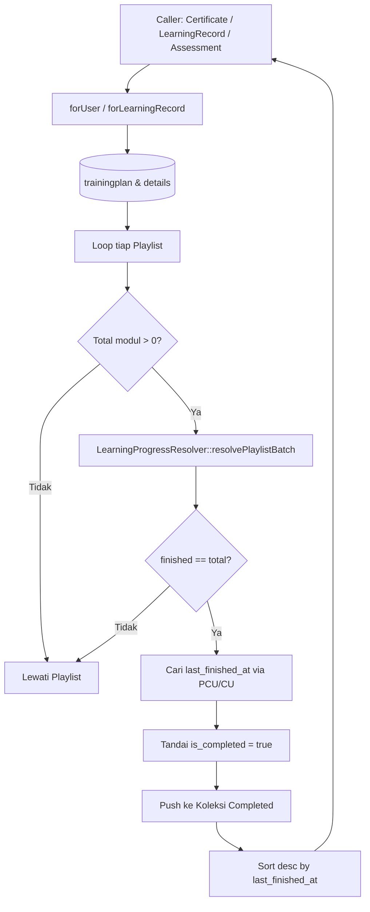

# CompletedPlaylistService

## 1. Overview
`CompletedPlaylistService` adalah service yang bertanggung jawab untuk mendeteksi dan mengumpulkan seluruh Playlist (Training Plan) yang telah **diselesaikan secara tuntas (100%)** oleh seorang user.

Service ini menjadi fondasi kelayakan pada berbagai fitur kunci OWL, termasuk:
- Penerbitan sertifikat kelulusan pelatihan (`CertificateEligibilityService`).
- Pembukaan akses assessment akhir playlist (`AssessmentAccessService`).
- Rekapitulasi jam belajar di riwayat pelatihan (`LearningRecordLearningHourService`).
- Tab riwayat pada halaman My Learning.

## 2. Source Location
[CompletedPlaylistService.php](file:///C:/laragon/owl/app/Services/Learning/CompletedPlaylistService.php) (`app/Services/Learning/CompletedPlaylistService.php`)

## 3. Main Responsibility
- **Evaluasi Kelulusan Playlist:** Memeriksa apakah seluruh modul di dalam sebuah playlist telah berstatus selesai (`isFinished()`) untuk user terkait.
- **Batch Progress Resolution:** Memanfaatkan `LearningProgressResolver` untuk mengevaluasi seluruh modul secara batch bebas N+1.
- **Penetapan Timestamp Penyelesaian:** Menentukan kapan playlist diselesaikan (`last_finished_at`) berdasarkan waktu update modul terakhir.
- **Preservasi Histori:** Menyediakan method khusus `forLearningRecord()` yang mempertahankan rekam jejak playlist yang pernah diselesaikan meskipun modul atau playlist tersebut saat ini berstatus tidak aktif atau di-soft-delete.

## 4. Used By
- [`LearningRecordLearningHourService`](file:///C:/laragon/owl/app/Services/Learning/LearningRecordLearningHourService.php) — memanggil `forLearningRecord()` untuk menghitung jam dari playlist selesai.
- [`CertificateEligibilityService`](file:///C:/laragon/owl/app/Services/CertificateEligibilityService.php) — mengecek apakah user telah menyelesaikan seluruh modul sebelum menerbitkan sertifikat.
- [`AssessmentAccessService`](file:///C:/laragon/owl/app/Services/AssessmentAccessService.php) — mengecek kelengkapan modul sebelum assessment dapat dikerjakan.
- [`LearningRecordController`](file:///C:/laragon/owl/app/Http/Controllers/LearningRecordController.php) — menampilkan playlist selesai di tab Learning Record.
- [`ExportMyLearningRecord`](file:///C:/laragon/owl/app/Exports/ExportMyLearningRecord.php) — ekspor Excel riwayat penyelesaian playlist.
- [`LearningAnalyticsService`](file:///C:/laragon/owl/app/Services/LearningAnalyticsService.php) — menghitung jumlah playlist yang berhasil diselesaikan user.

## 5. Dependencies
| Dependency | Type | Purpose |
|---|---|---|
| `LearningProgressResolver` | Service | Resolusi status selesai tiap modul secara batch |
| `App\Models\TrainingPlan` | Model | Query entitas playlist |
| `App\Models\TrainingPlanDetail` | Model | Relasi modul-modul dalam playlist |
| `App\Models\PlaylistContentUser` | Model | Query timestamp penyelesaian modul di tabel PCU |
| `App\Models\ContentUser` | Model | Query timestamp penyelesaian modul historis di tabel CU |
| `App\Support\DurationFormatter` | Support Helper | Konversi detik durasi ke teks durasi |

## 6. Database Tables
| Table | Operation | Purpose |
|---|---|---|
| `trainingplan` | READ | Mengambil daftar playlist aktif / all |
| `trainingplandetail` | READ | Mengambil daftar relasi konten/modul dalam playlist |
| `content` | READ | Mengecek keberadaan konten dan status aktifnya |
| `playlist_content_users` | READ | Mengambil timestamp penyelesaian modul (`completed_at`, `updated_at`) |
| `content_users` | READ | Fallback timestamp penyelesaian modul historis |

Service ini murni read-only.

## 7. Public Methods

### `forUser(int $userId, bool $includeInactive = false, bool $withTrashed = false): Collection`
**Purpose**
Mengambil seluruh playlist yang telah selesai 100% oleh user, diurutkan dari yang paling baru diselesaikan (`last_finished_at DESC`).

**Parameters**
| Parameter | Type | Description |
|---|---|---|
| `$userId` | `int` | ID Pengguna |
| `$includeInactive` | `bool` | Default `false`. Jika true, menyertakan playlist dan modul non-aktif |
| `$withTrashed` | `bool` | Default `false`. Jika true, menyertakan data yang ter-soft delete |

**Return**
`Collection<int, TrainingPlan>` — Koleksi objek `TrainingPlan` lengkap dengan properti dinamis: `total_items`, `finished_items`, `progress_percent` (100), `is_completed` (true), `duration`, dan `last_finished_at`.

**Process**
1. Query `TrainingPlan` dengan eager loading `trainingplandetail.content` berurutan sesuai `content_order`.
2. Untuk setiap playlist:
   - Saring detail konten yang valid (konten ada dan aktif jika `$includeInactive == false`).
   - Jika playlist tidak memiliki modul valid (`$total === 0`), lewati (playlist kosong tidak pernah dianggap selesai).
   - Jalankan `$this->resolver->resolvePlaylistBatch($userId, $plan->id, $contentIds)`.
   - Hitung modul yang berstatus `$r->isFinished()`.
   - Jika `$finished < $total`, abaikan (belum tuntas).
   - Jika `$finished === $total`:
     - Hitung durasi total format string.
     - Ambil timestamp penyelesaian modul terakhir dari `playlist_content_users` (atau fallback `content_users`).
     - Masukkan ke koleksi completed.
3. Urutkan hasil secara menurun berdasarkan `last_finished_at`.

---

### `forLearningRecord(int $userId): Collection`
**Purpose**
Resolver khusus untuk modul Learning Record dan ringkasan dashboard, dengan menyertakan modul non-aktif maupun soft-deleted.

**Parameters**
| Parameter | Type | Description |
|---|---|---|
| `$userId` | `int` | ID Pengguna |

**Return**
`Collection<int, TrainingPlan>`

**Process**
Memanggil `forUser($userId, includeInactive: true, withTrashed: true)`. Aturan ini menjamin kepatuhan audit: jika seorang karyawan telah menyelesaikan playlist pada tahun lalu, lalu tahun ini playlist tersebut di-non-aktifkan oleh admin, rekam jejak penyelesaian karyawan tersebut di Learning Record tidak boleh hilang.

## 8. Business Rules
1. **Syarat Kelulusan Mutlak (All or Nothing)**:
   Sebuah playlist HANYA dianggap selesai jika `finished_items == total_items` dan `total_items > 0`. Jika sebuah playlist memiliki 5 modul dan user baru menyelesaikan 4 modul, playlist tersebut TIDAK MASUK dalam koleksi ini.
2. **Playlist Kosong Bukan Selesai**:
   Playlist yang tidak memiliki modul atau modulnya telah dihapus (`total == 0`) secara eksplisit diabaikan.
3. **Preservasi Histori untuk Sertifikasi & Audit**:
   `forLearningRecord()` wajib menggunakan flag `withTrashed = true` dan `includeInactive = true` agar sertifikat dan jam pelatihan yang sah tidak hilang ketika kurikulum di-update atau diarsipkan.
4. **Timestamp Selesai Playlist**:
   Timestamp `last_finished_at` diambil dari waktu penyelesaian modul terakhir yang diselesaikan user dalam playlist tersebut.

## 9. Data Flow


## 10. Important Conditions
- `if ($total === 0) { continue; }`
  - *Alasan:* Mencegah playlist tanpa konten dianggap 100% selesai karena kondisi `0 == 0`.
- `if ($finished < $total) { continue; }`
  - *Alasan:* Menjamin seluruh materi wajib ditonton/dibaca tanpa ada yang terlewat.

## 11. Edge Cases
- **Playlist Diarsip/Dinonaktifkan Admin:** Pada tampilan reguler user tidak muncul, tetapi pada `forLearningRecord()` tetap dihitung agar hak sertifikasi dan kredit jam karyawan tidak hangus.
- **Modul Dihapus Setelah User Menyelesaikan:** Di-handle dengan memeriksa `includeInactive` dan `withTrashed`.

## 12. Related Services
- [`LearningProgressResolver`](file:///C:/laragon/owl/app/Services/Learning/LearningProgressResolver.php): Engine resolusi status tiap modul.
- [`OngoingPlaylistService`](file:///C:/laragon/owl/app/Services/Learning/OngoingPlaylistService.php): Pasangan layanan ini untuk playlist yang masih berjalan (< 100%).
- [`CertificateEligibilityService`](file:///C:/laragon/owl/app/Services/CertificateEligibilityService.php): Konsumen utama untuk kelayakan sertifikat.
- [`LearningRecordLearningHourService`](file:///C:/laragon/owl/app/Services/Learning/LearningRecordLearningHourService.php): Konsumen utama untuk kalkulasi jam riil.

## 13. Related Models
- [`TrainingPlan`](file:///C:/laragon/owl/app/Models/TrainingPlan.php)
- [`TrainingPlanDetail`](file:///C:/laragon/owl/app/Models/TrainingPlanDetail.php)
- [`PlaylistContentUser`](file:///C:/laragon/owl/app/Models/PlaylistContentUser.php)
- [`ContentUser`](file:///C:/laragon/owl/app/Models/ContentUser.php)

## 14. Related Controllers / Commands
- [`LearningRecordController`](file:///C:/laragon/owl/app/Http/Controllers/LearningRecordController.php)
- [`CertificateEligibilityService`](file:///C:/laragon/owl/app/Services/CertificateEligibilityService.php)

## 15. Known Risks / Maintenance Notes
- Jika sebuah playlist memiliki ratusan modul dan jumlah playlist di database sangat besar, pemanggilan `forUser` tanpa pagination bisa memakan waktu eksekusi. Oleh karena itu, pastikan eager loading `trainingplandetail.content` selalu dipertahankan dan jangan memanggil query individual di dalam loop.

## 16. Safe Modification Guide
- Jika ingin menambahkan status "Completed with Assessment":
  1. Jangan ubah logika kelulusan materi di class ini secara langsung; delegasikan pengecekan kelulusan ujian ke `CertificateEligibilityService` atau `AssessmentAccessService`.
  2. Pertahankan parameter `includeInactive` dan `withTrashed` untuk kebutuhan audit data historis.
  3. Jalankan pengujian `PlaylistServicesProgressTest`.

## 17. Testing / Verification
- **Automated Test Terkait:**
  - `tests/Feature/PlaylistServicesProgressTest.php`
  - `tests/Feature/PlaylistEndToEndLifecycleTest.php`
- **Command:**
  ```powershell
  php artisan test --filter=PlaylistServicesProgressTest
  ```

## 18. Handover Summary
- **Criticality:** Critical (Penentu utama kelulusan playlist, sertifikat, dan jam belajar)
- **Main Function:** Mengumpulkan seluruh playlist yang 100% selesai untuk seorang user.
- **Main Tables:** `trainingplan` (READ), `trainingplandetail` (READ), `playlist_content_users` (READ).
- **Main Caller:** `CertificateEligibilityService`, `LearningRecordLearningHourService`, `LearningRecordController`.
- **Be Careful When Changing:** Syarat `$finished < $total` dan penanganan `forLearningRecord()` dengan `withTrashed = true`.
