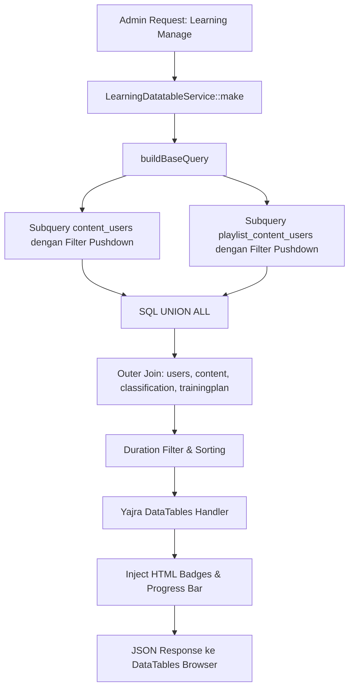

# LearningDatatableService

## 1. Overview
`LearningDatatableService` adalah service performa tinggi (high-performance query builder) yang melayani kebutuhan tabel DataTables server-side pada menu **Learning Manage** (Admin Monitoring Pembelajaran).

Service ini menyatukan dua sumber data progres yang berbeda — data pembelajaran mandiri (`content_users`) dan data modul playlist (`playlist_content_users`) — menjadi satu kesatuan tampilan (**Unified Learning Table**) menggunakan teknik **SQL UNION ALL** dengan optimasi **Filter Pushdown**.

## 2. Source Location
[LearningDatatableService.php](file:///C:/laragon/owl/app/Services/Learning/LearningDatatableService.php) (`app/Services/Learning/LearningDatatableService.php`)

## 3. Main Responsibility
- **Unified Base Query Construction (`buildBaseQuery`):** Merangkai subquery dari tabel `content_users` dan `playlist_content_users` lalu menggabungkannya via UNION ALL.
- **Filter Pushdown Optimization:** Menerapkan seluruh filter (status, tahun, tanggal, progres, klasifikasi, pegawai, pencarian kata kunci) sedini mungkin ke masing-masing subquery sebelum UNION dijalankan, untuk memaksimalkan penggunaan indeks database MySQL.
- **DataTables Response Generation (`make`):** Menyiapkan respons JSON standar Yajra DataTables dengan kolom yang diformat lengkap (badge status, badge kategori, avatar progres, link profil karyawan, dan tombol aksi).

## 4. Used By
- [`LearningManageController`](file:///C:/laragon/owl/app/Http/Controllers/LearningManageController.php) — controller utama menu monitoring pembelajaran administrator.
- [`ExportMyLearningRecord`](file:///C:/laragon/owl/app/Exports/ExportMyLearningRecord.php) / [`LearningExport`](file:///C:/laragon/owl/app/Exports/LearningExport.php) — ekspor data pembelajaran admin.

## 5. Dependencies
| Dependency | Type | Purpose |
|---|---|---|
| `Yajra\DataTables\Facades\DataTables` | Package Facade | Engine server-side pagination DataTables |
| `App\Support\DurationFormatter` | Support Helper | Pemformat string durasi waktu konten |
| `Carbon\Carbon` | Date Library | Parsing dan format tanggal pembelajaran |
| `Illuminate\Database\Query\Builder` | Query Builder | Penyusunan raw query builder tingkat rendah |

## 6. Database Tables
| Table | Operation | Purpose |
|---|---|---|
| `content_users` | READ | Subquery progres konten langsung |
| `playlist_content_users` | READ | Subquery progres konten dalam playlist |
| `users` | READ | Join data pegawai (`id_emp`, `name`, `department`, `team`, `ssohash`) |
| `content` | READ | Join data konten (`title`, `slug`, `type`, `duration`, `classification_id`) |
| `classification` | READ | Join nama kategori/klasifikasi konten |
| `trainingplan` | READ | Join judul playlist jika baris berasal dari playlist |

Service ini murni read-only.

## 7. Public Methods

### `buildBaseQuery(array $filters = [], string $type = '', string $slug = ''): Builder`
**Purpose**
Membangun query builder terpadu untuk data pembelajaran dengan filter pushdown.

**Parameters**
| Parameter | Type | Description |
|---|---|---|
| `$filters` | `array` | Kumpulan parameter filter dari request |
| `$type` | `string` | Tipe scope opsional (`category` atau `content`) |
| `$slug` | `string` | Slug spesifik jika difilter berdasarkan halaman kategori/konten |

**Return**
`Illuminate\Database\Query\Builder` — Query builder siap paginate.

**Proses Internal & Optimasi Filter Pushdown:**
1. Menyusun dua subquery dasar:
   - `$cuSelect` dari `content_users` (menghasilkan kolom `source_type = 'content'`, `category_source = 'All Content'`).
   - `$pcuSelect` dari `playlist_content_users` (menghasilkan `source_type = 'playlist'`, `category_source = 'Playlist'`).
2. Menerapkan **Filter Pushdown** langsung ke `$cuSelect` dan `$pcuSelect`:
   - Status (Finished, Ongoing, Not Started, Mandatory, Optional, Playlist).
   - Tahun dan rentang tanggal pembuatan (`created_at`).
   - Rentang persentase progres (`0`, `1-25`, `26-50`, `51-75`, `76-99`, `100`).
   - Klasifikasi dan Tipe Konten (`Document`, `Video`).
   - Filter NIP/Nama pegawai (subquery `users` via index `user_id`).
   - Pencarian judul modul & playlist.
   - Kata kunci pencarian global.
3. Menggabungkan subquery berdasarkan pilihan kategori:
   - Jika `category === 'all_content'`: hanya menggunakan `$cuSelect`.
   - Jika `category === 'playlist'`: hanya menggunakan `$pcuSelect`.
   - Jika `all`: menggabungkan `$cuSelect->unionAll($pcuSelect)`.
4. Melakukan LEFT JOIN pada outer query ke tabel `users`, `content`, `classification`, dan `trainingplan`.
5. Menerapkan filter durasi pada outer query menggunakan kalkulasi ekspresi SQL string durasi.
6. Menerapkan ordering (terbaru, terlama, progres tertinggi/terendah).

---

### `make(Request $request)`
**Purpose**
Menghasilkan JSON response lengkap untuk komponen DataTables di frontend.

**Parameters**
| Parameter | Type | Description |
|---|---|---|
| `$request` | `Request` | HTTP Request objek dari client DataTables |

**Return**
`\Illuminate\Http\JsonResponse`

**Process**
1. Mengatur pagination length (default 25 entri).
2. Menghitung total data (`ContentUser::count() + PlaylistContentUser::count()`) untuk indikator DataTables.
3. Menjalankan query builder `buildBaseQuery()`.
4. Menambahkan computed column untuk presentasi UI:
   - `type_badge`: badge warna oranye (Video) atau biru (Document).
   - `status_badge`: badge Mandatory, Optional, atau Playlist.
   - `category_badge`: All Content vs Playlist.
   - `id_emp` & `employee`: link ke profil user berdasarkan `ssohash`.
   - `learning_title`: judul konten dengan icon tipe dan subtext nama playlist.
   - `progress_bar`: progress bar HTML mini dengan persentase.
   - `action`: tombol "View".
5. Mengembalikan JSON via `DataTables::query()->make(true)`.

## 8. Business Rules
1. **Pemisahan Sumber Konten (All Content vs Playlist)**:
   Admin dapat memantau pembelajaran secara terpadu atau memfilter secara khusus hanya konten mandiri (`All Content`) atau hanya konten yang diambil melalui kurikulum playlist (`Playlist`).
2. **Filter Pushdown untuk Performa**:
   Di database dengan jutaan baris, melakukan UNION ALL terlebih dahulu sebelum WHERE akan menyebabkan MySQL membaca seluruh tabel ke temporary table. Dengan melakukan filter pushdown, index pada `user_id`, `created_at`, dan `finish` pada masing-masing tabel terpakai secara maksimal.
3. **Standarisasi ID Baris (Row ID)**:
   Row ID di-generate dengan format `{source_type}:{source_id}` (misal `content:123` atau `playlist:456`) untuk mencegah collision (benturan primary key) antara tabel `content_users` dan `playlist_content_users`.

## 9. Data Flow

## 10. Important Conditions
- `if (in_array($statusStr, ['mandatory', 'optional'], true))`
  - *Alasan:* Status mandatory dan optional hanya ada pada konten langsung (`content_users`). Pada subquery PCU dipasang `1 = 0` agar tidak membuang resource.
- `if ($statusStr === 'playlist')`
  - *Alasan:* Status playlist hanya ada pada PCU. Pada subquery CU dipasang `1 = 0`.

## 11. Edge Cases
- **Pencarian Global dengan Karakter Khusus:** Sanitasi string via `str_replace` dan binding parameter mencegah SQL Injection.
- **Durasi Format String Rusak:** Formula SQL CASE mengecek jumlah titik dua (`:`) pada kolom durasi untuk mencegah error konversi MySQL.

## 12. Related Services
- [`LearningHourService`](file:///C:/laragon/owl/app/Services/Learning/LearningHourService.php): Layanan formatting jam yang sejenis.

## 13. Related Models
- [`ContentUser`](file:///C:/laragon/owl/app/Models/ContentUser.php)
- [`PlaylistContentUser`](file:///C:/laragon/owl/app/Models/PlaylistContentUser.php)
- [`User`](file:///C:/laragon/owl/app/Models/User.php)
- [`Content`](file:///C:/laragon/owl/app/Models/Content.php)

## 14. Related Controllers / Commands
- [`LearningManageController`](file:///C:/laragon/owl/app/Http/Controllers/LearningManageController.php)

## 15. Known Risks / Maintenance Notes
- Logika parsing durasi string MySQL (`SUBSTRING_INDEX(c.duration, ':', ...)`) di method `buildBaseQuery()` bersifat sensitif terhadap format data di tabel `content`. Pastikan kolom `content.duration` selalu diisi dengan format baku `MM:SS` atau `HH:MM:SS`.

## 16. Safe Modification Guide
- Jika menambah kolom baru pada tabel DataTables:
  1. Tambahkan kolom pada SELECT outer query di `buildBaseQuery()`.
  2. Tambahkan `addColumn()` dan `orderColumn()` di method `make()`.
  3. Daftarkan nama kolom pada `rawColumns()` jika menghasilkan output HTML.
  4. Sesuaikan definisi kolom di view Blade `resources/views/learning/manage/index.blade.php`.

## 17. Testing / Verification
- **Automated Test Terkait:**
  - `tests/Feature/PlaylistAndContentStatusFilterTest.php`
- **Manual Verification:**
  - Buka menu Admin: `/learning/manage`
  - Coba filter status "Mandatory", "Optional", dan "Playlist".
  - Verifikasi bahwa pagination dan pencarian nama pegawai berfungsi lancar.

## 18. Handover Summary
- **Criticality:** High (Layanan monitoring utama seluruh data pembelajaran di panel administrator)
- **Main Function:** Query builder terpadu (UNION ALL) server-side DataTables dengan optimasi filter pushdown.
- **Main Tables:** `content_users` (READ), `playlist_content_users` (READ), `users` (READ), `content` (READ).
- **Main Caller:** `LearningManageController`.
- **Be Careful When Changing:** Skema SELECT kedua subquery sebelum UNION ALL (jumlah dan tipe kolom harus identik).
