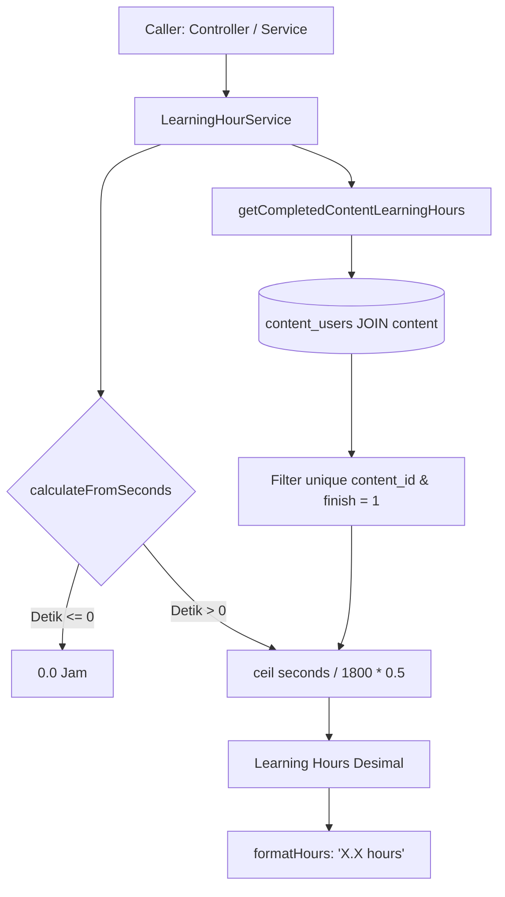

# LearningHourService

## 1. Overview
`LearningHourService` adalah service kalkulasi jam pembelajaran (learning hours) berbasis **discrete half-hour bucket** (pembulatan ke atas setiap kelipatan 30 menit / 0.5 jam). Service ini digunakan terutama pada dashboard My Learning, filter dropdown durasi, dan ringkasan pembelajaran konten yang telah selesai.

Fitur bisnis yang dilayani:
- Menghitung total jam belajar seorang karyawan dari konten-konten yang berstatus selesai (`finish = 1`).
- Mencegah double counting antara modul playlist dan konten mandiri.
- Mengonversi format durasi string (`HH:MM:SS` atau `MM:SS`) menjadi jam belajar desimal dengan pembulatan bucket 0.5 jam.

## 2. Source Location
[LearningHourService.php](file:///C:/laragon/owl/app/Services/Learning/LearningHourService.php) (`app/Services/Learning/LearningHourService.php`)

## 3. Main Responsibility
- **Bucket Calculation:** Mengonversi detik durasi konten ke satuan jam dengan aturan `ceil($seconds / 1800) * 0.5`.
- **User Learning Hour Summary:** Mengagregasi total jam belajar konten yang diselesaikan user secara unik (`unique content_id`).
- **Formatting & Filter Generation:** Format label jam (`0.5 hour`, `1 hour`, `2.5 hours`) dan opsi filter dropdown.

## 4. Used By
- [`LearningController`](file:///C:/laragon/owl/app/Http/Controllers/LearningController.php) — ringkasan jam belajar pada kartu profil user.
- [`LearningRecordController`](file:///C:/laragon/owl/app/Http/Controllers/LearningRecordController.php) — data opsi filter dan komputasi bucket lama.
- [`TrainingPlanController`](file:///C:/laragon/owl/app/Http/Controllers/TrainingPlanController.php) — format durasi playlist.
- [`PlaylistUserController`](file:///C:/laragon/owl/app/Http/Controllers/PlaylistUserController.php) — kalkulasi total jam playlist.
- [`ContentController`](file:///C:/laragon/owl/app/Http/Controllers/ContentController.php) — penyajian jam pada detail konten.
- [`LearningAnalyticsService`](file:///C:/laragon/owl/app/Services/LearningAnalyticsService.php) — komputasi analitik jam belajar karyawan.

## 5. Dependencies
| Dependency | Type | Purpose |
|---|---|---|
| `App\Models\ContentUser` | Model | Query konten selesai milik user |
| `App\Models\User` | Model | Identifikasi entitas user |
| `Illuminate\Support\Collection` | Support | Manipulasi koleksi durasi |

## 6. Database Tables
| Table | Operation | Purpose |
|---|---|---|
| `content_users` | READ | Filter user yang memiliki `finish = '1'` |
| `content` | READ | Join untuk mengambil durasi konten (`duration`) dan memeriksa `deleted_at IS NULL` |

Service ini murni read-only dan **tidak melakukan UPDATE atau INSERT**.

## 7. Public Methods

### `getTotalLearningHours(User|int $user, ?Collection $completedContentUsers = null): float`
**Purpose**
Mendapatkan total canonical learning hours untuk seluruh konten selesai milik user.

**Parameters**
| Parameter | Type | Description |
|---|---|---|
| `$user` | `User\|int` | Objek user atau ID user |
| `$completedContentUsers` | `?Collection` | Koleksi pre-loaded konten selesai (opsional, untuk mencegah query ulang) |

**Return**
`float` — Total jam belajar.

**Process**
Mendelegasikan pemanggilan ke `getCompletedContentLearningHours($user, $completedContentUsers)`.
*Catatan Arsitektur:* Durasi playlist sengaja tidak ditambahkan di sini karena playlist tersusun dari konten-konten yang sama; penambahan playlist akan mengakibatkan double counting (penghitungan ganda).

---

### `getCompletedContentLearningHours(User|int $user, ?Collection $completedContentUsers = null): float`
**Purpose**
Menghitung total jam dari durasi seluruh konten selesai yang unik.

**Parameters**
| Parameter | Type | Description |
|---|---|---|
| `$user` | `User\|int` | Objek user atau ID user |
| `$completedContentUsers` | `?Collection` | Koleksi opsional `content_users` |

**Return**
`float` — Total jam hasil kalkulasi.

**Process**
1. Jika koleksi pre-loaded tidak disediakan, lakukan query ke `content_users` join `content` untuk `finish = '1'`, bukan soft-deleted, dan `duration IS NOT NULL`.
2. Saring konten agar ID konten unik (`unique('content_id')`).
3. Ekstrak durasi dan lakukan penjumlahan `calculateTotal($durations)`.

---

### `calculate(?string $duration): float`
**Purpose**
Menghitung learning hours dari string durasi (`HH:MM:SS` atau `MM:SS`).

**Parameters**
| Parameter | Type | Description |
|---|---|---|
| `$duration` | `?string` | String durasi waktu |

**Return**
`float` — Nilai jam dalam bucket 0.5 jam.

---

### `calculateFromSeconds(?int $seconds): float`
**Purpose**
Formula inti penghitungan learning hour berbasis detik.

**Parameters**
| Parameter | Type | Description |
|---|---|---|
| `$seconds` | `?int` | Durasi waktu dalam detik |

**Return**
`float` — `ceil($seconds / 1800) * 0.5`. Jika detik <= 0, mengembalikan `0.0`.

---

### `bucket(?string $duration): float` / `bucketFromSeconds(?int $seconds): float`
Alias untuk `calculate()` dan `calculateFromSeconds()`.

---

### `format(?string $duration): string` / `formatFromSeconds(?int $seconds): string`
Mengonversi durasi langsung ke string representasi jam (misal: `"1.5 hours"`).

---

### `formatHours(float $hours): string`
**Purpose**
Format representasi angka jam ke teks yang rapi.

**Process**
- Jika `$hours <= 0`, kembalikan `'-'`.
- Format angka: hapus trailing zeros (`1.0` -> `1`, `1.50` -> `1.5`).
- Jika `$hours <= 1.0`, tambahkan akhiran `'hour'`, jika lebih tambahkan `'hours'`.

---

### `filterOptions(Collection $buckets): Collection`
**Purpose**
Menghasilkan list array opsi dropdown filter untuk frontend (`value` dan `label`).

## 8. Business Rules
1. **Formula Discrete Bucket (30 Menit)**:
   $$\text{Learning Hours} = \left\lceil \frac{\text{seconds}}{1800} \right\rceil \times 0.5$$
   - 1 detik s/d 1800 detik (30 menit) = 0.5 jam.
   - 1801 detik s/d 3600 detik (60 menit) = 1.0 jam.
   - 3601 detik s/d 5400 detik (90 menit) = 1.5 jam.
2. **Pencegahan Double Counting**:
   Total learning hours user dihitung dari konten selesai (`content_users.finish = 1`), bukan menjumlahkan konten + playlist. Karena modul di dalam playlist merujuk ke record konten, menjumlahkan keduanya akan menggandakan jam belajar karyawan.
3. **Keunikan Konten (`unique('content_id')`)**:
   Jika ada anomali di mana konten yang sama tersimpan lebih dari satu kali di `content_users`, hanya satu durasi konten yang dihitung.

## 9. Data Flow


## 10. Important Conditions
- `if ($seconds === 0) { return 0.0; }`
  - *Alasan:* Mencegah kalkulasi `ceil(0 / 1800) * 0.5` menghasilkan nilai palsu atau error pembagian.
- `content_users.finish === '1'`
  - *Alasan:* Jam belajar versi canonical bucket hanya diberikan bila konten berstatus tuntas/selesai.

## 11. Edge Cases
- **String Durasi Kosong / Null:** `durationToSeconds` menghasilkan 0 detik -> output `0.0`.
- **Format Durasi Bervariasi:** Mendukung format 2 bagian (`MM:SS`), 3 bagian (`HH:MM:SS`), maupun angka numerik murni.
- **Konten Dihapus (Soft Delete):** Dieksklusikan otomatis melalui `whereNull('content.deleted_at')`.

## 12. Related Services
- [`LearningRecordLearningHourService`](file:///C:/laragon/owl/app/Services/Learning/LearningRecordLearningHourService.php): Service learning hour alternatif yang menghitung jam *aktual yang dikonsumsi* (actual watch seconds) desimal 4 digit untuk rekap Learning Record.
- [`ActualLearningHourCalculator`](file:///C:/laragon/owl/app/Services/LearningHours/ActualLearningHourCalculator.php): Engine kalkulator jam aktual.
- [`LearningHourConverterService`](file:///C:/laragon/owl/app/Services/LearningHours/LearningHourConverterService.php): Service konversi durasi detik ke jam.

## 13. Related Models
- [`ContentUser`](file:///C:/laragon/owl/app/Models/ContentUser.php)
- [`User`](file:///C:/laragon/owl/app/Models/User.php)
- [`Content`](file:///C:/laragon/owl/app/Models/Content.php)

## 14. Related Controllers / Commands
- [`LearningController`](file:///C:/laragon/owl/app/Http/Controllers/LearningController.php)
- [`ContentController`](file:///C:/laragon/owl/app/Http/Controllers/ContentController.php)
- [`PlaylistUserController`](file:///C:/laragon/owl/app/Http/Controllers/PlaylistUserController.php)

## 15. Known Risks / Maintenance Notes
- **Perbedaan Filosofi Kalkulasi di OWL:** Perhatikan bahwa di OWL ada dua sistem penghitungan jam:
  1. *Discrete Bucket Model* (class ini: `LearningHourService`): Pembulatan kelipatan 0.5 jam berdasarkan durasi total konten yang diselesaikan.
  2. *Continuous Actual Model* (`LearningRecordLearningHourService` & `ActualLearningHourCalculator`): Berdasarkan detik aktual menonton (`actual_watch_seconds` / `current_time` dibagi 3600 hingga 4 desimal).
  Jangan tertukar saat mereferensikan service untuk laporan resmi KP (Kredit Poin) vs kartu profil.

## 16. Safe Modification Guide
- Jika institusi mengubah kebijakan pembulatan (misalnya dari kelipatan 30 menit ke pembulatan per 15 menit atau hitungan eksak):
  1. Ubah konstanta `BUCKET_SECONDS` (misal 900) dan `BUCKET_HOURS` (misal 0.25).
  2. Jangan mengubah query `unique('content_id')` karena akan menyebabkan duplikasi data.
  3. Jalankan unit test `tests/Unit/LearningHourServiceTest.php`.

## 17. Testing / Verification
- **Automated Test Terkait:**
  - `tests/Unit/LearningHourServiceTest.php`
- **Command:**
  ```powershell
  php artisan test --filter=LearningHourServiceTest
  ```

## 18. Handover Summary
- **Criticality:** High (Kalkulasi ringkasan jam belajar profil user dan filter durasi)
- **Main Function:** Menghitung total jam belajar berbasis discrete bucket 30 menit (0.5 jam).
- **Main Tables:** `content_users` (READ), `content` (READ).
- **Main Caller:** `LearningController`, `ContentController`, `LearningRecordController`.
- **Be Careful When Changing:** Konstanta `BUCKET_SECONDS` dan formula `ceil($seconds / 1800) * 0.5`.
