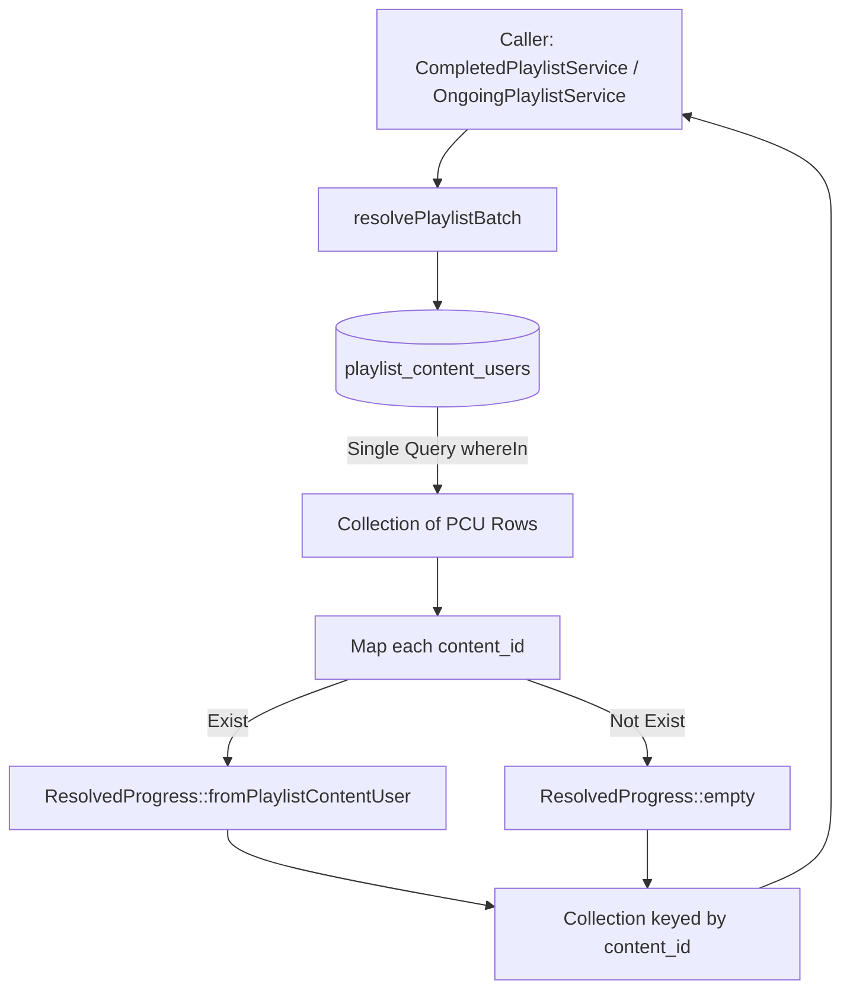

# LearningProgressResolver

## 1. Overview
`LearningProgressResolver` adalah service inti yang bertindak sebagai **Single Source of Truth** untuk menyelesaikan (resolve) status progres pembelajaran seorang user, baik untuk konten mandiri (direct content) maupun modul di dalam Playlist (training plan).

Service ini memecahkan masalah perbedaan skema historis di OWL antara progres konten mandiri (`content_users`) dan progres konten dalam konteks playlist (`playlist_content_users`), memastikan arsitektur pembacaan progres bebas dari duplikasi logika dan bebas masalah N+1 query.

## 2. Source Location
[LearningProgressResolver.php](file:///C:/laragon/owl/app/Services/Learning/LearningProgressResolver.php) (`app/Services/Learning/LearningProgressResolver.php`)

## 3. Main Responsibility
- **Direct Content Resolution:** Membaca status penyelesaian konten mandiri langsung dari tabel `content_users`.
- **Playlist Module Resolution:** Membaca status modul spesifik dalam suatu playlist secara definitif dari `playlist_content_users` (PCU).
- **Batch Resolution (Zero N+1):** Mengambil progres seluruh konten dalam satu playlist sekaligus hanya dengan satu query SQL efisien.

## 4. Used By
- [`CompletedPlaylistService`](file:///C:/laragon/owl/app/Services/Learning/CompletedPlaylistService.php) — memanggil `resolvePlaylistBatch()` untuk menentukan apakah playlist tuntas 100%.
- [`OngoingPlaylistService`](file:///C:/laragon/owl/app/Services/Learning/OngoingPlaylistService.php) — memanggil `resolvePlaylistBatch()` untuk agregasi kartu playlist ongoing user.
- [`AssessmentAccessService`](file:///C:/laragon/owl/app/Services/AssessmentAccessService.php) — memanggil `resolvePlaylist()` & `resolveDirect()` untuk validasi syarat membuka kuis/ujian.
- [`CertificateEligibilityService`](file:///C:/laragon/owl/app/Services/CertificateEligibilityService.php) — memanggil `resolvePlaylistBatch()` untuk syarat penerbitan sertifikat pelatihan.
- [`PlaylistUserController`](file:///C:/laragon/owl/app/Http/Controllers/PlaylistUserController.php) — menampilkan progres tiap video/dokumen dalam playlist player.
- [`TrainingPlanController`](file:///C:/laragon/owl/app/Http/Controllers/TrainingPlanController.php) — detail playlist dan manajemen modul.
- [`AssesmentUserController`](file:///C:/laragon/owl/app/Http/Controllers/AssesmentUserController.php) — validasi hak akses pengerjaan assessment.

## 5. Dependencies
| Dependency | Type | Purpose |
|---|---|---|
| `App\Models\ContentUser` | Model | Query progres konten langsung pada `content_users` |
| `App\Models\PlaylistContentUser` | Model | Query progres konten dalam playlist pada `playlist_content_users` |
| `App\Services\Learning\ResolvedProgress` | DTO / Value Object | Objek pembungkus hasil komputasi |
| `Illuminate\Support\Collection` | Support | Manipulasi koleksi data pada operasi batch |

## 6. Database Tables
| Table | Operation | Purpose |
|---|---|---|
| `content_users` | READ | Mengambil row progres berdasarkan `user_id` dan `content_id` |
| `playlist_content_users` | READ | Mengambil row progres berdasarkan `user_id`, `trainingplan_id`, dan `content_id` |

Service ini murni read-only dan **tidak melakukan INSERT, UPDATE, atau DELETE**.

## 7. Public Methods

### `resolveDirect(int $userId, int $contentId): ResolvedProgress`
**Purpose**
Mendapatkan status progres untuk konten tunggal yang dipelajari secara mandiri (bukan bagian dari playlist).

**Parameters**
| Parameter | Type | Description |
|---|---|---|
| `$userId` | `int` | ID User |
| `$contentId` | `int` | ID Konten |

**Return**
`ResolvedProgress` — objek berisi data dari `content_users` atau `ResolvedProgress::empty(SOURCE_NONE)` jika belum pernah diakses.

**Process**
1. Mencari baris pada tabel `content_users` dengan `user_id` dan `content_id`.
2. Jika ditemukan, kembalikan `ResolvedProgress::fromContentUser($cu)`.
3. Jika tidak ditemukan, kembalikan `ResolvedProgress::empty()`.

**Side Effects**
Tidak ada.

---

### `resolvePlaylist(int $userId, int $trainingPlanId, int $contentId): ResolvedProgress`
**Purpose**
Mendapatkan status progres satu konten/modul spesifik di dalam playlist tertentu.

**Parameters**
| Parameter | Type | Description |
|---|---|---|
| `$userId` | `int` | ID User |
| `$trainingPlanId` | `int` | ID Playlist (Training Plan) |
| `$contentId` | `int` | ID Konten/Modul |

**Return**
`ResolvedProgress` — objek progres definitif modul playlist.

**Process**
1. Mencari baris pada `playlist_content_users` berdasarkan kombinasi triplet: `user_id`, `trainingplan_id`, `content_id`.
2. Jika ada, kembalikan `ResolvedProgress::fromPlaylistContentUser($pcu)`.
3. Jika tidak ada baris PCU, kembalikan `ResolvedProgress::empty(SOURCE_NONE)` (progres 0%).
4. **Catatan Arsitektur:** Tidak ada runtime fallback ke tabel `content_users`. PCU bersifat definitif/authoritative.

**Side Effects**
Tidak ada.

---

### `resolvePlaylistBatch(int $userId, int $trainingPlanId, array|Collection $contentIds): Collection`
**Purpose**
Menyelesaikan status seluruh modul dalam satu playlist secara massal (batch) dalam 1 query SQL untuk menghindari query N+1.

**Parameters**
| Parameter | Type | Description |
|---|---|---|
| `$userId` | `int` | ID User |
| `$trainingPlanId` | `int` | ID Playlist |
| `$contentIds` | `array\|Collection` | Daftar ID Konten dalam playlist tersebut |

**Return**
`Collection<int, ResolvedProgress>` — Koleksi objek `ResolvedProgress` yang di-key berdasarkan `content_id`.

**Process**
1. Sanitasi dan ekstrak seluruh `contentIds` menjadi array integer.
2. Jika array kosong, kembalikan `collect()`.
3. Eksekusi 1 query ke `playlist_content_users` dengan kondisi `where('user_id', $userId)->where('trainingplan_id', $trainingPlanId)->whereIn('content_id', $contentIdArray)`.
4. Index hasil query dengan `keyBy('content_id')`.
5. Looping seluruh `contentIdArray`: jika ditemukan di map PCU, bungkus via `ResolvedProgress::fromPlaylistContentUser()`, jika tidak ditemukan, bungkus via `ResolvedProgress::empty()`.
6. Kembalikan koleksi hasil mapping.

**Side Effects**
Tidak ada.

## 8. Business Rules
1. **Authoritative Playlist Progress**: Sejak standardisasi fitur Playlist OWL, progres modul di dalam playlist WAJIB bersumber dari `playlist_content_users`. Progres menonton video playlist terisolasi dari progres menonton video yang sama di luar playlist.
2. **No Fallback Ambiguity at Runtime**: `resolvePlaylist` dan `resolvePlaylistBatch` sengaja tidak melakukan fallback otomatis ke `content_users` jika record PCU belum dibuat, melainkan mengembalikan progres 0% (`SOURCE_NONE`). Migrasi histori data masa lalu diselesaikan melalui script/batch migration terpisah (`HistoricalPlaylistProgressExecutionService`).
3. **Zero N+1 Query Guarantee**: Saat halaman daftar playlist memuat puluhan playlist dan ratusan modul, evaluasi harus selalu menggunakan `resolvePlaylistBatch` agar tidak terjadi looping query SQL.

## 9. Data Flow


## 10. Important Conditions
- `if (empty($contentIdArray))`
  - *Alasan:* Mencegah eksekusi SQL yang tidak perlu jika playlist belum memiliki konten/modul.
- `if ($pcus->has($cid))`
  - *Alasan:* Memastikan setiap konten yang terdaftar di playlist memiliki entri progres, meskipun user belum pernah membuka modul tersebut.

## 11. Edge Cases
- **Playlist Tanpa Konten:** Menghasilkan koleksi kosong secara instan tanpa query.
- **User Belum Pernah Membuka Playlist:** Seluruh item modul di-resolve menjadi `ResolvedProgress::empty()` dengan progres 0%, status `not_started`, sehingga caller tidak menerima nilai `null`.
- **Konten Di-soft Delete:** Query hanya mengecek keberadaan relasi user di PCU; filter status aktif/soft delete dikelola oleh caller seperti `OngoingPlaylistService`.

## 12. Related Services
- [`ResolvedProgress`](file:///C:/laragon\owl/app/Services/Learning/ResolvedProgress.php): DTO hasil dari method-method di class ini.
- [`OngoingPlaylistService`](file:///C:/laragon/owl/app/Services/Learning/OngoingPlaylistService.php): Pengguna utama batch resolution.
- [`CompletedPlaylistService`](file:///C:/laragon/owl/app/Services/Learning/CompletedPlaylistService.php): Pengguna utama batch resolution untuk deteksi kelulusan.
- [`HistoricalPlaylistProgressExecutionService`](file:///C:/laragon/owl/app/Services/LearningHours/HistoricalPlaylistProgressExecutionService.php): Service sinkronisasi data histori ke PCU.

## 13. Related Models
- [`PlaylistContentUser`](file:///C:/laragon/owl/app/Models/PlaylistContentUser.php)
- [`ContentUser`](file:///C:/laragon/owl/app/Models/ContentUser.php)

## 14. Related Controllers / Commands
- [`PlaylistUserController`](file:///C:/laragon/owl/app/Http/Controllers/PlaylistUserController.php)
- [`LearningOngoingController`](file:///C:/laragon/owl/app/Http/Controllers/LearningOngoingController.php)
- [`LearningRecordController`](file:///C:/laragon/owl/app/Http/Controllers/LearningRecordController.php)

## 15. Known Risks / Maintenance Notes
- **Jangan Menambahkan Fallback ke `content_users` di Runtime:** Sangat krusial untuk mempertahankan aturan arsitektur bahwa `resolvePlaylist` tidak fallback ke `content_users`. Menambahkan fallback di sini akan merusak isolasi progres playlist (misalnya seorang karyawan menonton video di My Learning reguler tidak boleh otomatis menandai playlist pelatihan wajib selesai).

## 16. Safe Modification Guide
- Jika perlu menambahkan data baru pada hasil resolusi (misal timestamp sertifikat atau tracking kuis):
  1. Tambahkan properti pada `ResolvedProgress`.
  2. Modifikasi factory method di `ResolvedProgress`.
  3. Jangan mengubah struktur return type `Collection<int, ResolvedProgress>` di `resolvePlaylistBatch()` agar controller tidak breaking.
  4. Jalankan pengujian `LearningProgressResolverTest`.

## 17. Testing / Verification
- **Automated Test Terkait:**
  - `tests/Unit/LearningProgressResolverTest.php`
  - `tests/Feature/PlaylistUserControllerResolverTest.php`
  - `tests/Feature/OngoingPlaylistServiceResolverTest.php`
- **Command:**
  ```powershell
  php artisan test --filter=LearningProgressResolverTest
  ```

## 18. Handover Summary
- **Criticality:** Critical (Pintu gerbang penentu status progres pembelajaran seluruh modul)
- **Main Function:** Single Source of Truth untuk kalkulasi progres direct content & batch playlist modules.
- **Main Tables:** `playlist_content_users` (READ), `content_users` (READ).
- **Main Caller:** `CompletedPlaylistService`, `OngoingPlaylistService`, `AssessmentAccessService`, `CertificateEligibilityService`.
- **Be Careful When Changing:** Jangan pernah mengubah aturan isolasi PCU atau menambahkan fallback runtime ke `content_users`.
