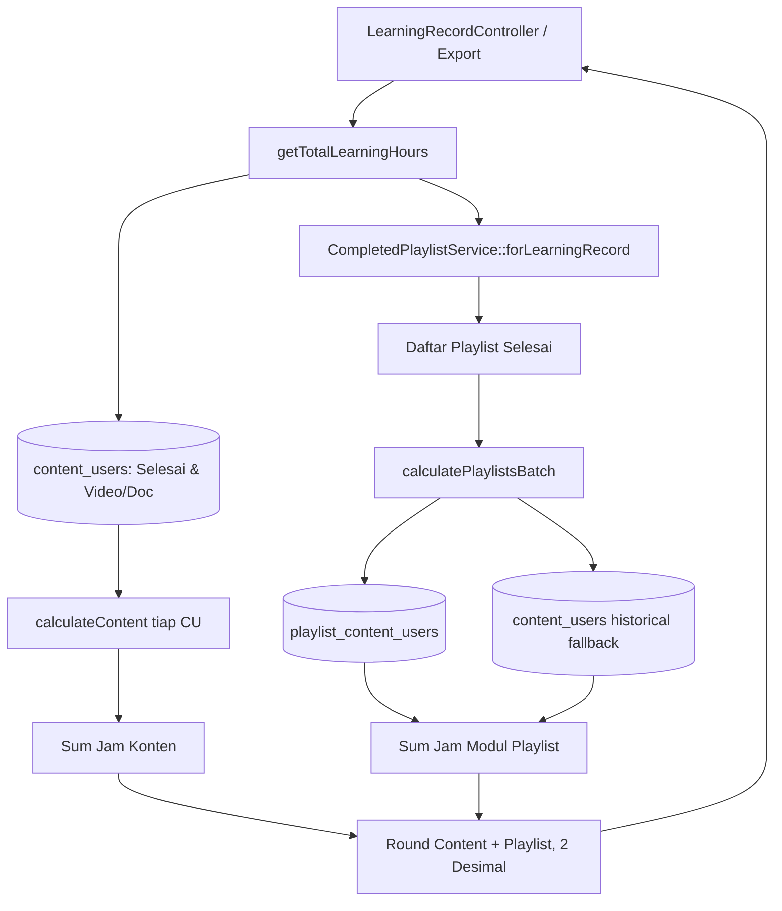

# LearningRecordLearningHourService

## 1. Overview
`LearningRecordLearningHourService` adalah service perhitungan **Actual Completed Learning Hours** (jam belajar riil yang telah dikonsumsi pengguna) untuk tab **Learning Record**, dashboard monitoring, dan ekspor data My Learning Record.

Berbeda dengan `LearningHourService` yang menggunakan pembulatan ember (discrete bucket 30 menit), service ini menghitung durasi presisi kontinu berdasarkan waktu tonton riil (`actual_watch_seconds` atau `current_time`) dengan presisi hingga 4 desimal (dan dibulatkan ke 2 desimal untuk ringkasan total). Service ini juga menggabungkan jam belajar dari konten selesai mandiri dan seluruh playlist yang telah diselesaikan secara tuntas.

## 2. Source Location
[LearningRecordLearningHourService.php](file:///C:/laragon/owl/app/Services/Learning/LearningRecordLearningHourService.php) (`app/Services/Learning/LearningRecordLearningHourService.php`)

## 3. Main Responsibility
- **Total Learning Hours Aggregator:** Menghitung gabungan jam riil konten selesai + playlist selesai untuk seorang user.
- **Single Content Calculation:** Menghitung jam belajar konten mandiri (`ContentUser`) dengan hirarki prioritas sumber detik (watch time -> current time -> full duration -> progress % -> fallback kolom learning_hours) serta pembatasan batas atas (`max_learning_hours`).
- **Batch Playlist Calculation (Zero N+1):** Menghitung jam riil kumpulan playlist yang diselesaikan pengguna dalam satu query batch, dengan fallback historis bila data PCU belum termigrasi.
- **Formatting:** Format tampilan jam untuk blade view (misal `0.73 hour`, `2.50 hours` yang di UI ditampilkan sebagai `0.73 h`, `2.50 h`).

## 4. Used By
- [`LearningRecordController`](file:///C:/laragon/owl/app/Http/Controllers/LearningRecordController.php) — controller utama halaman Learning Record pengguna.
- [`ExportMyLearningRecord`](file:///C:/laragon/owl/app/Exports/ExportMyLearningRecord.php) — ekspor Excel riwayat belajar user.
- [`LearningAnalyticsService`](file:///C:/laragon/owl/app/Services/LearningAnalyticsService.php) — ringkasan jam untuk dashboard analitik.

## 5. Dependencies
| Dependency | Type | Purpose |
|---|---|---|
| `CompletedPlaylistService` | Service | Mengambil daftar playlist yang berstatus completed untuk user |
| `App\Models\ContentUser` | Model | Sumber data riwayat modul konten langsung |
| `App\Models\PlaylistContentUser` | Model | Sumber data modul dalam playlist |
| `App\Models\TrainingPlan` | Model | Metadata playlist |
| `App\Support\DurationFormatter` | Support Helper | Parsing format durasi string ke detik |

## 6. Database Tables
| Table | Operation | Purpose |
|---|---|---|
| `content_users` | READ | Mengambil konten selesai (`finish = 1`, tipe Video/Document) |
| `content` | READ | Join data durasi dan tipe konten |
| `playlist_content_users` | READ | Mengambil riwayat progres modul dalam playlist yang diselesaikan |
| `trainingplan` | READ | Relasi playlist yang diselesaikan |

## 7. Public Methods

### `getTotalLearningHours(int $userId): float`
**Purpose**
Menghitung total canonical jam belajar riil yang telah selesai bagi seorang user (dibulatkan ke 2 desimal).

**Parameters**
| Parameter | Type | Description |
|---|---|---|
| `$userId` | `int` | ID Pengguna |

**Return**
`float` — Total jam belajar (misal `14.25`).

**Process**
1. Mengambil seluruh playlist selesai melalui `$this->completedPlaylistsService()->forLearningRecord($userId)`.
2. Query seluruh `content_users` dengan `finish = '1'`, bukan soft-deleted, dan bertipe `Video` atau `Document`.
3. Menghitung total jam konten mandiri: `sum(calculateContent($cu))`.
4. Menghitung total jam playlist selesai secara batch: `calculatePlaylistsBatch($userId, $completedPlaylists)->sum()`.
5. Mengembalikan `round($actualContentHours + $actualPlaylistHours, 2)`.

---

### `calculateContent(ContentUser $cu): float`
**Purpose**
Menghitung jam belajar aktual dari sebuah baris record `ContentUser`.

**Parameters**
| Parameter | Type | Description |
|---|---|---|
| `$cu` | `ContentUser` | Record progres konten |

**Return**
`float` — Jam belajar dengan presisi 4 desimal.

**Hirarki Penentuan Detik Aktual:**
1. Jika `actual_watch_seconds > 0`: gunakan `actual_watch_seconds`.
2. Jika `current_time > 0`: gunakan `current_time`.
3. Jika berstatus selesai (`finish = 1` atau `progress >= 100`) dan `duration_seconds > 0`: gunakan `duration_seconds` penuh.
4. Jika `progress > 0` dan `duration_seconds > 0`: gunakan `round((progress / 100) * duration_seconds)`.
5. Fallback historis: jika `cu.learning_hours > 0`, gunakan `round(learning_hours * 3600)`.
6. Jika tidak ada yang terpenuhi: 0 detik.
7. Konversi ke jam: `round(actualSeconds / 3600, 4)`.
8. Batasi dengan `content.max_learning_hours` jika kolom tersebut terdefinisi.

---

### `calculatePlaylistsBatch(int $userId, Collection $completedPlaylists): Collection`
**Purpose**
Menghitung konsumsi jam aktual untuk sejumlah playlist selesai secara batch tanpa N+1 query.

**Parameters**
| Parameter | Type | Description |
|---|---|---|
| `$userId` | `int` | ID Pengguna |
| `$completedPlaylists` | `Collection<int, TrainingPlan>` | Koleksi playlist selesai |

**Return**
`Collection<int, float>` — Map pasangan `[trainingplan_id => actual_learning_hours]`.

**Process**
1. Ambil seluruh `planIds`. Jika kosong, kembalikan `collect()`.
2. Single Query ke `playlist_content_users` berdasarkan `user_id` dan `planIds`, di-group berdasarkan `trainingplan_id`.
3. Single Query ke `content_users` untuk seluruh modul content ID sebagai fallback data historis jika baris PCU belum ada.
4. Loop setiap playlist: hitung konsumsi detik setiap modul valid dengan aturan hirarki (actual_watch -> current_time -> duration -> progress% -> fallback kolom).
5. Batasi modul dengan `content.max_actual_watch_seconds` jika ada.
6. Simpan hasil kalkulasi jam playlist: `round(consumedPlaylistSeconds / 3600, 4)`.

---

### `calculatePlaylistSingle(int $userId, TrainingPlan $plan): float`
Helper wrapper untuk kalkulasi 1 playlist tunggal.

---

### `formatHours(float $hours): string`
Memformat jam menjadi teks dengan 2 digit desimal (misal `0.08 hour`, `2.50 hours`, atau `'-'` jika <= 0).

---

### `filterOptions(Collection $buckets): Collection`
Memformat opsi dropdown filter pada halaman Learning Record.

## 8. Business Rules
1. **Model Continuous Actual vs Bucket**: Di Learning Record, jam belajar dihitung secara proporsional dan aktual (bukan pembulatan kelipatan 30 menit). Menonton 10 menit (600 detik) tercatat sebagai $\frac{600}{3600} \approx 0.1667$ jam.
2. **Prioritas Watch Time**: Jika player video mengirimkan event `actual_watch_seconds` (durasi riil menonton tanpa skip), nilai ini menjadi prioritas tertinggi. Jika tidak ada, fallback ke posisi terakhir `current_time`.
3. **Caps / Ceiling Protection**:
   - Konten tunggal dibatasi oleh `content.max_learning_hours`.
   - Modul playlist dibatasi oleh `content.max_actual_watch_seconds`.
   Mencegah user yang membiarkan tab terbuka terus-menerus mendapatkan jam belajar yang melebihi batas durasi modul.
4. **Historical Fallback Safety**: Playlist lama yang diselesaikan sebelum sistem PCU dibuat tetap dapat terhitung jam belajarnya via fallback ke `content_users`.

## 9. Data Flow


## 10. Important Conditions
- `whereIn('content.type', ['Video', 'Document'])`
  - *Alasan:* Tipe konten selain Video dan Document (misalnya artikel eksternal atau link) tidak diperhitungkan ke dalam kredit jam belajar resmi.
- `if ($d->content && $d->content->max_actual_watch_seconds !== null)`
  - *Alasan:* Mencegah kecurangan durasi tonton abnormal melebihi durasi konten maksimal yang diizinkan admin.

## 11. Edge Cases
- **Duration Kosong atau Null:** Fallback membaca dari `content.duration` string dan dikonversi via `DurationFormatter::toSeconds()`.
- **PCU Belum Ada untuk Playlist Lama:** Menggunakan fallback otomatis ke `content_users` milik user tersebut untuk modul yang bersangkutan.
- **Playlist Tanpa Modul Valid:** Menghasilkan 0.0 jam tanpa menyebabkan pembagian dengan nol.

## 12. Related Services
- [`CompletedPlaylistService`](file:///C:/laragon/owl/app/Services/Learning/CompletedPlaylistService.php): Dependency injeksi untuk deteksi playlist selesai.
- [`LearningHourService`](file:///C:/laragon/owl/app/Services/Learning/LearningHourService.php): Service jam versi discrete bucket (berbeda tujuan).
- [`ActualLearningHourCalculator`](file:///C:/laragon/owl/app/Services/LearningHours/ActualLearningHourCalculator.php): Service penghitung jam aktual tingkat granular.

## 13. Related Models
- [`ContentUser`](file:///C:/laragon/owl/app/Models/ContentUser.php)
- [`PlaylistContentUser`](file:///C:/laragon/owl/app/Models/PlaylistContentUser.php)
- [`TrainingPlan`](file:///C:/laragon/owl/app/Models/TrainingPlan.php)

## 14. Related Controllers / Commands
- [`LearningRecordController`](file:///C:/laragon/owl/app/Http/Controllers/LearningRecordController.php)
- [`ExportMyLearningRecord`](file:///C:/laragon/owl/app/Exports/ExportMyLearningRecord.php)

## 15. Known Risks / Maintenance Notes
- Logika hierarki fallback di `calculateContent()` dan `calculatePlaylistsBatch()` harus selalu sinkron dengan `ActualLearningHourCalculator`. Jika ada perubahan urutan fallback di satu tempat, pastikan tempat lainnya disesuaikan agar laporan My Learning Record dan tabel sinkronisasi menghasilkan angka yang sama persis.

## 16. Safe Modification Guide
- Jika ingin mengubah presisi pembulatan total:
  1. Periksa baris `return round($actualContentHours + $actualPlaylistHours, 2);`.
  2. Periksa tampilan Blade `record-row.blade.php` dan file ekspor Excel `ExportMyLearningRecord.php`.
  3. Jalankan automated test `MyLearningRecordDatabaseLearningHourTest`.

## 17. Testing / Verification
- **Automated Test Terkait:**
  - `tests/Feature/MyLearningRecordDatabaseLearningHourTest.php`
  - `tests/Feature/RecordAllCombinedTest.php`
- **Command:**
  ```powershell
  php artisan test --filter=MyLearningRecordDatabaseLearningHourTest
  ```

## 18. Handover Summary
- **Criticality:** Critical (Penentu angka resmi jam pembelajaran di Learning Record dan Ekspor KP)
- **Main Function:** Menghitung total dan rincian jam belajar aktual riil (konten + playlist) dengan hirarki prioritas watch time.
- **Main Tables:** `content_users` (READ), `playlist_content_users` (READ), `trainingplan` (READ), `content` (READ).
- **Main Caller:** `LearningRecordController`, `ExportMyLearningRecord`.
- **Be Careful When Changing:** Hirarki pemilihan detik (`actual_watch_seconds` -> `current_time` -> `duration_seconds`) dan batas atas (`max_learning_hours`).
