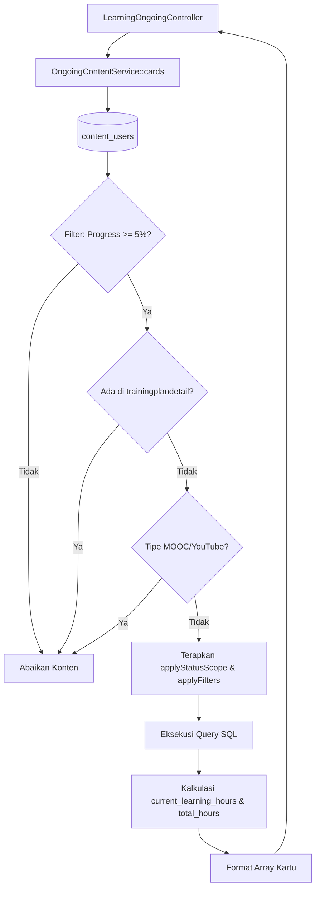

# OngoingContentService

## 1. Overview
`OngoingContentService` bertanggung jawab atas business logic kartu pembelajaran mandiri (Content mode: Video dan Dokumen) serta kartu MOOC (Massive Open Online Courses / YouTube) pada tab **Learning On Going**.

Service ini mengisolasi penuh data konten mandiri dari modul yang menjadi bagian dari playlist. Konten yang merupakan bagian dari sebuah playlist sengaja disaring dan dikeluarkan agar tidak muncul ganda (duplicate) di tab Ongoing.

## 2. Source Location
[OngoingContentService.php](file:///C:/laragon/owl/app/Services/Learning/OngoingContentService.php) (`app/Services/Learning/OngoingContentService.php`)

## 3. Main Responsibility
- **Isolasi Konten Mandiri:** Memastikan konten yang terdaftar di tabel `trainingplandetail` (anggota playlist) tidak ditampilkan pada tab Content mandiri.
- **Standar Kartu Video & Dokumen (`cards`):** Memproses kueri `content_users` dengan threshold progres awal minimum (>= 5%), menerapkan cakupan status (`ongoing`, `paused`, `not_started`, `completed`), dan menghitung konsumsi jam belajar aktual.
- **Standar Kartu MOOC (`moocCards`):** Menangani khusus konten bertipe `YouTube` dan `MOOC` dengan aturan lifecycle tersendiri.
- **Filter Komprehensif:** Mendukung filter berbasis durasi, posisi detik tonton (`current_time`), nomor halaman terakhir (`last_page`), total halaman dokumen, klasifikasi konten, dan tanggal akses.

## 4. Used By
- [`LearningOngoingController`](file:///C:/laragon/owl/app/Http/Controllers/LearningOngoingController.php) — controller utama tab Learning Ongoing saat user memilih mode "Content" atau mode "MOOC".

## 5. Dependencies
| Dependency | Type | Purpose |
|---|---|---|
| `App\Models\ContentUser` | Model | Query utama rekam jejak konten pengguna |
| `App\Support\DurationFormatter` | Support Helper | Konversi format string durasi ke detik |
| `Illuminate\Support\Facades\DB` | DB Facade | Query ekspresi SQL khusus (bulan, rentang waktu) |

## 6. Database Tables
| Table | Operation | Purpose |
|---|---|---|
| `content_users` | READ | Mengambil progres belajar user pada konten mandiri |
| `content` | READ | Mengambil metadata konten (judul, durasi, tipe, klasifikasi) |
| `trainingplandetail` | READ (`whereNotExists`) | Memeriksa dan mengecualikan konten yang merupakan anggota playlist |
| `classification` | READ | Relasi kategori/klasifikasi konten |
| `assesment` & `assesment_scores` | READ | Relasi nilai kuis yang melekat pada konten mandiri |

Service ini murni read-only.

## 7. Public Methods

### `cards(int $userId, array $filters): Collection`
**Purpose**
Membangun koleksi kartu pembelajaran konten mandiri (Video & Dokumen) yang sedang berlangsung sesuai filter aktif.

**Parameters**
| Parameter | Type | Description |
|---|---|---|
| `$userId` | `int` | ID Pengguna |
| `$filters` | `array` | Parameter filter dari HTTP request |

**Return**
`Collection<int, array>` — Daftar kartu konten siap render.

**Process**
1. Inisialisasi builder `ContentUser` untuk `user_id` yang bersangkutan dengan scope `withAvailableContent()`.
2. **Aturan 1 (Threshold Awal):** Terapkan `where('progress', '>=', 5)`. Konten dengan progres di bawah 5% dianggap belum benar-benar dipelajari dan tidak memenuhi syarat kartu ongoing.
3. **Aturan 2 (Eksklusi Playlist):** Terapkan `whereNotExists` pada tabel `trainingplandetail` untuk `content_id`. Konten playlist dikelola terpisah di `OngoingPlaylistService`.
4. **Aturan 3 (Eksklusi MOOC):** Terapkan `whereNotIn('type', ['YouTube', 'MOOC'])`.
5. Terapkan scope status (`applyStatusScope`):
   - `not_started`: `finish = 0` dan `progress = 0`.
   - `ongoing`: `finish = 0` dan `progress` antara 1 s/d 99.
   - `paused`: `finish = 0` dan `learning_status = 'paused'`.
   - `completed`: `finish = 1` atau `progress >= 100`.
6. Terapkan seluruh filter lanjutan (`applyFilters`): pencarian judul, tanggal, durasi, halaman dokumen, jam belajar.
7. Ambil data dari database dan hitung metrik jam:
   - `current_learning_hours`: jam aktual dari detik tonton riil / posisi `current_time` / persentase progres.
   - `total_learning_hours`: total jam dari durasi konten.
8. Kembalikan array koleksi kartu.

---

### `moocCards(int $userId, array $filters): Collection`
**Purpose**
Membangun koleksi kartu khusus untuk konten MOOC / YouTube.

**Parameters**
| Parameter | Type | Description |
|---|---|---|
| `$userId` | `int` | ID Pengguna |
| `$filters` | `array` | Parameter pencarian |

**Return**
`Collection<int, array>` — Koleksi kartu MOOC.

**Process**
1. Filter khusus `content.type IN ('YouTube', 'MOOC')`.
2. Eksklusikan konten yang masuk dalam anggota playlist.
3. Syarat MOOC Ongoing: `finish = '0'` DAN (`learning_status = 'in_progress'` ATAU `progress > 0`).
4. Format atribut jam dan kembalikan koleksi kartu.

## 8. Business Rules
1. **Threshold Kelayakan Ongoing 5%**:
   Konten biasa baru diakui sebagai "ongoing" jika user telah mencapai minimal 5% progres (`progress >= 5`). Hal ini mencegah konten yang dibuka tidak sengaja (hanya klik pembuka 1 detik) mengotori tampilan Ongoing user.
2. **Isolasi Mutlak dari Playlist**:
   Jika suatu materi video dimasukkan ke dalam suatu kurikulum Playlist oleh admin, materi tersebut TIDAK BOLEH muncul sebagai kartu terpisah di mode Content. Progresnya hanya boleh berjalan di dalam konteks Playlist terkait.
3. **Pemisahan Tipe MOOC/YouTube**:
   Materi MOOC dan YouTube memiliki UX dan pola tracking yang berbeda sehingga dipisahkan ke method `moocCards()`.
4. **Hierarki Jam Belajar Riil**:
   Penentuan jam terpakai memprioritaskan waktu tonton aktual (`actual_watch_seconds`), diikuti posisi `current_time`, dan persentase progres sebagai opsi terakhir.

## 9. Data Flow


## 10. Important Conditions
- `where('progress', '>=', 5)`
  - *Alasan:* Kebijakan bisnis OWL agar kartu ongoing hanya menampilkan materi yang benar-benar aktif dipelajari.
- `whereNotExists(trainingplandetail)`
  - *Alasan:* Menjaga kebersihan UI agar user tidak bingung melihat video yang sama muncul dua kali (di tab Content dan di tab Playlist).

## 11. Edge Cases
- **Konten Tanpa Durasi di `content_users`:** Service mengambil fallback dari `content.duration` dan mengonversinya via `DurationFormatter::toSeconds()`.
- **Nilai Progress di Luar Skala (0 - 100):** Dibatasi dan dinormalisasi dalam perhitungan.
- **Filter Status Paused:** Hanya berlaku pada konten video tunggal yang memiliki state `paused` pada player.

## 12. Related Services
- [`OngoingPlaylistService`](file:///C:/laragon/owl/app/Services/Learning/OngoingPlaylistService.php): Layanan rekanan untuk kartu Playlist.
- [`LearningRecordLearningHourService`](file:///C:/laragon/owl/app/Services/Learning/LearningRecordLearningHourService.php): Formula jam aktual yang setara.

## 13. Related Models
- [`ContentUser`](file:///C:/laragon/owl/app/Models/ContentUser.php)
- [`Content`](file:///C:/laragon/owl/app/Models/Content.php)
- [`TrainingPlanDetail`](file:///C:/laragon/owl/app/Models/TrainingPlanDetail.php)

## 14. Related Controllers / Commands
- [`LearningOngoingController`](file:///C:/laragon/owl/app/Http/Controllers/LearningOngoingController.php)

## 15. Known Risks / Maintenance Notes
- Filter database menggunakan banyak klausa dinamis `when()`. Pastikan index database pada `content_users(user_id, content_id, progress, finish)` dan `trainingplandetail(content_id)` tetap optimal agar query `whereNotExists` tidak memicu slow query saat volume data `content_users` bertambah besar.

## 16. Safe Modification Guide
- Jika ingin mengubah threshold awal progres (misal dari 5% menjadi 1%):
  1. Ubah `$query->where('progress', '>=', 5);` di `cards()`.
  2. Pastikan tidak menghapus filter `whereNotExists` untuk playlist.
  3. Uji tampilan tab Ongoing di browser dengan berbagai kombinasi filter.

## 17. Testing / Verification
- **Automated Test Terkait:**
  - `tests/Feature/PlaylistAndContentStatusFilterTest.php`
  - `tests/Feature/VideoWatchTimeTrackingTest.php`
- **Command:**
  ```powershell
  php artisan test --filter=PlaylistAndContentStatusFilterTest
  ```

## 18. Handover Summary
- **Criticality:** High (Pengelola kartu pembelajaran mandiri dan MOOC pada My Learning)
- **Main Function:** Menyeleksi, menyaring, dan menghitung jam belajar untuk konten mandiri (Video & Dokumen) yang sedang berlangsung.
- **Main Tables:** `content_users` (READ), `content` (READ), `trainingplandetail` (READ).
- **Main Caller:** `LearningOngoingController`.
- **Be Careful When Changing:** Syarat threshold progres minimal 5% dan klausul `whereNotExists` terhadap `trainingplandetail`.
