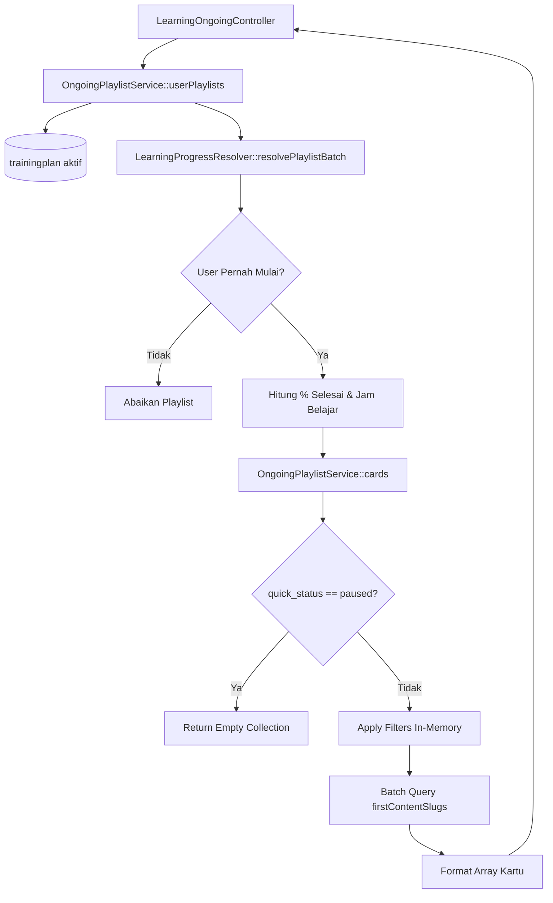

# OngoingPlaylistService

## 1. Overview
`OngoingPlaylistService` menangani business logic kartu Playlist (Training Plan) pada mode "Playlist" di tab **Learning On Going** (pembelajaran yang sedang berlangsung).

Service ini bertugas:
- Mengidentifikasi playlist mana saja yang sudah pernah disentuh atau dimulai oleh seorang user.
- Mengagregasi persentase progres, jumlah modul selesai, jam belajar yang telah terpakai, dan aktivitas terakhir.
- Menerapkan seluruh filter interaktif (pencarian judul, bucket progres, tahun/bulan aktivitas, rentang durasi, rentang tanggal, filter jam belajar) secara efisien di memori (in-memory) tanpa query berulang.
- Menentukan entry point URL playlist (konten modul pertama yang harus dibuka pengguna).

## 2. Source Location
[OngoingPlaylistService.php](file:///C:/laragon/owl/app/Services/Learning/OngoingPlaylistService.php) (`app/Services/Learning/OngoingPlaylistService.php`)

## 3. Main Responsibility
- **Touch Detection (`userPlaylists`):** Hanya memproses playlist yang sudah pernah dibuka/disentuh user (`hasStarted() == true`).
- **Progress Aggregation:** Menghitung `finished_items`, `avg_progress`, `progress_percent` ($\frac{\text{finished}}{\text{total}} \times 100$), serta `is_completed`.
- **Card Filtering & Formatting (`cards`):** Menyeleksi playlist berdasarkan `quick_status` (`ongoing`, `not_started`, `completed`), filter durasi, dan filter tanggal aktivitas terakhir.
- **Entry Point Resolution (`firstContentSlugs`):** Mengambil slug konten pertama berdasarkan urutan `content_order` dengan 1 query gabungan bebas N+1.

## 4. Used By
- [`LearningOngoingController`](file:///C:/laragon/owl/app/Http/Controllers/LearningOngoingController.php) — controller utama tab Learning Ongoing saat user memilih tab view Playlist.

## 5. Dependencies
| Dependency | Type | Purpose |
|---|---|---|
| `LearningProgressResolver` | Service | Resolusi status modul batch |
| `App\Models\TrainingPlan` | Model | Query data playlist |
| `App\Models\TrainingPlanDetail` | Model | Relasi urutan modul playlist |
| `App\Models\PlaylistContentUser` | Model | Data progres dan durasi tonton modul |
| `App\Models\ContentUser` | Model | Timestamp fallback historis |
| `App\Support\DurationFormatter` | Support Helper | Konversi detik ke format durasi |
| `Illuminate\Support\Facades\DB` | DB Facade | Query batch slug konten pertama playlist |

## 6. Database Tables
| Table | Operation | Purpose |
|---|---|---|
| `trainingplan` | READ | Mengambil playlist berstatus aktif |
| `trainingplandetail` | READ | Mengambil relasi modul playlist terurut |
| `content` | READ | Memeriksa modul aktif dan mengambil slug pertama |
| `playlist_content_users` | READ | Mengambil progres dan timestamp aktivitas |
| `content_users` | READ | Fallback timestamp aktivitas historis |

Service ini murni read-only.

## 7. Public Methods

### `userPlaylists(int $userId): Collection`
**Purpose**
Mengambil seluruh playlist aktif yang sudah disentuh oleh user beserta seluruh agregat metriknya.

**Parameters**
| Parameter | Type | Description |
|---|---|---|
| `$userId` | `int` | ID Pengguna |

**Return**
`Collection<int, TrainingPlan>` — Koleksi playlist yang sudah diperkaya dengan atribut komputasi.

**Process**
1. Ambil seluruh playlist aktif beserta `trainingplandetail.content` aktif yang diurutkan berdasar `content_order`.
2. Ambil seluruh data `playlist_content_users` milik user untuk ID-ID playlist tersebut.
3. Untuk setiap playlist:
   - Saring detail modul yang valid.
   - Batch resolve via `LearningProgressResolver::resolvePlaylistBatch()`.
   - **Filter Sentuh:** Periksa `$resolvedBatch->filter(fn ($r) => $r->hasStarted())->isNotEmpty()`. Jika user belum pernah menyentuh satupun modul, abaikan playlist ini.
   - Hitung `finished` dan `avgProgress`.
   - Hitung `progress_percent`: `round(finished / total * 100)`.
   - Hitung `current_learning_hours` dari total detik tonton aktual modul (`actual_watch_seconds` / `current_time` / durasi selesai).
   - Tentukan `last_activity_at` dan `last_finished_at`.
4. Kembalikan koleksi playlist yang disentuh.

---

### `cards(Collection $userPlaylists, array $filters): Collection`
**Purpose**
Menerapkan filter dinamis pada koleksi `userPlaylists` dan memformat data ke dalam struktur kartu UI.

**Parameters**
| Parameter | Type | Description |
|---|---|---|
| `$userPlaylists` | `Collection<int, TrainingPlan>` | Hasil dari `userPlaylists()` |
| `$filters` | `array` | Array parameter filter (quick_status, search, dll) |

**Return**
`Collection<int, array>` — Daftar representasi array kartu UI.

**Process**
1. Jika `filters['quick_status'] === 'paused'`, kembalikan `collect()` kosong (playlist tidak mengenal status paused).
2. Saring kandidat sesuai `quick_status`:
   - `completed`: playlist dengan `is_completed == true`.
   - `not_started`: `finished_items == 0 && progress_percent == 0`.
   - `default` (`ongoing`): `finished_items >= 1 && progress_percent < 100 && !is_completed`.
3. Terapkan filter in-memory (`applyFilters`): kata kunci, bucket progres, tahun/bulan aktivitas, total durasi, rentang tanggal, filter jam.
4. Cari slug konten pertama untuk navigasi via `firstContentSlugs()`.
5. Map ke array kartu yang siap di-render di Blade/AJAX response.

## 8. Business Rules
1. **Aturan "Sentuh" (Touched Only)**:
   Playlist yang belum pernah dibuka sama sekali oleh user tidak akan ditampilkan pada daftar ongoing, kecuali jika pengguna sengaja memilih filter quick status `not_started`.
2. **Formula Progres Playlist**:
   $$\text{Progress Playlist (\%)} = \text{round}\left( \frac{\text{Modul Selesai}}{\text{Total Modul}} \times 100 \right)$$
   Progres playlist berbasis jumlah penyelesaian item (item-based completion), bukan rata-rata persentase detik video.
3. **Tidak Ada Status Paused**:
   Konsep status `paused` hanya berlaku untuk satu file video tunggal (`ContentUser`), bukan untuk playlist. Jika filter `paused` dipilih pada mode Playlist, hasil selalu kosong.
4. **Year & Month Activity**:
   Filter tahun dan bulan pada kartu playlist mengacu pada **waktu aktivitas terakhir** user di playlist tersebut (`last_activity_at`), bukan tanggal playlist dibuat oleh admin.

## 9. Data Flow


## 10. Important Conditions
- `if ($filters['quick_status'] === 'paused') { return collect(); }`
  - *Alasan:* Menghindari pencocokan salah karena status paused hanya ada di tingkat konten.
- `if (!$hasStarted) { continue; }`
  - *Alasan:* Menjaga performa UI agar tab Ongoing tidak dipenuhi ratusan playlist katalog yang belum pernah disentuh user.

## 11. Edge Cases
- **Playlist Tanpa Modul Valid:** Dilewati secara aman (`total === 0`).
- **Modul Pertama Tidak Memiliki Slug:** Dilindungi dengan fallback `null` sehingga tautan URL tidak memicu broken link 500 error.

## 12. Related Services
- [`LearningProgressResolver`](file:///C:/laragon/owl/app/Services/Learning/LearningProgressResolver.php): Sumber resolusi progres per modul.
- [`OngoingContentService`](file:///C:/laragon/owl/app/Services/Learning/OngoingContentService.php): Layanan rekanan untuk mode kartu Content.
- [`CompletedPlaylistService`](file:///C:/laragon/owl/app/Services/Learning/CompletedPlaylistService.php): Khusus untuk playlist yang sudah 100% selesai.

## 13. Related Models
- [`TrainingPlan`](file:///C:/laragon/owl/app/Models/TrainingPlan.php)
- [`TrainingPlanDetail`](file:///C:/laragon/owl/app/Models/TrainingPlanDetail.php)
- [`PlaylistContentUser`](file:///C:/laragon/owl/app/Models/PlaylistContentUser.php)

## 14. Related Controllers / Commands
- [`LearningOngoingController`](file:///C:/laragon/owl/app/Http/Controllers/LearningOngoingController.php)

## 15. Known Risks / Maintenance Notes
- Seluruh penyaringan filter dilakukan secara in-memory setelah data disentuh user diambil. Jika seorang user menyentuh ribuan playlist, penggunaan memori akan meningkat. Namun dalam praktiknya, jumlah playlist aktif jarang melebihi beberapa ratus.

## 16. Safe Modification Guide
- Jika ingin mengubah threshold "ongoing" (misal mengizinkan progres sebagian modul):
  1. Periksa bagian penentuan `$hasStarted` di `userPlaylists()`.
  2. Periksa closure di `cards()` untuk match status ongoing.
  3. Uji tampilan tab Ongoing di frontend dan jalankan test `OngoingPlaylistServiceResolverTest`.

## 17. Testing / Verification
- **Automated Test Terkait:**
  - `tests/Feature/OngoingPlaylistServiceResolverTest.php`
  - `tests/Feature/PlaylistFrontendIntegrationTest.php`
- **Command:**
  ```powershell
  php artisan test --filter=OngoingPlaylistServiceResolverTest
  ```

## 18. Handover Summary
- **Criticality:** High (Pengelola kartu playlist di tab My Learning On Going)
- **Main Function:** Menyeleksi, menghitung agregat progres, dan memformat kartu playlist ongoing user.
- **Main Tables:** `trainingplan` (READ), `trainingplandetail` (READ), `playlist_content_users` (READ).
- **Main Caller:** `LearningOngoingController`.
- **Be Careful When Changing:** Rumus persentase playlist (`finished / total * 100`) dan penanganan `quick_status`.
