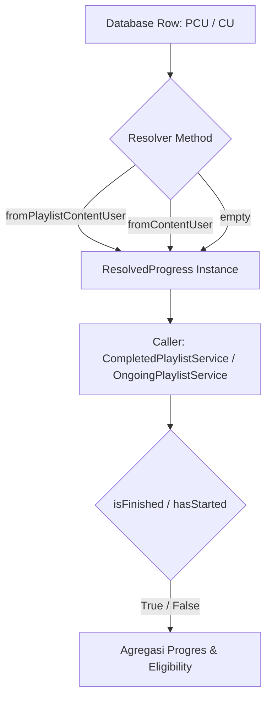

# ResolvedProgress

## 1. Overview
`ResolvedProgress` adalah sebuah Value Object (Data Transfer Object / DTO) immutable yang merepresentasikan hasil resolusi progres pembelajaran seorang pengguna pada suatu konten/modul. Class ini bertugas menampung state komputasi progres (persentase, status selesai, durasi tonton, halaman terakhir, total halaman, durasi konten) beserta metadata sumber data (`source`, `isAuthoritative`, `isHistoricalFallback`).

Class ini merupakan bagian fondasi dari domain **Learning**, yang memastikan seluruh service dan controller membaca status progres pembelajaran dengan format yang seragam, terlepas dari apakah data berasal dari tabel `playlist_content_users` (alur playlist baru) atau `content_users` (alur konten langsung / fallback histori).

## 2. Source Location
[ResolvedProgress.php](file:///C:/laragon/owl/app/Services/Learning/ResolvedProgress.php) (`app/Services/Learning/ResolvedProgress.php`)

## 3. Main Responsibility
- **Tanggung Jawab Utama:** Membungkus nilai progres pembelajaran secara immutable (readonly properties pada PHP 8.1) agar tidak dapat dimutasi sembarangan di luar context resolver.
- **Factory/Instantiation:** Menyediakan named constructor (`fromPlaylistContentUser`, `fromContentUser`, `empty`) untuk standardisasi pembuatan objek dari model Eloquent yang berbeda.
- **Helper Business Query:** Menyediakan method evaluasi sederhana seperti `isFinished()` dan `hasStarted()`.

## 4. Used By
- [`LearningProgressResolver`](file:///C:/laragon/owl/app/Services/Learning/LearningProgressResolver.php) — pembuat utama instance DTO ini.
- [`CompletedPlaylistService`](file:///C:/laragon/owl/app/Services/Learning/CompletedPlaylistService.php) — mengevaluasi `$r->isFinished()`.
- [`OngoingPlaylistService`](file:///C:/laragon/owl/app/Services/Learning/OngoingPlaylistService.php) — mengevaluasi `$r->hasStarted()`, `$r->isFinished()`, dan `$r->progress`.
- [`AssessmentAccessService`](file:///C:/laragon/owl/app/Services/AssessmentAccessService.php) — mengecek apakah modul prasyarat sudah selesai sebelum assessment dapat diakses.
- [`CertificateEligibilityService`](file:///C:/laragon/owl/app/Services/CertificateEligibilityService.php) — validasi kelulusan modul playlist.
- [`PlaylistUserController`](file:///C:/laragon/owl/app/Http/Controllers/PlaylistUserController.php) — menyajikan progres modul pada tampilan playlist user.

## 5. Dependencies
| Dependency | Type | Purpose |
|---|---|---|
| `App\Models\PlaylistContentUser` | Model | Sumber data pembuatan DTO via `fromPlaylistContentUser()` |
| `App\Models\ContentUser` | Model | Sumber data pembuatan DTO via `fromContentUser()` |

## 6. Database Tables
Class ini adalah Value Object murni dalam memori (in-memory DTO) dan **tidak melakukan interaksi database langsung**. Tabel yang direpresentasikan oleh class ini:
| Table | Operation | Purpose |
|---|---|---|
| `playlist_content_users` | NONE (Represented) | Data progres modul playlist |
| `content_users` | NONE (Represented) | Data progres konten tunggal / fallback histori |

## 7. Public Methods

### `__construct(...)`
**Purpose**
Menginisialisasi instance DTO dengan atribut readonly.

**Parameters**
| Parameter | Type | Description |
|---|---|---|
| `$progress` | `int` | Persentase progres (0-100), default: 0 |
| `$finish` | `int` | Penanda selesai (0 atau 1), default: 0 |
| `$learningStatus` | `string` | Status status pembelajaran (`not_started`, `in_progress`, dll), default: 'not_started' |
| `$currentTime` | `?int` | Posisi detik terakhir diputar (video), default: null |
| `$lastPage` | `?int` | Halaman terakhir dibaca (dokumen), default: null |
| `$totalPages` | `?int` | Total halaman dokumen, default: null |
| `$durationSeconds` | `?int` | Durasi konten dalam satuan detik, default: null |
| `$source` | `string` | Asal data (`playlist_content_users`, `content_users`, `historical_content_users`, `none`, `ambiguous`) |
| `$isAuthoritative` | `bool` | True jika data berasal dari sumber definitif, default: false |
| `$isHistoricalFallback` | `bool` | True jika data diambil dari fallback histori `content_users` untuk playlist |

**Return**
`void`

**Process**
Menyimpan seluruh parameter ke public readonly property.

**Side Effects**
Tidak ada.

---

### `fromPlaylistContentUser(PlaylistContentUser $pcu): self`
**Purpose**
Membuat instance `ResolvedProgress` dari model `PlaylistContentUser`.

**Parameters**
| Parameter | Type | Description |
|---|---|---|
| `$pcu` | `PlaylistContentUser` | Instance model progres playlist user |

**Return**
`ResolvedProgress` dengan source `playlist_content_users`, `isAuthoritative = true`, `isHistoricalFallback = false`.

**Process**
Mengekstrak field `progress`, `finish`, `learning_status`, `current_time`, `last_page`, `total_pages`, `duration_seconds` dari model PCU.

**Side Effects**
Tidak ada.

---

### `fromContentUser(ContentUser $cu, bool $asHistoricalPlaylistFallback = false): self`
**Purpose**
Membuat instance `ResolvedProgress` dari model `ContentUser`.

**Parameters**
| Parameter | Type | Description |
|---|---|---|
| `$cu` | `ContentUser` | Instance model progres konten langsung |
| `$asHistoricalPlaylistFallback` | `bool` | Flag apakah digunakan sebagai fallback histori playlist |

**Return**
`ResolvedProgress` dengan metadata source yang sesuai (`content_users` atau `historical_content_users`).

**Process**
Mengekstrak atribut progress dan menyetel flag `isHistoricalFallback` sesuai argumen `$asHistoricalPlaylistFallback`.

**Side Effects**
Tidak ada.

---

### `empty(string $source = self::SOURCE_NONE): self`
**Purpose**
Membuat instance `ResolvedProgress` kosong (0%, belum mulai).

**Parameters**
| Parameter | Type | Description |
|---|---|---|
| `$source` | `string` | Nilai label sumber (default: `self::SOURCE_NONE`) |

**Return**
`ResolvedProgress` dengan status `not_started`, progres 0, finish 0.

**Side Effects**
Tidak ada.

---

### `isFinished(): bool`
**Purpose**
Menentukan apakah konten/modul dianggap telah selesai dipelajari.

**Parameters**
Tidak ada.

**Return**
`bool` (true jika selesai).

**Process**
Memeriksa: `(int) $this->finish === 1 || (int) $this->progress >= 100`.

**Side Effects**
Tidak ada.

---

### `hasStarted(): bool`
**Purpose**
Menentukan apakah konten/modul sudah pernah disentuh atau dimulai oleh user.

**Parameters**
Tidak ada.

**Return**
`bool` (true jika sudah dimulai).

**Process**
Memeriksa: `(int) $this->progress > 0 || (int) $this->currentTime > 0 || (int) $this->lastPage > 0`.

**Side Effects**
Tidak ada.

## 8. Business Rules
1. **Definisi Selesai (`isFinished`)**: Konten dianggap selesai jika salah satu dari dua kondisi terpenuhi: flag `finish == 1` ATAU nilai `progress >= 100`. Aturan ini menjamin toleransi terhadap data histori yang mungkin memiliki progress 100% namun flag finish belum terupdate ke 1, atau sebaliknya.
2. **Definisi Memulai (`hasStarted`)**: Konten dianggap sudah disentuh jika progress > 0% ATAU user sudah menonton video > 0 detik (`currentTime > 0`) ATAU membaca dokumen > 0 halaman (`lastPage > 0`).
3. **Immutability**: Nilai progress tidak boleh diubah setelah diinstansiasi untuk menjaga integritas data lintas layer.
4. **Authoritative vs Fallback**: Data yang bersumber langsung dari `PlaylistContentUser` selalu ditandai `isAuthoritative = true`. Data yang berasal dari `ContentUser` untuk konteks playlist ditandai `isHistoricalFallback = true` dan `isAuthoritative = false`.

## 9. Data Flow


## 10. Important Conditions
- `(int) $this->finish === 1 || (int) $this->progress >= 100`
  - *Alasan:* Menangani ketidakkonsistenan status di mana progress mencapai 100 namun finish masih bernilai '0', atau finish bernilai '1' saat progress tercatat 99%.
  - *Hasil:* Mengembalikan `true`, menandakan modul tuntas.
- `(int) $this->progress > 0 || (int) $this->currentTime > 0 || (int) $this->lastPage > 0`
  - *Alasan:* Menentukan apakah user pernah berinteraksi dengan modul meskipun persentase progress belum terhitung bulat.

## 11. Edge Cases
- **Null Values pada Model:** Seluruh getter menggunakan null coalescing (`?? 0`, `?? 'not_started'`) sehingga aman dari TypeError saat data kolom database bernilai `NULL`.
- **Progress > 100:** Ditangani dengan aman karena evaluasi menggunakan `>= 100`.
- **Tidak ada record:** Menggunakan `ResolvedProgress::empty(SOURCE_NONE)` tanpa melempar exception.

## 12. Related Services
- [`LearningProgressResolver`](file:///C:/laragon/owl/app/Services/Learning/LearningProgressResolver.php): Service pembuat objek ini.
- [`CompletedPlaylistService`](file:///C:/laragon/owl/app/Services/Learning/CompletedPlaylistService.php): Konsumen evaluasi `isFinished()`.
- [`OngoingPlaylistService`](file:///C:/laragon/owl/app/Services/Learning/OngoingPlaylistService.php): Konsumen evaluasi `hasStarted()` dan `progress`.

## 13. Related Models
- [`PlaylistContentUser`](file:///C:/laragon/owl/app/Models/PlaylistContentUser.php)
- [`ContentUser`](file:///C:/laragon/owl/app/Models/ContentUser.php)

## 14. Related Controllers / Commands
- [`PlaylistUserController`](file:///C:/laragon/owl/app/Http/Controllers/PlaylistUserController.php)
- [`LearningOngoingController`](file:///C:/laragon/owl/app/Http/Controllers/LearningOngoingController.php)

## 15. Known Risks / Maintenance Notes
- Class ini menggunakan PHP 8.1 constructor promotion dengan `readonly`. Modifikasi manual terhadap properti setelah instansiasi akan menimbulkan fatal error di PHP runtime.
- Jika ada penambahan atribut baru pada tabel `playlist_content_users` atau `content_users` yang dibutuhkan frontend (misalnya timestamp completion spesifik), pastikan kedua named constructor di-update secara konsisten.

## 16. Safe Modification Guide
- Jika ingin menambah logic penentuan selesai (misal threshold skor assessment):
  1. Jangan ubah `isFinished()` sembarangan karena berdampak ke kalkulasi kelulusan seluruh playlist dan certificate eligibility.
  2. Pastikan backward compatibility terhadap data lama tetap terjaga.
  3. Jalankan automated test `LearningProgressResolverTest` dan `PlaylistServicesProgressTest`.

## 17. Testing / Verification
- **Automated Test Terkait:**
  - `tests/Unit/LearningProgressResolverTest.php`
  - `tests/Feature/PlaylistServicesProgressTest.php`
- **Command:**
  ```powershell
  php artisan test --filter=LearningProgressResolverTest
  ```

## 18. Handover Summary
- **Criticality:** High (Fondasi evaluasi progres pembelajaran di seluruh modul OWL)
- **Main Function:** Value Object immutable yang membungkus status progres belajar dan menyediakan evaluasi tuntas/mulai.
- **Main Tables:** Tidak ada akses langsung (merepresentasikan `playlist_content_users` & `content_users`).
- **Main Caller:** `LearningProgressResolver`.
- **Be Careful When Changing:** Method `isFinished()` dan `hasStarted()`, karena digunakan langsung oleh sertifikat, assessment access, dan status tab Ongoing.
