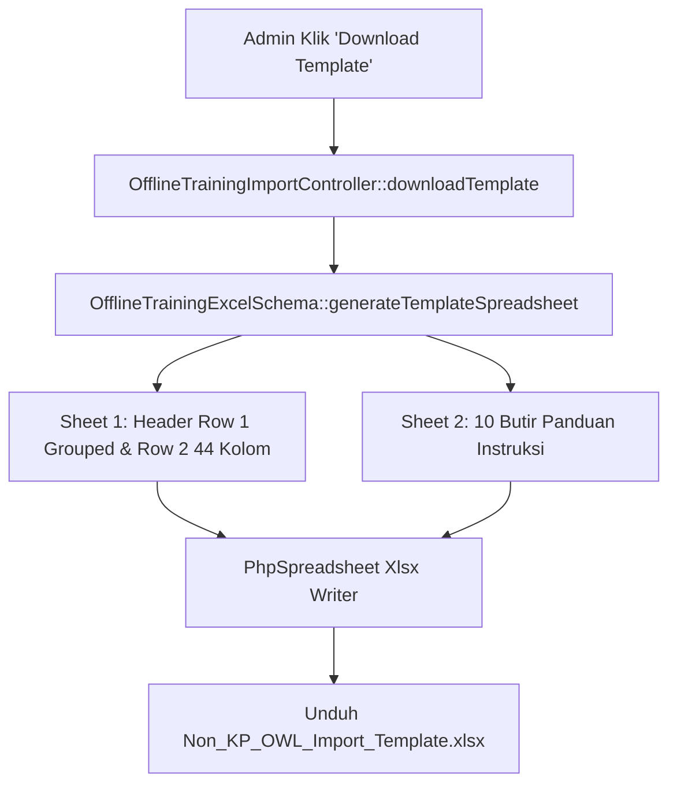

# OfflineTrainingExcelSchema

## 1. Overview
`OfflineTrainingExcelSchema` adalah service definisi skema dan generator template Excel resmi untuk fitur **Import Pelatihan Non-KP OWL (Offline Training)**.

Class ini bertindak sebagai **Single Source of Truth** untuk seluruh spesifikasi kolom impor Excel:
- Mendefinisikan struktur 44 kolom kanonikal yang terbagi ke dalam 7 kelompok kategori utama (Job Information, Training Information, Attendance, Obligation, L1, L2 Post Test, L3 Project).
- Menghasilkan file template Excel dinamis berformat `.xlsx` lengkap dengan header bertingkat (parent group & child header), pewarnaan sel standar HRDC, validasi kolom wajib, dan lembar panduan pengisian (**Instructions Sheet**).

## 2. Source Location
[OfflineTrainingExcelSchema.php](file:///C:/laragon/owl/app/Services/Record/OfflineTrainingExcelSchema.php) (`app/Services/Record/OfflineTrainingExcelSchema.php`)

## 3. Main Responsibility
- **Definisi 44 Kolom Kanonikal (`columns`):** Memetakan nomor kolom, nama header, kelompok grup, key database terkait, tipe data, status wajib/opsional, nilai contoh, dan catatan panduan.
- **Definisi Kelompok Header (`groups`):** Mengatur merge cell baris pertama untuk 7 kategori besar beserta warna tema hex RGB.
- **Generator Spreadsheet Template (`generateTemplateSpreadsheet`):** Membangun workbook PhpSpreadsheet dengan dua sheet: Sheet 1 (*Non KP OWL Import*) dan Sheet 2 (*Instructions*).
- **Integritas Sistem (`systemFields` & `requiredDatabaseKeys`):** Memastikan kolom sistem internal (ID, foreign key, timestamp) tidak bocor ke template dan menetapkan kunci wajib (`course_name`, `employee_id`, `name`).

## 4. Used By
- [`OfflineTrainingImportService`](file:///C:/laragon/owl/app/Services/Record/OfflineTrainingImportService.php) — memvalidasi keberadaan header wajib (`requiredDatabaseKeys()`).
- [`OfflineTrainingImportController`](file:///C:/laragon/owl/app/Http/Controllers/Manage/Record/OfflineTrainingImportController.php) — mengunduh file template Excel kosong bagi admin.

## 5. Dependencies
| Dependency | Type | Purpose |
|---|---|---|
| `PhpOffice\PhpSpreadsheet\Spreadsheet` | Library | Pembuatan struktur workbook Excel |
| `PhpOffice\PhpSpreadsheet\Cell\Coordinate` | Library | Konversi indeks numerik ke huruf kolom Excel |
| `PhpOffice\PhpSpreadsheet\Style\Alignment` | Library | Styling perataan teks |
| `PhpOffice\PhpSpreadsheet\Style\Border` | Library | Garis batas sel tabel |
| `PhpOffice\PhpSpreadsheet\Style\Fill` | Library | Pewarnaan background header |

## 6. Database Tables
Service ini murni pendefinisian skema dan generator template in-memory (**0 database queries**).

## 7. Public Methods

### `groups(): array`
**Purpose**
Mendefinisikan pengelompokan baris pertama (Row 1) untuk merge-header:
- **JOB INFORMATION:** Kolom B–H (span 7, warna Indigo `#E0E7FF`)
- **TRAINING INFORMATION:** Kolom I–AG (span 25, warna Amber `#FEF3C7`)
- **ATTENDANCE:** Kolom AH–AI (span 2, warna Emerald `#DCFCE7`)
- **OBLIGATION:** Kolom AJ–AL (span 3, warna Rose `#FEE2E2`)
- **L1:** Kolom AM–AM (span 1, warna Purple `#F3E8FF`)
- **L2 (POST TEST):** Kolom AN–AO (span 2, warna Violet `#EDE9FE`)
- **L3 (PROJECT):** Kolom AP–AR (span 3, warna Sky `#E0F2FE`)

---

### `columns(): array`
**Purpose**
Mendefinisikan spesifikasi lengkap 44 kolom pada baris kedua (Row 2).

**Daftar Pemetaan 44 Kolom Kanonikal:**
| No | Header | Group | DB Key | Required | Type | Note |
|---|---|---|---|---|---|---|
| 1 | No | - | null | No | number | Nomor urut baris |
| 2 | ID | JOB INFORMATION | `employee_id` | **Yes** | string | NIP Pegawai |
| 3 | Name | JOB INFORMATION | `name` | **Yes** | string | Nama lengkap peserta |
| 4 | Grade | JOB INFORMATION | `grade` | No | string | Golongan/grade |
| 5 | Job Position | JOB INFORMATION | `job_position` | No | string | Posisi jabatan |
| 6 | Team | JOB INFORMATION | `team` | No | string | Tim/unit kerja |
| 7 | Department | JOB INFORMATION | `department` | No | string | Departemen |
| 8 | Company | JOB INFORMATION | `company` | No | string | Perusahaan entitas |
| 9 | Course Name | TRAINING INFORMATION | `course_name` | **Yes** | string | Judul pelatihan utama |
| 10 | Sub_Course Name | TRAINING INFORMATION | `sub_course_name` | No | string | Topik/modul spesifik |
| 11 | Type | TRAINING INFORMATION | `type` | No | string | In-House, Public, dll |
| 12 | Category | TRAINING INFORMATION | `category` | No | string | Kategori kompetensi |
| 13 | Level | TRAINING INFORMATION | `level` | No | string | Basic, Intermediate, dll |
| 14 | Batch | TRAINING INFORMATION | `batch` | No | string | Gelombang batch |
| 15 | Main Classification | TRAINING INFORMATION | `main_classification` | No | string | Klasifikasi utama |
| 16 | Sub Classification | TRAINING INFORMATION | `sub_classification` | No | string | Sub klasifikasi |
| 17 | Counted as '26 Corporate KPI | TRAINING INFORMATION | `counted_corporate_kpi` | No | boolean | Yes / No |
| 18 | Sub '26 Corporate KPI | TRAINING INFORMATION | `sub_corporate_kpi` | No | string | Program strategis KPI |
| 19 | Delivery Method | TRAINING INFORMATION | `delivery_method` | No | string | Classroom, Practical |
| 20 | Sub_Delivery Method | TRAINING INFORMATION | `sub_delivery_method` | No | string | Hands-on Lab, dll |
| 21 | Provider | TRAINING INFORMATION | `provider` | No | string | Internal / External |
| 22 | Sub_Provider | TRAINING INFORMATION | `sub_provider` | No | string | Vendor / University |
| 23 | Duration | TRAINING INFORMATION | `duration_seconds` | No | duration | Format HH:MM:SS |
| 24 | Learning (Hours) | TRAINING INFORMATION | `learning_hours` | No | number | Jam belajar kredit |
| 25 | Progress | TRAINING INFORMATION | `progress` | No | number | 0 s/d 100 (%) |
| 26 | Start Date | TRAINING INFORMATION | `start_date` | No | date | Format YYYY-MM-DD |
| 27 | Finish Date | TRAINING INFORMATION | `finish_date` | No | date | Format YYYY-MM-DD |
| 28 | Month | TRAINING INFORMATION | null | No | string | Tampilan Excel saja |
| 29 | Provider Name | TRAINING INFORMATION | `provider_name` | No | string | Nama vendor/lembaga |
| 30 | Venue | TRAINING INFORMATION | `venue` | No | string | Lokasi/ruangan |
| 31 | Instructor | TRAINING INFORMATION | `instructor` | No | string | Nama trainer |
| 32 | Assessment Score | TRAINING INFORMATION | `assessment_score` | No | number | Nilai evaluasi (0-100) |
| 33 | Certificate | TRAINING INFORMATION | `certificate` | No | string | Yes / No |
| 34 | Attendance Yes/No | ATTENDANCE | `attendance` | No | boolean | Yes / No |
| 35 | Reason | ATTENDANCE | `attendance_reason` | No | string | Alasan jika tidak hadir |
| 36 | Bond Status | OBLIGATION | `bond_status` | No | string | Yes / No ikatan dinas |
| 37 | Bond End Date | OBLIGATION | `bond_end_date` | No | date | Akhir ikatan dinas |
| 38 | Bond Amount | OBLIGATION | `bond_amount` | No | number | Nilai penalti (IDR) |
| 39 | Program | L1 | `l1_program` | No | string | Evaluasi reaksi |
| 40 | Numerical | L2 (POST TEST) | `l2_numerical` | No | number | Nilai post-test |
| 41 | Verbal | L2 (POST TEST) | `l2_verbal` | No | string | Hasil lulus/tidak |
| 42 | Numerical | L3 (PROJECT) | `l3_numerical` | No | number | Nilai implementasi |
| 43 | Verbal | L3 (PROJECT) | `l3_verbal` | No | string | Evaluasi perilaku |
| 44 | PIC | L3 (PROJECT) | `pic` | No | string | PIC admin HR/diklat |

---

### `requiredDatabaseKeys(): array`
Mengembalikan 3 kolom wajib mutlak: `['course_name', 'employee_id', 'name']`.

---

### `systemFields(): array`
Daftar kolom yang dilarang muncul di Excel template: `id`, `offline_training_id`, `user_id`, `created_by`, `created_at`, `updated_at`, `deleted_at`.

---

### `generateTemplateSpreadsheet(): Spreadsheet`
Membangun workbook PhpSpreadsheet lengkap dengan styling, freeze pane baris 1 & 2, autofit width, serta sheet panduan instruksi.

## 8. Business Rules
1. **Kolom Wajib Mutlak**:
   Setiap baris impor WAJIB menyertakan **`Course Name`**, **`ID (NIP)`**, dan **`Name`**. Baris yang tidak memiliki salah satu dari ketiga kolom ini dianggap tidak valid.
2. **Pengecualian Kolom 'Month'**:
   Kolom 28 (`Month`) disediakan khusus untuk kenyamanan pelaporan Excel di lingkungan HRDC, namun secara bisnis **tidak disimpan ke database** karena nilai bulan selalu diturunkan dari `start_date` atau `finish_date`.
3. **Pemisahan Evaluasi L2 dan L3**:
   Kolom evaluasi Kirkpatrick membedakan skor angka (`numerical`) dan keterangan kualitatif (`verbal`) untuk Level 2 (Post-Test) dan Level 3 (Project/Behavior).

## 9. Data Flow

## 10. Important Conditions
- `requiredDatabaseKeys() === ['course_name', 'employee_id', 'name']`
  - *Alasan:* Identifikasi unik suatu pelatihan dan peserta memerlukan judul kursus, NIP, dan nama karyawan.

## 11. Edge Cases
- **Kolom 'No' Kosong:** Diperbolehkan karena kolom nomor urut tidak dipetakan ke database.
- **Nama Header Mengandung Karakter Spesial:** Parser di `OfflineTrainingImportService` menormalkan tanda kurung dan strip.

## 12. Related Services
- [`OfflineTrainingImportService`](file:///C:/laragon/owl/app/Services/Record/OfflineTrainingImportService.php): Konsumen skema ini untuk validasi dan parsing upload file.

## 13. Related Models
- [`OfflineTraining`](file:///C:/laragon/owl/app/Models/OfflineTraining.php)
- [`OfflineTrainingUser`](file:///C:/laragon/owl/app/Models/OfflineTrainingUser.php)

## 14. Related Controllers / Commands
- [`OfflineTrainingImportController`](file:///C:/laragon/owl/app/Http/Controllers/Manage/Record/OfflineTrainingImportController.php)

## 15. Known Risks / Maintenance Notes
- Urutan indeks 1 s/d 44 di method `columns()` terikat erat dengan generator template. Jika admin HRDC menambahkan kolom baru di tengah tabel, selalu tambahkan di bagian akhir atau perbarui mapping `matchGroupedHeader` di service import untuk menjaga backward compatibility terhadap file Excel versi sebelumnya.

## 16. Safe Modification Guide
- Jika ingin menambah kolom opsional baru:
  1. Tambahkan entri baru di `columns()`.
  2. Sesuaikan rentang `end_col` dan `span` pada `groups()`.
  3. Tambahkan field penampung di migration database `offline_trainings` atau `offline_training_users`.
  4. Perbarui `OfflineTrainingImportService::normalizeRowData()`.

## 17. Testing / Verification
- **Automated Test Terkait:**
  - `tests/Feature/OfflineTrainingImportModalTest.php`
  - `tests/Feature/OfflineTrainingImportTest.php`
- **Manual Verification:**
  - Unduh template dari halaman `/manage/record/offline`
  - Buka di Microsoft Excel, pastikan freeze pane aktif pada baris 3 dan Sheet "Instructions" dapat dibaca dengan jelas.

## 18. Handover Summary
- **Criticality:** High (Spesifikasi standar skema Excel untuk seluruh data pelatihan eksternal/offline)
- **Main Function:** Definisi kanonikal 44 kolom, 7 grup header, dan generator template spreadsheet resmi.
- **Main Tables:** None (Schema definition class).
- **Main Caller:** `OfflineTrainingImportController`, `OfflineTrainingImportService`.
- **Be Careful When Changing:** Jumlah total kolom 44 dan daftar `requiredDatabaseKeys`.
