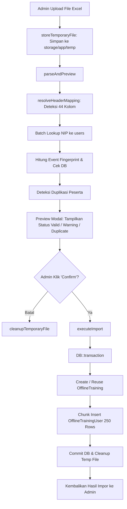

# OfflineTrainingImportService

## 1. Overview
`OfflineTrainingImportService` adalah service inti yang menangani seluruh alur kerja **Impor Pelatihan Non-KP OWL (Offline Training)** dari spreadsheet Excel (`.xlsx` / `.xls`) ke dalam database.

Service ini memecahkan tantangan integrasi data pelatihan eksternal, sertifikasi vendor, seminar, dan workshop luring dengan menyediakan:
- Alur kerja 2 langkah aman: **Upload $\rightarrow$ Preview & Validasi $\rightarrow$ Konfirmasi Eksekusi**.
- Pengelompokan cerdas beberapa baris peserta ke dalam satu sesi pelatihan yang sama (**Training Event Fingerprinting**).
- Pencocokan otomatis akun LMS berdasarkan NIP (**Employee ID Lookup**).
- Penanganan toleran terhadap peserta yang belum terdaftar di LMS (**Graceful Null Fallback**).
- Pencegahan duplikasi data ganda (**Safe Deduplication & Skip Behavior**).

## 2. Source Location
[OfflineTrainingImportService.php](file:///C:/laragon/owl/app/Services/Record/OfflineTrainingImportService.php) (`app/Services/Record/OfflineTrainingImportService.php`)

## 3. Main Responsibility
- **Manajemen File Sementara (`storeTemporaryFile`, `cleanupTemporaryFile`):** Menyimpan file upload sementara di `storage/app/temp` dengan token acak dan TTL 1 jam.
- **Parsing & Pratinjau Interaktif (`parseAndPreview`):** Membaca sheet, mencocokkan header fleksibel (grouped 2-row maupun single row), menormalkan data, memvalidasi aturan bisnis, dan mendeteksi duplikasi sebelum penulisan.
- **Deduplikasi & Pengelompokan Event:** Mengelompokkan peserta ke sesi training yang tepat menggunakan hash fingerprint unik.
- **Eksekusi Atomik Database (`executeImport`):** Menulis data `OfflineTraining` dan melakukan chunked insert ke `OfflineTrainingUser` di dalam transaksi database atomik.

## 4. Used By
- [`OfflineTrainingImportController`](file:///C:/laragon/owl/app/Http/Controllers/Manage/Record/OfflineTrainingImportController.php) — controller endpoint upload, preview modal, dan confirm import.

## 5. Dependencies
| Dependency | Type | Purpose |
|---|---|---|
| `OfflineTrainingExcelSchema` | Service | Validasi header wajib kanonikal |
| `PhpOffice\PhpSpreadsheet\IOFactory` | Library | Membaca file spreadsheet Excel |
| `PhpOffice\PhpSpreadsheet\Shared\Date` | Library | Konversi serial date numeric Excel ke tanggal PHP |
| `App\Models\OfflineTraining` | Model | Induk acara pelatihan offline |
| `App\Models\OfflineTrainingUser` | Model | Data peserta dan nilai evaluasi |
| `App\Models\User` | Model | Pencocokan akun user LMS via `id_emp` |

## 6. Database Tables
| Table | Operation | Purpose |
|---|---|---|
| `offline_trainings` | READ / INSERT | Memeriksa training eksis dan membuat baris training baru |
| `offline_training_users` | READ / INSERT | Mengecek duplikasi peserta dan menyimpan peserta baru via chunk insert (250/batch) |
| `users` | READ | Batch lookup user berdasarkan kolom `id_emp` |

## 7. Public Methods

### `storeTemporaryFile(UploadedFile $file, int $userId): array`
**Purpose**
Menyimpan file Excel upload sementara dan menerbitkan session token acak 16 byte.

**Process**
1. Validasi ekstensi `.xlsx` atau `.xls`.
2. Simpan file ke `storage/app/temp/offline_import_{token}.{ext}`.
3. Simpan metadata (token, user_id, nama file asli, path) ke Cache selama 3600 detik (1 jam).
4. Kembalikan array metadata.

---

### `parseAndPreview(string $token, int $userId): array`
**Purpose**
Menganalisis file Excel, memetakan kolom, mencocokkan user, mendeteksi duplikat, dan mengembalikan data pratinjau modal untuk ditinjau admin.

**Process & Validasi Alur:**
1. Validasi token kepemilikan user.
2. Load spreadsheet via `IOFactory`.
3. Selesaikan pemetaan header via `resolveHeaderMapping()` (mendukung 2-baris grouped header maupun 1-baris flat header).
4. Validasi kolom wajib (`validateRequiredHeaders`): wajib memiliki `course_name`, `employee_id`, dan `name`.
5. Baca seluruh baris data dan abaikan baris kosong (`isRowEntirelyBlank`).
6. **Batch Employee Lookup:** Kumpulkan semua NIP unik dan query ke `User::whereIn('id_emp', $uniqueNips)` dalam 1 query.
7. **Batch Training Lookup:** Kumpulkan semua judul kursus unik dan cari event eksis di `OfflineTraining`.
8. Bangun peta peserta eksis di database untuk deteksi duplikasi.
9. Iterasi setiap baris Excel:
   - Normalisasi format (tanggal, jam, durasi, progress, mata uang).
   - Validasi data (tanggal mulai $\le$ selesai, progress 0-100%).
   - Hitung fingerprint event: `buildTrainingFingerprint()`.
   - Cek duplikasi: jika peserta sudah pernah tercatat pada event yang sama (di file yang sama ATAU di database), tandai sebagai `duplicate`.
   - Klasifikasikan status baris: `valid`, `warning` (misal user belum punya akun LMS), `invalid` (error fatal), atau `duplicate`.
10. Simpan statistik ke cache dan kembalikan 100 baris pertama untuk rendering modal cepat.

---

### `executeImport(string $token, int $userId): array`
**Purpose**
Mengeksekusi penyimpanan permanen ke database setelah admin menekan tombol "Confirm Import".

**Process:**
1. Parse ulang data terverifikasi.
2. Filter baris: lewati baris yang `invalid` atau `duplicate`.
3. Kelompokkan peserta berdasarkan fingerprint training (`$groupedByTraining`).
4. Buka transaksi atomik `DB::transaction`:
   - Untuk setiap fingerprint:
     - Jika training sudah ada di DB: gunakan training eksis (`reusedTrainings++`).
     - Jika training belum ada di DB: buat row baru di `offline_trainings` (`createdTrainings++`).
     - Siapkan array insert peserta untuk `offline_training_users`.
     - Lakukan batch insert peserta dalam potongan 250 baris (`array_chunk($participantInserts, 250)`).
5. Hapus file sementara di storage dan bersihkan cache (`cleanupTemporaryFile`).
6. Kembalikan ringkasan eksekusi (`rows_processed`, `imported`, `skipped_duplicates`, dll).

---

### `buildTrainingFingerprint(array $data): string`
**Purpose**
Menghasilkan hash MD5 deterministik untuk mengidentifikasi keunikan sesi training:
$$\text{Fingerprint} = \text{MD5}(\text{course\_name} \mid \text{batch} \mid \text{start\_date} \mid \text{finish\_date} \mid \text{type} \mid \text{venue})$$

---

### Field Normalizers:
- `normalizeBoolean()`: Mendukung teks Yes, Y, 1, True, Ya $\rightarrow$ `true`; No, N, 0, False, Tidak $\rightarrow$ `false`.
- `normalizeProgress()`: Menghilangkan `%`, mengenali float desimal Excel (misal `0.75` otomatis menjadi `75.0`).
- `normalizeDuration()`: Mengonversi `HH:MM:SS` ke detik, serta mengenali angka jam $\le 24$ sebagai jam ($\times 3600$ detik).
- `normalizeDate()`: Mengonversi objek serial date PhpSpreadsheet numerik ($> 1000$) maupun string teks ke `YYYY-MM-DD`.
- `normalizeMoney()`: Membersihkan teks currency (Rp, IDR, USD, tanda baca ribuan) menjadi float 2 desimal.

## 8. Business Rules
1. **Penyatuan Sesi Pelatihan (Training Event Fingerprint)**:
   Jika dalam file Excel terdapat 50 baris peserta yang mengikuti kursus `"Safety Induction"`, Batch `"Batch 1"`, Tanggal `"2026-08-10"`, dan Venue yang sama, sistem **TIDAK MEMBUAT 50 PELATIHAN**, melainkan hanya membuat **1 baris `OfflineTraining`** dengan **50 baris `OfflineTrainingUser`** di bawahnya.
2. **Perilaku Skip Duplikasi yang Aman (Non-Destructive Skip)**:
   Peserta yang sudah terdaftar pada sesi training yang sama (baik di dalam file yang sama maupun sudah tersimpan di database sebelumnya) secara otomatis dilewati (`skipped_duplicates`). Baris duplikat tidak menggagalkan seluruh file dan tidak menduplikasi data di database.
3. **Toleransi Akun Pegawai (Graceful Non-LMS Employee)**:
   Jika NIP pegawai belum memiliki akun di tabel `users` LMS, sistem TIDAK MENOLAK baris tersebut. Data tetap diimpor dengan `user_id = null`, nama dan NIP tetap tersimpan lengkap di `offline_training_users`, dan berstatus `warning` di pratinjau. Ketika user tersebut mendaftar di LMS di masa depan, datanya dapat ditautkan via sinkronisasi NIP.
4. **Validasi Tanggal Pelatihan**:
   Tanggal selesai (`finish_date`) tidak boleh lebih awal dari tanggal mulai (`start_date`).

## 9. Data Flow

## 10. Important Conditions
- `if (!$row['course_name'] || !$row['employee_id'] || !$row['name'])`
  - *Alasan:* Menolak baris tanpa identitas pelatihan atau peserta yang jelas.
- `if (isset($existingParticipantMap[$dbKey]))`
  - *Alasan:* Mencegah double enrollment pada pelatihan yang sama di database.

## 11. Edge Cases
- **Cell Tanggal Format Serial Excel:** Dikonversi dengan `ExcelDate::excelToDateTimeObject`.
- **Nilai Format Pecahan Persen Excel (0.5 alih-alih 50):** Ditangani oleh `normalizeProgress()` yang mengalikan angka $\le 1.0$ dengan 100.
- **Nilai Uang Ikatan Dinas dengan Teks Mata Uang:** Dibersihkan oleh `normalizeMoney()`.

## 12. Related Services
- [`OfflineTrainingExcelSchema`](file:///C:/laragon/owl/app/Services/Record/OfflineTrainingExcelSchema.php): Definisi skema kolom.
- [`RecordAllCombinedService`](file:///C:/laragon/owl/app/Services/Record/RecordAllCombinedService.php): Menggabungkan data hasil impor ini dengan data online di tab All KP OWL.

## 13. Related Models
- [`OfflineTraining`](file:///C:/laragon/owl/app/Models/OfflineTraining.php)
- [`OfflineTrainingUser`](file:///C:/laragon/owl/app/Models/OfflineTrainingUser.php)
- [`User`](file:///C:/laragon/owl/app/Models/User.php)

## 14. Related Controllers / Commands
- [`OfflineTrainingImportController`](file:///C:/laragon/owl/app/Http/Controllers/Manage/Record/OfflineTrainingImportController.php)

## 15. Known Risks / Maintenance Notes
- File Excel dengan ukuran baris sangat besar ($> 5.000$ baris) dapat memakan memori PHP yang cukup besar saat di-load via PhpSpreadsheet. Jika institusi mengimpor puluhan ribu baris dalam satu file, pertahankan batas upload file (misal 10MB) dan pastikan `memory_limit` PHP minimal 512MB.

## 16. Safe Modification Guide
- Jika ingin menambahkan field pengelompokan baru pada fingerprint event (misal menambahkan kolom `instructor` ke fingerprint):
  1. Modifikasi method `buildTrainingFingerprint()`.
  2. Perhatikan bahwa perubahan fingerprint akan mempengaruhi cara sistem mendeteksi kesamaan sesi pelatihan antara file baru dan data lama di DB.
  3. Jalankan automated test `tests/Feature/OfflineTrainingImportTest.php`.

## 17. Testing / Verification
- **Automated Test Terkait:**
  - `tests/Feature/OfflineTrainingImportTest.php`
  - `tests/Feature/OfflineTrainingImportModalTest.php`
- **Manual Verification:**
  - Buka `/manage/record/offline`, klik tombol "Import Excel".
  - Unggah template terisi, periksa modal preview menampilkan jumlah valid/warning/duplicate dengan tepat.
  - Klik "Confirm Import" dan periksa data muncul di tabel Offline Record.

## 18. Handover Summary
- **Criticality:** Critical (Pintu gerbang masuk seluruh data pelatihan Non-KP OWL ke sistem)
- **Main Function:** Validasi 44 kolom, deduplikasi peserta, pembuatan sesi training otomatis, dan impor batch atomik.
- **Main Tables:** `offline_trainings` (READ / INSERT), `offline_training_users` (READ / INSERT), `users` (READ).
- **Main Caller:** `OfflineTrainingImportController`.
- **Be Careful When Changing:** Rumus fingerprint event `buildTrainingFingerprint()` dan logika `skipped_duplicates`.
