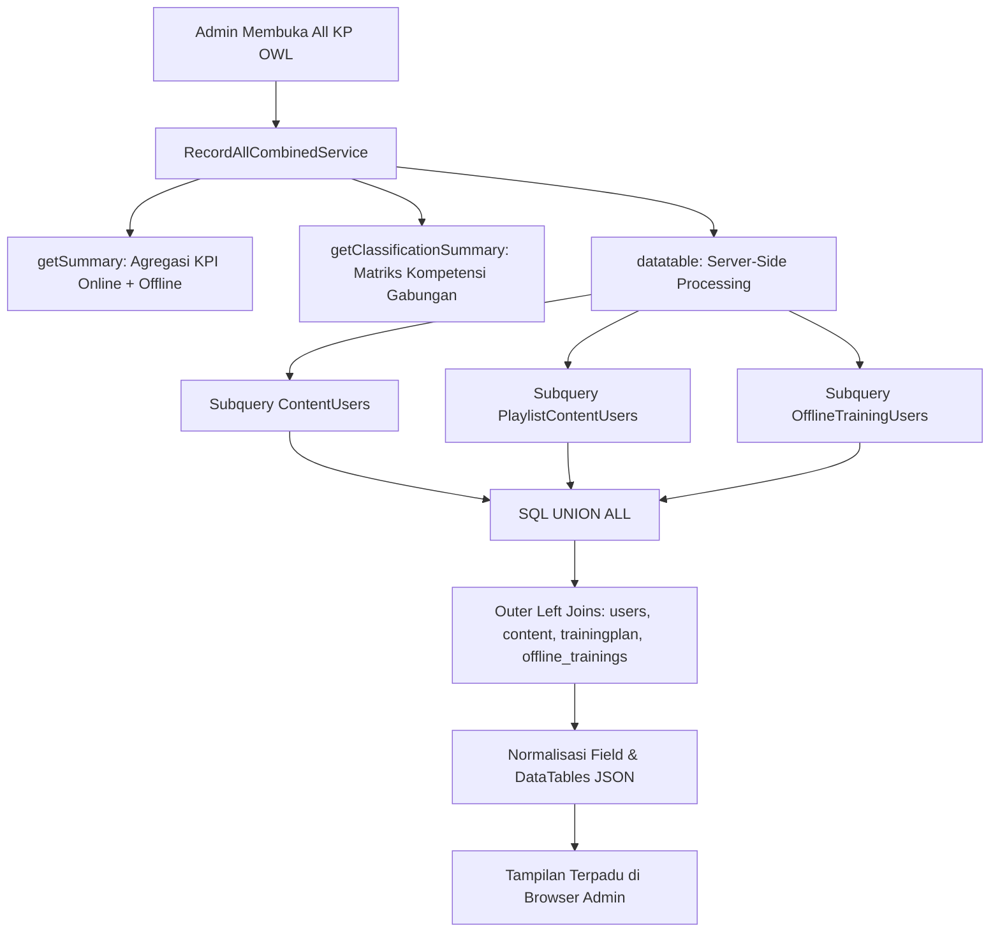

# RecordAllCombinedService

## 1. Overview
`RecordAllCombinedService` adalah service agregasi tingkat tinggi yang menggabungkan seluruh catatan pembelajaran di OWL — baik pelatihan online internal (**KP OWL**) maupun pelatihan offline eksternal (**Non-KP OWL**) — ke dalam satu tampilan master terpadu (**All KP OWL Record**).

Service ini memecahkan kebutuhan manajemen dan auditor SDM (HRDC) untuk:
- Melihat total pencapaian jam belajar korporat (Corporate Learning Hours) lintas metode pelatihan.
- Menyajikan ringkasan KPI gabungan (Total Pelatihan, Sedang Berjalan, Selesai, Rasio Kelulusan).
- Menggabungkan matriks klasifikasi kompetensi materi online dan offline.
- Menyediakan tabel DataTables server-side performa tinggi yang menggabungkan tiga tabel sekaligus (`content_users`, `playlist_content_users`, dan `offline_training_users`).

## 2. Source Location
[RecordAllCombinedService.php](file:///C:/laragon/owl/app/Services/Record/RecordAllCombinedService.php) (`app/Services/Record/RecordAllCombinedService.php`)

## 3. Main Responsibility
- **KPI Summary Aggregator (`getSummary`):** Menggabungkan metrik pelatihan online (dari `LearningManageController`) dengan data pelatihan offline (`offline_training_users`).
- **Classification Competency Matrix (`getClassificationSummary`):** Menyatukan klasifikasi materi online (`classification`) dengan klasifikasi pelatihan offline (`main_classification`), serta mempertahankan baris Unclassified di akhir.
- **Unified Query Builder (`buildCombinedQuery`):** Merangkai subquery UNION ALL dengan teknik *Lean Pushdown* (filter di-pushdown ke subquery dan relasi teks berat di-join di outer query) untuk meminimalkan beban memori database.
- **Normalisasi Skema Online vs Offline:** Menyelaraskan perbedaan nama kolom antara sistem online dan offline ke dalam skema standar yang seragam.

## 4. Used By
- [`RecordAllController`](file:///C:/laragon/owl/app/Http/Controllers/Manage/Record/RecordAllController.php) — controller utama halaman All KP OWL di panel Record Management.

## 5. Dependencies
| Dependency | Type | Purpose |
|---|---|---|
| `LearningManageController` | Controller | Sumber kalkulasi KPI dan jam pembelajaran online kanonikal |
| `App\Models\OfflineTraining` | Model | Entitas pelatihan offline |
| `App\Models\OfflineTrainingUser` | Model | Entitas peserta offline |
| `Yajra\DataTables\Facades\DataTables` | Facade | Engine server-side pagination |

## 6. Database Tables
| Table | Operation | Purpose |
|---|---|---|
| `content_users` | READ | Subquery pembelajaran konten mandiri online |
| `playlist_content_users` | READ | Subquery pembelajaran modul playlist online |
| `offline_training_users` | READ | Subquery peserta pelatihan offline/eksternal |
| `offline_trainings` | READ | Join metadata pelatihan offline (judul, tanggal, durasi) |
| `users` | READ | Join akun pegawai LMS |
| `content` | READ | Join judul dan durasi konten online |
| `trainingplan` | READ | Join judul playlist online |
| `classification` | READ | Join nama klasifikasi konten online |

Service ini murni read-only.

## 7. Public Methods

### `getSummary(): array`
**Purpose**
Menghitung ringkasan KPI korporat gabungan Online dan Offline.

**Proses Kalkulasi:**
1. Mengambil metrik online dari `LearningManageController::getKpiSummary()` dan `getTotalLearningHours()`.
2. Menghitung metrik offline dari `offline_training_users JOIN offline_trainings`:
   - `offlineTotal`: jumlah baris peserta bukan soft-deleted.
   - `offlineOngoing`: peserta dengan `progress > 0` dan `progress < 100`.
   - `offlineFinished`: peserta dengan `progress >= 100`.
   - `offlineHours`: `SUM(otu.learning_hours)`.
3. Menjumlahkan metrik gabungan:
   - `total_learning = onlineTotal + offlineTotal`
   - `total_learning_hours = round(onlineHours + offlineHours, 2)`
   - `completion_rate = (totalFinished / totalLearning) * 100`
4. Mengembalikan struktur array yang berisi total gabungan, breakdown online, dan breakdown offline.

---

### `getClassificationSummary(): Collection`
**Purpose**
Menghasilkan matriks tabel klasifikasi kompetensi gabungan.

**Proses Penggabungan (Online vs Offline):**
1. Ambil summary klasifikasi online (`classification_name`).
2. Ambil summary klasifikasi offline (`main_classification`).
3. Gabungkan seluruh nama klasifikasi unik (case-insensitive merge).
4. Untuk setiap klasifikasi: hitung kolom `kp_owl` (online), `non_kp_owl` (offline), `total_learning`, `learning_hours`, `ongoing`, dan `finished`.
5. Letakkan kategori `'Unclassified'` pada baris paling akhir.
6. Kembalikan koleksi terurut dengan nomor urut 1-based.

---

### `getFilterOptions(): array`
Mengambil seluruh opsi unik untuk dropdown filter: daftar klasifikasi gabungan dan daftar tahun gabungan.

---

### `buildCombinedQuery(array $filters = []): Builder`
**Purpose**
Membangun query builder terpadu untuk DataTables server-side.

**Arsitektur Query (Lean Pushdown Union):**
1. **Subquery 1 (Online Content):** dari `content_users` (`source = 'online'`, `source_type = 'content'`).
2. **Subquery 2 (Online Playlist):** dari `playlist_content_users` (`source = 'online'`, `source_type = 'playlist'`).
3. **Subquery 3 (Offline Training):** dari `offline_training_users JOIN offline_trainings` (`source = 'offline'`, `source_type = 'offline_training'`).
4. Ketiga subquery digabungkan via **`UNION ALL`**.
5. Outer Query melakukan LEFT JOIN ke `users`, `content`, `classification`, `trainingplan`, `offline_training_users`, dan `offline_trainings`.
6. Normalisasi kolom dinamis di-select pada level SQL SELECT ekspresi.

---

### `datatable(Request $request): JsonResponse`
Menjalankan pagination DataTables server-side dengan badge visual sumber (`KP OWL` warna biru langit vs `Non KP OWL` warna amber), status, progress bar, dan tombol aksi detail.

## 8. Business Rules & Normalization
Tabel perbandingan normalisasi field antara sistem **Online (KP OWL)** dan **Offline (Non-KP OWL)**:

| Field Normalisasi | Sumber Online (KP OWL) | Sumber Offline (Non-KP OWL) | Aturan Resolusi SQL |
|---|---|---|---|
| **`row_id`** | `online:content:{id}` / `online:playlist:{id}` | `offline:{id}` | Format string ber-prefix untuk mencegah benturan primary key |
| **`employee_id`** | `users.id_emp` | `otu.employee_id` | `COALESCE(otu.employee_id, u.id_emp, '')` |
| **`employee_name`**| `users.name` | `otu.name` | `COALESCE(otu.name, u.name, '')` |
| **`department`** | `users.department` | `otu.department` | `COALESCE(otu.department, u.department, '')` |
| **`learning_title`**| `content.title` / `trainingplan.title` | `ot.course_name` | Mengambil judul kursus/pelatihan masing-masing |
| **`type`** | `content.type` (Video/Document) / `'Playlist'` | `ot.type` (In-House, Public, dll) | Diselaraskan |
| **`classification`**| `classification.classification_name` | `ot.main_classification` | `COALESCE(..., 'Unclassified')` |
| **`category`** | `'All Content'` / `'Playlist'` | `ot.category` | Kategori asal |
| **`learning_hours`**| Durasi konten dikonversi ke jam | `otu.learning_hours` (kredit resmi) | Jam belajar aktual peserta |
| **`status`** | Evaluasi `finish = '1'` vs `progress` | `otu.progress >= 100` | `'Finished'`, `'Ongoing'`, atau `'Not Started'` |
| **`finish_date`** | `COALESCE(completed_at, updated_at)` | `COALESCE(ot.finish_date, ot.start_date)` | Tanggal penyelesaian pelatihan |

## 9. Data Flow

## 10. Important Conditions
- `if ($includeOffline && Schema::hasTable('offline_trainings'))`
  - *Alasan:* Pengecekan skema defensif agar aplikasi tidak crash jika fitur offline training belum dimigrasi di environment tertentu.
- `orderBy('raw_finish_date', 'desc')->orderBy('record_date', 'desc')`
  - *Alasan:* Menampilkan pelatihan yang paling baru diselesaikan di urutan teratas secara default.

## 11. Edge Cases
- **Peserta Offline Belum Terdaftar di LMS:** Ditangani dengan aman oleh `COALESCE(otu.name, u.name)`, data tetap tampil lengkap di tabel.
- **Konten Online Tanpa Durasi:** Di-fallback ke 0.0 jam tanpa error parsing.

## 12. Related Services
- [`OfflineTrainingImportService`](file:///C:/laragon/owl/app/Services/Record/OfflineTrainingImportService.php): Pemasok data pelatihan offline.
- [`LearningDatatableService`](file:///C:/laragon/owl/app/Services/Learning/LearningDatatableService.php): Layanan sejenis khusus untuk online.

## 13. Related Models
- [`OfflineTraining`](file:///C:/laragon/owl/app/Models/OfflineTraining.php)
- [`OfflineTrainingUser`](file:///C:/laragon/owl/app/Models/OfflineTrainingUser.php)
- [`ContentUser`](file:///C:/laragon/owl/app/Models/ContentUser.php)
- [`PlaylistContentUser`](file:///C:/laragon/owl/app/Models/PlaylistContentUser.php)

## 14. Related Controllers / Commands
- [`RecordAllController`](file:///C:/laragon/owl/app/Http/Controllers/Manage/Record/RecordAllController.php)
- [`LearningManageController`](file:///C:/laragon/owl/app/Http/Controllers/LearningManageController.php)

## 15. Known Risks / Maintenance Notes
- Kueri `buildCombinedQuery` melakukan penggabungan tiga tabel besar. Meskipun filter pushdown diterapkan dan join teks berat diletakkan di outer query, pencarian teks bebas yang luas pada jutaan baris data tetap dapat memakan resource CPU database. Pertahankan indeks pada kolom tanggal, status, dan NIP di ketiga tabel sumber.

## 16. Safe Modification Guide
- Jika ingin menambah kolom baru pada tabel All KP OWL:
  1. Pastikan kolom tersebut tersedia di ketiga sumber data atau definisikan nilai fallback-nya di outer SELECT query.
  2. Tambahkan kolom di view Blade `manage/record/all.blade.php`.
  3. Uji dengan test suite `tests/Feature/RecordAllCombinedTest.php`.

## 17. Testing / Verification
- **Automated Test Terkait:**
  - `tests/Feature/RecordAllCombinedTest.php`
  - `tests/Feature/RecordOfflineFoundationTest.php`
- **Manual Verification:**
  - Buka `/manage/record/all`
  - Periksa kartu KPI menampilkan penjumlahan metrik Online dan Offline.
  - Coba filter "Source: Non KP OWL" dan verifikasi hanya data offline yang muncul.

## 18. Handover Summary
- **Criticality:** Critical (Pintu utama pelaporan gabungan seluruh riwayat pelatihan korporat OWL)
- **Main Function:** Agregasi metrik KPI dan query DataTables gabungan Online (KP OWL) dan Offline (Non-KP OWL).
- **Main Tables:** `content_users` (READ), `playlist_content_users` (READ), `offline_training_users` (READ), `offline_trainings` (READ).
- **Main Caller:** `RecordAllController`.
- **Be Careful When Changing:** Skema SELECT ketiga subquery sebelum UNION ALL dan penanganan row ID prefix (`online:` vs `offline:`).
